# mitori ビルド計画（MILESTONES.md） — v1.0（レビュー R1 反映、実行計画）

- 版: 1.0（2026-10-03） / 正本: `contracts/*.ts`（7 ファイル）→ `REVIEW-LOG.md` → `ARCHITECTURE.md`・ADR → 各 spec（冒頭の「改訂 R1」節が本文より優先）。本書は**作業分割・受け入れ試験・順序**の正本。
- **数値の正本**: ドメイン spec の ID と値（`bench/budgets/<pkg>.json` に転記）。本書の数値が spec と食い違えば spec が勝ち、本書を直す（CONS-29）。
- 対象範囲（このプロジェクトセッション）: **P0 + P1 の全部**、P2 のうち「agent mode + gates + 修復」「batch review round + carry-forward」「差分更新 S9」「Inbox」「doc_edit の 2 択」「`mitori install claude-code`（plugin / skill / AGENTS ブロック）」「`mitori gen --prep/--ingest`」「`mitori mcp`（opt-in）」、P3 のうち「自己完結 HTML export」。Cloudflare 共有は設計のみ（WP-17、任意・最後）。範囲外の一覧は §11。
- 表記
  - **WP-xx** = 作業パッケージ。**[A] [B] [C]** = 並列グループ。
  - 区分: **★ MVP**（M3 = P1 出口に必須）／ **◆ 範囲内**（M4・M5、このセッションで作るが MVP ではない）／ **☆ stretch**（時間があれば。cut line で最初に落とす）。
  - 規模: **S** ≤ 3 agent-day、**M** 4〜7、**L** 8〜12（1 agent-day = 1 体の実装 agent が 1 日で進める量 [仮]、M1 終了時に実績で較正）。
  - モデル: 設計判断・アルゴリズム・セキュリティの重い WP は `claude-opus-5-5`、定型実装・UI・試験整備は `claude-sonnet-5-5`。
- コマンドはすべて repo root で `nix develop --command <cmd>`（以下 `nd <cmd>` と略記）。

---

## 0. 進め方の原則（R1）

1. **WP-00a だけは直列**（≈3 日）。完了時に契約を `packages/*` へ移して凍結する（M0）。凍結後の `@mitori/core`・api・server 契約の変更は**週 1 回のバッチ PR**（ラベル `contract-change`）で、architect が 48 時間以内に採否を返す（SC-01）。台帳は `contracts/CR-LEDGER.md` → WP-00a 以後は `packages/core/CR-LEDGER.md`。
2. **契約とフェイクで並列**: 依存先が未完成でも `createXxx(deps)` の型に合う fake（`@mitori/<pkg>/testing`: in-memory SQLite、録画再生 Spawner、FakeClock、seeded Random、inline WorkerPool、fixture の ParseResponse）で単体完結させる。**他 WP の実装への依存は禁止、依存してよいのは契約だけ**。
3. **毎日 skeleton に結合**（SC-04・SC-06）: WP-11a の walking skeleton ができた日から、各 WP は自分の機能を skeleton に差し込む PR を出す。`packages/server/src/compose.ts` と結合試験 INT-xx は **integrator（WP-INT）**だけが持つ。
4. **所有ディレクトリの外は書かない**（§1.2 の表が正）。共有ファイルは分割済み（budgets・i18n・fixtures、SC-16）。package の `src/index.ts` は WP-00a が全 subdir の re-export 付きで作り、以後は integrator だけが変更する。
5. **形式の凍結日**（SC-09）: indexer 出力（`PACK_FORMAT`・skeleton golden）= WP-02 着手から 2 週目末、doc の Markdown 書式（O8）= WP-04 着手から 1 週目末、MBF/1 = WP-08a 完了時。以後の変更は版 bump + `cassette:rerecord` / golden 再生成の ticket。
6. **読む範囲を絞る**（SC-12）: 各 WP の「読む範囲」に書いた節だけが必読。WP-00a がそれと CR 台帳から `docs/design/briefs/WP-xx.md`（≤ 12k token）を生成する。
7. **計測の時間帯**（SC-20）: サブスクの 5h 枠を実装 agent と計測が取り合わないよう、M2 出口前に 3 時間 × 2 の計測窓を置き、その間は実装 agent を止める。
8. 繰り返す手順は project skill（`.claude/skills/`）: `mitori-check`（typecheck + unit + boundaries + ledger）、`mitori-bench`、`mitori-contract-test`、`mitori-release-build`、`mitori-measure`（計測窓の手順）。
9. 月 ¥1,000 を超える継続コスト（Actions の課金、Cloudflare Paid、API key の eval）は事前承認。既定の構成は 0 円（§9）。

---

## 1. 依存グラフ・ストリーム・所有

### 1.1 依存グラフ

```mermaid
flowchart LR
  W00a["WP-00a 土台・契約凍結 (S, opus)"] --> W00b["WP-00b fixtures・truth・budgets (M, sonnet)"]
  W00a --> A
  subgraph A["[A] M0 直後に一斉着手"]
    W11a["WP-11a walking skeleton (S)"]
    W01["WP-01 platform (M)"]
    W02["WP-02 indexer S0/S1 (L)"]
    W03["WP-03 indexer S2–S4 (L)"]
    W04["WP-04 doc (L)"]
    W05["WP-05 agent bridge (L)"]
    W06["WP-06 gen (L)"]
    W07["WP-07 anchor + review (L)"]
    W08a["WP-08a bundle・router・契約 parser (M)"]
    W09["WP-09 server + client (L)"]
    W10a["WP-10a web: shell・map・reader (L)"]
    W12["WP-12 品質基盤 (M→)"]
    WINT["WP-INT 結合 (継続)"]
  end
  A --> B
  subgraph B["[B] A の公開面が揃い次第"]
    W08b["WP-08b git 安全・patch job・accept (L)"]
    W10b["WP-10b web: review ループ (L)"]
    W11["WP-11 CLI + Pull + install + mcp (M)"]
    W06b["WP-06b S9・on-demand・翻訳 (M)"]
  end
  B --> C
  subgraph C["[C]"]
    W08c["WP-08c agent・修復・昇格 (L)"]
    W13["WP-13 HTML export (M)"]
  end
  C -.-> S["☆ WP-17 共有 / WP-18 床面図"]
```

### 1.2 ストリームと所有ディレクトリ（重ならない）

| ストリーム | WP（順） | 所有ディレクトリ（ここ以外は書かない） | モデル |
|---|---|---|---|
| S0 architect | WP-00a → CR バッチ → 敵対ループの triage | `/`（root 設定）、`packages/core`、`docs/design/**`、`scripts/check-*.ts`、`.github/workflows/` | opus |
| S1 基盤 | WP-01（M0 直後から単独のストリーム、SC-06） | `packages/platform` | sonnet |
| S2 解析 | WP-02 ∥ WP-03（2 体） | `packages/indexer/src/{inventory,parse,lang,skeleton,tokens,update,pin}/`（WP-02）、`packages/indexer/src/{facts,resolve,structure,pack,search}/`（WP-03） | opus |
| S3 文書 | WP-04 → WP-13 →（☆ WP-18） | `packages/doc/src/**`（WP-13 は `src/export/`、WP-18 は `src/layout/floorplan.ts`） | opus（WP-13 は sonnet） |
| S4 エージェント | WP-05 | `packages/agent`、`bench/contract/` | opus |
| S5 生成 | WP-06 → WP-06b | `packages/gen/src/**`（WP-06b は `src/{incremental,ondemand,translate}/`） | opus |
| S6 ループ | WP-07 → WP-08b → WP-08c、WP-08a（別の 1 体） | `packages/anchor`、`packages/loop/src/review/`（WP-07）、`packages/loop/src/{bundle,router,prompts,contracts}/`（WP-08a）、`packages/loop/src/{git,gates,jobs}/`（WP-08b）、`packages/loop/src/{agent,repair,external,pr}/`（WP-08c） | opus（08a は sonnet） |
| S7 サーバ | WP-09 | `packages/server/src/{http,auth,sse,ws,settings,trust,inbox,routes}/`、`packages/client` | opus |
| S8 UI | WP-10a → WP-10b | `apps/web/src/{shell,map,reader,palette,settings,gen,stores}/` + `apps/web/i18n/{shell,map,reader,palette,settings,gen}.{ja,en}.json`（WP-10a）、`apps/web/src/{composer,threads,jobs,review,inbox,proposals,trust}/` + 対応 i18n（WP-10b） | sonnet |
| S9 CLI | WP-11a（M0 直後、≤ 1 週）→ WP-11 | `apps/cli/src/{main.ts,daemon/,build/}`、`scripts/{gen-assets,release}.ts`（WP-11a）、`apps/cli/src/commands/`、`integrations/`、`packages/loop/src/{install,mcp,pull}/`（WP-11） | sonnet |
| S10 品質 | WP-00b → WP-12 | `fixtures/**`（`fixtures/<pkg>/` は各 WP が追加のみ可）、`bench/{runner,compare,asset}/`、`bench/budgets/`（各 WP は自分の `<pkg>.json` だけ編集）、`eval/`、`e2e/harness/` | sonnet |
| S11 結合 | WP-INT | `packages/server/src/{compose.ts,wiring/}`、`test/int/`、`packages/*/src/index.ts`（re-export の追加だけ） | opus |

e2e のシナリオは機能の WP が `e2e/<area>/` に置く（harness は WP-12）。

---

## 2. WP-00 土台（M0）

### WP-00a 土台と契約凍結 — 直列・最初 ★（S、opus、architect）

- **所有**: root（`package.json` workspaces、`bunfig.toml`、`tsconfig.base.json`、`biome.json`、`flake.nix` の devShells `default`/`ci`）、全 `packages/*/package.json` と `src/index.ts`、`packages/core`、`scripts/check-{boundaries,cr-ledger,budgets,contract-index}.ts`、`.github/workflows/ci.yml`、`.claude/skills/mitori-check/`、プロジェクト `CLAUDE.md`、`docs/design/briefs/`
- **依存**: なし
- **読む範囲**: ARCHITECTURE §3・§9・§12、ADR-0010、`contracts/` 全部（型名の索引だけでよい）、本書
- **成果物**
  1. bun workspaces: `packages/{core,platform,indexer,doc,anchor,agent,gen,loop,server,client,testkit}`、`apps/{cli,web}`（`apps/share` は WP-17）、`bench`、`eval`、`e2e`、`fixtures`。
  2. 契約の移設: `core.ts` → `packages/core/src/domain.ts`、`api.ts` → `packages/core/src/api.ts`、`server.ts` → `packages/server/src/contract.ts`、`indexer.ts`・`gen.ts`（Part A → `packages/doc/src/contract.ts`、Part B → `packages/gen/src/contract.ts`）・`loop.ts`（§A → anchor、§B → agent、§C → loop）・`ui.ts` → `apps/web/src/contract.ts`。`declare function` は `throw new MitoriError("E_UNSUPPORTED")` のスタブに。**代入互換テスト（contracts の型 == packages の型）を M0 で 1 回だけ実行して削除**（SC-01）。
  3. core の純関数を実装: `newId`・`base32`・`staticBlockId`・`glossaryId`・`HREFS`・canonical JSON・`MitoriError`・`canTransition(thread|job)`・`priceUsage`・`tokenBand`・`emaUpdate`・`createSecretScanner`（SECRET_RULES + entropy + placeholder 除外）。
  4. `scripts/check-boundaries.ts`（`PACKAGE_DEPS` 違反、`Bun.*`/`bun:*`/`node:*` の不許可使用、deep import、`@mitori/<pkg>/testing` の production からの import、直接の `writeFile`/`rename`/`mkdir`/`crypto.getRandomValues`/`spawn` を検出）。`scripts/check-cr-ledger.ts`（spec の CR 表記が台帳に無い・未決定なら失敗）。`scripts/contract-index.ts`（export 名の索引を `docs/design/briefs/INDEX.md` に）。
  5. TypeScript **6.0.3 固定**、svelte-check 4.7.x、biome、playwright を devDependencies に。既知の第三者依存を全部 pin（web-tree-sitter 0.27 + grammar 6、elkjs、shiki、markdown-it、svelte 5、vite 8、@sveltejs/vite-plugin-svelte、codemirror 6 + @codemirror/merge、@modelcontextprotocol/sdk、xxhash wasm、picomatch）。`trustedDependencies: []`、`bun install --frozen-lockfile`（SC-08・SC-16・SEC-16）。
  6. root scripts: `check`（tsc -b + biome + boundaries + cr-ledger + budgets lint + svelte-check）、`test`、`golden`、`bench`、`bench:compare`、`e2e`、`eval`、`contract-test`、`build:bin`、`size`、`ci:pr`。
  7. CI（`.github/workflows/ci.yml`）: PR = ubuntu 1 job ≤ 10 分（`ci:pr`）。Actions は commit SHA 固定、`permissions: contents: read`。nightly・bench・contract は self-hosted（schedule / workflow_dispatch のみ）。
  8. `apps/cli` の hello: `bun build --compile` で `mitori --version`（darwin-arm64・linux-x64）。
  9. briefs: `docs/design/briefs/WP-xx.md`（各 ≤ 12k token: 成果物、読む節、golden/truth、影響する CR、範囲外）。
  10. fixtures の骨格: `fixtures/{repos,truth,golden,agent-streams,injection}/` と各 README（置き場所と命名規則）、最小 repo `fixtures/repos/ts-small`（3 ファイル）1 つと、その truth の雛形。中身の拡充は WP-00b。
  11. 各 package の `src/index.ts` を、計画した全 subdir（§1.2）の `export * from ".//index.ts"` とスタブ付きで作る（以後の変更は integrator のみ）。
- **受け入れ試験**
  - `nd bun install --frozen-lockfile && nd bun run check` が緑（7 契約の移設後も tsc 0 エラー）。
  - わざと `@mitori/gen` から `@mitori/loop` を import する PR、`packages/indexer` で `Bun.file`、`packages/doc` で `writeFile` を使う PR が CI で落ちる（`nd bun run check` が非 0）。
  - spec に未登録の `CR-99` を書くと `nd bun scripts/check-cr-ledger.ts` が失敗。<!-- cr-ledger:ignore -->
  - `nd bun run build:bin && ./dist/mitori-darwin-arm64 --version` が node_modules の無い一時 dir で ≤ 20 ms（`hyperfine` 10 回の median）。
  - `nd bunx --bun svelte-check --version` が成功し、`apps/web/src/__probe.svelte` の型検査が通る。

### WP-00b fixtures・truth・budgets — [A] と並行 ★（M、sonnet、WP-12 担当に引き継ぎ）

- **所有**: `fixtures/repos/*`、`fixtures/truth/*`、`bench/budgets/*.json`、`scripts/{fetch-corpus,budgets-merge}.ts`
- **依存**: WP-00a
- **読む範囲**: testing spec §2、各 spec の受け入れ ID 表（budgets 転記用）
- **成果物**: fixture repo `ts-small`・`py-small`・`go-small`（デモ用「再試行回数」コード含む）・`rust-small`・`mixed`・`nongit`・`injection`（RT-01〜33 の素材）・`secrets`（untracked credentials.json など SEC-07 用）。各 fixture の truth（symbol・import・facts・module 境界の期待表）。corpus 取得 script（crit・m3e・hono・Go stdlib・flask・ripgrep・excalidraw・fastapi・react を shallow clone、repo には入れない）。`bench/budgets/<pkg>.json` を ARCHITECTURE §10.2 と各 spec から作成し `budgets-merge.ts` で結合（`minN` 付き）。
- **受け入れ試験**: `nd bun scripts/budgets-merge.ts --check`（重複 id 0・unit 欠落 0）、`nd bun test fixtures/truth`（truth の自己整合）、`nd bun scripts/fetch-corpus.ts --verify`（hash 一致）。

---

## 3. グループ A（M0 直後に一斉着手）

### WP-11a walking skeleton ★（S、sonnet、S9）

- **所有**: `apps/cli/src/{main.ts,daemon/,build/}`、`scripts/gen-assets.ts`、`scripts/release.ts`
- **依存**: 契約のみ（server・web はスタブ）
- **読む範囲**: ARCHITECTURE §2.1〜2.4・§3.5、ADR-0001 R1、`specs/server.md` §1〜2、SC-04 / SC-25 の検証結果
- **成果物**: darwin-arm64 + linux-x64 のバイナリに、br/gz 事前圧縮の Svelte dist（WP-10a のスタブ shell）、grammar wasm 6 本、parse Worker、**専用 ELK Worker**（`elk-api.js` + `with {type:"file"}` で埋め込んだ `elk-worker.min.js`）、fine-grained Shiki（MVP 言語 + json/yaml/toml/md/sh/sql）、migration runner を同梱。`mitori <path> --no-open` で daemon 起動 → S0 スタブ → `GET /doc` → shell 描画まで。`assets.lock.json`（wasm・grammar の sha256）。
- **受け入れ試験**: `nd bun run build:bin && nd bun run size`（バイナリ ≤ 85MB 目標 / 95MB 上限）、node_modules の無い dir で `mitori fixtures/repos/go-small --no-open` が ≤ 1 s で `GET /api/v1/health` に応答し `GET /` が shell を返す（`nd bun test test/skeleton`）、ELK 300 ノードを compile 後のバイナリで ≤ 120 ms、wasm hash 不一致で build 失敗。

### WP-01 platform ★（M、sonnet、S1）

- **所有**: `packages/platform`
- **依存**: 契約のみ
- **読む範囲**: core §18、`server.ts` §2、ADR-0012（git env）、ADR-0014、`specs/server.md` §2・§3.1
- **成果物**: `SqlDb`（bun:sqlite、WAL、`tx` の savepoint）、migration runner（`MIGRATION_ORDER`）、`Hasher`、`Spawner`（argv、env は渡した map だけ、process group、engine は SIGINT → 8 s → SIGKILL、gate/git は SIGTERM → 2 s → SIGKILL）、`WorkerPool`、`FsWatcher`（macOS recursive `fs.watch`、**Linux は O3 を実測して決定**、`WATCH_BATCH` leading 5 ms + max-wait 30 ms）、`SafeWriter`（ADR-0014 の 6 段手順と kind 別 allowlist）、`FsReader`、lockfile、`Logger`、`Random`、`Metrics`、`GitReader`（通常 / shadow / side repo、永続 `cat-file --batch` + 64MB LRU、`log`・`checkAttr`・`statusDirty`・`revCount`・`isShallow`）、`resolveSafePath`。Node adapter は範囲外（§11）。
- **受け入れ試験**: `nd bun test packages/platform`（PLAT-U/I 全件）。SafeWriter: symlink component・`..`・root 外 realpath・rename 直前の symlink 差し替えをすべて拒否（RT-25〜28 の platform 部分）。watcher: macOS で書き込み → event p50 ≤ 25 ms、Linux の計測結果と採用方式を `docs/design/specs/platform-watch.md` に記録。`GitReader.lsFiles` 1.2k files ≤ 20 ms、shadow repo で同じ形（CONS-27）。kill -9 後の lock 回収、atomic write の途中失敗で元ファイルが残る。

### WP-02 indexer A: S0 inventory・S1 parse・増分・pin store ★（L、opus、S2-a）

- **所有**: `packages/indexer/src/{inventory,parse,lang,skeleton,tokens,update,pin}/`
- **依存**: 契約のみ（platform は fake）
- **読む範囲**: indexer spec 改訂 R1・§0〜§3・§7・§10・付録 A、core §6
- **成果物**: S0 の分類規則（vendored/minified/generated/lockfile/data_large/binary/secret（`SECRET_PATH_GLOBS`）/oversize/fixture/special、linguist 属性）、not-a-project guard と列挙上限（UXP-23）、parse Worker（TS/TSX/JS/JSX/Python/Go/Rust + generic）、symbol（sig/body hash、`doc?`）、skeleton 3 段、token 推定（`kind:*` 補正のみ）、`update(changes)`、**pin store**（`idx_blob_text`、`pinBlobs/unpinBlobs`、7 日 GC、CONS-13）、`symbolsAt(blob)`、`idx_*` migration。**2 週目末に出力形式を凍結**。
- **受け入れ試験**: `nd bun run bench --filter idx.s01` で crit / m3e / hono / Go stdlib の S0〜S1 cold: 100k LOC ≤ 0.3 s（limit 0.5）、7k files ≤ 1.2 s（limit 1.5）、warm ≤ 10 ms（limit 25）、peak RSS ≤ 700MB。1 ファイル更新 ≤ 15 ms。minified が S0 で除外。`nd bun run golden --filter indexer` で skeleton golden がバイト一致、sig skeleton / full の比が crit で **[0.12, 0.24]**（CONS-29）。fixture 7 種で symbol 抽出が truth と一致。dirty file を 2 回保存した後も `blobText(旧 blob)` が返る。

### WP-03 indexer B: S2 facts・S3 構造・S4 pack・検索 ★（L、opus、S2-b、WP-02 と並行）

- **所有**: `packages/indexer/src/{facts,resolve,structure,pack,search}/`
- **依存**: 契約のみ（ParseResponse は fixture）
- **読む範囲**: indexer spec 改訂 R1・§4〜§6・§8・§11、core §6
- **成果物**: facts 検出器 **tier 1 のみ**（SC-26）、import 解決（tsconfig paths・go.mod・python packages・cargo）、graph（import 1.0 / ref √n·IDF / same-dir 0.2）、**Louvain（決定的順序）+ BFS 分割 + §6.3 split/merge + §6.6 照合（reps seed）**（SC-15）、PageRank、Tarjan SCC、module 階層と安定 `ModuleId`、repo pack（≈10k token、揮発値なし、PT-05）、FTS5 trigram 検索、palette 項目（`HREFS`、digest）。
- **受け入れ試験**: `nd bun test packages/indexer --test-name-pattern "IDX-AT"`。crit で routes ≥ 62、**env 17**、entry 検出。m3e で modularity ≥ 0.2 かつ directory 分割（−0.221）より高い。同じ index digest で repo pack がバイト一致（2 回生成）。再スキャンで ModuleId 保持（member 変化 < 50%）、DB を消して `doc.index.json` の seed から ID と slug が復元（IDX-AT-34）。同一 OS で membership が決定的（IDX-AT-30 を緩和）。S0〜S4 合計 ≤ 1.0 s（100k LOC、limit 2.0）。検索 1 query ≤ 1 ms。

### WP-04 doc ★（L、opus、S3）

- **所有**: `packages/doc/src/**`（`src/export/` と `src/layout/floorplan.ts` を除く）
- **依存**: 契約のみ
- **読む範囲**: gen spec 改訂 R1・§10 全部、gen.ts Part A、ADR-0004 R1、ADR-0014、api §3（HTML_CONTRACT）
- **成果物**: Markdown ⇄ block（`BLOCK_ID_PLACEMENT` の byte 仕様 = O8、1 週目末に凍結）、`doc.index.json` / `mitori.json` の決定的 serialize（`DocModuleEntry`、`aspect`）、`ensureManifest`（docId 発行）、`staticBlockId`、所有台帳 `doc_files`、SafeWriter 経由の flush（断片 memo・queue 外 serialize・cadence・cite 遅延）、外部編集の取り込み、`editBlock`（file 形 → `ClaimStamper` → L0〜L2 → dropped）、`setVerified`（git user）、履歴・提案（`AiMarkdownValidator`、`conflict`、`externalLinks`）、`createBlockRenderer`（markdown-it html 無効、Shiki は compute Worker、claim placeholder + `splice`、CJK 空白除去）、`createDiagramLayouter`（ELK Worker、`toMermaid`）、`applyStatic`（§0 バッジ、§2 container 図、§4 quickstart、§5 コード地図、§8 IF 表、§11 TODO、§6 placeholder「生成する ≈6k tok」）、`doc_*` migration。
- **受け入れ試験**: `nd bun run golden --filter doc` で load → save 差分 0（golden 20 文書）。外部エディタで 1 block を変えると `human-edited` で取り込み、他の block は不変。サンプル文書を GitHub 上で表示し ID コメント不可視・表/fence/alert が崩れない（スクリーンショットを spec に添付）。2,000 block の描画が cache 済みで ≤ 100 ms・未 cache で ≤ 1 s。ELK 300 ノード ≤ 100 ms、1,000 ≤ 400 ms。静的節だけで目次に空欄なし（fixture 7 種）。RT-25〜29（symlink `.mitori`、slug traversal、`file`・docDir 改ざん、root の mitori.json、既存 docs/README.md）で root 外書き込み 0。1 block 更新の flush ≤ 5 ms CPU（10k block、DOC-B-001）。3 行の reanchor 後に節取得が新しい範囲（DOC-U-030）。

### WP-05 agent bridge ★（L、opus、S4）

- **所有**: `packages/agent`、`bench/contract/`
- **依存**: 契約のみ（Spawner は録画再生 fake）
- **読む範囲**: loop spec 改訂 R1・§6・§8.1・§14.1〜14.2、loop.ts §B、ADR-0005 R1、testing §8（CC-xx）
- **成果物**: `buildClaudeSpawn`（**I1〜I14**、`ENV_INJECT`、SAFE_PATH、pin 済み binary）、`StreamNormalizer`（success / error_max_budget_usd / rate_limit_event / permission_denials / refusal + category / CLI continuation 検出）、claude-cli `Engine`（detect: `--version`・`auth status`・capability probe、run、parking、80% budget SIGINT、`apiKeySource` 検査）、`AgentScheduler`（レーン、並列 3・上限 8・サブスク 3、`reserveInteractive`・`interactiveBurst`、429 back-off、5h yield・`window_spend`、`message_start` で fan-out 解放、`subscribe`）、`UsageLedger`（1 呼び出し 1 行、`stateWrite`、`call:*` 補正、`raw` 見積り、κ）、`priceUsage`、generic engine、anthropic-api engine（**Messages streaming + cache breakpoint + structured outputs のみ**、Batch と count_tokens は範囲外）。warm pool は ☆（既定 0）。契約テスト job（maintainer 機 / self-hosted、CC-01〜24）。
- **受け入れ試験**: `nd bun test packages/agent`（AGT-U-I01〜I14 が invariant id と一致、どれか 1 flag を外す mutation で必ず落ちる、AGT-U-021〜031）。argv に prompt なし、env に `ANTHROPIC_API_KEY` が残らない、`ENV_INJECT` の値が profile key に入る。録画再生で usage は `result` からだけ ledger に 1 回。8 並列で 429 を模擬すると実効並列が下がり回復後に戻る。5h utilization 0.81 で background が止まり interactive は動く。background 3 本実行中に interactive が ≤ 50 ms で開始（VirtualScheduler）。`nd bun run contract-test`（maintainer 機）で lean overhead ≤ 1.0k / ≤ 4.5k、canary 無効、`--system-prompt-file` 有効、CC-24 で `ephemeral_5m > 0`・`1h = 0`。

### WP-06 gen ★（L、opus、S5）

- **所有**: `packages/gen/src/**`（`src/{incremental,ondemand,translate}/` を除く）
- **依存**: 契約のみ（indexer・doc・agent は fake、cassette は scenario 形式）
- **読む範囲**: gen spec 改訂 R1・§1〜§9・§13・§16、gen.ts Part B、ADR-0011 R1
- **成果物**: planner と見積り（effort 3 段、standard = rank 上位 ≤ 40 module eager、C_bg = C − reserve、session の batch 見積り、`WINDOW_PRIORS`、範囲表示、billing）、**M2 の 7 prompt**（overview early/final、module、parent、labels（40/call）、flows、glossary。英語・版固定・**`GEN_DATA_FENCE`**）、compact 形の `gen.block/1` 行検証器 + continuation 再試行 1 回、`Verifier`（stamp・L0〜L2・`vacuous` → `cited`、`ClaimStamper` を実装）、orchestrator（優先度キュー、`prioritize`、pause/resume/cancel、`pinned` pack、cache key = §3.8 R1）、doc への適用（lock 中は提案、`write` 内）、`SessionEngine`（packet + batches.json、fingerprint 必須の ingest、`next`、`model`）、`gen_*` migration。
- **受け入れ試験**: `nd bun test packages/gen`（GEN-U 全件、GEN-U-040/041、GEN-I-020 = PT-05 の (a)(b)(c)）。不正な行（存在しない section、marker 不一致、範囲外 cite）が 1 回だけ continuation で再要求され、2 回目の失敗行は placeholder のまま、必須 aspect 欠落時だけ task failed。fingerprint 不一致の ingest は `E_GEN_FINGERPRINT`。同じ入力の 2 回目の run は全 task が `cached`（0 token）、system 版を上げると再利用しない。**実 engine の計測（O1/O2、M-1〜M-12）は M2 の出口で行う**（SC-02）。

### WP-07 anchor + review engine ★（L、opus、S6）

- **所有**: `packages/anchor`、`packages/loop/src/review/`
- **依存**: 契約のみ
- **読む範囲**: loop spec 改訂 R1・§1・§2、loop.ts §A・§C（review）、ADR-0007
- **成果物**: `AnchorEngine`（identity → symbol（S2 R1: rarest-line pivot・rolling hash・候補 ≤ 64）→ Myers → TextQuote → outdated、`lineMap`、batch `reanchor`）、`ReviewEngine`（thread CRUD・draft 遅延作成・`THREAD_TRANSITIONS`（R1 の 2 行込み）の強制・message 原文保持・round・`estimateFinish`・Finish（push/pull、notes は `sendToAi` のみ）・`wait`（waiter 数）・`completeRound`・`withdrawRound`・reply（`docUpdate`）・propose-resolution・promote・carry-forward）、`renderReviewStdout`（`mitori.review/1`、note の memo、`bundle≈k`）、`rev_*` migration。
- **受け入れ試験**: `nd bun test packages/anchor packages/loop/src/review`。crit の直近 40 commit を再生し、各 commit 前に付けた 200 個の anchor（claim + comment）で**消失 0**、再アンカー成功率 ≥ 97%（limit 95%、対象が残っている場合）。AR1 に「同じ未 commit ファイルを 2 回編集」、AR7 に病的ケース（50% が `}`/空行）。10k 行ファイルの再写像 ≤ 50 ms、1k anchor × 3 ファイル変更 ≤ 100 ms（病的ケース込み）。状態遷移の property テスト（agent は resolve 不可、表外は `E_STATE_TRANSITION`）。`mitori.review/1` の overhead ≤ 50 token/thread（golden）。daemon 停止で `wait` が `shutdown` + `approved:false`。

### WP-08a bundle・router・出力契約 parser ★（M、sonnet、S6 の 2 体目）

- **所有**: `packages/loop/src/{bundle,router,prompts,contracts}/`
- **依存**: 契約のみ（純関数）
- **読む範囲**: loop spec 改訂 R1・§3〜§5、loop.ts §C（bundle・router・contracts）
- **成果物**: `BundleBuilder`（MBF/1 文法、`BUNDLE_ORDER`、落とす順、`OMITTED:`、chips、copy-as-prompt、DENY/ACCEPT は system prompt file 側、pull の tier 予算）、`route()`（`ROUTER_RULES` + R0b + `INTENT_JOB_KIND` + sensitive 判定 + filter/LFS 除外）、`deriveWriteScope`、loop の prompt 群（answer/findings/patch/agent）、`parseContract`（core の `ThreadOutcome`・`DocUpdate`）、`applyEditsToText`。**完了時に MBF/1 を凍結**。
- **受け入れ試験**: `nd bun run golden --filter loop.bundle`（tier の token 数: XS 0.4〜0.7k、S ≈1.1k、M 3.5〜5k、L 9〜12k）、構築 p95 ≤ 100 ms（`nd bun run bench --filter loop.bundle`）、router の決定表 property テスト（note は送らない限り job にならない、混在 intent は partition）、`agentPathsOk` の allowlist 23 例。

### WP-09 server + client ★（L、opus、S7）

- **所有**: `packages/server/src/{http,auth,sse,ws,settings,trust,inbox,routes}/`、`packages/client`
- **依存**: 契約のみ（ドメインは stub / fake）
- **読む範囲**: `specs/server.md` 全部、`server.ts`、api.ts、ADR-0009 R1
- **成果物**: daemon（`_serve`、lock、registry、port 記憶、idle 4 h、`decideVersionAction`、health challenge）、認証（nonce → `POST /auth/exchange` → session token、`session.key`、bearer、Host、CSRF、`ROUTE_META.clients`）、router（`ROUTE_META` + `ROUTE_OWNERS`、未実装 501）、SSE hub（seq、boot、全体リング 4,096、coalesce、resync、fetch stream）、WorkspaceManager（lazy load・unload・`registered`・`E_WS_NOT_PROJECT`）、write queue と `stateWrite`、idempotency、settings resolver（`SETTING_SCOPES`・`EXEC_SETTING_KEYS`）、trust（60 s 規則）、`buildInbox`、静的配信（事前圧縮・`immutable`・`SECURITY_HEADERS`）、`@mitori/client`（`call(routeKey)`・SSE client）。
- **受け入れ試験**: `nd bun test packages/server packages/client`（SRV-I-001〜032、SRV-AT-01〜10）。不正 Host → 421、cross-site POST → 403、token なし → 401、web から cli 専用 → 403、CORS 0、`PATCH /settings` の exec キー → `E_FORBIDDEN_KEY`。SSE 200 接続で p99 ≤ 5 ms、PT-01 fuzz の byte 一致、`last=<seq>` で欠落 0。並行 100 書き込みで rev 単調・欠番なし。daemon 再起動後に session が生きる。idle RSS（empty）≤ 30MB。

### WP-10a web: shell・map（container）・Reader・⌘K ★（L、sonnet、S8）

- **所有**: `apps/web/src/{shell,map,reader,palette,settings,gen,stores}/` と対応 i18n namespace
- **依存**: 契約のみ（`@mitori/client` 型のモック server）
- **読む範囲**: ux spec 改訂 R1・§1〜§4.5・§7〜§13、JUDGEMENT §6（床面図 §6.3.3〜6.3.4 を除く）、ui.ts、design-tokens.css
- **成果物**: Vite 8 + Svelte 5（runes、store は `.svelte.ts` の class）、head inline script（CSP hash、`mitori_ui`）、Router（`APP_ROUTES`、href は core `HREFS`）、auth（fragment nonce → exchange → localStorage）、SSE client（fetch stream・seq）、Launcher、**S1 = ELK container 図**（FloorPlan 部品の container mode、room 選択・room card・Z0〜Z2、0 tok カード、engine 状態カード）、Reader（BlockHost = innerHTML + 委譲、`READER_LEVEL_RULES`、cite peek、verdict バッジ（`cited` 含む）、Deep Dive、⌥ 長押し + `.` toggle、claim cursor）、目次・ミニマップ、⌘K（Worker、3 つの query 形、top-hit、prefix mode）、keyboard registry（`DEFAULT_KEYMAP`、IME guard R1、`ROUTE_SCOPES`）、ja/en カタログ（namespace）+ parity、和文組版 CSS・ダーク、status bar（AuthKind + billing）、生成の見積りカード（開示行、範囲、billing、window）と進捗（`doc.block.upsert` / `partial` の高さ予約）、幅の計算（ResizeObserver）。キー再割当て editor は ☆。
- **受け入れ試験**: `nd bun run size --filter web`（初期 JS ≤ 150KB hard・60KB 警告、CSS ≤ 25KB、Web フォント 0）。`nd bun run e2e --grep @wp10a`: 1,000 block の Reader で DOM ≤ 5k、読者レベル切替 ≤ 50 ms、節遷移 p95 ≤ 100 ms、⌘K ≤ 16 ms（5 万件）、CLS 0、AC-U-W01（7 viewport）、AC-J46b、AC-U-DP、AC-U-B01、AC-G-W01、AC-U-EN、AC-J01・J02・J06・J07。IME e2e（変換中の Enter/Esc で何も起きない、keyCode 229 で発火なし + hint）。`nd bun run check`（lint `mitori/ime-guard` ほか 12 規則、i18n parity、ux.md 表の ja 文字列 lint）。

### WP-12 品質基盤 ★（M、sonnet、S10、milestone ごとに段階的）

- **所有**: `bench/{runner,compare,asset,measure}/`、`eval/`、`e2e/harness/`、`.claude/skills/{mitori-bench,mitori-measure}/`
- **依存**: WP-00b
- **読む範囲**: testing spec 改訂 R1・§1・§3・§5〜§7・§9、ARCHITECTURE §10・§12
- **成果物（段階）**: M1: bench ランナー（head vs base、20% 劣化で fail、分散 25% 超は警告）、asset budget（br/gz の実配信バイト）、Playwright harness（DOM ノード、マウント行、fetch 数、INP）、`bench/measure/pass1-proto.ts`（使い捨て計測、SC-02）。M2: citation 監査 UI 用データ出力、scenario / exact cassette store、計測窓の skill。M3: hidden test 付き patch fixture の eval、$/成功、injection red-team（RT-01〜33）、デモ台本（synthesis §8.1）の自動化。統計判定（Wilson 下限、`minN`）。
- **受け入れ試験**: 25% 遅くした合成ベンチで `nd bun run bench:compare` が非 0。asset 上限超過で `nd bun run size` が非 0。fake engine で `nd bun run eval --suite smoke` が最後まで回り JSON + Markdown を出す。Wilson 判定の単体試験（n=30、p=0.75 で閾値 0.70 が合格）。

---

## 4. グループ B・C

### WP-08b git 安全・patch job・accept / undo ★（L、opus、S6）

- **所有**: `packages/loop/src/{git,gates,jobs}/`
- **依存**: 契約のみ（WP-07・08a・05・01 の公開面を fake で、揃い次第差し替え）
- **読む範囲**: loop spec 改訂 R1・§7（§7.6 は format gate のみ）・§8、ADR-0006 R1・0012・0013、loop.ts §C（git・gates・jobs）
- **成果物**: **side repo**（ADR-0012）、`GitSafety`（snapshot（secret path / 内容 hit / filter・LFS 除外）・`buildTree`・遅延 worktree・refs・`applyEdits`（原子的 line-range）・`checkScope`（`diff-tree`）・`precheck`（merge-tree）・`accept`（hunk 決定、H′ 再検査、未 commit 適用 + checkpoint、autoCommit + doc 同 commit）・`undo`（preForce）・`exportPatch`・`gc`（side.git 内 prune）・`recoverAccept`・shadow repo 版）、git env/diff/config 規則と `git_config` trust、**format gate のみ**（gofmt、biome/prettier、ruff/black、cargo fmt。template + 展開、sandbox / consent）、`JobRunner`（answer/patch、`runGates`、`commit`、cancel、parking による revise）、`job_*` migration、Copy as prompt。
- **受け入れ試験**: `nd bun test packages/loop/src/{git,gates,jobs}`（GIT-S-01〜07、RT-06〜24・30〜33 の該当分）。デモ Fix（go-small「再試行回数を設定可能に」）: patch mode、入力 ≤ 3k・出力 ≤ 1.5k、gofmt gate 通過、accept → working tree に未 commit で反映 → Undo で完全復元、**ユーザー repo の refs・objects・worktree メタが不変**（GIT-S-06）。global `diff.external` を設定しても hunk と secret scan が正しい。scope 試験: README.md の編集は拒否され job は失敗・worktree 破棄。merge 事前検査 ≤ 50 ms、snapshot + head tree ≤ 0.5 s（2k files）。部分 accept で H′ の gate が再実行される（AC-U-G02）。

### WP-10b web: review ループ ★（L、sonnet、S8）

- **所有**: `apps/web/src/{composer,threads,jobs,review,inbox,proposals,trust}/` と対応 i18n
- **依存**: 契約のみ（WP-09 の実 API が揃い次第）
- **読む範囲**: ux spec 改訂 R1・§4.6〜§4.13・§5・§6、ui.ts（Composer 以降）、JUDGEMENT §6.5〜6.9
- **成果物**: 選択 → 浮遊ツールバー（c/e/f/p/y）→ Composer（意図 ⌘1–4、`COMPOSER_DENSITY`、chips、見積り chip、router chip メニュー、path 既定、遅延 draft、mention R1）、楽観的スレッドカード、job のステージ表示（偽の % なし）、answer の streaming、Review（静的 diff / CM6 + merge は 2,000 行以上か Split のみ lazy、hunk 単位、gate verdict 表示、sensitive job の制限）、10 秒 Undo、採用後カード（コミット・差分コピー）、block 履歴、doc 直接編集（CM6 + cite widget）、Inbox（j/k、filter、PullBar）、doc_edit の 2 択（`DOC_EDIT_CHOICES`）、Finish（`ReviewEstimate`、held notes、pull 既定）、trust ダイアログ（R1 文言）、鮮度バッジ → suggestion。
- **受け入れ試験**: `nd bun run e2e --grep @wp10b`: デモ台本の手順 3〜4（実 engine は録画再生）、楽観的カード ≤ 100 ms、ショートカット ≤ 50 ms、5,000 行 diff の DOM ≤ 15k、AC-U-G01/G02、AC-U-F01、AC-U-P01、AC-U-E01、AC-U-RS、AC-G-VAC。確認ダイアログは 100k token 超・repo 全体・昇格・`window_risk`・overage のときだけ。CM6 chunk ≤ 135KB gz で Review を開くまで要求されない。

### WP-11 CLI + Pull + install + mcp（★ は review / bundle / reply / touch / open、◆ は残り）（M、sonnet、S9）

- **所有**: `apps/cli/src/commands/`、`integrations/`、`packages/loop/src/{install,mcp,pull}/`
- **依存**: 契約のみ
- **読む範囲**: loop spec 改訂 R1・§10・§11、ARCHITECTURE §2.2、`specs/server.md` §1.1・§7.4
- **成果物**: コマンド一式（ARCHITECTURE §2.2 R1）、daemon 起動・registry・health challenge・nonce・版不一致、★`mitori review`（stdout/stderr/exit code 契約、waiter id、既存タブがあれば開かない）・★`bundle`・★`reply`（`--body-file` 制限）・★`touch --stdin`・★`open`、`check`・`digest`、◆`gen --prep/--ingest`（`--continue`・`--model`・`NEXT:`）、◆`install claude-code`（`createInstaller`、marketplace.json・plugin.json・`skills/review/SKILL.md` ≤ 1.5KB・`skills/gen/SKILL.md`・`agents/mitori-gen-writer.md`・hooks.json（`{mitoriBin}`）・AGENTS/CLAUDE 管理ブロック ≤ 80 token・sha256 鮮度）、◆`install agents-md`、◆`mcp`（opt-in、`MCP_TOOLS` 8 個、出力は fence 付き）、`config set`（TTY）、`export --html`（CLI が書く）、`usage`・`stop`・`doctor`。TTY 必須コマンドの `E_TTY_REQUIRED`。
- **受け入れ試験**: `nd bun test apps/cli`（PULL 契約、TTY 規則: CLAUDECODE=1 で `gen`・`init --commit`・`install --force` が exit 2）。Pull E2E（実 Claude Code、maintainer 機）: `/mitori:review` → list → bundle → 編集 → `mitori reply --done` → round 完了 → 再アンカー・提案。note だけの round で code 書込 0。finish payload ≤ 50 token/thread + 本文。`claude plugin validate ./integrations/claude-code` が通る、skill 本体 ≤ 1.5KB。MCP: initialize ≤ 60 ms、tools/list のバイト固定（golden）。

### WP-06b 差分更新 S9・on-demand・翻訳 ◆（M、opus、S5）

- **所有**: `packages/gen/src/{incremental,ondemand,translate}/`
- **依存**: 契約のみ
- **読む範囲**: gen spec 改訂 R1・§11・§12（simplify は ☆）
- **成果物**: `onIndexDelta`（claim の stale 化、early cutoff R1〜R8、suggestion + 見積り + id）、`syncBlocks`（doc.sync、常に提案）、節単位の scoped run、`expand`（placeholder）、翻訳（block / section、block hash × lang で cache、D5）、Ask 回答の「文書に追記」（server の配線で loop → gen）、M4 で残り 5 prompt（datamodel・quality・decisions・risks・questions）。やさしく（simplify）は ☆。
- **受け入れ試験**: `nd bun test packages/gen/src/incremental`。crit の直近 40 commit 再生で、3 ファイル以下・IF 変更なしの commit の更新費用 ≤ Pass 1 の 5%（limit 10%）、commit 平均 ≤ 15%。保存 → stale バッジ ≤ 50 ms（e2e）。LLM は自動では走らない（suggestion のみ、D12）。翻訳 2 回目は 0 token。

### WP-08c agent mode・typecheck/test gate・修復・昇格 ◆（L、opus、S6）

- **所有**: `packages/loop/src/{agent,repair,external,pr}/`
- **依存**: 契約のみ（WP-08b の公開面）
- **読む範囲**: loop spec 改訂 R1・§6.6・§7.6（全部）・§7.7・§8、ADR-0013
- **成果物**: agent mode（`Edit(//abs)`、worktree、`dontAsk`）、typecheck/test gate 検出器（Go/TS/Python/Rust、sandbox / consent / 依存 hash）、修復（continuation → resume（persistSessions のみ）→ cold、≤ 2 回、抜粋 ≤ 1k）、昇格（Opus は提案のみ・要確認）、revise/retry、external patch（MCP `submit_patch`）、☆ GitHub PR。
- **受け入れ試験**: `nd bun test packages/loop/src/{agent,repair}`。injection fixture で範囲外書き込み 0、RT-30（sandbox 下で AI が書いた test が ~/.aws を読めない / sandbox 無しでは `pending_consent`）・RT-31（依存書き換えで job 失敗）。eval fixture で patch の gate 通過率（Wilson 下限で判定）初回 ≥ 70%、修復込み ≥ 85%（hidden test）、$/成功 Fix 中央値 ≤ $0.05。

### WP-13 自己完結 HTML export ◆（M、sonnet、S3）

- **所有**: `packages/doc/src/export/`、`apps/web/vite.viewer.config.ts`（viewer ビルド設定のみ、WP-10a と合意済みの 1 ファイル）
- **依存**: 契約のみ
- **読む範囲**: gen spec §10.10 + 改訂 R1、ux §4.13 + 改訂 R1、ADR-0008 R1、ui.ts `ViewerPayload`
- **成果物**: viewer 専用ビルド（API なし・読み取り専用・同じ Reader 部品）、`createHtmlExporter`（JS/CSS/データ inline、JSON の escape、meta CSP、secret scan と件数、抜粋あり/なし、抜粋数）、`mitori export --html`（CLI が書く）。viewer ローカルコメントは ☆。
- **受け入れ試験**: `nd bun run e2e --grep @export`: ネットワーク遮断で開ける、目次・読者レベル・cite peek（静的）・図が動く、viewer JS ≤ 60KB gz、secret を埋めた fixture で redaction ≥ 3 件・原文 0、block に `</script>` を含めても壊れない、外部画像が読み込まれない（CSP）。

### ☆ WP-17 Cloudflare 共有（任意・最後、S0/S1）

- **所有**: `apps/share`
- **依存**: WP-13、`mitori.snapshot/1` の追加 ADR（ADR-0008 R1 の必須条件を含む）
- **成果物**: `mitori-share` Worker、`mitori-snapshots` R2、`mitori-meta` D1（メタのみ）、E2E 暗号化（鍵は fragment）、署名 upload、上限・TTL・507 停止。
- **受け入れ試験**: 月 0 円の構成で動作、サーバが平文を受け取らない（ログ・R2 の中身で確認）、上限超過で 507。**Paid 化・DO 導入は事前承認**。

### ☆ WP-18 床面図（S1 の floor plan、stretch）

- **所有**: `packages/doc/src/layout/floorplan.ts`、`apps/web/src/map/floorplan/`
- **依存**: `specs/floorplan.md` を満たすこと（zone 分類器・actor 検出器 tier 2・品質ゲート）
- **受け入れ試験**: FP-AT-01〜06（`specs/floorplan.md` §6）、flag off で MVP の挙動が変わらない。

---

## 5. 結合 WP（WP-INT、integrator、opus、継続）

- **所有**: `packages/server/src/{compose.ts,wiring/}`、`test/int/`、各 package の `src/index.ts`（re-export の追加のみ）
- **役割**: (1) 毎日、全 WP の main を skeleton に結合し INT を回す、(2) `DOMAIN_WIRING` の実装（`assembleAnchoredItems`・`distributeReanchor`・`publishSuggestions`）、(3) fake → 実装の差し替え、(4) 結合で見つけた契約の穴を CR として architect に出す（自分では契約を変えない）。
- **結合試験（milestone ごと、`nd bun test test/int --test-name-pattern INT-xx`）**

| INT | M | 内容 |
|---|---|---|
| INT-00 | M0.5 | skeleton: バイナリ起動 → health → shell → `GET /doc`（スタブ） |
| INT-01 | M1 | 実 repo（go-small・crit）を開く → S0〜S4 → `doc.outline` + map + facts をブラウザに 0 token で表示、外枠 ≤ 0.3 s・最初の有用な画面 ≤ 3 s（limit 5 s） |
| INT-02 | M1 | ファイル保存 → `index.changed` → reanchor（claim + thread を同じ rev）→ `doc.freshness` ≤ 50 ms |
| INT-03 | M1 | ⌘K: palette digest・`palette.changed`、外部 seed からの module ID 復元 |
| INT-04 | M2 | 見積り → 1 クリック → scenario cassette で block streaming → flush → `.mitori/` を commit して GitHub 形式で読める |
| INT-05 | M2 | session engine: prep → fake agent が out/ を書く → check → ingest → NEXT |
| INT-06 | M3 | デモ台本 §8.1 の 1〜4（Explain・patch Fix・accept・Undo・Copy as prompt・`mitori review` の pull round） |
| INT-07 | M4 | agent mode + test gate（sandbox / consent）+ 修復 |
| INT-08 | M4 | batch round（`ReviewEstimate` → Finish push で複数 job）+ carry-forward |
| INT-09 | M4 | S9: commit 再生 → `gen.suggestions` → run → 提案 |
| INT-10 | M4 | `mitori install claude-code` → Pull E2E（録画）→ round 完了 → 提案 |
| INT-11 | M4 | MCP: 8 tool、出力の fence |
| INT-12 | M5 | export → オフラインで開く |

---

## 6. 評価・ベンチ WP（WP-12 の後半 = WP-EVAL、sonnet）

| 段階 | 中身 | 判定 |
|---|---|---|
| M1 | bench（S0〜S4、update、peak RSS、idle RSS empty/loaded）、asset bytes、UI 構造不変条件 | budgets の **limit**、head vs base 20% |
| M2 | **計測窓**（3 h × 2、実装 agent 停止）で O1・O2・M-1〜M-12 を実測し `bench/budgets/gen.json` の `gen.std.*` を確定。citation 監査（人手 50 claim × 30 分、§10）、L0/L1（claim 母集団全体、Wilson 下限） | L0 ≥ 97%・L1 ≥ 85%（limit）、見積り誤差 ±40%（limit） |
| M3 | patch fixture（hidden test、n = 30）の gate 通過率・$/成功、injection red-team（RT-01〜33 で範囲外書き込み 0）、デモ台本の自動実行 | Wilson 下限 ≥ 閾値 − 10pp、または 2 run 合算 |
| M4 | S9 の commit 再生、Batch 比（≤ 0.7）、Pull payload（≤ 50 tok/thread） | limit |

- eval の LLM 呼び出しは `scope.kind = "eval"` で ledger に別記録。週あたり API 換算の上限 $20 [仮]。API key で回すなら月 ¥900 以下の hard cap をユーザーが承認してから。

---

## 7. マイルストーン（出口は limit 基準、SC-11）

| M | 名前 | 含む WP | 出口条件（CI か記録で確認） | timebox [仮] | cut line（timebox の 130% を超えたら） |
|---|---|---|---|---|---|
| **M0** | 契約凍結 | WP-00a | §2 WP-00a の受け入れ試験、CR 台帳が全行 decided、briefs 生成 | 3 日 | — |
| **M0.5** | walking skeleton | WP-11a、WP-00b、WP-INT（INT-00） | INT-00、バイナリ size gate、wasm hash gate | +5 日 | ELK を compute Worker と共用で暫定（専用化は M1） |
| **M1** | 0 token の見取り図（**P0 出口**）★ | WP-01、02、03、04（静的部分）、09、10a（map・reader・palette）、11（open のみ）、12（M1 段階）、INT-01〜03 | crit・m3e・hono・Go stdlib・flask で `mitori` → 最初の有用な画面 ≤ 5 s（limit。target 3 s）、解析・配信・UI の静的 budget の limit が緑、初期 JS ≤ 150KB（60KB は警告）、**O3・O4・O8 の記録**（O1/O2 は M2）、AC-J01・J02・J06・J07 | +12 日 | ⌘K は TOC 検索だけ、facts は tier 1 の半分（entry・route・env・script）、Launcher は 1 workspace のみ |
| **M2** | 設計書が流れ込む ★ | WP-05、06（7 prompt）、10a（見積りカード・進捗）、12（M2 段階）、INT-04〜05 | 5 repo で standard 生成が見積り → 1 クリック → block streaming。citation L0 ≥ 97%・L1 ≥ 85%（limit、母集団全体）、最初の AI block p95 ≤ 30 s（limit）、**O1/O2・M-1〜M-12 を実測し budgets の gen.std.* を確定**、`.mitori/` を commit して GitHub で出典リンクごと読める | +10 日 | session engine を M4 へ、flows prompt を M4 へ（§3 は静的 placeholder） |
| **M3** | Read → Ask → Fix（**P1 出口 = MVP**）★ | WP-07、08a、08b、10b（Composer・ジョブカード・Review・Undo）、11（review CLI）、12（M3 段階）、INT-06 | synthesis §8.1 のデモ台本が 5 repo で通る（Explain・patch Fix・accept・Undo・Copy as prompt・`mitori review`）。patch gate 通過率（Wilson 下限 ≥ 60%）、$/成功 Fix ≤ $0.05、コメント消失 0、IME e2e 緑（chromium + webkit）、RT 全件で範囲外書き込み 0、AC-U-W01 | +12 日 | AI Review（findings）を M4 へ、doc 直接編集を M4 へ |
| **M4** | 大規模レビュー（P2 の範囲分）◆ | WP-08c、07（batch round・carry-forward）、06b、10b（Inbox・doc_edit・Finish・trust）、11（install・prep/ingest・mcp）、INT-07〜11 | 差分更新 ≤ Pass 1 の 10%（limit、典型 commit）、Batch ≤ 単発合計の 0.7 倍、Pull payload ≤ 50 tok/thread、`mitori install claude-code` → Pull E2E 成功、MCP opt-in で 8 tool | +12 日 | MCP を M5 へ、残り 5 prompt を M5 へ |
| **M5** | export ◆ | WP-13、INT-12 | 自己完結 HTML がオフラインで動く（E2E-11） | +4 日 | 抜粋なしオプションを後回し |
| M6 | ☆ stretch | WP-17、WP-18、warm pool、キー再割当て editor、やさしく | 各 WP の受け入れ試験 | 任意 | — |

各 milestone で dogfooding: mitori 自身の設計書を mitori で生成・更新し、CI で鮮度（stale block 数）を表示する（M2 以降）。

---

## 8. 敵対レビューの手順（adversarial loop）

1. **候補の凍結**: milestone の出口試験が緑になった commit に tag `m<N>-rc<k>`。
2. **critic**: 同じ 5 観点（consistency・security・perf-tokens・ux-personas・scope）+ milestone に応じた domain critic（M2: generation quality、M3: git safety）。各 critic は独立した agent（opus）で、`docs/design/reviews/m<N>/<critic>.md` に書く。予算は 1 critic ≤ $1.5（API 換算）、1 round ≤ $8。
3. **指摘の形式**: `id | severity S0〜S3 | where（ファイル:行）| problem | 再現手順 or 検証スクリプト（scratchpad）| fix 提案`。S0 = 安全・データ損失・出口条件の偽陽性、S1 = 機能不全・契約矛盾、S2 = 品質・効率、S3 = 表記。**検証できない指摘は S2 以下**。
4. **triage**（architect、24 時間以内）: 各指摘に 採用 / 採用・変更 / 延期（M と理由）/ 却下（反証）を付け、`REVIEW-LOG.md` に追記（R2、R3 …）。契約に触れるものは CR 台帳へ。
5. **修正**: 所有 WP が直す。S0/S1 は出口までに必ず。
6. **dry round**: 修正後にもう 1 round（前回と同じ critic、同じ予算）。新しい確定 S0/S1 が無ければ dry。
7. **出口規則**: 全 budget の limit が緑、未解決 S0/S1 = 0、dry round 1 回、延期 S2 ≤ 5（各 owner と期日）。target 未達は傾向として記録するだけ（S2 にしない）。**1 milestone あたり最大 2 round（≤ $16）**。2 round で収束しなければ architect が cut line を適用するか、ユーザーに判断を仰ぐ。
8. 確率的な指標の判定は Wilson 下限（n = 30 で閾値 − 10pp）か 2 run 合算。指標ごとの最小 n は budgets の `minN`（SC-14）。

---

## 9. CI 計画と費用（0 円構成、SC-10）

| job | どこで | いつ | 中身 | 時間 |
|---|---|---|---|---|
| `pr` | GitHub-hosted ubuntu 1 job | 全 PR | check・unit・golden・変更範囲の int・asset bytes | ≤ 10 分 |
| `e2e-pr` | 同上 | `apps/web/**` 変更時 | chromium の e2e（@pr タグ） | ≤ 8 分 |
| `nightly` | self-hosted Mac | schedule | full e2e（chromium、M3 以降 webkit）、全 int、eval smoke、exact-key cassette drift | ≤ 60 分 |
| `bench` | self-hosted Mac | schedule・dispatch | bench 全部（head vs base） | ≤ 30 分 |
| `contract` | self-hosted Mac（専用 OS ユーザー） | 週次 schedule・`claude --version` 変化時の dispatch | CC-01〜24（サブスク、maintainer の認証） | ≤ 10 分 |

- GitHub Free の 2,000 分/月に対し PR 150 本 × 10 分 = 1,500 分 + e2e-pr ≈ 400 分 [仮]。ci-usage を週次で集計し 60% で警告。超えそうなら e2e-pr を nightly に寄せる。spending limit は $0 のまま。self-hosted の課金延期の状況を月次で確認。
- `devShells.ci`（go・rust・python・playwright の chromium だけ、CJK フォントは e2e のみ）と無料の nix store cache（GitHub cache）。

---

## 10. ユーザー作業（人が要るもの）

| 作業 | 期限 | 止まるもの |
|---|---|---|
| GitHub の plan（Free / Pro）と spending limit $0 の確認 | M0 | CI の分数（§9） |
| self-hosted runner（maintainer の Mac）の登録とサブスク認証、専用 OS ユーザー | 第 1 週（M0.5） | nightly・bench・契約テスト |
| 計測窓 3 h × 2 の日時を決める（その間は他の Claude セッションも止める） | M2 の 1 週前 | O1/O2・M-1〜M-12 |
| citation 人手監査（50 claim × 30 分） | M2・M3 | citation の判定 |
| IME 実機マトリクス（ことえり / Google 日本語入力、JIS 配列の Shift+1..5、Firefox の bare Alt） | M3 の前 | M3 の出口（IME e2e の実機確認） |
| Windows での和文組版確認（BIZ UDPGothic / Yu Mincho） | 範囲外（記録のみ） | — |
| anthropic-api の契約テスト用 API key と月の hard cap（使う場合のみ、承認） | 任意 | anthropic-api engine の実 CLI 検証 |
| Cloudflare の請求アラート ¥500（WP-17 を着手する場合） | WP-17 前 | WP-17 |

---

## 11. このセッションでやらないこと（SC-13）

| 項目 | 理由 / いつ |
|---|---|
| やさしく（simplify）、読書パスの編集 UI、S6 用語集・S8 生成管理の専用画面（MVP は最小のリスト） | P3。☆（M6） |
| キー再割当て editor（「単一キー shortcut を全部 off」の toggle は残す、WCAG 2.1.4） | ☆ |
| warm pool（既定 0）| 実測で効果 ≈1.1 s、RSS 204MB（PT-13）。☆ |
| Node 22 版（npm 撤退先）の dual-green | 撤退先であって成果物ではない。port の形だけ保つ |
| darwin-arm64・linux-x64 以外のバイナリ（Windows・macOS x64・Linux arm64）、署名・Homebrew・npm 配布 | P3 |
| Codex adapter（codex-cli・codex skill・`CODEX_PRICING`） | MVP 後（WP-16） |
| GitHub PR 作成（`POST /jobs/:job/pr`） | ☆（route は 501） |
| anthropic-api の Message Batches・`count_tokens`・Haiku の per-file notes | P3 の Pass 2 |
| eval の quiz・L3 judge・packet あり/なし A/B、公開ベンチ | P3 |
| 床面図（WP-18）、viewer ローカルコメントと import-comments | ☆ |
| Cloudflare 共有（WP-17） | 任意・最後 |

---

## 12. リスク

| リスク | 影響する WP | 対応 |
|---|---|---|
| Louvain の modularity が足りない（O4） | WP-03 | M1 は Louvain + BFS 分割 + split/merge + 照合で出口（m3e ≥ 0.2）。Leiden refinement は M2 で bench が改善を示したときだけ（SC-15） |
| compact 行形式の妥当率が full より悪い | WP-06 | M-1 で比較、2pp 以上悪ければ full に戻す（設計は両方受理） |
| side repo（alternates）の性能・prune 後の欠落 | WP-08b | GIT-S-06/07 と 30 日 dogfooding（R1-O1）。undo は object の存在を先に確認 |
| `sandbox-exec` の非推奨・`bwrap` 未導入 | WP-08b/c | consent 経路だけで出荷可能な設計（ADR-0013）。`@anthropic-ai/sandbox-runtime` を M3 前に比較 |
| D14 で `--json-schema` が有利 | WP-05・06 | 行プロトコルは保持し、stage 単位で切り替えられる（`EngineRequest.jsonSchema`） |
| `--bare` 既定化・課金区分の変更 | WP-05・11 | capability 検出 → Pull / Copy as prompt へ自動 fallback を M3 の試験に含める |
| Svelte 5 runes の生成品質 | WP-10a/b | CLAUDE.md に runes 規約、行き詰まれば該当部品だけ素の TS + DOM |
| 初期 JS 超過 | WP-10a | M3 までは 150KB hard・60KB 警告。chunk 計画を最初の PR で提出 |
| サブスクの 5h 枠を実装 agent と計測が取り合う | 全 WP | 計測窓（§0-7）、eval の週次上限（§6） |
| cassette の再録が頻発 | WP-06・08 | scenario cassette を既定、exact-key は nightly のみ、形式の凍結日（§0-5） |
| CI の無料枠超過 | 全 WP | §9 の構成、60% 警告、e2e-pr の縮小 |
