# mitori ビルド計画（MILESTONES.md） — 第 1 版

- 版: 0.1 draft（2026-10-03） / 正本: `ARCHITECTURE.md`・`contracts/*.ts`。本書は作業分割と受け入れ基準
- 対象範囲（このプロジェクトセッション）: **P0 + P1 の全部**、P2 のうち「agent mode + gates + resume 修復」「batch review round + carry-forward」「差分更新 S9」「Inbox」「doc_edit の 2 択」「`mitori install claude-code`（plugin / skill / AGENTS ブロック）」「`mitori gen --prep/--ingest`」「`mitori mcp`（opt-in）」、P3 のうち「自己完結 HTML export」。Cloudflare 共有は設計のみ（最後・任意）。Codex adapter は範囲外（MVP 後）
- 表記: **WP-xx** = 作業パッケージ。**[‖A]** = 並列グループ A（同じグループは同時に着手可能）。受け入れ試験は CI で自動化できるものを優先し、数値は `bench/budgets.json` を正とする

---

## 0. 進め方の原則

1. **WP-00（土台）だけは直列**。完了時に契約を `packages/core` 等へ移して「凍結」する。以後 `@mitori/core` の変更は architect レビュー（PR に `contract-change` ラベル）。
2. **以降は全 WP が契約とフェイクで並列に進む**。依存先の実装が未完成でも、`createXxx(deps)` の型に合うフェイク（in-memory SQLite、録画 stream を再生する `Spawner`、固定 `Clock`、fixture の `ParseResponse`）で単体完結させる。
3. **結合は server の composition root（WP-09）で行い、マイルストーン M1〜M5 ごとに結合試験を通す**。
4. **所有ディレクトリの外は書かない**。他 WP の公開面に変更が要るときは、その WP の担当へ issue を出す（契約変更なら architect）。
5. 繰り返す手順は project skill にする（`.claude/skills/`: `mitori-check`（typecheck + unit + boundaries）、`mitori-bench`、`mitori-contract-test`、`mitori-release-build`）。
6. 推奨モデル: 設計判断・アルゴリズムの重い WP は `claude-opus-5-5`、定型実装・テスト整備は `claude-sonnet-5-5`。月 ¥1,000 を超える継続コスト（CI の課金枠超過、Cloudflare Paid 化など）は事前承認。

---

## 1. 依存グラフ（概要）

```mermaid
flowchart LR
  W00["WP-00 土台・契約凍結"] --> A
  subgraph A["並列グループ A（WP-00 直後に一斉着手）"]
    W01["WP-01 platform"]
    W02["WP-02 indexer S0/S1"]
    W03["WP-03 indexer S2–S4"]
    W04["WP-04 doc"]
    W05["WP-05 agent bridge"]
    W06["WP-06 gen"]
    W07["WP-07 anchor + review"]
    W09["WP-09 server + client"]
    W10a["WP-10a web: shell/map/reader"]
    W12["WP-12 品質基盤"]
  end
  A --> B
  subgraph B["並列グループ B（A の公開面が揃い次第）"]
    W08["WP-08 jobs + git 安全"]
    W10b["WP-10b web: review ループ"]
    W11["WP-11 CLI + Pull + install + mcp"]
    W06b["WP-06b S9 + on-demand"]
  end
  B --> C
  subgraph C["グループ C"]
    W13["WP-13 HTML export"]
    W17["WP-17 Cloudflare 共有（任意）"]
  end
```

実装者 8 人での割り当て例（ストリーム）:

| ストリーム | WP（順） | 主な所有ディレクトリ |
|---|---|---|
| S1 基盤 | WP-00 → WP-01 → WP-09 | `/`（root 設定）, `packages/core`, `packages/platform`, `packages/server`, `packages/client`, `scripts/` |
| S2 解析 | WP-02 → WP-03 | `packages/indexer` |
| S3 文書 | WP-04 → WP-13 | `packages/doc` |
| S4 エージェント | WP-05 | `packages/agent`, `bench/contract/` |
| S5 生成 | WP-06 → WP-06b | `packages/gen` |
| S6 ループ | WP-07 → WP-08 | `packages/anchor`, `packages/loop` |
| S7 UI | WP-10a → WP-10b | `apps/web` |
| S8 CLI・品質 | WP-12 → WP-11 | `apps/cli`, `integrations/`, `bench/`, `eval/`, `e2e/`, `fixtures/` |

---

## 2. 作業パッケージ

### WP-00 土台と契約凍結 — 直列・最初（S1、opus）

- **所有**: root（`package.json` workspaces, `bunfig.toml`, `tsconfig.base.json`, `biome.json`, `flake.nix` への追記）、`packages/*/package.json` と空の `src/index.ts`、`packages/core`、`scripts/check-boundaries.ts`、`bench/budgets.json`、`fixtures/repos/*`（最小構成）、`.github/workflows/ci.yml`、`.claude/skills/mitori-check/`、プロジェクト `CLAUDE.md` の追記（境界規則・Svelte 5 runes 規約・IME 規約）
- **依存**: なし
- **成果物**
  - `contracts/core.ts`・`api.ts` を `packages/core/src/{domain,api}.ts` に移し、純関数を追加: ID 生成（`ID_SPEC`・`ID_ALPHABET`）、canonical JSON（キー整列・決定的）、`MitoriError` クラス、`canTransition(thread|job)`、`priceUsage` の純計算、`tokenBand`。
  - 他パッケージは `createXxx()` が `E_UNSUPPORTED` を投げるスタブと、契約ファイルの型をそのまま公開する `index.ts`。
  - `check-boundaries.ts`（`PACKAGE_DEPS` に違反する import、`Bun.*`/`node:*` の不許可使用、deep import を検出）。
  - `bench/budgets.json`（ARCHITECTURE §10.2 の全行）と、コード定数との一致テスト。
  - fixture repo: `ts-small`, `py-small`, `go-small`, `rust-small`, `mixed`, `nongit`, `injection`（命令文を埋め込んだ red-team 用）。大きな corpus（crit, m3e, hono, Go stdlib, flask, ripgrep, excalidraw, fastapi, react）は取得スクリプトで shallow clone（repo には入れない）。
  - CI: typecheck（tsc）、`bun test`、boundaries、budgets lint。macOS + Linux。
  - `apps/cli` の hello: `bun build --compile` で `mitori --version` が動く（macOS arm64 と Linux x64）。
- **受け入れ試験**
  - `bun install && bun run check` が緑。
  - わざと `@mitori/gen` から `@mitori/loop` を import する PR が CI で落ちる。`packages/indexer` で `Bun.file` を使うと落ちる。
  - 契約ファイルと `packages/core` の型が一致（契約を `import type` して代入互換を検査するテスト）。
  - 単一バイナリが node_modules のないディレクトリで起動し、`--version` が 20 ms 以内。

---

### WP-01 platform — [‖A]（S1、sonnet）

- **所有**: `packages/platform`
- **依存**: WP-00
- **成果物**: `SqlDb`（bun:sqlite / node:sqlite、WAL、`tx` の savepoint）、migration runner（`(pkg, version)` 順、`srv_migrations`）、`Hasher`（xxh3・sha256・gitBlob）、`Spawner`（argv・env・stdin・SIGINT→SIGTERM→SIGKILL）、`WorkerPool`（Bun Worker / worker_threads、idle shrink）、watcher（macOS/Windows: recursive `fs.watch`。**Linux は O3 を実測して決定**: Bun recursive watch か `git ls-files -m -o` + stat の差分 polling）、atomic write、lockfile（O_EXCL + pid + health）、`Logger`（NDJSON・ローテーション・content 非記録）、`GitReader`（通常 repo / shadow repo）。
- **受け入れ試験**
  - 全アダプタの単体テストが Bun と Node 22 の両方で緑。
  - watcher: macOS で書き込み → イベント p50 ≤ 25 ms。Linux の計測結果と採用方式を `docs/specs/platform-watch.md` に記録。
  - `GitReader.lsFiles` が 1.2k files で ≤ 20 ms、shadow repo（非 git ディレクトリ）で同じ結果形。
  - kill -9 後の lockfile 回収、atomic write の途中失敗で元ファイルが残る。

### WP-02 indexer A: S0 inventory・S1 parse・増分 — [‖A]（S2、opus）

- **所有**: `packages/indexer`（`src/inventory/`, `src/parse/`, `src/lang/`, `src/skeleton/`, `src/tokens/`, `src/update/`）
- **依存**: WP-00（platform はフェイクで開始し、WP-01 完了で差し替え）
- **成果物**: S0 の分類規則（vendored/minified/generated/lockfile/data_large/binary/secret/oversize、`.gitattributes` linguist 属性）、parse Worker（web-tree-sitter 0.27、TS/TSX/JS/JSX/Python/Go/Rust + generic）、`ParseRequest/Response`、symbol（sig/body hash）、skeleton 3 段（`l0`/`sig`/`doc`、行番号保持、`⋮` 省略、60 行上限）、token 推定（`CHARS_PER_TOKEN` + EMA 較正）、`update(changes)`、`idx_*` migration。
- **受け入れ試験**
  - crit / m3e / hono / Go stdlib で S0〜S1 cold: 100k LOC ≤ 0.3 s（上限 0.5）、7k files ≤ 1.2 s（上限 1.5）、warm ≤ 10 ms（上限 25）、peak RSS ≤ 700MB。
  - 1 ファイル更新 ≤ 15 ms。`mermaid.min.js` 級の minified が S0 で除外される。
  - skeleton の golden（バイト一致）と、sig skeleton / full の比が crit で 0.10〜0.20。
  - fixture repo 7 種で symbol 抽出が期待値と一致。

### WP-03 indexer B: S2 facts・S3 構造・S4 pack・検索 — [‖A]（S2 の 2 人目、または WP-02 の後、opus）

- **所有**: `packages/indexer`（`src/facts/`, `src/structure/`, `src/pack/`, `src/search/`）
- **依存**: WP-00（WP-02 の `ParseResponse` は fixture で代用）
- **成果物**: facts 検出器（entry, route: net/http・chi・gin・echo・express・hono・next app・fastapi・flask, cli: cobra・urfave・commander・yargs・click・typer・argparse・clap, env, schema（SQL migration・prisma・drizzle・SQLAlchemy の基本）, test 名, script（package.json・Makefile・flake・justfile）, dependency, existing_doc, todo）、import 解決（tsconfig paths, go.mod, python packages, cargo）、graph（import 1.0 / ref √n·IDF / same-dir 0.2）、**directory prior の Leiden（O4 を決めて実装）**、PageRank、Tarjan SCC、module 階層（leaf 2〜6k LOC、深さ ≤ 3、fan-out ≈ 10）と安定 `ModuleId`、repo pack（≈10k token、決定的）、FTS5 trigram 検索、palette 項目。
- **受け入れ試験**
  - crit で routes ≥ 62、env 12、entry 検出（研究 04 §4.2 の再現）。
  - m3e で module 分割の modularity ≥ 0.2 かつ directory 分割（−0.221）より高い。
  - 同じ index digest で repo pack がバイト一致（2 回生成して比較）。再スキャンで ModuleId が保たれる（member 変化 < 50% のとき）。
  - S0〜S4 合計 ≤ 1.0 s（100k LOC、上限 2.0）。検索 1 query ≤ 1 ms。

### WP-04 doc — [‖A]（S3、opus）

- **所有**: `packages/doc`
- **依存**: WP-00
- **成果物**: Markdown ⇄ block（`BLOCK_ID_PLACEMENT` の byte 単位仕様 = O8、ID コメント除去 → markdown-it `token.map`）、`doc.index.json` / `mitori.json` の決定的 serialize、`.mitori/.gitignore` の自己 ignore、load 時の外部編集検出（`human-edited`）と ID 付与、`editBlock`（3-way）、`setVerified`、履歴、提案、block HTML 描画（`HTML_CONTRACT`、html 無効、Shiki Oniguruma、claim span・cite chip・用語）、`DiagramLayouter`（ELK を compute Worker で。`toMermaid`）、`applyStatic`（§0 のバッジ、§2 の静的見取り図、§4 quickstart、§5 コード地図、§8 IF 表、§11 TODO、§6 placeholder「生成する ≈6k tok」）、`doc_*` migration。
- **受け入れ試験**
  - load → save で差分 0（golden 20 文書）。外部エディタで 1 block を変えると `human-edited` で取り込まれ、他の block は不変。
  - サンプル文書を GitHub 上で表示し、ID コメントが見えず表・fence・alert が崩れないこと（スクリーンショットを spec に添付）。
  - 2,000 block の描画がキャッシュ済みで ≤ 100 ms、未キャッシュで ≤ 1 s。ELK 300 ノード ≤ 100 ms、1,000 ノード ≤ 400 ms。
  - 静的節だけで目次の全節が空欄なく埋まる（fixture 7 種）。

### WP-05 agent bridge — [‖A]（S4、opus）

- **所有**: `packages/agent`、`bench/contract/`
- **依存**: WP-00（platform の Spawner はフェイク → WP-01 で差し替え）
- **成果物**: `buildClaudeSpawn`（I1〜I12 を満たす唯一の flag 決定点）、`StreamNormalizer`（claude stream-json → `JobEvent`。録画 fixture: success / error_max_budget_usd / rate_limit_event あり・なし / permission_denials / refusal）、claude-cli `Engine`（detect: `--version`・`auth status`・capability probe、run、80% budget SIGINT、`apiKeySource` 検査）、`AgentScheduler`（レーン、並列 3・上限 8、429 back-off、5h yield と再開、warm-first fan-out、warm pool ≤ 2）、`UsageLedger`（1 呼び出し 1 行、EMA 較正）、`priceUsage`、generic engine、anthropic-api engine（opt-in: structured outputs、cache breakpoint、`count_tokens`、Batch、refusal + `fallbacks: "default"`、effort の明示、append-only 履歴）。契約テスト job（実 CLI、canary の CLAUDE.md・project hook・`.mcp.json` が効かないこと）と support 記事 hash 監視。**O1（D14）は WP-06 と共同で計測**、O5（refusal の見え方）を調査。
- **受け入れ試験**
  - spawn 不変条件の単体テスト 12 件が緑。argv に prompt が含まれないこと、env に `ANTHROPIC_API_KEY` が残らないこと。
  - 録画再生で `usage` は `result` からだけ ledger に 1 回記録される（途中 usage は無視）。
  - 実 CLI（maintainer 機）で lean overhead ≤ 1.0k（tools なし）・≤ 4.5k（Read/Edit）、canary が無効であること、`--system-prompt-file` が効くこと。
  - 8 並列で 429 を模擬すると実効並列が下がり、回復後に戻る。5h utilization 0.81 の観測で background が止まり、interactive は動く。

### WP-06 gen — [‖A]（S5、opus）

- **所有**: `packages/gen`
- **依存**: WP-00（indexer・doc・agent はフェイクで開始 → WP-02/03/04/05 で差し替え）
- **成果物**: planner と見積り（effort 3 段、標準 = rank 上位 ≤ 40 module eager、C=3 / session C=1 / API+Batch の代替、overview がクリティカルパス）、gen prompt 群（英語・版固定・`UNTRUSTED_FENCE`）、`gen.block/1` 行検証器 + 1 回再試行、`Verifier`（stamp・L0〜L2、L3 は sample 選択のみ）、orchestrator（優先度キュー、`prioritize`、pause/resume/cancel、cache key で再利用）、doc への適用（lock 中は提案）、`SessionEngine`（`mitori.prep/1` packet、fingerprint 必須の ingest）、`gen_*` migration。**P0 計測: O1（D14）と O2（crit・m3e の Pass 1 実測、5h 枠消費）**。
- **受け入れ試験**
  - crit・m3e で標準生成: 入力 / naive 全文 ≤ 0.20（上限 0.30）、費用 / naive map-reduce ≤ 0.25、citation L0 ≥ 99%・L1 ≥ 90%、最初の AI block p50 ≤ 20 s。実測値を `docs/specs/gen-pass1-measurement.md` に記録し、見積り SLO（C=3）を budgets.json に確定する。
  - 不正な行（存在しない section、md に無い claim text、範囲外 cite）が 1 回だけ再要求され、2 回目の失敗行は placeholder のまま残る。
  - 見積り誤差 ±25% 以内（初回）。fingerprint 不一致の ingest は `E_GEN_FINGERPRINT`。
  - 同じ入力の 2 回目の run は全 task が `cached`（0 token）。

### WP-07 anchor + review engine — [‖A]（S6、opus）

- **所有**: `packages/anchor`、`packages/loop`（`src/review/`）
- **依存**: WP-00
- **成果物**: `AnchorEngine`（identity → symbol → Myers → TextQuote → outdated、`lineMap`、batch `reanchor`）、`ReviewEngine`（thread CRUD・draft 自動保存・`THREAD_TRANSITIONS` の強制・message 原文保持・round・Finish（push/pull）・`wait` long-poll・`completeRound`・reply・propose-resolution・promote・carry-forward）、`renderReviewStdout`（`mitori.review/1`）、`rev_*` migration。
- **受け入れ試験**
  - crit の直近 40 commit を再生し、各 commit 前に付けた 200 個の anchor（claim + comment）で **消失 0**、再アンカー成功率 ≥ 95%（対象が残っている場合）。
  - 10k 行ファイルの再写像 ≤ 50 ms、1k anchor × 3 ファイル変更 ≤ 100 ms。
  - 状態遷移の property テスト: agent は `resolve` できない、表にない遷移は `E_STATE_TRANSITION`。
  - `mitori.review/1` の overhead ≤ 50 token/thread（golden）。daemon 停止で `wait` が `shutdown` + `approved:false`。

### WP-09 server + client — [‖A]（S1、opus）

- **所有**: `packages/server`、`packages/client`
- **依存**: WP-00（各ドメインはスタブ/フェイク）、WP-01（実アダプタ）
- **成果物**: daemon（`_serve`、lock、registry、port 記憶、idle 終了、版不一致処理）、認証（nonce → cookie、bearer、Host、CSRF、`ROUTE_META.clients`）、ルータ（`ROUTE_META` 駆動、未実装ルートは 501）、SSE hub（envelope、throttle、リングバッファ 1,000、`Last-Event-ID` replay、`resync`）、WorkspaceManager（lazy load・unload）、write queue、idempotency、静的配信（事前圧縮、`immutable`、CSP）、composition root（実体とフェイクの切替）、watcher → indexer → anchor → doc/loop/gen の配線、`@mitori/client`（`call(routeKey)`・SSE client）。
- **受け入れ試験**
  - セキュリティ試験: 不正 Host → 421、cross-site POST（`Sec-Fetch-Site: cross-site`）→ 403、token なし → 401、ブラウザから CLI 専用ルート → 403、CORS ヘッダが一切出ない。
  - `ROUTE_META` の全ルートに handler があること（網羅テスト）。
  - SSE: 200 クライアントで p99 ≤ 5 ms、切断・再接続で欠落なし（replay）、ギャップ超過で `resync`。
  - write queue: 並行 100 書き込みで `rev` が単調・欠番なし。CLI 直接書き込みが存在しないこと（grep テスト）。
  - idle RSS ≤ 30MB、外枠描画まで ≤ 0.3 s。

### WP-10a web: shell・見取り図・Reader — [‖A]（S7、sonnet）

- **所有**: `apps/web`（`src/shell/`, `src/map/`, `src/reader/`, `src/palette/`, `src/i18n/`, `src/settings/`, `src/gen/`）
- **依存**: WP-00（API は `@mitori/client` の型に合わせたモックサーバで開発 → WP-09 で実物）
- **成果物**: Vite 8 + Svelte 5、head inline script（CSP hash、`mitori_ui` から幅・テーマ復元）、ルーティング（`APP_ROUTES`）、Launcher、見取り図（`DiagramLayout` → SVG、overlay、ノード → 節ジャンプ）、Reader（`BlockHost` = innerHTML + 委譲、`READER_LEVEL_RULES`、cite peek、バッジ、Deep Dive、⌥ 長押し）、目次・ミニマップ、⌘K（Worker、かな・ローマ字）、ショートカット registry（`DEFAULT_KEYMAP`、IME ガード、再割当て・衝突検出）、ja/en カタログ + parity、和文組版 CSS・ダーク、status bar（今日の token・5h 枠）、生成の見積りダイアログと進捗（`doc.block.upsert` / `partial`）。
- **受け入れ試験**
  - 初期 JS ≤ 60KB gz（上限 150）、CSS ≤ 15KB、Web フォント 0（実配信バイトで測る）。
  - e2e: 1,000 block の Reader で DOM ≤ 5k、読者レベル切替 ≤ 50 ms、節遷移 p95 ≤ 100 ms、⌘K ≤ 16 ms（5 万件）、CLS 0。
  - IME e2e: 変換中の Enter/Esc で何も起きない、全 keydown ハンドラが `isComposing` を通る（lint ルール）。
  - parity テスト（ja/en のキー一致・placeholder 一致）。

### WP-12 品質基盤 — [‖A]（S8、sonnet）

- **所有**: `bench/`、`eval/`、`e2e/`（ハーネス部分）、`fixtures/`（拡充）、`.claude/skills/mitori-bench/`
- **依存**: WP-00
- **成果物**: bench ランナー（`*.bench.ts` を head と base で走らせ比較、20% 劣化で fail、分散 25% 超は警告）、asset budget 検査（brotli/gzip の実配信バイト）、Playwright ハーネス（構造不変条件ヘルパ: DOM ノード、マウント行、fetch 数、INP 計測）、eval ハーネス（citation の人手サンプル UI 用データ、hidden test 付き fixture repo で patch 正しさ、$/成功、packet あり/なし A/B、injection red-team）、デモ台本（synthesis §8.1）の自動化スクリプト。
- **受け入れ試験**
  - 25% 遅くした合成ベンチで CI が落ちる。asset 上限超過で落ちる。
  - fake engine で eval が最後まで回り、レポート（JSON + Markdown）を出す。

---

### WP-08 jobs + git 安全 — [‖B]（S6、opus）

- **所有**: `packages/loop`（`src/bundle/`, `src/router/`, `src/git/`, `src/gates/`, `src/jobs/`, `src/prompts/`）
- **依存**: WP-07（review engine）、WP-05（scheduler。フェイクで先行可）、WP-01（Spawner, GitReader）、WP-02（read / enclosingSymbol）、WP-04（doc block 更新）
- **成果物**: `BundleBuilder`（MBF/1 文法、`BUNDLE_ORDER`、落とす順序、`OMITTED:`、chips、copy-as-prompt）、`route()`（`ROUTER_RULES`）、`GitSafety`（snapshot・worktree（sparse）・refs・`applyEdits`（原子的 line-range）・`checkScope`・`precheck`（merge-tree）・`accept`（未 commit 適用 + checkpoint、任意で trailer 付き commit）・`undo`・`exportPatch`・`gc`・shadow repo 版）、gates（検出器 Go/TS/Python/Rust、trust、実行、抜粋 ≤ 1k）、`JobRunner`（answer/patch/agent、repair ≤ 2 回 `--resume`、昇格、Opus 提案のみの最終段、revise・retry・cancel、external patch）、loop の prompt 群（answer/findings/patch/agent/repair）、`job_*` migration。
- **受け入れ試験**
  - デモ Fix（fixture の Go repo で「再試行回数を設定可能に」）: patch mode、入力 ≤ 3k・出力 ≤ 1.5k、gofmt gate 通過、accept → working tree に未 commit で反映 → Undo で完全復元。
  - bundle tier の golden token 数（XS 0.4〜0.7k、S ≈1.1k、M 3.5〜5k、L 9〜12k）。構築 p95 ≤ 100 ms。
  - scope 試験: README.md の編集は拒否され `permission_denials` / `ScopeReport.outside` に残り、job は失敗・worktree 破棄。injection fixture で範囲外書き込み 0。
  - merge 事前検査 ≤ 50 ms、snapshot + worktree ≤ 0.5 s（2k files）。
  - eval fixture で patch の gate 通過率 初回 ≥ 70%、修復込み ≥ 85%（hidden test 付き）。$/成功 Fix 中央値 ≤ $0.05。

### WP-10b web: review ループ — [‖B]（S7、sonnet）

- **所有**: `apps/web`（`src/composer/`, `src/threads/`, `src/jobs/`, `src/review/`, `src/inbox/`, `src/proposals/`, `src/trust/`）
- **依存**: WP-10a、WP-09（実 API）、WP-07/WP-08（実データ。モックで先行可）
- **成果物**: 選択 → 浮遊ツールバー（c/e/f/p/y）→ Composer（意図チップ ⌘1–4、context chips、見積りチップ、⌘Enter）、楽観的スレッドカード、job のステージ表示（偽の % なし）、answer の streaming、Review 画面（CM6 + merge を遅延、hunk 単位 accept/reject、⌥⌘Enter、設計書の提案差分（提案モードの見た目））、10 秒 Undo トースト、block 履歴タイムライン、Inbox（j/k、フィルタ）、doc_edit の 2 択ダイアログ、Finish（Shift+F、batch の節約表示）、trust ダイアログ、鮮度バッジ → 節の再生成提案。
- **受け入れ試験**
  - デモ台本の手順 3〜4 が e2e で通る（実 engine は録画再生）。
  - 楽観的カード ≤ 100 ms、ショートカット反応 ≤ 50 ms、Review 画面で 5,000 行 diff の DOM ≤ 15k。
  - 確認ダイアログは 100k token 超・repo 全体・昇格時だけ出る。
  - CM6 chunk ≤ 135KB gz で、Review を開くまで読み込まれない。

### WP-11 CLI + Pull + install + mcp — [‖B]（S8、sonnet）

- **所有**: `apps/cli`、`integrations/`、`.claude/skills/mitori-release-build/`
- **依存**: WP-09（daemon・client）、WP-07（review 契約）、WP-06（prep/ingest）、WP-08（external patch）
- **成果物**: コマンド一式（ARCHITECTURE §2.2）、daemon 起動・registry・nonce・版不一致処理、`mitori review`（stdout/stderr/exit code の契約）、`bundle`・`reply`・`check`・`touch --stdin`・`digest`、`gen --prep/--ingest`、`install claude-code`（`.claude-plugin/marketplace.json`、plugin.json、`skills/review/SKILL.md` ≤ 1.5KB 明示起動のみ、`hooks/hooks.json` の PostToolUse touch（出力 0）、AGENTS.md / CLAUDE.md 管理ブロック ≤ 80 token、sha256 鮮度）、`install agents-md`、`mcp`（opt-in、`MCP_TOOLS` 8 個、stdio → HTTP、2025-11-25 / 2026-07-28 両対応）、`export --html`、`usage`・`stop`・`doctor`、5 ターゲットの `--compile` と埋め込みアセット。
- **受け入れ試験**
  - Pull E2E（実 Claude Code、maintainer 機）: `/mitori:review` → list → bundle → 編集 → `mitori reply --done` → round 完了 → 再アンカー・提案。finish payload ≤ 50 token/thread + 本文。
  - `claude plugin validate ./integrations/claude-code` が通る。skill 本体 ≤ 1.5KB。
  - MCP: shim 起動 → initialize ≤ 60 ms、tools/list のバイトが固定（golden）、1 call ≤ 30 s。
  - バイナリ ≤ 85MB、起動 ≤ 20 ms、`mitori` → 外枠描画 ≤ 0.3 s。

### WP-06b 差分更新 S9 + on-demand — [‖B]（S5、opus）

- **所有**: `packages/gen`（`src/incremental/`, `src/ondemand/`）
- **依存**: WP-06、WP-07（anchor の reanchor）、WP-02（IndexDelta）
- **成果物**: `onIndexDelta`（claim の stale 化、early cutoff 規則: interface digest 変化 / stale claim > 20% / facts 変化 / 新 symbol、再生成の提案 + 見積り）、節単位の scoped run、やさしく（`simplify`、block hash でキャッシュ、提案）、翻訳（`translate`、block hash × lang でキャッシュ）、Ask 回答の「文書に追記」（server 配線で loop → gen）。
- **受け入れ試験**
  - crit の直近 40 commit 再生で、3 ファイル以下・interface 変更なしの commit の更新費用 ≤ Pass 1 の 5%（上限 10%）、commit 平均 ≤ 15%。
  - 保存 → stale バッジ ≤ 50 ms（e2e）。LLM は自動では走らない（提案のみ、D12）。
  - やさしく ≈0.5k token、2 回目は 0 token（cache）。

---

### WP-13 自己完結 HTML export — [C]（S3、sonnet）

- **所有**: `packages/doc`（`src/export/`）、`apps/web`（viewer ビルド設定のみ。WP-10 担当と調整）
- **依存**: WP-04、WP-10a
- **成果物**: viewer 専用ビルド（API なし・読み取り専用・同じ Reader 部品）、1 ファイル HTML（JS/CSS/データ inline、外部通信なし）、secret scan と redaction 件数、`mitori export --html`。
- **受け入れ試験**: オフラインで開ける（ネットワーク遮断 e2e）、Reader の主要機能（目次・読者レベル・cite peek の静的版・図）が動く、viewer JS ≤ 60KB gz、secret を埋めた fixture で redaction が働く。

### WP-17 Cloudflare 共有 — [C]・任意・最後（S1）

- **所有**: `apps/share`
- **依存**: WP-13、ADR-0008 の追加 ADR（`mitori.snapshot/1` の暗号方式）
- **成果物**: `mitori-share` Worker、`mitori-snapshots` R2、`mitori-meta` D1（メタのみ）、E2E 暗号化（鍵は fragment）。Free 枠内、上限でエラー停止。
- **受け入れ試験**: 月 0 円の構成で動作、サーバが平文を受け取らないこと（ログ・R2 の中身で確認）。**Paid 化・DO 導入は事前承認**。

### 範囲外（記録のみ）

- WP-16 Codex adapter（`codex-cli`、AGENTS.md 抑止 O6、SIWC・app-server・`--oss` の調査）— MVP 後。
- L3 judge の本運用、Pass 2 深掘り（Batch）、読書パスの編集 UI、決定事項ログ画面、公開ベンチ、Windows 署名、Homebrew — P3 以降。

---

## 3. マイルストーン（結合試験）

| M | 名前 | 含む WP | 出口条件（すべて CI か記録で確認） |
|---|---|---|---|
| **M0** | 契約凍結 | WP-00 | §2 WP-00 の受け入れ試験 |
| **M1** | 0 token の見取り図（**P0 出口**） | WP-01, 02, 03, 04（静的部分）, 09, 10a（map・reader・palette）, 11（`mitori` open のみ）, 12 | crit・m3e・hono・Go stdlib・flask で `mitori` → 最初の有用な画面 ≤ 3 s（5M LOC 級は 8 s）、ARCHITECTURE §10.2 の解析・配信・UI の静的 SLO を満たす、初期 JS ≤ 60KB。**計測完了: O1（D14）、O2（Pass 1 実測・5h 枠）、O3（Linux watch）、O4（Leiden）、O8（ID 配置）** と、その結果による budgets.json の確定 |
| **M2** | 設計書が流れ込む | WP-05, 06, 10a（生成 UI） | 5 repo で標準生成が見積り → 1 クリック → block streaming。citation L0 ≥ 99%・L1 ≥ 90%、最初の AI block p50 ≤ 20 s、見積り誤差 ±25%、`.mitori/` を commit して GitHub で出典リンクごと読める |
| **M3** | Read → Ask → Fix（**P1 出口**） | WP-07, 08, 10b, 11（review CLI） | synthesis §8.1 のデモ台本が 5 repo で通る（Explain・patch Fix・accept・Undo・Copy as prompt・`mitori review`）。patch gate 通過率 ≥ 70%、$/成功 Fix ≤ $0.05、コメント消失 0、IME e2e 緑 |
| **M4** | 大規模レビュー（P2 の範囲分） | WP-08（agent mode・repair・昇格）, 07（batch round・carry-forward）, 06b（S9）, 10b（Inbox・doc_edit・Finish）, 11（install・prep/ingest・mcp） | 差分更新 ≤ Pass 1 の 5%（典型 commit）、Batch ≤ 単発合計の 0.7 倍、Pull payload ≤ 50 tok/thread、`mitori install claude-code` → Pull E2E 成功、MCP opt-in で 8 tool が動く |
| **M5** | export | WP-13 | 自己完結 HTML がオフラインで動く |
| M6 | 共有（任意） | WP-17 | 月 0 円・平文なし |

各マイルストーンで dogfooding: mitori 自身の設計書を mitori で生成・更新し、CI で鮮度（stale block 数）を表示する（M2 以降）。

---

## 4. リスクとスケジュール上の注意

| リスク | 影響する WP | 対応 |
|---|---|---|
| Leiden の JS 実装が未成熟（O4） | WP-03 | 2 日で判断がつかなければ directory 分割 + Louvain + 連結性修復で暫定し、Leiden は M2 までに置き換え |
| D14 の結果で `--json-schema` が有利 | WP-05, 06 | 行プロトコルは保持し、stage 単位で切り替えられる設計（`EngineRequest.jsonSchema`） |
| `--bare` 既定化・課金区分の変更 | WP-05, 11 | capability 検出 → Pull / Copy as prompt へ自動 fallback を M3 の試験に含める |
| Svelte 5 runes の生成品質 | WP-10a/b | CLAUDE.md に runes 規約、レビュー観点を固定。行き詰まれば該当部品だけ素の TS + DOM |
| 初期 JS 60KB 超過 | WP-10a | chunk 計画を WP-10a の最初の PR で提出し、asset budget を最初から CI に入れる |
| 実 CLI 契約テストの認証（O9） | WP-05, 12 | maintainer 機の定期実行で開始し、CI secret はユーザーの用意を待つ |
| 研究値（$・時間）が推定にとどまる | WP-06 | M1 で実測し budgets.json を更新してから M2 の出口を判定 |
