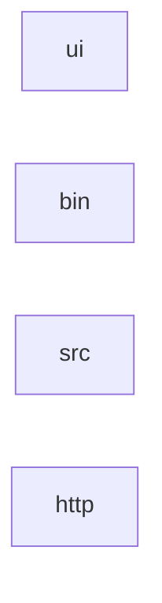
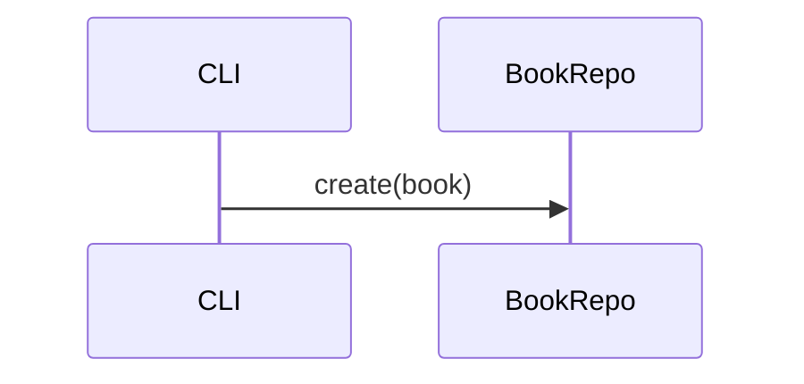
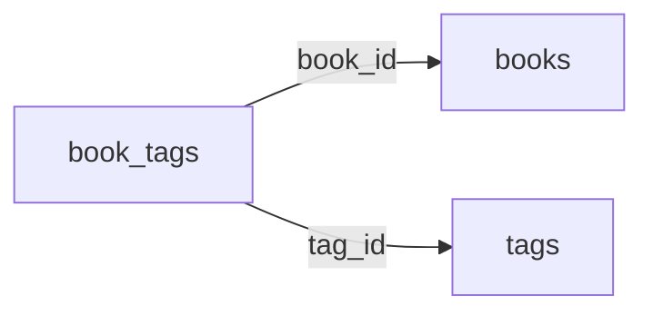

# 0. ひとことで <!-- b_yd6g654y -->

> [!NOTE]
> **未生成**
> この節はまだ生成されていません。mitori の「生成する」で作られます。 <!-- b_hqgb1rkx -->

- 言語: javascript 80 行 · jsx 40 行 · tsx 40 行 · typescript 40 行
- 規模: 16 ファイル · 200 行
- 最終 commit: `fd73d67799ef`（main）
- ライセンス: 不明
<!-- b_hhewf7jr -->

- 読んだファイル 12 · 除外 4
- 除外の内訳: data_large 1 · generated 2 · lockfile 1
<!-- b_he87g2c2 -->

# 1. これは何か・誰のためか・なぜあるか <!-- b_hym5mfqc -->

## 解決する課題 <!-- b_x6hgv5kk -->

買ったまま読んでいない本（積読）を、忘れずに消化できるようにする（[index.ts:1-12](../../src/index.ts#L1-L12)）。`BookRepo.create` が id を振る（[repo.ts:10-20](../../src/db/repo.ts#L10-L20)、[types.ts:3](../../src/db/types.ts#L3)）。 <!-- b_t0db49bm -->

## 利用者 <!-- b_v5r2cmmk -->

- 本を買いすぎる人
- 読書会の幹事
  - 入れ子の項目も崩れない <!-- b_6ewypkzj -->

## 制約 <!-- b_jftd7fva -->

- 再試行は 1 回だけ（推測）。 <!-- b_56jy9psy -->

# 2. 見取り図 <!-- b_y5pce933 -->

> [!NOTE]
> **未生成**
> この節はまだ生成されていません。mitori の「生成する」で作られます。 <!-- b_yy6fghf6 -->

<!-- b_fs161v6r -->

# 3. 主要な流れ <!-- b_kah19xkk -->

読み込みから一覧表示までの流れ。表・コード・図・注意書きの見え方の確認用。 <!-- b_ykxe4zg7 -->

## 3.1 CSV の取り込み <!-- b_2apw63ab -->

CSV を読み、`BookRepo` に保存する。 <!-- b_y4d469xq -->

取り込みの順序

<!-- b_x52n9bc5 -->

### 手順 <!-- b_pcwbw2w6 -->

1. CSV を読む
2. 行を検証する
3. 保存する <!-- b_7eswsndm -->

### 例外と境界 <!-- b_1dwjnrw4 -->

- 空の CSV は何もしない
- 重複した ISBN は `|` を含んでもエスケープされる <!-- b_tka59mwd -->

# 4. 動かしてみる <!-- b_xn276g9g -->

| 用途 | 名前 | コマンド | 定義 | 状態 |
|---|---|---|---|---|
| run | `dev` | `dev` | `package.json:12` | 未実行 |
| test | `test` | `test` | `package.json:14` | 未実行 |
| build | `build` | `build` | `package.json:13` | 未実行 |
| lint | `lint` | `lint` | `package.json:16` | 未実行 |
| format | `format` | `format` | `package.json:17` | 未実行 |
| typecheck | `typecheck` | `typecheck` | `package.json:15` | 未実行 |
<!-- b_59zqtq6w -->

| 名前 | 既定値 | 読む場所 |
|---|---|---|
| `DATABASE_URL` | なし | `src/config.ts:24` |
| `LOG_LEVEL` | あり | `src/config.ts:21` |
| `PORT` | あり | `src/config.ts:23` |
| `TSUNDOKU_API_TOKEN` | なし | `src/config.ts:26` |
<!-- b_7jpkd0se -->

| 入口 | 種類 | 場所 | 状態 |
|---|---|---|---|
| tsundoku | bin | `bin/tsundoku.js:1` | 未実行 |
| src/index.ts | main | `src/index.ts:1` | 未実行 |
<!-- b_0h895x4x -->

# 7. データモデル <!-- b_bt3ztc8k -->

| エンティティ | フィールド | 定義 | 形式 |
|---|---|---|---|
| `book_tags` | book_id, tag_id | `src/db/schema.ts:1` | drizzle |
| `book_tags` | book_id, tag_id | `db/migrations/0001_init.sql:1` | sql |
| `books` | id, isbn, title, status, added_at | `src/db/schema.ts:1` | drizzle |
| `books` | id, isbn, title, status, added_at | `db/migrations/0001_init.sql:1` | sql |
| `tags` | id, name | `src/db/schema.ts:1` | drizzle |
| `tags` | id, name | `db/migrations/0001_init.sql:1` | sql |
<!-- b_xgcdn0ft -->

<!-- b_vxg0wssp -->

> [!NOTE]
> **未生成**
> この節はまだ生成されていません。mitori の「生成する」で作られます。 <!-- b_y38tb6tr -->

# 10. 設計判断 <!-- b_vazmb35v -->

> [!IMPORTANT]
> **なぜ 1 回だけ再試行するのか**
> 長く待たせないため。失敗が続くなら利用者に知らせる方がよい。 <!-- b_dmk01hv0 -->

- まだ決定はありません。スレッドの結論を「決定として残す」と、ここに並びます。
<!-- b_t4nkfvpz -->

# ui（src/ui） <!-- b_m448cakr -->

- ファイル 2 · 80 行 · 重要度 0.40
<!-- b_eysfp68p -->

> [!NOTE]
> **未生成**
> このモジュールのページはまだ生成されていません。mitori の「生成する」で作られます。 <!-- b_jra4n3tn -->
