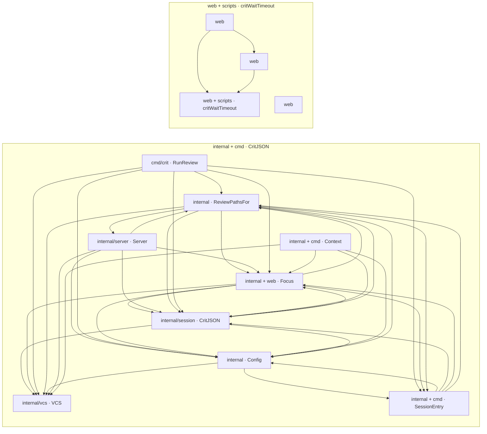

# 2. 見取り図 <!-- b_stdp6am8 -->

フロアプランは2つのグループに分かれる。1つは `internal` と `cmd/crit` からなる Go のレビュー中核群、もう1つは `web` のブラウザ UI 一式である（推測）。中核群では CLI 入口がコマンドを各ハンドラへ振り分ける。HTTP サーバー層はレビュー状態管理とフォーカスを参照してセッションを公開し、レビュー状態管理は差分の取得を VCS 抽象化層に任せる（[cli\_dispatch.go:11-23](../../cmd/crit/cli_dispatch.go#L11-L23)、[server.go:127](../../internal/server/server.go#L127)、[session.go:416-431](../../internal/session/session.go#L416-L431)）。PR/MR 同期はフォーカスやレビュー状態管理と相互に参照し合う（推測）。ブラウザ側では、レビュー画面本体と live mode フロントが共有 UI ヘルパーを通じて API を呼ぶ（[app.js:34-43](../../web/app.js#L34-L43)、[live-mode.js:153](../../web/live-mode.js#L153)、[crit-shared.js:13-40](../../web/crit-shared.js#L13-L40)）。 <!-- b_az000q88 -->

<!-- b_bv92n6kf -->
