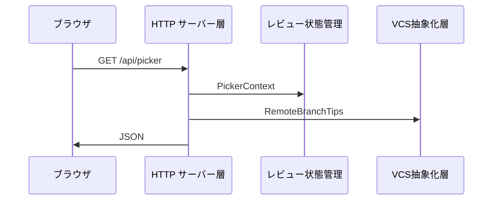
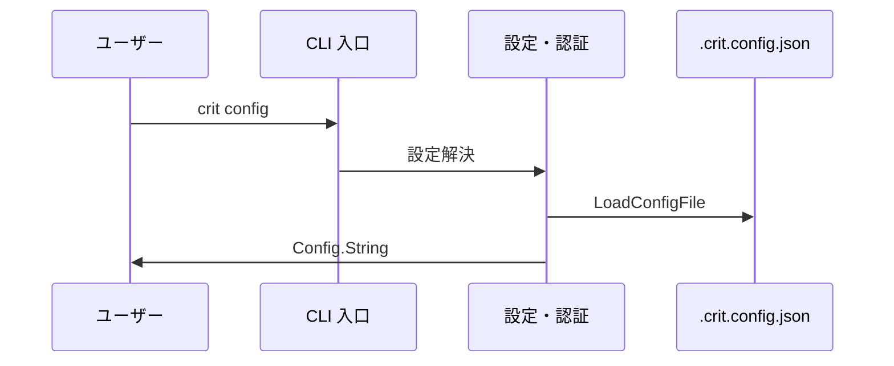
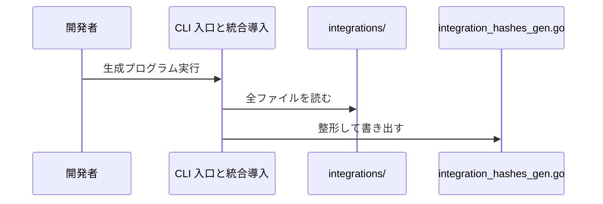

# 3. 主要な流れ <!-- b_tzpbdcwn -->

ここで扱うフローは、ブラウザ UI からの HTTP 要求を `internal/server` が受け、`Session` や VCS 抽象層の情報を JSON で返す経路が中心である。もう一つは、`crit config` のように CLI が設定ファイルを読み込んで結果を出力する経路である。 <!-- b_5tmxjf4r -->

## 3.1 ピッカー一覧の取得 <!-- b_av7pbgz4 -->

ブラウザが `/api/picker` を GET すると、`Server.handlePicker` がセッションから VCS とフォーカスを取り出す（[picker.go:193-204](../../internal/server/picker.go#L193-L204)）。続いてオープン中の PR/MR、スタック、リモートブランチを集め、重複を除いて 1 つの JSON で返す（[picker.go:212-248](../../internal/server/picker.go#L212-L248)）。 <!-- b_25knjt26 -->

ピッカー要求がサーバー層からセッションと VCS 層を経て JSON になる流れを示す。

<!-- b_tnz2afgt -->

### 手順 <!-- b_4cy71ek7 -->

1. GET 以外のメソッドは 405 で拒否する（[picker.go:194-197](../../internal/server/picker.go#L194-L197)）。
2. `sess.PickerContext()` で VCS、リポジトリルート、フォーカスを得る（[picker.go:199-201](../../internal/server/picker.go#L199-L201)）。
3. `openChanges` で PR/MR 一覧を取得する（[picker.go:206-207](../../internal/server/picker.go#L206-L207)）。
4. `detectStackForKind` でスタックを求め、`HeadSHA` を既出として記録する（[picker.go:212-222](../../internal/server/picker.go#L212-L222)）。
5. 未収録の PR は `OtherPRs` か `OtherMRs` に振り分ける（[picker.go:223-232](../../internal/server/picker.go#L223-L232)）。
6. `vcs.RemoteBranchTips` の結果のうち未収録のものを `Branches` に加え、`writeJSON` で返す（[picker.go:234-248](../../internal/server/picker.go#L234-L248)）。 <!-- b_y8bkgy04 -->

### 例外と境界 <!-- b_x93xcf1x -->

- PR 一覧、スタック、ブランチの取得に失敗しても処理は続き、エラー文字列は `Errors` に蓄積される（[picker.go:206-217](../../internal/server/picker.go#L206-L217)）。
- VCS が `nil` のときはブランチ取得を行わない（[picker.go:202-204](../../internal/server/picker.go#L202-L204)、[picker.go:234-246](../../internal/server/picker.go#L234-L246)）。 <!-- b_h62k7wec -->

## 3.2 crit config の設定読込 <!-- b_vebh0jxt -->

`crit config` はグローバルの `~/.crit.config.json` とプロジェクトの設定をマージして JSON で表示する（[cli.go:33-40](../../internal/config/cli.go#L33-L40)）。個々のファイルは `LoadConfigFile` が読み、どのキーが明示されたかも記録する（[config.go:277-316](../../internal/config/config.go#L277-L316)）。 <!-- b_qjstqm3y -->

CLI 入口から設定モジュールがファイルを読み、秘匿化して出力する流れを示す。

<!-- b_1cmzbsjv -->

### 手順 <!-- b_550w1qfy -->

1. `GlobalConfigPath` がホーム直下の `.crit.config.json` のパスを返す（[config.go:585-591](../../internal/config/config.go#L585-L591)）。
2. `LoadConfigFile` がファイルを読み、存在しなければ空の設定を返す（[config.go:279-285](../../internal/config/config.go#L279-L285)）。
3. JSON の生キーから `ConfigPresence` を作り、続いて `Config` へ展開する（[config.go:281-300](../../internal/config/config.go#L281-L300)）。
4. 不正な `default_markdown_view` は警告して空にする（[config.go:309-312](../../internal/config/config.go#L309-L312)）。
5. `Config.String` はトークンを `[redacted]` に置き換えて整形 JSON にする（[config.go:144-160](../../internal/config/config.go#L144-L160)）。 <!-- b_8fa1epa7 -->

## 3.3 統合ハッシュの生成 <!-- b_gyk1j83s -->

`cmd/crit/gen_integration_hashes.go` の `main` は、`integrations` ディレクトリ配下のファイルを走査して SHA-256 を求める（[gen\_integration\_hashes.go:33-56](../../cmd/crit/gen_integration_hashes.go#L33-L56)）。結果を `integration_hashes_gen.go` に Go のマップとして書き出す（[gen\_integration\_hashes.go:56-83](../../cmd/crit/gen_integration_hashes.go#L56-L83)）。 <!-- b_rh29jsv7 -->

生成プログラムが統合ファイルを読み、ハッシュ表のソースを書き出す流れを示す。

<!-- b_nx89ba8j -->

### 手順 <!-- b_hqk4wfxx -->

1. `runtime.Caller` でソースの位置を求め、リポジトリルートと出力先を決める（[gen\_integration\_hashes.go:17-25](../../cmd/crit/gen_integration_hashes.go#L17-L25)）。
2. `filepath.Walk` で `integrations` を巡り、README.md を除く各ファイルを読む（[gen\_integration\_hashes.go:28-42](../../cmd/crit/gen_integration_hashes.go#L28-L42)）。
3. 相対パスをキー、`sha256.Sum256` の値を値としてマップに入れる（[gen\_integration\_hashes.go:43-49](../../cmd/crit/gen_integration_hashes.go#L43-L49)）。
4. キーをソートして `integrationHashes` のソースを組み立てる（[gen\_integration\_hashes.go:56-70](../../cmd/crit/gen_integration_hashes.go#L56-L70)）。
5. `format.Source` で整形し、`os.WriteFile` で書き込む（[gen\_integration\_hashes.go:74-83](../../cmd/crit/gen_integration_hashes.go#L74-L83)）。 <!-- b_nafjt3rz -->

### 例外と境界 <!-- b_z5s1szdy -->

- 位置の取得、走査、整形、書き込みのいずれかが失敗すると、標準エラーに出力して終了コード 1 で終わる（[gen\_integration\_hashes.go:17-21](../../cmd/crit/gen_integration_hashes.go#L17-L21)、[gen\_integration\_hashes.go:51-54](../../cmd/crit/gen_integration_hashes.go#L51-L54)、[gen\_integration\_hashes.go:74-78](../../cmd/crit/gen_integration_hashes.go#L74-L78)、[gen\_integration\_hashes.go:80-83](../../cmd/crit/gen_integration_hashes.go#L80-L83)）。 <!-- b_w65tjqg2 -->
