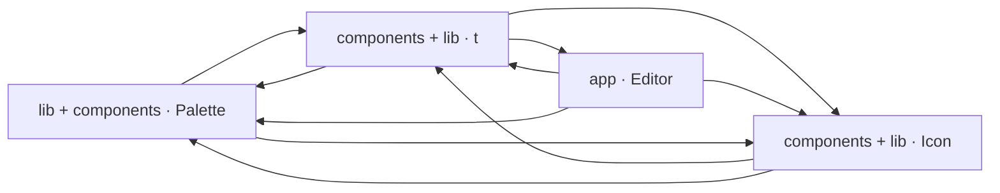

# 2. 見取り図 <!-- b_7dpp5vbw -->

フロアプランは 4 つのモジュールからなる。最上位は `app/Editor.tsx` のエディタ本体で、既定エクスポートの `Editor` が操作状態と履歴を持ち、ほかの 3 つを組み合わせる（[Editor.tsx:453](../../app/Editor.tsx#L453)）。`lib/` の型・色・整列の基盤は `lib/tokens.ts` の型と寸法定数を全体に供給し、`components/` 側は共通 UI と 4 言語辞書（`lib/i18n.ts`）を持つものと、部品描画とプロンプト生成（`lib/prompt.ts`）を持つものに分かれる（[tokens.ts:2340-2358](../../lib/tokens.ts#L2340-L2358)、[i18n.ts:5-6](../../lib/i18n.ts#L5-L6)、[prompt.ts:1745](../../lib/prompt.ts#L1745)）。矢印は import の向きで、エディタ本体から 3 モジュールへ、2 つの `components/` モジュールは互いに、そしてどちらも基盤へ依存する（推測）。 <!-- b_yx56q4rk -->

<!-- b_gg36aj6a -->
