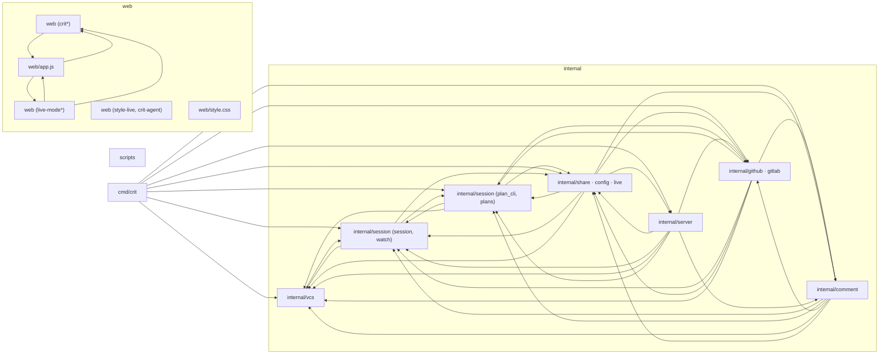

# 2. 見取り図 <!-- b_r6an5jvk -->

フロアプランの入口は `cmd/crit` の CLI 本体である。ここではサブコマンドを振り分け、実処理は `internal` 側のパッケージに任せる（[cli\_dispatch.go:3-15](../../cmd/crit/cli_dispatch.go#L3-L15)、[cli\_handlers.go:15-30](../../cmd/crit/cli_handlers.go#L15-L30)）。中核グループ `internal` の中で、`internal/server` がレビュー UI 向けの API と埋め込み静的資産を配信する（[server.go:127-228](../../internal/server/server.go#L127-L228)）。サーバーが公開する状態は `internal/session` の `Session` が保持し、変更ファイルや diff は `internal/vcs` の `VCS` インターフェース越しに取得する（[session.go:416-431](../../internal/session/session.go#L416-L431)、[vcs.go:14-137](../../internal/vcs/vcs.go#L14-L137)）。ブラウザ側のグループ `web` は画面本体、live mode、iframe 注入スクリプトからなり、その資産は `webassets.FS` としてサーバーに渡る。forge 同期は別のノードとして GitHub・GitLab とコメントをやり取りする（[embed.go:1-6](../../web/embed.go#L1-L6)、[forge.go:126-136](../../internal/forge/forge.go#L126-L136)）。 <!-- b_p3cmqmrd -->

<!-- b_a4bjr3h7 -->
