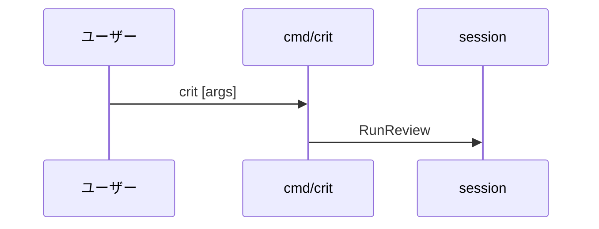

# 3. 主要な流れ <!-- b_qqbrp8x1 -->

ここで扱うのは、`crit` バイナリの起動からレビュー対象の解決、ブラウザ UI への配信までの流れである。入口は `cmd/crit` の `main` で、サブコマンドは振り分けられ、ローカル HTTP サーバーが UI 向けの API を返す。 <!-- b_cbjpg91z -->

## 3.1 crit コマンドの起動と振り分け <!-- b_sd7t4sg0 -->

引数なしの `crit` はレビューを直接開始し、サブコマンド付きならまず `dispatchCLI` が処理を試みる。処理されなければ位置引数として扱う（[main.go:21-32](../../cmd/crit/main.go#L21-L32)）。エラーは `clicmd.Exit` が終了コードに変換する。 <!-- b_nv4kw02d -->

`main` が引数に応じてレビュー開始、サブコマンド実行、位置引数処理のいずれかへ進む。

<!-- b_0eg64zv9 -->

### 手順 <!-- b_51zg4bam -->

1. 引数が 2 未満なら `session.RunReview(nil)` を呼び、`clicmd.Exit` に結果を渡す（[main.go:22-25](../../cmd/crit/main.go#L22-L25)）。
2. それ以外は `dispatchCLI` に引数を渡し、処理済みならエラーを `clicmd.Exit` へ渡して戻る（[main.go:26-29](../../cmd/crit/main.go#L26-L29)）。
3. 未処理なら `resolveAtPrefixedArgs` で引数を解決し、`runPositionalCLI` を呼ぶ（[main.go:30-31](../../cmd/crit/main.go#L30-L31)）。
4. `clicmd.Exit` は `ExitError` の `Code` が非ゼロならそれを、それ以外は 1 を終了コードにする（[clicmd.go:26-37](../../internal/clicmd/clicmd.go#L26-L37)）。 <!-- b_1hd8gssd -->

## 3.2 プレビューのコンテンツ配信 <!-- b_14c9enj6 -->

`/preview-content/` へのリクエストは `handlePreviewContent` が受け、セッションの `Origin` が置かれたディレクトリ配下のファイルだけを返す（[preview\_handlers.go:12-57](../../internal/server/preview_handlers.go#L12-L57)）。 <!-- b_mvxp22a3 -->

### 手順 <!-- b_vp4sfpty -->

1. GET 以外は 405 を返す（[preview\_handlers.go:13-16](../../internal/server/preview_handlers.go#L13-L16)）。
2. セッション未準備なら 503、`Origin` が空なら 404 を返す（[preview\_handlers.go:17-25](../../internal/server/preview_handlers.go#L17-L25)）。
3. パスが空か `/` なら `servePreviewHTML` で `Origin` を返す（[preview\_handlers.go:30-33](../../internal/server/preview_handlers.go#L30-L33)）。
4. 解決後のパスが `baseDir` の外なら 403 を返す（[preview\_handlers.go:35-39](../../internal/server/preview_handlers.go#L35-L39)）。
5. 存在しないかディレクトリなら 404、HTML なら `servePreviewHTML`、他は `http.ServeFile` で返す（[preview\_handlers.go:41-56](../../internal/server/preview_handlers.go#L41-L56)）。 <!-- b_40a6tdxq -->

## 3.3 story API の振り分け <!-- b_dxvnfk3k -->

`/api/story` は `handleStory` がメソッドで GET・POST・DELETE に分岐する（[server\_story.go:14-25](../../internal/server/server_story.go#L14-L25)）。 <!-- b_d4mhhd4s -->

### 手順 <!-- b_45xyygrx -->

1. GET は `handleStoryGet` に渡す（[server\_story.go:18-19](../../internal/server/server_story.go#L18-L19)）。
2. POST は `handleStoryPost` に渡す（[server\_story.go:20-21](../../internal/server/server_story.go#L20-L21)）。
3. DELETE は `handleStoryDelete` に渡す（[server\_story.go:22-23](../../internal/server/server_story.go#L22-L23)）。
4. それ以外のメソッドは 405 を返す（[server\_story.go:24-26](../../internal/server/server_story.go#L24-L26)）。 <!-- b_es5z6kbm -->
