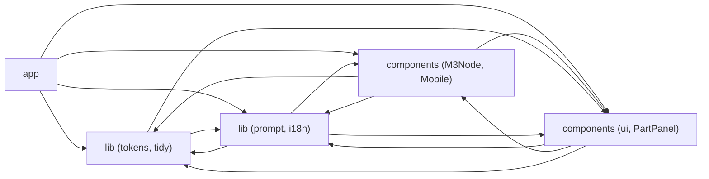

# 2. 見取り図 <!-- b_jw8zzpj2 -->

フロアプランは 5 つのモジュールで構成される。入口は `app/page.tsx` で、静的な起動画面を表示してから `Editor` を動的に読み込む（[page.tsx:8-17](../../app/page.tsx#L8-L17)）。`Editor` は、文書モデルとトークンを持つ `lib` 側、プロンプト生成と多言語辞書、`M3Node` を中心とする描画層、インスペクタなどの編集パネルを呼び出す（推測）。データは、`Doc` と `Palette` が `lib/tokens.ts` から描画層と編集パネルへ渡り、プロンプト層が同じ `Doc` を文章に変換するという向きに流れる（推測）。 <!-- b_3tsvmyzk -->

<!-- b_3jxs2dyb -->
