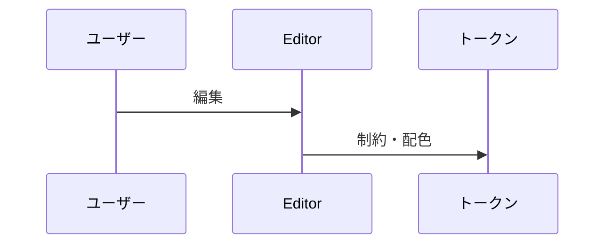
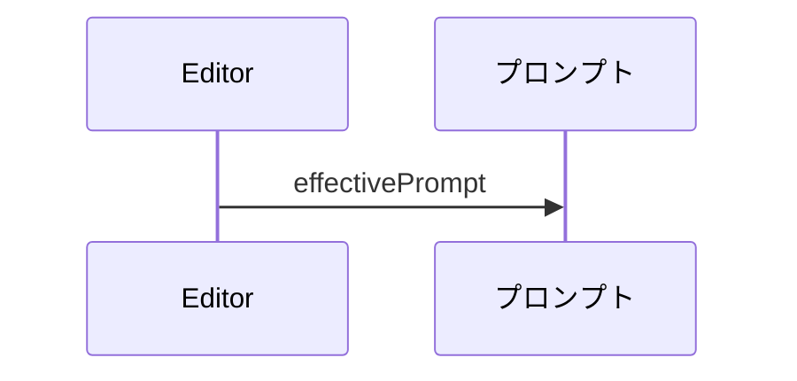
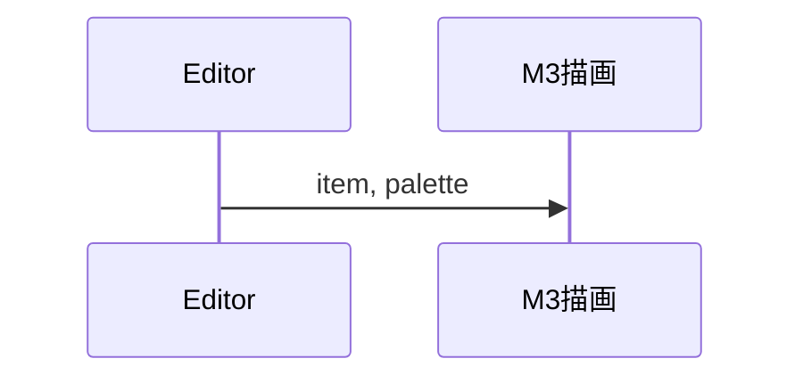

# 3. 主要な流れ <!-- b_baw2s5ys -->

3 つのフローはいずれも `Editor` を起点とする。`Editor` が文書の状態を持ち、デザイントークン、プロンプト生成、M3 パーツ描画の各モジュールへ処理を渡す構成である（[Editor.tsx:453-468](../../app/Editor.tsx#L453-L468)）。 <!-- b_ae6ckhr3 -->

## 3.1 編集とトークン計算 <!-- b_hr9xhgfh -->

ユーザーの編集は `Editor` の `groups` 状態に入り、`lib/tokens.ts` の寸法・配色関数で値が決まる。更新時には `constrainModalRails` が制約を掛ける（[Editor.tsx:459-463](../../app/Editor.tsx#L459-L463)）。 <!-- b_19db37k7 -->

`Editor` が状態更新時にレール制約を適用し、トークン関数で配色を得る流れである。

<!-- b_20sna28f -->

### 手順 <!-- b_f4tstv0e -->

1. `setGroups` が次の状態を受け取り、`constrainModalRails` を通して保存する（[Editor.tsx:461-463](../../app/Editor.tsx#L461-L463)）。
2. 配色は `paletteOf` が `Theme` に応じて `schemeFromSeed` で再生成する（[tokens.ts:538-547](../../lib/tokens.ts#L538-L547)）。 <!-- b_jra12jfj -->

## 3.2 プロンプト生成 <!-- b_ya1gnerb -->

デザイン `Doc` は `lib/prompt.ts` の `effectivePrompt` で AI 向けの文章になる。手編集があればそれを優先する（[prompt.ts:1864](../../lib/prompt.ts#L1864)）。 <!-- b_7bxwrvpg -->

`Editor` の文書から `effectivePrompt` がプロンプトを返す流れである。

<!-- b_mb3aga5z -->

### 手順 <!-- b_7da14dw2 -->

1. `doc.promptEdit` が定義済みなら、その文字列をそのまま返す（[prompt.ts:1864](../../lib/prompt.ts#L1864)）。
2. 未定義なら `buildPrompt` が生成した文字列を返す（[prompt.ts:1864](../../lib/prompt.ts#L1864)）。 <!-- b_6wba43mt -->

## 3.3 パーツの描画 <!-- b_h2teq0q5 -->

`Item` と `Palette` は `M3Static` に渡され、スタイルと本体 `Body` が描画される（[M3Node.tsx:1939-1976](../../components/M3Node.tsx#L1939-L1976)）。 <!-- b_jypxexd2 -->

`Editor` が `Item` を描画層へ渡す流れである。

<!-- b_vpzhpk76 -->

### 手順 <!-- b_c6aqa598 -->

1. `M3Static` が `baseRadii` と `sizeOf` で角丸と寸法を決める（[M3Node.tsx:1950-1953](../../components/M3Node.tsx#L1950-L1953)）。
2. 内容は `Body` が描く（[M3Node.tsx:1973](../../components/M3Node.tsx#L1973)）。 <!-- b_j6ewzxqw -->
