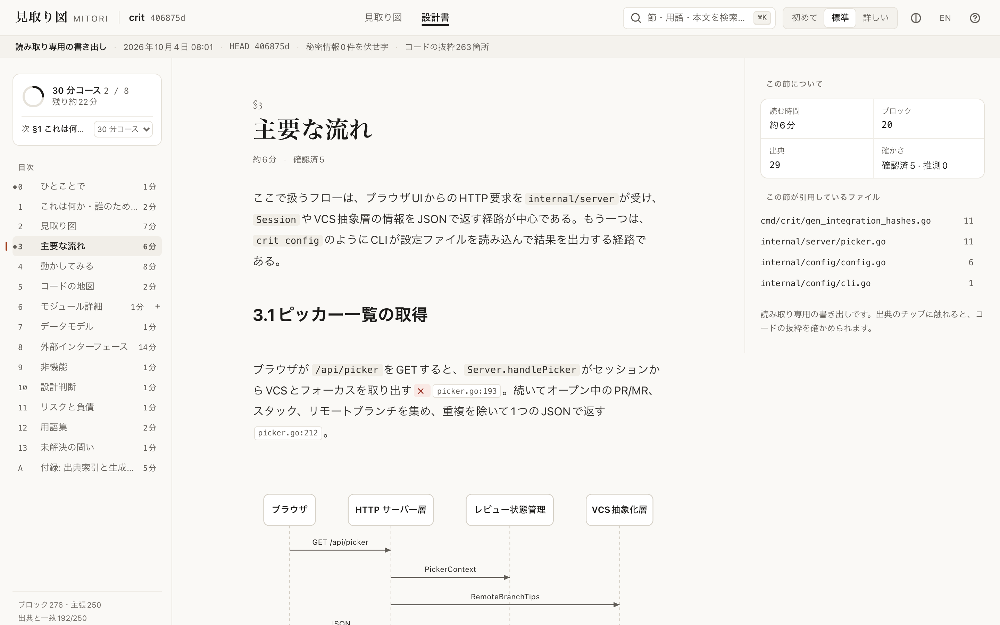
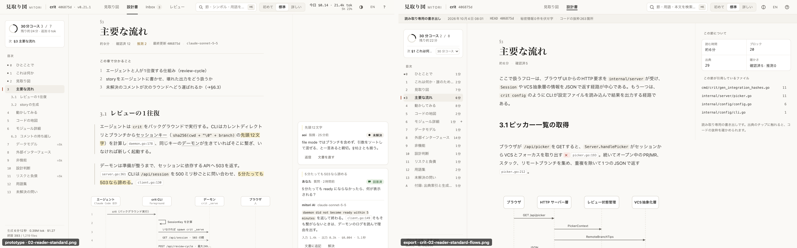
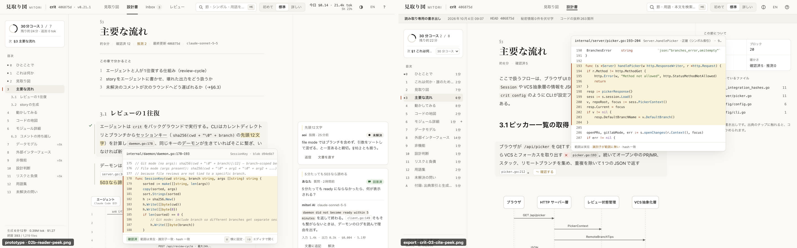
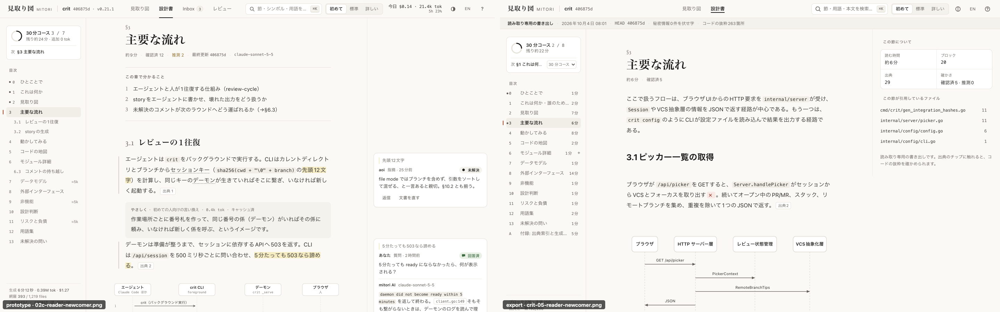
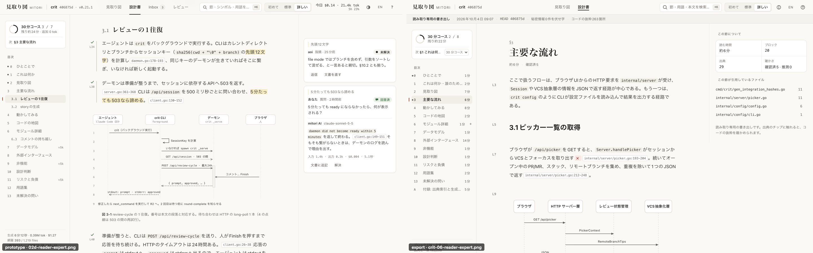
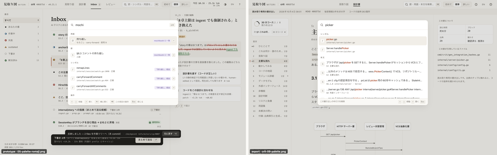
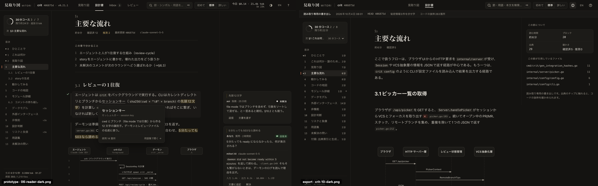
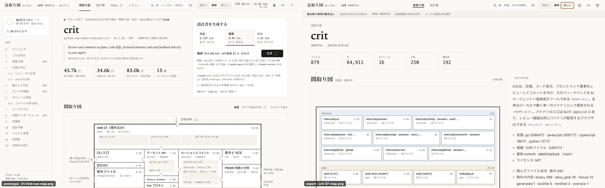

# export — WP-13: 自己完結 HTML export（branch `fin/export`、2026-10-04）

`mitori export --html [-o file] [--no-code]` が **1 ファイルの HTML** を書く。ネットワーク不要で開け、Reader と同じ体験
（目次・読者レベル・出典チップと静的コード peek・確かさバッジ・用語カード・図・⌘K 検索・ダーク・EN）がそのまま入っている。
読み取り専用。サーバーも daemon も要らない — **commit しないチームや社外にも、設計書を 1 ファイルで渡せる**（ADR-0008）。
LLM は 1 トークンも使っていない。



## 使い方

```sh
mitori export --html                      # ./<repo>.mitori.html（コード抜粋つき）
mitori export --html -o design.html --no-code   # 出典は path:行 だけ（ファイルが約 4 割小さい）
mitori export --html -o ~/share/                # ディレクトリを渡すとその中に <repo>.mitori.html
mitori export --html --level newcomer --lang en --decisions
# daemon の GET /api/v1/ws/<ws>/export/html?level=&lang=&excerpts=0|1 が同じ文書をダウンロードで返す
```

書き出し後の 1 行: `exported: 1576 KB · sha256 2b6b35c2853e · 0 redaction(s) · 263 code excerpt(s) from 82 file(s)`（ja は
`書き出しました: … · 伏せ字 N 件 · コード抜粋 N 件（M ファイル）`）。ファイルの上部の帯にも
「読み取り専用の書き出し · {日時} · HEAD {head7} · 秘密情報{n}件を伏せ字 · コードの抜粋{n}箇所」が出る。

## 受け入れ試験（`MITORI_E2E_CHANNEL=chrome scripts/nd bun run e2e --grep @export`、インストール済み Chrome）

| 試験（brief §1） | 結果 | 試験名（`e2e/export/export.spec.ts`） |
|---|---|---|
| ネットワーク遮断で開ける | **pass** — `offline` + 外部 request 0、fetch/XHR/WebSocket/EventSource/beacon 0、console error 0、CSP 違反 0 | crit opens offline |
| 目次・読者レベル・cite peek（静的）・図が動く | **pass** | table of contents / reader levels / cite peek on real code / diagrams are pre-laid-out SVG |
| viewer JS ≤ 60 KB gz | **pass — 58.07 KB**（`bun run size`: `asset.viewer.js` 58.07 / 60, 上限 70） | 同上（テストが inline script を gzip して数える） |
| secret を埋めた fixture で redaction ≥ 3・原文 0 | **pass — 6 件**（AWS・GitHub・Stripe・パスワード・DB URL・環境変数代入）、ファイル全体に原文 0（`--no-code` 版も） | secrets: no planted value in the file |
| block に `</script>` を含めても壊れない | **pass** — 本文・コード fence・リンク title・節題・用語集・図ラベルに入れても `<script>` は 2 個のまま、注入コードは動かず、文字は文字として表示 | `</script>` in the content breaks nothing |
| 外部画像が読み込まれない（CSP） | **pass** — `` は `` にならずリンク、注入した `<script>` と `new Image()` は `script-src` / `img-src` 違反で止まる（CDP: blocked by CSP） | a link or image to the outside / the CSP blocks … |
| （追加）Safari のエンジンでも開ける | **pass** — Playwright の WebKit で crit を開き、本文・図・読者レベル切替・peek・地図が動く、外部 request 0、注入 script は CSP で止まる（WebKit が無い環境では skip） | Safari's engine (WebKit) |
| （追加）どの幅でも目次と読者レベルに届く | **pass** — 1,200 px（ノート PC の窓）で目次ボタンが出てドロワーが開く、1,280 px は rail が常設、700 / 390 px と地図ではドロワーに「読者レベル・テーマ・言語」 | narrow window / every width reaches the TOC |

29 本の e2e（LCP を含む）が緑、実行 ≈ 42 s（beforeAll で gen-assets・本物の daemon×3・CLI×6 が走る分を含む）。
単体・結合: `packages/doc/src/export/*.test.ts`（25）、`apps/web/src/viewer/*.test.ts`（15）、`e2e/export/export.int.test.ts`（13、本物の
daemon 構成 + `mitori export` コマンド）、`e2e/export/payload-contract.test.ts`。`scripts/nd bun run check` 緑。

## 数字

| 項目 | 値 |
|---|---|
| viewer JS（inline、gzip -9） | **58.6 KB**（58,618 B。予算 target 60 / limit 70）。生 164 KB。Svelte ランタイム + 既存 Reader 部品の再利用 |
| viewer CSS（生） | 64.9 KB（tokens / base / prose / levels / plan を共有） |
| crit（879 files、276 blocks、250 claims、263 抜粋 / 82 ファイル） | **1.58 MB**（`--no-code` 0.92 MB）。CLI 実行 **0.41–0.65 s** |
| m3e-canvas（115 blocks、89 抜粋） | 0.70 MB（`--no-code` 0.45 MB）。CLI 0.37–0.49 s |
| LCP（crit、file://） | **92–104 ms**（ローカル）／ **252–312 ms**（CPU 4× throttle）— 予算 `ui.lcp.export.local` 500 ms、`ui.lcp.export` 1500 ms |
| 抜粋の圧縮 | Shiki の `style="color:var(--shiki-…)"` を 1 文字クラスに（既定色の span は削除）。crit で 2.27 MB → 1.57 MB |

## 何をどう作ったか

- **`packages/doc/src/export/`** — `createHtmlExporter`。daemon と同じ形（`DocOutline` / `SectionView` / `MapView` / `PaletteIndex` / `CitePeek`）を
  一度だけ描画して固める。`payload.ts`（組み立て・秘密の伏せ字・抜粋の切り出し）、`html.ts`（meta CSP・JSON の `< > & U+2028/9` を `\uXXXX`・
  viewer script の検査）、`svg.ts`（IR + 配置済みレイアウト → インライン SVG、色は CSS クラス → ダークに追従）、`mermaid.ts`（IR が失われた
  図を Mermaid fence から読み戻す）、`sha256.ts`（CSP の hash と `ExportRes.sha256`）、`source.ts`（コード側のポート）。
- **`apps/web/src/viewer/` + `apps/web/vite.viewer.config.ts`** — `AppMode = "viewer"`。**同じ部品**を使う: `BlockHost`（イベント委譲・virtual）、
  `decorate` / `levels`（CSS だけで読者レベル）、`CitePeek` / `TermCard`、`FloorPlan` / `PlanController`（地図）、`palette/search`（かな・ローマ字・あいまい）、
  tokens / base / prose / levels の CSS。新規は hash ルーター、header・rail・about 列、ヘルプ、全文検索（「本文」グループ）、OmittedPeek（「この書き出しには
  含まれていません」）、VerdictNote（バッジの説明。確認・質問のボタンは無い）。i18n は `apps/web/i18n` から viewer が使うキーだけを**ビルド時に**切り出す
  （残りの約 70 KB が 60 KB 予算に入らない）。
- **秘密**: 描画前の md・claim の引用・節題・用語集・図ラベル・マップ・パレット・抜粋の全部に走査。抜粋は**ファイル全体**を伏せ字にしてから行を切り出す
  （文脈が要る秘密も見つかる）。deny-glob / 秘密ファイルは indexer が除外しているので、そもそも読まない。同じ行を何度引用しても件数は 1。
- **渡さないもの**: claim の確認者（`git config` の名前・メール）と生成にかかった費用（`usageTotals` は 0 に）。判定（`human-verified` など）は残る。ブロックの生成メタ（モデル・prompt 版）も入れない。
- **配線**: `POST /ws/:ws/export`（CLI 用、`ExportRes`）・`GET /ws/:ws/export/html`（ダウンロード）は workspace ごとの exporter（CR m1-7）。
  `gen-assets` が viewer を web dist に `assets/viewer-<hash>.js|css` + `viewer/viewer.json` で入れる（バイナリに同梱、`bun run size` が測る）。
  viewer が無い checkout では「viewer bundle is not built」で拒否 — 動かない白紙は書かない。

## 検証パスで直したもの（敵対的検証、同じブランチ）

受け入れ試験は最初から緑だったが、実物を幅・ブラウザ・未生成の repo で開き直すと次の穴があった。全部に回帰テストを付けた。

| 見つけたこと | 直し方 | 試験 |
|---|---|---|
| **1,100–1,231 px の窓（13 インチのノート PC で窓を最大化しない幅）で目次が消える**: 3 列が入らず rail はドロワーになるのに、目次ボタンは CSS の media query で 1,099 px 以下にしか出なかった | ボタンの表示を layout の rail モードに合わせる（アプリのヘッダーと同じ） | every width reaches the TOC |
| **スマホ・タブレット（< 1,024 px）で読者レベルを変えられない**: ヘッダーから「初めて／標準／詳しい」・テーマ・言語が消え、代わりは ⌘K だけ（タッチ端末に無い）。地図ではメニューボタンが何も開かなかった | ドロワーの先頭に「読者レベル・テーマ・言語」。地図でもドロワーを出す | narrow window / every width |
| 未生成の節が受け取った人に「mitori の『生成する』で作られます」と言う（ファイルにそのボタンは無い）。空の決定事項も「決定として残す」を勧める | 「この節は、書き出した時点ではまだ生成されていませんでした。」（en も）。決定事項は「まだ決定はありません。」だけ | WP13-U-09、read-only means read-only |
| 「詳しい」で全ブロックに **「L0」** が出る（`DocStore.mdLine` が stub のまま 0 を書いていた） | `ExportSource.mdLine` で daemon の `MdLines`（アプリが出す行番号と同じ）を使う。不明なら `data-ln` を書かない | WP13-U-09、expert level shows each block's line |
| **伏せ字の件数の二重計上**: 用語集（s12 の表ブロックにも同じ文字列）と図のラベル（ブロックの Mermaid fence にも同じ文字列）を 2 回数えていた。secrets fixture は 6 件を 7 件と報告 | 件数は Markdown にある場所で 1 回だけ数える（伏せ字そのものは全箇所のまま） | WP13-U-06（差分で +1 を確認）、golden 7 → 6 |
| 出典 peek に行番号が無く、コードが枠の左端に接していた。ヘッダーの `path:範囲` が先に「…」になった | 行番号の gutter・tab 幅 4・path を優先して記号/blob 側を省略 | cite peek on real code |
| `mitori export --html -o <既存のディレクトリ>` がディレクトリへの上書きで失敗 | ディレクトリなら中に `<名前>.mitori.html` を書く（末尾 `/` も同じ。無いディレクトリはエラーで何も書かない） | WP13-CLI-01 |
| 「確かさ」タイルで「古い可能性」が「古 / い可能性」と割れる | 項目単位で折り返す | （目視） |
| `bun test` 中に作り直されたバイナリの viewer が **67.7 KB gz**（予算 60 超え）。同時に int test が ENOENT | gen-assets を常に NODE_ENV=production で（Vite が NODE_ENV=test を見て Svelte の開発版を解決していた） | EXP-I-05、compiled の @export |

未生成のまま（0 トークン）の repo もそのまま書き出せることを確認した（go-small: 301 KB、抜粋 19 箇所、静的な節・間取り図・facts 表）。

## プロトタイプとの比較（左: `docs/design/prototypes/editorial/shots`、右: export）

| | |
|---|---|
|  | 標準。見出し・本文・出典チップ・図・目次・読書パスは同じ造形。**違い**: プロトタイプにある「この章で分かること」（dogfood の md は sidecar が無く learn ブロックが取り込めない）と、右のコメントカード（export は「この節について」）、header の Inbox/レビュー/使用量（export は意図的に無い） |
|  | 出典 peek。コードは Shiki で着色、引用範囲を行ハイライト、footer に識別子・hash の検査。**違い**: プロトタイプの左の「確認済」ピルは実アプリの `CitePeek` に無い（共有部品のまま）。長い範囲は 64 行で切る |
|  | 初めて: L3 は消え、出典は段落末の「出典 n」に畳む |
|  | 詳しい: 長い出典ラベル・L3・行番号 |
|  | ⌘K。**違い**: 操作グループは viewer の 12 個、スレッド・最近は無い。「本文」グループは export だけ |
|  | ダーク。図も追従 |
|  | 見取り図。ELK 配置（daemon）の間取り図を `PlanController` で。**違い**: 生成カード・ヒーロー・0 tok 帯は無く、統計タイル + 「5分で分かる」列 |

コンパイル済みバイナリ（`bun run build:bin`、70.6 MB）でも同じ結果（`MITORI_E2E_BINARY=compiled`: crit 1580 KB・263 抜粋・secrets 6 件、@export 29 本緑）。
**注意（直した）**: `bun test` の中から作られたバイナリ（INT-00 / SKEL が古いバイナリを作り直す）は、gen-assets が NODE_ENV=test を
引き継いで Svelte の開発版を入れていた（viewer 67.7 KB gz で予算超過、web の asset hash も `build:bin` と食い違い int test が ENOENT）。
gen-assets は常に production で組む（EXP-I-05 が NODE_ENV=test / production の両方で同じバイトと ≤ 60 KB を確認）。

他: [crit 全 13 枚](crit-01-reader-standard-s0.png)（標準・初めて・詳しい・peek・地図・部屋・⌘K・ダーク・EN・狭い窓・ドロワー）、
[rich](rich-02-reader-standard-flows.png)（深さ L0–L3・why・用語カード・全 verdict の合成文書）、[m3e-canvas](m3e-02-reader-standard-flows.png)、
[WebKit・390 px のドロワー](webkit-14-phone-drawer.png)（読者レベル・テーマ・言語）。
`scripts/nd bun e2e/export/support/shoot.ts <file.html> <dir> <prefix> [chapter] [peekChapter] [query]` と `…/compare.ts` で再生成。

## 動かないもの・限界（正直に）

- **viewer ローカルコメント / import（☆）は未実装**（brief の Out of scope）。`MODE_CAPABILITIES.viewer.compose = "local"` は使っていない。
- **アプリ本体の書き出しダイアログ（⌘K「HTML として書き出す」、設定 → dialog）は無い**。ux §4.13 の daemon 側の UI は apps/web の他トラックの領分で、
  ここでは CLI と 2 つのルートまで。ダイアログの文言（「コードの抜粋{n}箇所（{m}ファイル）を含みます」+「抜粋を含めない」）に要る数字は `ExportRes` に揃っている。
- **dogfood の設計書は sidecar（`doc.index.json`）が無い**ため、取り込んだブロックは全部 L1・用語集 0・IR 無し。e2e の crit / m3e-canvas はそれを承知で使い
  （図は Mermaid fence から読み戻し、地図は index の module graph から）、読者レベル・用語・verdict の全種は `rich`（本物の doc store に書いた合成文書）で通している。
  実運用の生成物（sidecar あり）なら全部入る。dogfood の md は**走査後に取り込む**必要がある（先に読むと全 claim が `unsupported`）— e2e は manifest だけ置いて
  daemon の索引が出来てから md を置く 2 段階にしている。
- **本文の言語は書かれたまま**（`--lang` は画面の言語）。翻訳（D5）は書き出さない。
- **`includeDecisions` は §10 の決定事項の一覧だけ**（決定の本文 `decisions/*.md` は doc が I/O を持たないので入らない — CR 4）。
- 抜粋は 1 引用 ±3 行・最大 64 行、全体 12 MB で打ち切り（後ろの章が「含まれていません」になる）。6,000 引用まで。
- 種類の少ない図: 流れ・シーケンス・コンテナ。ER は IR があれば描くが専用の見た目は無い。幅の広い図は箱の中で横スクロール（実寸の 68 % 未満には縮めない）。
- ブラウザは Chrome（インストール版）と WebKit（Playwright 同梱、Safari のエンジン）で確認。Firefox はこの機械に無く未確認。実機の Safari アプリ・Linux / Windows も未確認。
  WebKit では `text-autospace` が効かず、「3.1ピッカー」のように和欧間の隙間が出ない（本文の描画規則 UXP-24 は CSS の autospace 前提。アプリと共通の課題）。
- viewer JS は 58.6 KB で、予算（60）まで **約 1.4 KB の余裕しかない**。共有部品（`BlockHost` など）が育つとここが先に超える — テストが落ちる作りにしてある。
  `@mitori/core` の `domain.ts` が module 直下で作る `Set`/`Map`/`RegExp`（エラーコード表など）が tree-shake されず約 6 KB（生）入っている。core 側で `/* @__PURE__ */` を付ければ削れる（試算 −0.65 KB gz）。
- `CitePeek` の「o 横に固定 / ⇧O エディタで開く」は CSS で隠している（部品を変えずに済ませた）。peek の行番号 gutter も viewer.css 側だけ。**アプリ本体の peek には行番号が無い**（共有部品 `reader/CitePeek.svelte` の持ち主に回す）。
- dogfood の md は sidecar が無いので、「3.1 …」のような小見出しは節ではなく見出しブロック（serif の節番号にならない）。生成し直した文書なら節になる。
- 用語カードの「よみ · ローマ字 · 英語」で、ローマ字と英語が同じ語（tsundoku · tsundoku）だと 2 回出る（共有部品 `TermCard`）。

## 再実行

```sh
scripts/nd bun run check
scripts/nd bun test packages/doc/src/export apps/web/src/viewer e2e/export apps/cli
MITORI_E2E_CHANNEL=chrome scripts/nd bun run e2e --grep @export     # 要 corpus: scripts/nd bun run corpus:fetch --only crit,m3e-canvas
scripts/nd bun e2e/export/support/build-exports.ts test-results/export    # 本物の daemon + CLI で crit / m3e-canvas / secrets を書き出す
scripts/nd bunx vite build -c apps/web/vite.viewer.config.ts --mode report   # viewer を単体でビルド（dist/viewer/）し、大きい module 順を表示
```

契約への要望は [`docs/design/cr-requests/WP-13.md`](../../design/cr-requests/WP-13.md)。
