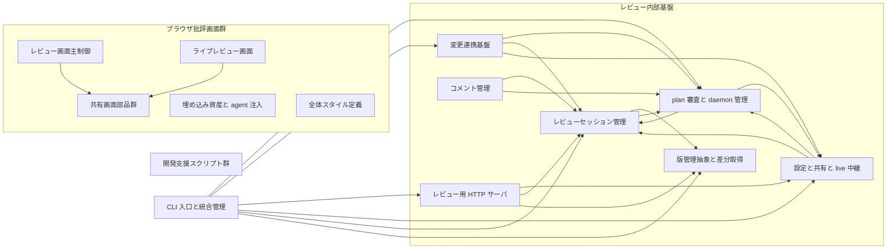

# 2. 間取り図 <!-- b_z37q7swr -->

Floor plan は import の重みで結ばれた module 群を示し、中心に `Session` と `Server` と共有設定系を置く内部基盤がある（[session.go:416-430](../../internal/session/session.go#L416-L430)、[server.go:127-136](../../internal/server/server.go#L127-L136)、[config.go:462](../../internal/config/config.go#L462)）。入口の `dispatchCLI` から plan 系と `Session` を経て `VCS` 差分取得へ至り、forge 連携と `RunComment` 系が周辺を支える（[cli\_dispatch.go:216](../../cmd/crit/cli_dispatch.go#L216)、[session.go:456-460](../../internal/session/session.go#L456-L460)、[vcs.go:14-16](../../internal/vcs/vcs.go#L14-L16)、[run.go:19](../../internal/comment/run.go#L19)）。browser 側は `fetchJSON` 系の共有部品と live 系と主制御が分担し、開発支援 script 群は実行時から外れて置かれる（[crit-shared.js:23-32](../../web/crit-shared.js#L23-L32)、[live-mode.js:153](../../web/live-mode.js#L153)、[app.js:851](../../web/app.js#L851)、[bench-compare.py:41-52](../../scripts/bench-compare.py#L41-L52)）。 <!-- b_qhmcck66 -->

<!-- b_n6m2ajkf -->
