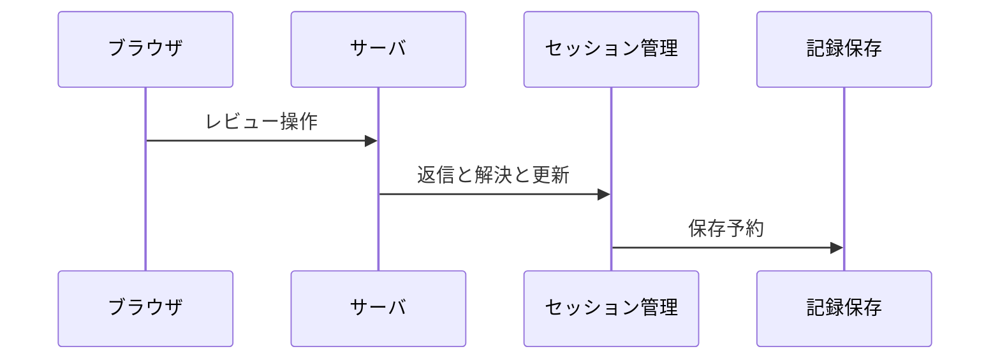
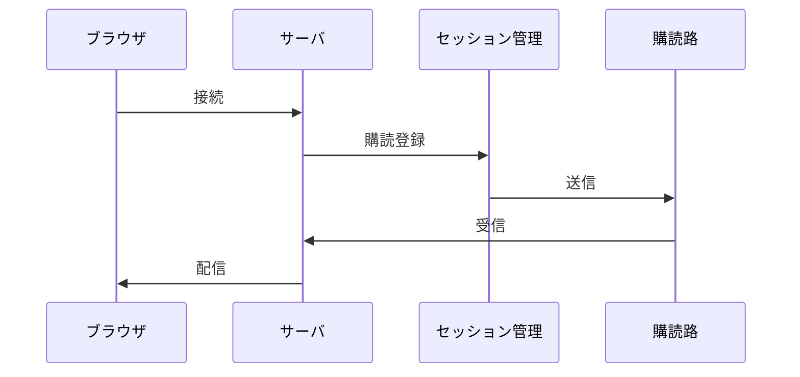
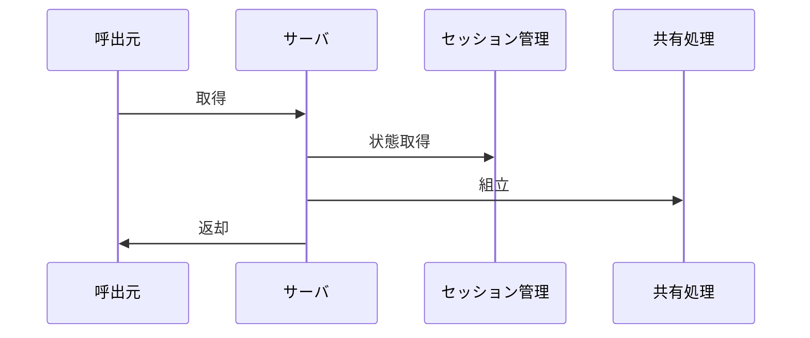

# 3. 主要な流れ <!-- b_v07482p9 -->

流れの入口は `Server` の HTTP ハンドラであり、接頭辞の除去と振分けから始まる（[server.go:1990-1995](../../internal/server/server.go#L1990-L1995)、[server.go:2333-2338](../../internal/server/server.go#L2333-L2338)）。
ファイル単位とレビュー全体の二つのコメント系が並び、前者は `path` 問合せを必須とする（[server.go:1997-2001](../../internal/server/server.go#L1997-L2001)、[server.go:2341-2348](../../internal/server/server.go#L2341-L2348)）。
状態操作は `Session` が施錠下で配列を更新し `scheduleWrite` で保存を予約する（[session.go:1799-1820](../../internal/session/session.go#L1799-L1820)、[session.go:1450-1458](../../internal/session/session.go#L1450-L1458)）。 <!-- b_h8183fk6 -->

## 3.1 ファイルコメント操作 <!-- b_4jm5557m -->

`handleCommentByID` は `/api/comment/` を除去して `routeCommentByID` で振分け先を決める（[server.go:1990-1993](../../internal/server/server.go#L1990-L1993)）。
`path` 問合せが空では 400 を返し、揃えば `handleReplyRoute` と `handleFileCommentResolve` と `handleFileCommentUpdate` に渡す（[server.go:1997-2010](../../internal/server/server.go#L1997-L2010)）。
`Session` 側は `AddReply` で返信を追加して未解決に戻し、`SetCommentResolved` で解決状態と `ResolvedRound` を付ける（[session.go:1799-1818](../../internal/session/session.go#L1799-L1818)、[session.go:1655-1668](../../internal/session/session.go#L1655-L1668)）。 <!-- b_3era8q45 -->

ファイルコメントの返信と解決と更新が `Server` から `Session` へ流れる順序である。

<!-- b_mqzg4fcd -->

### 手順 <!-- b_49hdwfe9 -->

1. `handleCommentByID` は `/api/comment/` を切り取り `routeCommentByID` で `route` を得て振り分ける（[server.go:1990-2005](../../internal/server/server.go#L1990-L2005)）。
2. `path` 問合せが空の場合 400 を返す（[server.go:1997-2000](../../internal/server/server.go#L1997-L2000)）。
3. 返信の場合は `handleReplyRoute` に `path` と `route.id` と `route.sub` を渡す（[server.go:2003-2005](../../internal/server/server.go#L2003-L2005)）。
4. 解決の場合は `handleFileCommentResolve` に `path` と `route.id` を渡す（[server.go:2006-2007](../../internal/server/server.go#L2006-L2007)）。
5. 更新の場合は `handleFileCommentUpdate` に `path` と `route.id` を渡す（[server.go:2008-2010](../../internal/server/server.go#L2008-L2010)）。
6. `AddReply` は `Replies` に追加し `Resolved` を戻して `UpdatedAt` を付ける（[session.go:1799-1818](../../internal/session/session.go#L1799-L1818)）。
7. `SetCommentResolved` は `Resolved` と `ResolvedRound` を付け `scheduleWrite` する（[session.go:1655-1670](../../internal/session/session.go#L1655-L1670)）。
8. `DeleteFileCommentAs` は `UserID` が異なれば拒み `appendPendingRemoteDelete` に積んで除く（[session.go:1705-1723](../../internal/session/session.go#L1705-L1723)）。 <!-- b_9wvnd7sp -->

### 例外と境界 <!-- b_91y4eg6r -->

- `routeCommentByID` が失敗すると 400 を返す（[server.go:1991-1996](../../internal/server/server.go#L1991-L1996)）。
- `path` が空では 400 を返す（[server.go:1997-2000](../../internal/server/server.go#L1997-L2000)）。
- 対象が無ければ `SetCommentResolved` は失敗を返す（[session.go:1655-1661](../../internal/session/session.go#L1655-L1661)）。
- `UserID` 不一致では `DeleteFileCommentAs` は `deleteResultForbidden` を返す（[session.go:1705-1715](../../internal/session/session.go#L1705-L1715)）。
- 対象が無ければ `AddReply` は失敗し、成功時は解決を解除する（[session.go:1799-1817](../../internal/session/session.go#L1799-L1817)）。 <!-- b_1exyg6ne -->

## 3.2 レビューコメント操作 <!-- b_ee1s1kq3 -->

`handleReviewCommentByID` は `/api/review-comment/` を除去して `routeCommentByID` で振分け先を決める（[server.go:2333-2336](../../internal/server/server.go#L2333-L2336)）。
`handleReviewCommentReplyRoute` と `handleReviewCommentResolve` と `handleReviewCommentUpdate` に渡す（[server.go:2341-2348](../../internal/server/server.go#L2341-L2348)）。
`UpdateReviewComment` と `ResolveReviewComment` と `AddReviewCommentReply` で配列を更新し `scheduleWrite` する（[session.go:1450-1458](../../internal/session/session.go#L1450-L1458)、[session.go:1483-1496](../../internal/session/session.go#L1483-L1496)、[session.go:1530-1549](../../internal/session/session.go#L1530-L1549)）。 <!-- b_w2wdhyzm -->

レビュー全体への返信と解決と更新が `Server` から `Session` へ流れる順序である。

<!-- b_zxx4fmz3 -->

### 手順 <!-- b_fkz46zfe -->

1. `handleReviewCommentByID` が接頭辞除去と `routeCommentByID` で `route` を得る（[server.go:2333-2336](../../internal/server/server.go#L2333-L2336)）。
2. `route.kind` で `handleReviewCommentReplyRoute` と `handleReviewCommentResolve` と `handleReviewCommentUpdate` に分岐する（[server.go:2341-2348](../../internal/server/server.go#L2341-L2348)）。
3. `UpdateReviewComment` は `Body` と `UpdatedAt` を更新する（[session.go:1450-1458](../../internal/session/session.go#L1450-L1458)）。
4. `DeleteReviewComment` は配列から除いて `scheduleWrite` する（[session.go:1467-1474](../../internal/session/session.go#L1467-L1474)）。
5. `ResolveReviewComment` は `Resolved` と `ResolvedRound` を付ける（[session.go:1483-1496](../../internal/session/session.go#L1483-L1496)）。
6. `AddReviewCommentReply` は `Replies` に追加し解決を解除する（[session.go:1530-1546](../../internal/session/session.go#L1530-L1546)）。
7. `UpdateReviewCommentReply` は `Replies` 内の `Body` を更新する（[session.go:1556-1566](../../internal/session/session.go#L1556-L1566)）。 <!-- b_qgh2ak95 -->

### 例外と境界 <!-- b_4c62b12n -->

- `routeCommentByID` が失敗すると 400 を返す（[server.go:2334-2338](../../internal/server/server.go#L2334-L2338)）。
- 対象が無ければ `UpdateReviewComment` は失敗を返す（[session.go:1450-1462](../../internal/session/session.go#L1450-L1462)）。
- 対象が無ければ `DeleteReviewComment` は失敗を返す（[session.go:1467-1478](../../internal/session/session.go#L1467-L1478)）。
- 対象が無ければ `ResolveReviewComment` は失敗を返す（[session.go:1483-1500](../../internal/session/session.go#L1483-L1500)）。
- 対象が無ければ `AddReviewCommentReply` は失敗を返す（[session.go:1530-1553](../../internal/session/session.go#L1530-L1553)）。 <!-- b_ey8da7ct -->

## 3.3 ライブイベント配信 <!-- b_14nzzf0y -->

`handleEvents` は `http.MethodGet` のみ受けて応答のヘッダを付ける（[server.go:2757-2772](../../internal/server/server.go#L2757-L2772)）。
`BrowserConnect` で数え `Subscribe` で `SSEEvent` の `ch` を得て待受ける（[session.go:2811-2817](../../internal/session/session.go#L2811-L2817)、[session.go:2839-2841](../../internal/session/session.go#L2839-L2841)、[server.go:2778-2783](../../internal/server/server.go#L2778-L2783)）。
`heartbeat` で保活し `event` を `json.Marshal` して送り `event.Type` で終了を判定する（[server.go:2785-2806](../../internal/server/server.go#L2785-L2806)）。 <!-- b_4asejvkj -->

ブラウザの接続が `Server` と `Session` の購読を経て保活と配信を受ける順序である。

<!-- b_hn97xjr6 -->

### 手順 <!-- b_ab79bkgr -->

1. `handleEvents` は `r.Method` が `http.MethodGet` 以外では 405 で拒む（[server.go:2757-2761](../../internal/server/server.go#L2757-L2761)）。
2. `http.Flusher` が無ければ 500 を返す（[server.go:2763-2767](../../internal/server/server.go#L2763-L2767)）。
3. `flusher` でヘッダを送り空行を流す（[server.go:2769-2776](../../internal/server/server.go#L2769-L2776)）。
4. `BrowserConnect` と `Subscribe` で登録し `BrowserDisconnect` と `Unsubscribe` で戻す（[server.go:2778-2784](../../internal/server/server.go#L2778-L2784)）。
5. `Subscribe` は緩衝 4 の `SSEEvent` 送受信路を作り `subscribers` に加える（[session.go:2811-2817](../../internal/session/session.go#L2811-L2817)）。
6. `notify` は `subscribers` へ非閉塞で送る（[session.go:2827-2836](../../internal/session/session.go#L2827-L2836)）。
7. `heartbeat` と `ch` 受信と切断を待つ（[server.go:2785-2795](../../internal/server/server.go#L2785-L2795)）。
8. 受信 `event` を `json.Marshal` して送り `event.Type` で終了を判定する（[server.go:2795-2806](../../internal/server/server.go#L2795-L2806)）。 <!-- b_505m7pt9 -->

## 3.4 共有ペイロード更新 <!-- b_53mj2t1w -->

`handleUpsertPayload` は GET のみ受け `shareFilesForSession` で `files` と `reviewType` を集める（[server.go:1342-1353](../../internal/server/server.go#L1342-L1353)）。
空なら 400 を返し、揃えば `LoadShareComments` と `ShareFilePaths` で `comments` を作る（[server.go:1359-1368](../../internal/server/server.go#L1359-L1368)、[share.go:235-240](../../internal/share/share.go#L235-L240)、[share.go:243-249](../../internal/share/share.go#L243-L249)）。
`GetDeleteToken` と `shareCLIArgsForSession` を添えて `buildUpsertPayload` を `writeJSON` する（[server.go:1369-1372](../../internal/server/server.go#L1369-L1372)）。 <!-- b_dhkqm738 -->

共有更新用の取得が `Server` から `Session` と共有処理を経て返る順序である。

<!-- b_nqv7ssj5 -->

### 手順 <!-- b_b5xx40qr -->

1. `handleUpsertPayload` は `r.Method` が `http.MethodGet` 以外では 405 で拒む（[server.go:1342-1346](../../internal/server/server.go#L1342-L1346)）。
2. `shareFilesForSession` で `files` と `reviewType` を得て失敗時は 500 を返す（[server.go:1347-1358](../../internal/server/server.go#L1347-L1358)）。
3. `files` が空なら 400 を返す（[server.go:1359-1364](../../internal/server/server.go#L1359-L1364)）。
4. `CritJSONPath` で `critPath` を得る（[server.go:1365-1368](../../internal/server/server.go#L1365-L1368)）。
5. `LoadShareComments` に `critPath` と `FilePathsSnapshot` と `ShareFilePaths` を渡す（[server.go:1368-1369](../../internal/server/server.go#L1368-L1369)）。
6. `LoadShareComments` は `reviewType` で分岐し `LoadPreviewShareComments` に渡す（[share.go:235-238](../../internal/share/share.go#L235-L238)）。
7. `ShareFilePaths` は `ShareFile` の `Path` を抜き出す（[share.go:243-249](../../internal/share/share.go#L243-L249)）。
8. `shareCLIArgsForSession` と `GetDeleteToken` を添えて `buildUpsertPayload` を返す（[server.go:1369-1372](../../internal/server/server.go#L1369-L1372)）。 <!-- b_88y67v40 -->

### 例外と境界 <!-- b_v682bndy -->

- `handleUpsertPayload` は `r.Method` が `http.MethodGet` 以外では 405 で拒む（[server.go:1342-1346](../../internal/server/server.go#L1342-L1346)）。
- `shareFilesForSession` の失敗時は 500 を返す（[server.go:1352-1358](../../internal/server/server.go#L1352-L1358)）。
- `files` が空では 400 を返す（[server.go:1359-1364](../../internal/server/server.go#L1359-L1364)）。
- `LoadCliArgsFromReviewFile` は不存在で空を返し破損で警告する（[share.go:359-373](../../internal/share/share.go#L359-L373)）。 <!-- b_2nvx515g -->
