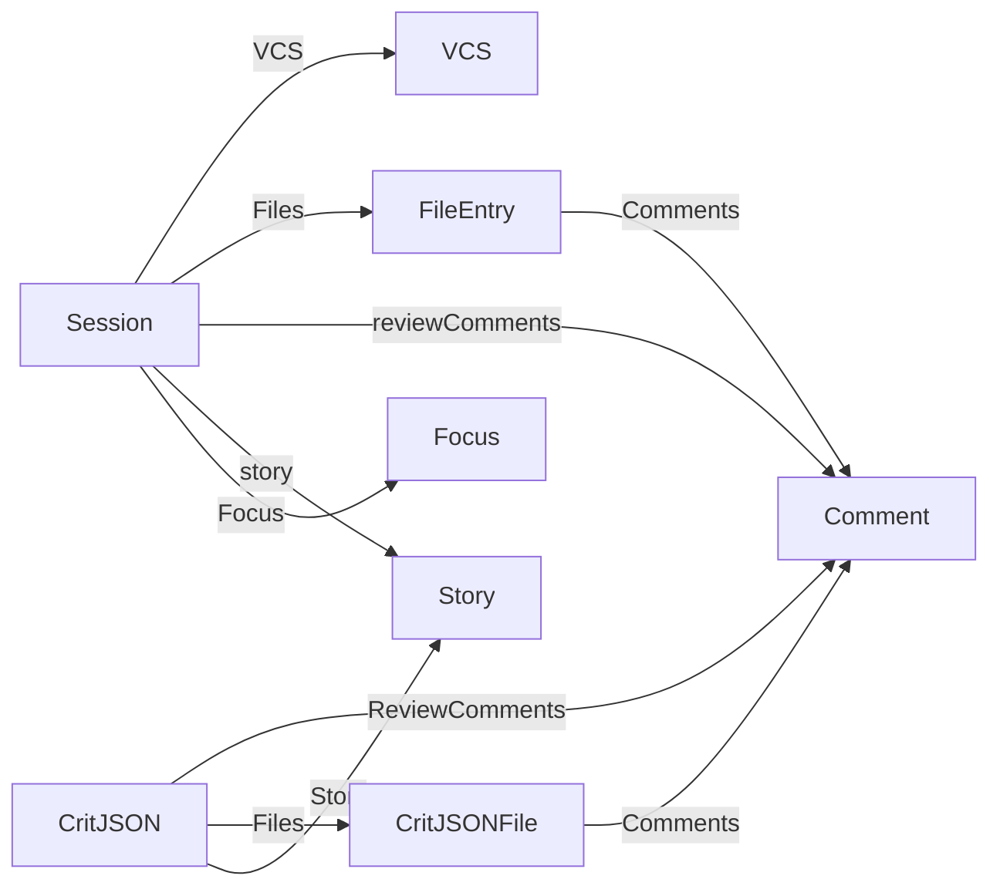

# 7. データモデル <!-- b_nwjchzxe -->

**主要な型（コードの宣言から読み取った 0 tok の一覧）**
| 型 | 種類 | 定義 | フィールド | 持っている型 | 使うファイル |
|---|---|---|---|---|---|
| `Comment` | struct | `internal/session/session.go:129` | 31 | — | 17 |
| `CritJSON` | struct | `internal/session/session.go:540` | 21 | `ReviewComments` → `Comment`・`Files` → `CritJSONFile`・`Story` → `Story` | 31 |
| `Focus` | struct | `internal/session/session_focus.go:45` | 19 | — | 12 |
| `Config` | struct | `internal/config/config.go:22` | 40 | — | 17 |
| `Session` | struct | `internal/session/session.go:416` | 54 | `VCS` → `VCS`・`Files` → `FileEntry`・`reviewComments` → `Comment`・`story` → `Story`・`Focus` → `Focus` | 17 |
| `VCS` | interface | `internal/vcs/vcs.go:14` | — | — | 17 |
| `ChangeID` | struct | `internal/forge/forge.go:21` | 3 | — | 13 |
| `CritJSONFile` | struct | `internal/session/session.go:671` | 3 | `Comments` → `Comment` | 16 |
| `FileEntry` | struct | `internal/session/session.go:210` | 18 | `Comments` → `Comment` | 11 |
| `Server` | struct | `internal/server/server.go:58` | 39 | — | 10 |
| `Story` | struct | `internal/session/session.go:611` | 10 | — | 6 |
| `SessionEntry` | struct | `internal/daemon/daemon.go:94` | 9 | — | 14 |
<!-- b_sc749cx5 -->

<!-- b_3rshbakt -->

- スキーマ（テーブル・モデル）は検出されませんでした。
<!-- b_4627wsnr -->
