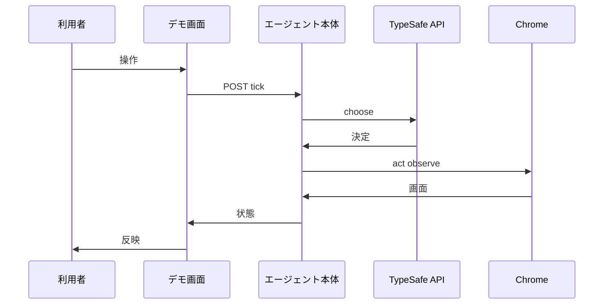
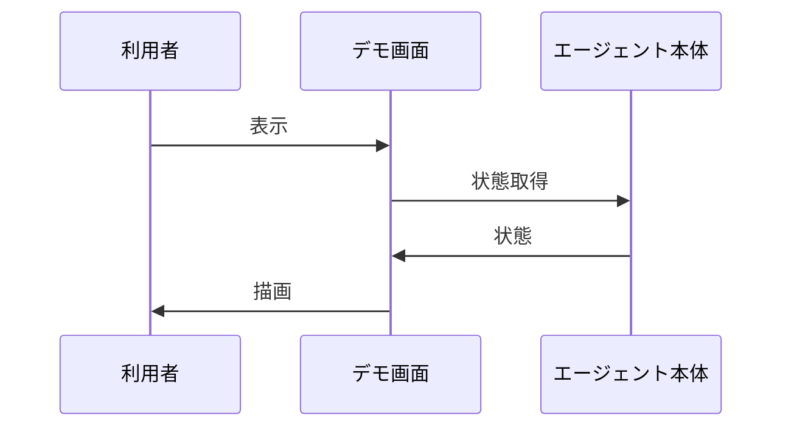
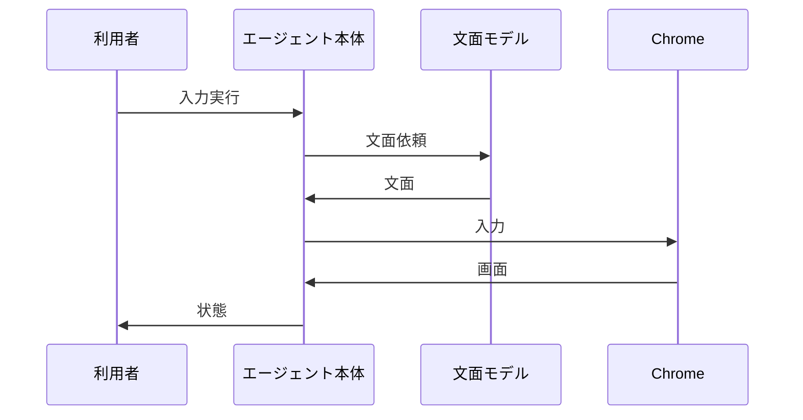

# 3. 主要な流れ <!-- b_d2ydgy4a -->

コマンド実行は `do_POST` が `command` を呼び出して結果を返す（[demo.py:104-118](../../jev_ultrafast/demo.py#L104-L118)）。状態取得は `do_GET` が `/api/state` に対して `response_state` を直接返す（[demo.py:81-87](../../jev_ultrafast/demo.py#L81-L87)）。いずれの応答も `response_state` が `snapshot` に `text_model` と `max_steps` を添えた辞書である（[demo.py:32-34](../../jev_ultrafast/demo.py#L32-L34)）。 <!-- b_5t55tjbr -->

## 3.1 デモからのエージェント実行 <!-- b_f9hxbz3k -->

`do_POST` は検証後に `command` を呼び出して結果を返す（[demo.py:104-118](../../jev_ultrafast/demo.py#L104-L118)）。`command` は `reset` で `Agent` を作り直し、それ以外は `AGENT.command` に委ねる（[demo.py:44-67](../../jev_ultrafast/demo.py#L44-L67)）。`tick` は `predict` と `act` を順に実行して `snapshot` を返し、`StalePage` のときは `observe` し直す（[agent.py:52-64](../../jev_ultrafast/agent.py#L52-L64)）。 <!-- b_ej2tq960 -->

デモ操作がエージェント循環を経て状態として戻る順序を示す。

<!-- b_j4ghtxs6 -->

### 手順 <!-- b_3emfy06f -->

1. `do_POST` は `Host` と `X-Demo-Token` と `Origin` を検証し、`LOCK` の取得に成功した場合のみ `command` を呼び出す（[demo.py:104-118](../../jev_ultrafast/demo.py#L104-L118)）。
2. `command` は `reset` で `close_browser` 後に `Agent` を作り直し、`scenario` を状態に記録する（[demo.py:44-62](../../jev_ultrafast/demo.py#L44-L62)）。
3. 既存の `AGENT` がある場合は `AGENT.command` に委ね、`response_state` を返す（[demo.py:63-67](../../jev_ultrafast/demo.py#L63-L67)）。
4. `tick` は `predict` で `choose` した決定を `act` に渡し、`StalePage` のときは `observe` し直して `ready` に戻す（[agent.py:52-64](../../jev_ultrafast/agent.py#L52-L64)、[agent.py:65-77](../../jev_ultrafast/agent.py#L65-L77)）。
5. `predict` は `fresh` でなければ `observe` し、`choose` の結果を `decisions` に積んで `predicted` にする（[agent.py:65-85](../../jev_ultrafast/agent.py#L65-L85)）。
6. `act` は指紋が合う決定を一度だけ消費して実行し、実行後に `observe` して履歴に記録する（[agent.py:86-92](../../jev_ultrafast/agent.py#L86-L92)、[agent.py:117-144](../../jev_ultrafast/agent.py#L117-L144)）。 <!-- b_jz8q9105 -->

### 例外と境界 <!-- b_g8vbq4mv -->

- `do_POST` は想定外の `Host` や `TOKEN` 不一致で `403` を返し、実行中の要求がある場合は `409` を返す（[demo.py:104-112](../../jev_ultrafast/demo.py#L104-L112)）。
- 古い画面に対する操作は `StalePage` となり、`tick` は `observe` し直して `ready` に戻す（[agent.py:52-64](../../jev_ultrafast/agent.py#L52-L64)）。
- 停止後や予算超過の `predict` は `ValueError` となり、`do_POST` が `400` で返す（[agent.py:65-76](../../jev_ultrafast/agent.py#L65-L76)、[demo.py:104-121](../../jev_ultrafast/demo.py#L104-L121)）。 <!-- b_7f8st0y7 -->

## 3.2 画面の状態取得と反映 <!-- b_rh6djfsv -->

`do_GET` は `/api/state` に対して `response_state` を返す（[demo.py:81-87](../../jev_ultrafast/demo.py#L81-L87)）。`response_state` は `AGENT` が無ければ待機状態の辞書を返す（[demo.py:32-34](../../jev_ultrafast/demo.py#L32-L34)）。`snapshot` は `browser` を除いた状態に `action_space` の要素一覧を添える（[agent.py:46-50](../../jev_ultrafast/agent.py#L46-L50)）。 <!-- b_hjakyz2m -->

画面が状態を取得して描画へ反映する順序を示す。

<!-- b_kher24re -->

### 手順 <!-- b_q8k42s2q -->

1. `do_GET` は `Host` を検証し、パスに応じて応答を振り分ける（[demo.py:81-84](../../jev_ultrafast/demo.py#L81-L84)）。
2. `/api/state` への要求は `LOCK` の下で `response_state` を返す（[demo.py:84-87](../../jev_ultrafast/demo.py#L84-L87)）。
3. `response_state` は `AGENT` があれば `snapshot` を、無ければ待機状態を返す（[demo.py:32-34](../../jev_ultrafast/demo.py#L32-L34)）。
4. `snapshot` は `browser` を除いた状態に `action_space` の `elements` を添える（[agent.py:46-50](../../jev_ultrafast/agent.py#L46-L50)）。 <!-- b_4ba12eaq -->

### 例外と境界 <!-- b_n30xcp2h -->

- `Host` 不一致の `do_GET` は `403` となり、未知パスは `404` となる（[demo.py:81-83](../../jev_ultrafast/demo.py#L81-L83)、[demo.py:98-100](../../jev_ultrafast/demo.py#L98-L100)）。
- `/demo.mp4` は動画が無い場合は `404` となる（[demo.py:88-99](../../jev_ultrafast/demo.py#L88-L99)）。 <!-- b_rceb03y1 -->

## 3.3 テキスト入力の生成と実行 <!-- b_4118w24h -->

`act` で `fill` が選ばれると `field_context` で文脈を作り `field_text` に文面を依頼する（[agent.py:86-115](../../jev_ultrafast/agent.py#L86-L115)）。生成文は `act` で入力され、実行後に `observe` で画面を取り直す（[agent.py:117-142](../../jev_ultrafast/agent.py#L117-L142)）。 <!-- b_q5d900fn -->

文面生成を伴う入力実行の順序を示す。

<!-- b_d3hwa46n -->

### 手順 <!-- b_nqvzh8t3 -->

1. `act` は決定と指紋が一致した場合のみ続行し、決定を先に消費する（[agent.py:86-92](../../jev_ultrafast/agent.py#L86-L92)）。
2. `fill` の場合は `fresh` で画面を確認し `field_context` で文脈を作る（[agent.py:105-109](../../jev_ultrafast/agent.py#L105-L109)）。
3. 文脈が `pending_text` と一致しなければ `field_text` で文面を生成する（[agent.py:109-115](../../jev_ultrafast/agent.py#L109-L115)）。
4. `Browser.act` で入力を実行し、`pending_text` を破棄する（[agent.py:116-119](../../jev_ultrafast/agent.py#L116-L119)）。
5. 実行後に `observe` して履歴に記録し、画面変化を追記する（[agent.py:121-148](../../jev_ultrafast/agent.py#L121-L148)）。 <!-- b_ts0q3wdt -->

### 例外と境界 <!-- b_bc0btwtf -->

- `TEXT_MODEL_API_KEY` が無い場合は `field_text` が例外となり何も入力されない（[model.py:160-163](../../jev_ultrafast/model.py#L160-L163)）。
- 文面が空や長過ぎる場合は `ValueError` となり入力されない（[model.py:187-193](../../jev_ultrafast/model.py#L187-L193)）。
- 文面生成前の画面変化は `StalePage` となり、実行は行われない（[agent.py:106-108](../../jev_ultrafast/agent.py#L106-L108)）。 <!-- b_9zb0r9c7 -->
