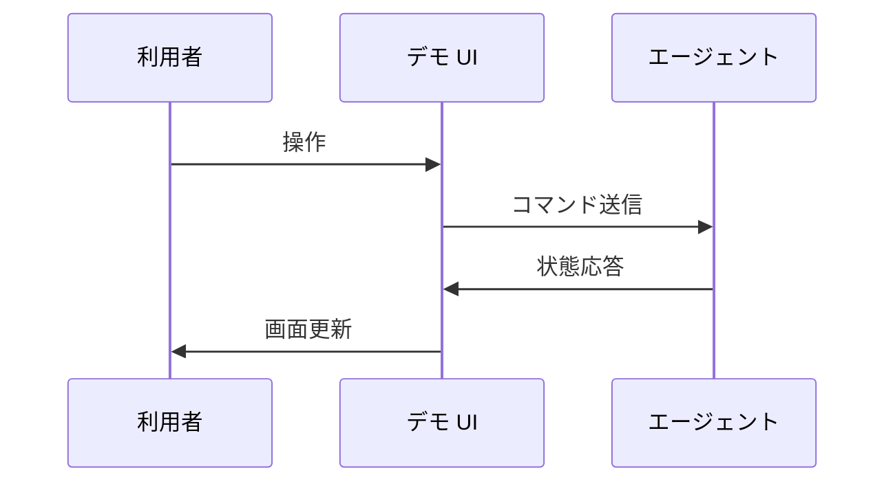
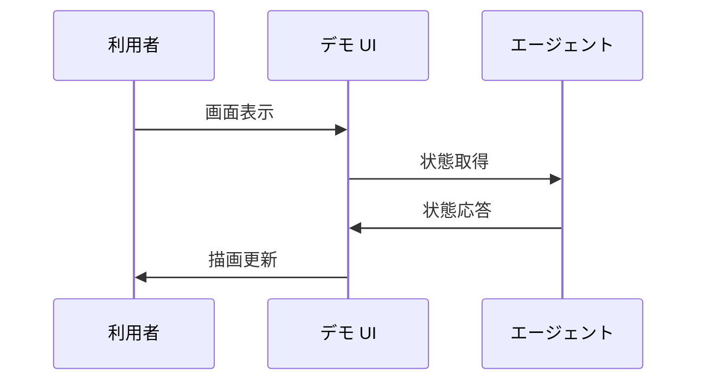

# 3. 主要な流れ <!-- b_d2ydgy4a -->

2 つの流れはデモを起点に `Agent` による操作へ至る経路である（推測）。いずれも静的画面とサーバ側の状態取得を経由し、判断はサーバ側に残る（推測）。 <!-- b_5t55tjbr -->

## 3.1 デモからのエージェント実行 <!-- b_f9hxbz3k -->

利用者の操作はデモサーバの入口から `Agent` の循環に入る（推測）。観測と選択と実行を束ねた結果が状態として返り、画面に反映される（推測）。入口はデモの起動点である（[demo.py:144](../../jev_ultrafast/demo.py#L144)）。 <!-- b_ej2tq960 -->

デモ操作がエージェント循環を経て状態として戻る順序を示す。

<!-- b_j4ghtxs6 -->

### 手順 <!-- b_3emfy06f -->

1. デモサーバが起動し要求受付を開始する（[demo.py:144](../../jev_ultrafast/demo.py#L144)）。
2. 画面からの取得要求を受けて現在の状態を返す（[app.js:56](../../jev_ultrafast/static/app.js#L56)）。
3. 受けた操作を循環に渡して観測と選択と実行を進める（[agent.py:12-13](../../jev_ultrafast/agent.py#L12-L13)）。
4. 実行後の状態を応答として画面側へ戻す（[app.js:236](../../jev_ultrafast/static/app.js#L236)）。 <!-- b_jz8q9105 -->

### 例外と境界 <!-- b_g8vbq4mv -->

- 古い画面に対する操作は `StalePage` として退け、再観測を促す（推測）。
- 選択肢に無い応答は `validate_choice` で退け、次の観測から選び直す（推測）。 <!-- b_7f8st0y7 -->

## 3.2 画面の状態取得と反映 <!-- b_rh6djfsv -->

デモ画面は起動時に状態取得を開始し、応答を描画に反映する（推測）。目標選択や操作判断は含まず、サーバ側の処理結果の表示に徹する（推測）。入口は静的画面の読込点である（[index.html:142](../../jev_ultrafast/static/index.html#L142)）。 <!-- b_hjakyz2m -->

画面が状態を取得して描画へ反映する順序を示す。

<!-- b_kher24re -->

### 手順 <!-- b_q8k42s2q -->

1. 静的画面が読み込まれて初期化が始まる（[index.html:142](../../jev_ultrafast/static/index.html#L142)）。
2. 状態取得を要求する（[app.js:56](../../jev_ultrafast/static/app.js#L56)）。
3. 取得した状態を画面要素へ反映する（[app.js:236](../../jev_ultrafast/static/app.js#L236)）。
4. 以降の操作ごとに取得と反映を繰り返す（[app.js:22](../../jev_ultrafast/static/app.js#L22)）。 <!-- b_4ba12eaq -->

### 例外と境界 <!-- b_n30xcp2h -->

- 取得要求が失敗した場合は画面更新が行われない（推測）。 <!-- b_rceb03y1 -->
