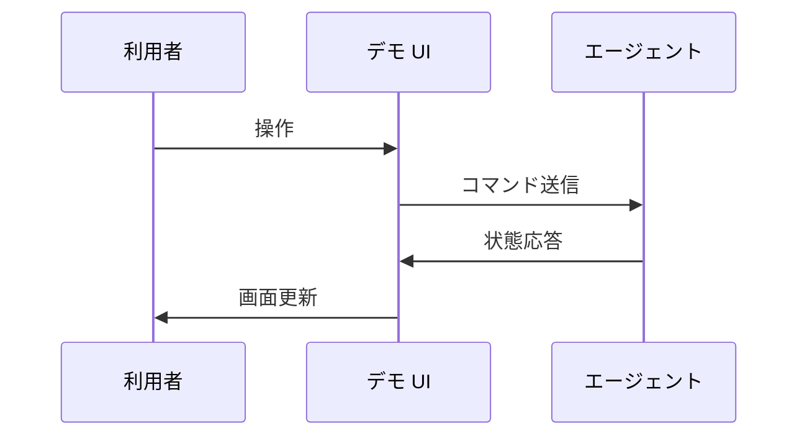
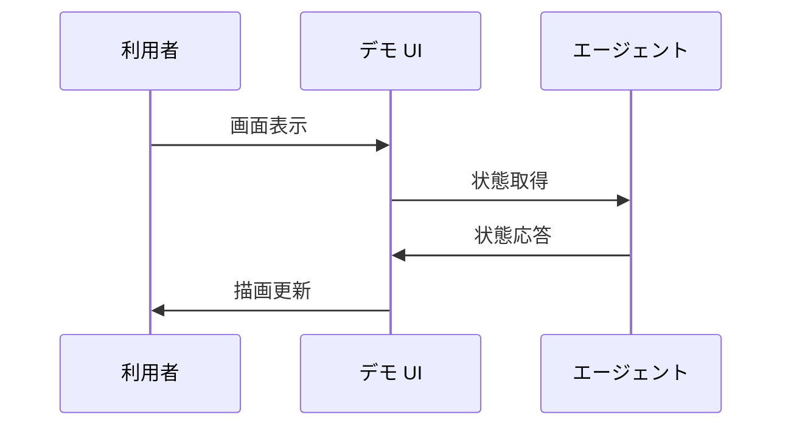
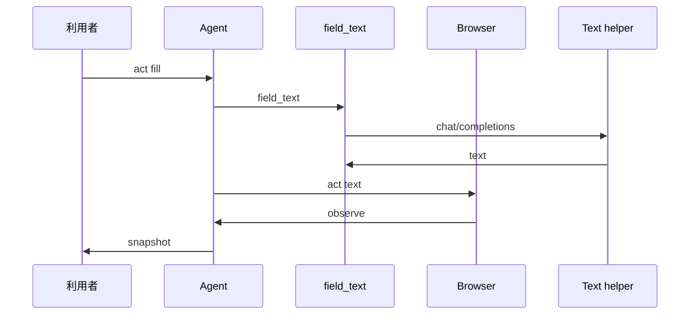

# 3. 主要な流れ <!-- b_d2ydgy4a -->

どの流れも `do_POST` と `do_GET` が入口となり `command` の結果を `response_state` で返す点が共通する（[demo.py:104-119](../../jev_ultrafast/demo.py#L104-L119)、[demo.py:81-87](../../jev_ultrafast/demo.py#L81-L87)）。`Agent` は観測と選択と実行を `command` で分離して進める（[agent.py:12-13](../../jev_ultrafast/agent.py#L12-L13)、[agent.py:52-77](../../jev_ultrafast/agent.py#L52-L77)）。返された状態は画面の `render` で表示に反映される（[app.js:69-75](../../jev_ultrafast/static/app.js#L69-L75)）。 <!-- b_5t55tjbr -->

## 3.1 デモからのエージェント実行 <!-- b_f9hxbz3k -->

利用者の操作はデモサーバの入口から `Agent` の循環に入る（推測）。観測と選択と実行を束ねた結果が状態として返り、画面に反映される（推測）。入口はデモの起動点である（[demo.py:144](../../jev_ultrafast/demo.py#L144)）。 <!-- b_ej2tq960 -->

デモ操作がエージェント循環を経て状態として戻る順序を示す。

<!-- b_j4ghtxs6 -->

### 手順 <!-- b_3emfy06f -->

1. デモサーバが起動し要求受付を開始する（[demo.py:144](../../jev_ultrafast/demo.py#L144)）。
2. 画面からの取得要求を受けて現在の状態を返す（[app.js:56](../../jev_ultrafast/static/app.js#L56)）。
3. 受けた操作を循環に渡して観測と選択と実行を進める（[agent.py:12-13](../../jev_ultrafast/agent.py#L12-L13)）。
4. 実行後の状態を応答として画面側へ戻す（[app.js:236](../../jev_ultrafast/static/app.js#L236)）。 <!-- b_jz8q9105 -->

### 例外と境界 <!-- b_g8vbq4mv -->

- 古い画面に対する操作は `StalePage` として退け、再観測を促す（推測）。
- 選択肢に無い応答は `validate_choice` で退け、次の観測から選び直す（推測）。 <!-- b_7f8st0y7 -->

## 3.2 画面の状態取得と反映 <!-- b_rh6djfsv -->

デモ画面は起動時に状態取得を開始し、応答を描画に反映する（推測）。目標選択や操作判断は含まず、サーバ側の処理結果の表示に徹する（推測）。入口は静的画面の読込点である（[index.html:142](../../jev_ultrafast/static/index.html#L142)）。 <!-- b_hjakyz2m -->

画面が状態を取得して描画へ反映する順序を示す。

<!-- b_kher24re -->

### 手順 <!-- b_q8k42s2q -->

1. 静的画面が読み込まれて初期化が始まる（[index.html:142](../../jev_ultrafast/static/index.html#L142)）。
2. 状態取得を要求する（[app.js:56](../../jev_ultrafast/static/app.js#L56)）。
3. 取得した状態を画面要素へ反映する（[app.js:236](../../jev_ultrafast/static/app.js#L236)）。
4. 以降の操作ごとに取得と反映を繰り返す（[app.js:22](../../jev_ultrafast/static/app.js#L22)）。 <!-- b_4ba12eaq -->

### 例外と境界 <!-- b_n30xcp2h -->

- 取得要求が失敗した場合は画面更新が行われない（推測）。 <!-- b_rceb03y1 -->

## 3.3 テキスト入力の生成と実行 <!-- b_4118w24h -->

`command` の `act` で `fill` を選ぶと `field_context` で文脈を作り `field_text` に文面を依頼する（[agent.py:52-53](../../jev_ultrafast/agent.py#L52-L53)、[agent.py:86-87](../../jev_ultrafast/agent.py#L86-L87)、[agent.py:105-114](../../jev_ultrafast/agent.py#L105-L114)）。文面は `act` の引数として渡され実行後に履歴へ記録される（[agent.py:116-118](../../jev_ultrafast/agent.py#L116-L118)、[agent.py:121-132](../../jev_ultrafast/agent.py#L121-L132)）。`TEXT_MODEL_API_KEY` が無い場合や応答が不正な場合は `field_text` が例外を返す（[model.py:160-164](../../jev_ultrafast/model.py#L160-L164)、[model.py:187-193](../../jev_ultrafast/model.py#L187-L193)）。 <!-- b_q5d900fn -->

文面生成を伴う入力実行の順序を示す。

<!-- b_d3hwa46n -->

### 手順 <!-- b_nqvzh8t3 -->

1. `command` が `act` を受け取り決定済みの選択を取り出す（[agent.py:52-53](../../jev_ultrafast/agent.py#L52-L53)、[agent.py:86-93](../../jev_ultrafast/agent.py#L86-L93)）。
2. `field_context` が目標と欄と履歴から文脈を作る（[model.py:151-157](../../jev_ultrafast/model.py#L151-L157)）。
3. `field_text` が外部 LLM に文面を依頼し検証する（[model.py:160-172](../../jev_ultrafast/model.py#L160-L172)、[model.py:187-193](../../jev_ultrafast/model.py#L187-L193)）。
4. `act` が新鮮さを確認してから入力を実行する（[browser.py:100-105](../../jev_ultrafast/browser.py#L100-L105)）。
5. 実行を履歴に記録し `observe` で変化を確認する（[agent.py:121-127](../../jev_ultrafast/agent.py#L121-L127)、[agent.py:142-146](../../jev_ultrafast/agent.py#L142-L146)）。 <!-- b_ts0q3wdt -->

### 例外と境界 <!-- b_bc0btwtf -->

- `TEXT_MODEL_API_KEY` が無い場合は `field_text` が例外となり何も入力されない（[model.py:160-164](../../jev_ultrafast/model.py#L160-L164)、[agent.py:109-117](../../jev_ultrafast/agent.py#L109-L117)）。
- 応答の JSON が不正な場合は `field_text` が例外となり入力されない（[model.py:160-162](../../jev_ultrafast/model.py#L160-L162)、[model.py:187-193](../../jev_ultrafast/model.py#L187-L193)、[agent.py:109-117](../../jev_ultrafast/agent.py#L109-L117)）。
- 文面生成前に画面が変わると `StalePage` となり選択からやり直す（[agent.py:106-109](../../jev_ultrafast/agent.py#L106-L109)、[agent.py:59-64](../../jev_ultrafast/agent.py#L59-L64)）。 <!-- b_9zb0r9c7 -->
