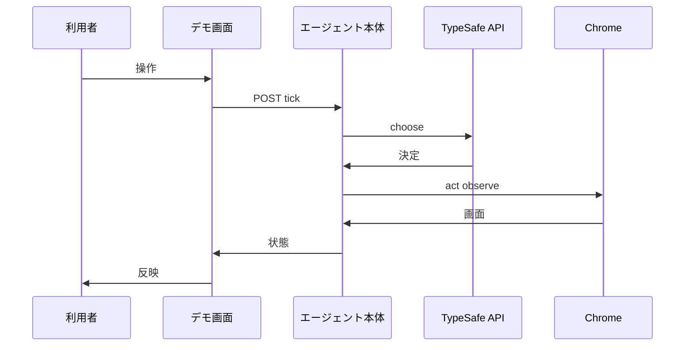
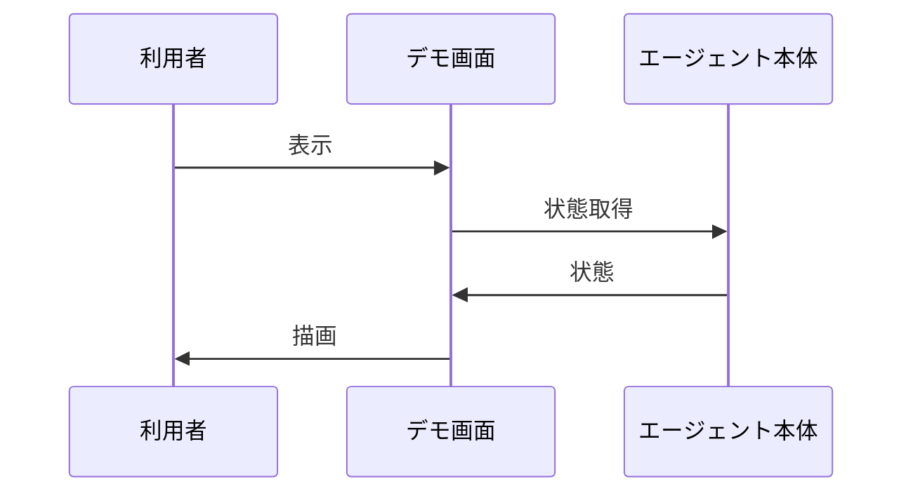
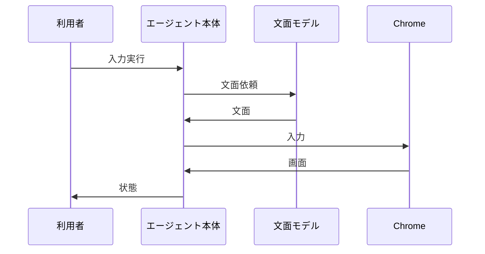

# 3. 主要な流れ <!-- b_d2ydgy4a -->

3 つの流れはいずれもデモサーバを入口とし、`response_state` と `snapshot` から得た状態を JSON で返す（[demo.py:32-34](../../jev_ultrafast/demo.py#L32-L34)、[agent.py:46-50](../../jev_ultrafast/agent.py#L46-L50)）。コマンド系の 2 流れは `do_POST` が検証と `LOCK` 排他のうえで `command` から `AGENT.command` へ進む（[demo.py:104-119](../../jev_ultrafast/demo.py#L104-L119)、[demo.py:44-67](../../jev_ultrafast/demo.py#L44-L67)）。状態取得は `do_GET` が `/api/state` に対して `response_state` を返す読取りであり、エージェント状態を変えない（[demo.py:81-87](../../jev_ultrafast/demo.py#L81-L87)）。静的ファイル配信は `do_GET` の別枝であり、コマンド実行とは合流しない（[demo.py:81-102](../../jev_ultrafast/demo.py#L81-L102)）。 <!-- b_5t55tjbr -->

## 3.1 デモからのエージェント実行 <!-- b_f9hxbz3k -->

`do_POST` は検証後に `command` を呼び出して結果を返す（[demo.py:104-118](../../jev_ultrafast/demo.py#L104-L118)）。`command` は `reset` で `Agent` を作り直し、それ以外は `AGENT.command` に委ねる（[demo.py:44-67](../../jev_ultrafast/demo.py#L44-L67)）。`tick` は `predict` と `act` を順に実行して `snapshot` を返し、`StalePage` のときは `observe` し直す（[agent.py:52-64](../../jev_ultrafast/agent.py#L52-L64)）。 <!-- b_ej2tq960 -->

デモ操作がエージェント循環を経て状態として戻る順序を示す。

<!-- b_j4ghtxs6 -->

### 手順 <!-- b_3emfy06f -->

1. `do_POST` は `Host` と `X-Demo-Token` と `Origin` を検証し、不一致なら 403 を返し、`LOCK` を非ブロッキングで取得できなければ 409 を返す（[demo.py:104-112](../../jev_ultrafast/demo.py#L104-L112)）。
2. `Content-Length` を検証して JSON を読み、`command` を呼んで 200 を返し、想定内例外は 400、想定外は 500 として `LOCK` を解放する（[demo.py:113-125](../../jev_ultrafast/demo.py#L113-L125)）。
3. `command` の `reset` は `scenario` と `goal` を検証し、`close_browser` 後に `Agent` を作り直して `scenario` を記録する（[demo.py:44-62](../../jev_ultrafast/demo.py#L44-L62)）。
4. それ以外の `command` は `AGENT` が無ければ例外とし、`AGENT.command` に委譲して `response_state` を返す（[demo.py:44-67](../../jev_ultrafast/demo.py#L44-L67)）。
5. `command` の `tick` は `predict` 後に指紋付きで `act` を呼び、`StalePage` 時は再観測して待機に戻す（[agent.py:52-64](../../jev_ultrafast/agent.py#L52-L64)）。
6. `predict` は状態と予算を確認し、必要なら再観測して `choose` を呼び、決定に指紋と経過時間を添えて保存する（[agent.py:65-85](../../jev_ultrafast/agent.py#L65-L85)）。
7. `act` は決定を先に消費し、`DONE` と `BLOCKED` を確定するか、対象操作と予算を確認する（[agent.py:86-104](../../jev_ultrafast/agent.py#L86-L104)）。
8. 実行結果は履歴へ追記してから `observe` し、`page_changed` の更新と記録と閉塞判定を行う（[agent.py:121-148](../../jev_ultrafast/agent.py#L121-L148)、[agent.py:149-158](../../jev_ultrafast/agent.py#L149-L158)）。 <!-- b_jz8q9105 -->

### 例外と境界 <!-- b_g8vbq4mv -->

- `do_POST` は想定外の `Host` や `TOKEN` 不一致で `403` を返し、実行中の要求がある場合は `409` を返す（[demo.py:104-112](../../jev_ultrafast/demo.py#L104-L112)）。
- 古い画面に対する操作は `StalePage` となり、`tick` は `observe` し直して `ready` に戻す（[agent.py:52-64](../../jev_ultrafast/agent.py#L52-L64)）。
- 停止後や予算超過の `predict` は `ValueError` となり、`do_POST` が `400` で返す（[agent.py:65-76](../../jev_ultrafast/agent.py#L65-L76)、[demo.py:104-121](../../jev_ultrafast/demo.py#L104-L121)）。 <!-- b_7f8st0y7 -->

## 3.2 画面の状態取得と反映 <!-- b_rh6djfsv -->

`do_GET` は `/api/state` に対して `response_state` を返す（[demo.py:81-87](../../jev_ultrafast/demo.py#L81-L87)）。`response_state` は `AGENT` が無ければ待機状態の辞書を返す（[demo.py:32-34](../../jev_ultrafast/demo.py#L32-L34)）。`snapshot` は `browser` を除いた状態に `action_space` の要素一覧を添える（[agent.py:46-50](../../jev_ultrafast/agent.py#L46-L50)）。 <!-- b_hjakyz2m -->

画面が状態を取得して描画へ反映する順序を示す。

<!-- b_kher24re -->

### 手順 <!-- b_q8k42s2q -->

1. `do_GET` は `Host` を検証し、不一致なら 403 を返す（[demo.py:81-83](../../jev_ultrafast/demo.py#L81-L83)）。
2. `/api/state` へは `LOCK` の下で `response_state` を返す（[demo.py:84-87](../../jev_ultrafast/demo.py#L84-L87)）。
3. `/demo.mp4` は動画が存在する場合のみ `video/mp4` で返す（[demo.py:88-91](../../jev_ultrafast/demo.py#L88-L91)）。
4. 静的パスは対応表で振り分け、未知パスは 404 とし、既知ファイルは `__TOKEN__` を `TOKEN` に置換して返す（[demo.py:92-102](../../jev_ultrafast/demo.py#L92-L102)）。
5. `response_state` は `AGENT` があれば `snapshot`、無ければ待機辞書に `TEXT_MODEL` と `MAX_STEPS` を添えて返す（[demo.py:32-34](../../jev_ultrafast/demo.py#L32-L34)）。
6. `snapshot` は `browser` を除く状態に `action_space` 由来の `elements` を添えて返す（[agent.py:46-50](../../jev_ultrafast/agent.py#L46-L50)）。 <!-- b_4ba12eaq -->

### 例外と境界 <!-- b_n30xcp2h -->

- `Host` 不一致の `do_GET` は `403` となり、未知パスは `404` となる（[demo.py:81-83](../../jev_ultrafast/demo.py#L81-L83)、[demo.py:98-100](../../jev_ultrafast/demo.py#L98-L100)）。
- `/demo.mp4` は動画が無い場合は `404` となる（[demo.py:88-99](../../jev_ultrafast/demo.py#L88-L99)）。 <!-- b_rceb03y1 -->

## 3.3 テキスト入力の生成と実行 <!-- b_4118w24h -->

`act` で `fill` が選ばれると `field_context` で文脈を作り `field_text` に文面を依頼する（[agent.py:86-115](../../jev_ultrafast/agent.py#L86-L115)）。生成文は `act` で入力され、実行後に `observe` で画面を取り直す（[agent.py:117-142](../../jev_ultrafast/agent.py#L117-L142)）。 <!-- b_q5d900fn -->

文面生成を伴う入力実行の順序を示す。

<!-- b_d3hwa46n -->

### 手順 <!-- b_nqvzh8t3 -->

1. `act` は決定と指紋が一致した場合のみ続行し、決定を先に消費する（[agent.py:86-92](../../jev_ultrafast/agent.py#L86-L92)）。
2. `fill` の場合は `fresh` で画面を確認し、`field_context` で文脈を作る（[agent.py:105-110](../../jev_ultrafast/agent.py#L105-L110)、[model.py:151-157](../../jev_ultrafast/model.py#L151-L157)）。
3. `pending_text` が文脈一致すれば再利用し、違えば `field_text` を呼び出して `text_calls` に記録する（[agent.py:110-115](../../jev_ultrafast/agent.py#L110-L115)）。
4. `field_text` は鍵と接続先と機種を決め、応答 JSON から `text` を検証して値と付帯情報を返す（[model.py:160-194](../../jev_ultrafast/model.py#L160-L194)）。
5. `act` は実行直前に `fresh` を再確認し、`browser_operation` で入力する（[browser.py:100-107](../../jev_ultrafast/browser.py#L100-L107)）。
6. 実行結果は履歴へ追記してから `observe` し、`page_changed` を更新する（[agent.py:121-148](../../jev_ultrafast/agent.py#L121-L148)）。 <!-- b_ts0q3wdt -->

### 例外と境界 <!-- b_bc0btwtf -->

- `TEXT_MODEL_API_KEY` が無い場合は `field_text` が例外となり何も入力されない（[model.py:160-163](../../jev_ultrafast/model.py#L160-L163)）。
- 文面が空や長過ぎる場合は `ValueError` となり入力されない（[model.py:187-193](../../jev_ultrafast/model.py#L187-L193)）。
- 文面生成前の画面変化は `StalePage` となり、実行は行われない（[agent.py:106-108](../../jev_ultrafast/agent.py#L106-L108)）。 <!-- b_9zb0r9c7 -->
