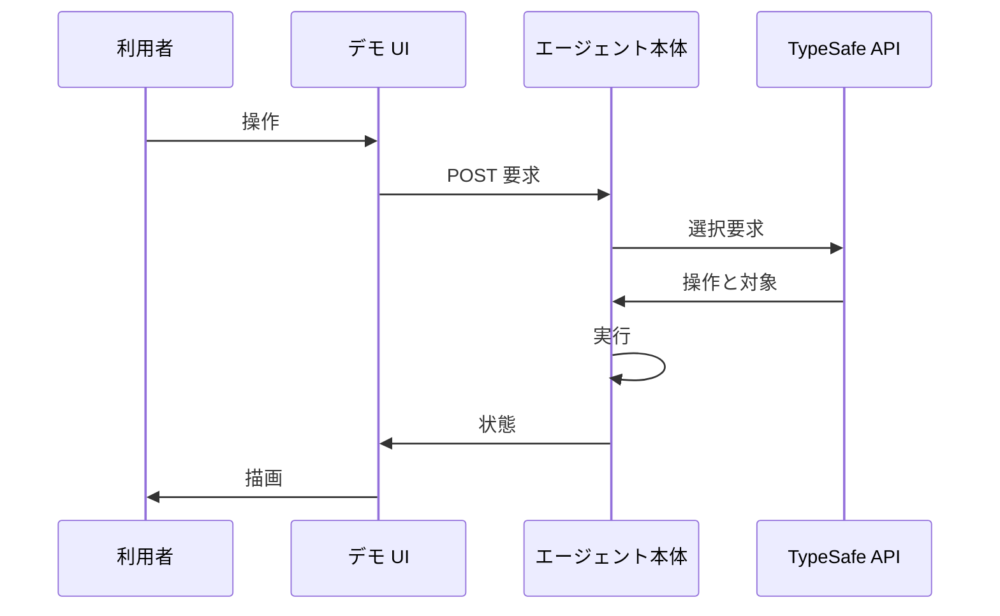
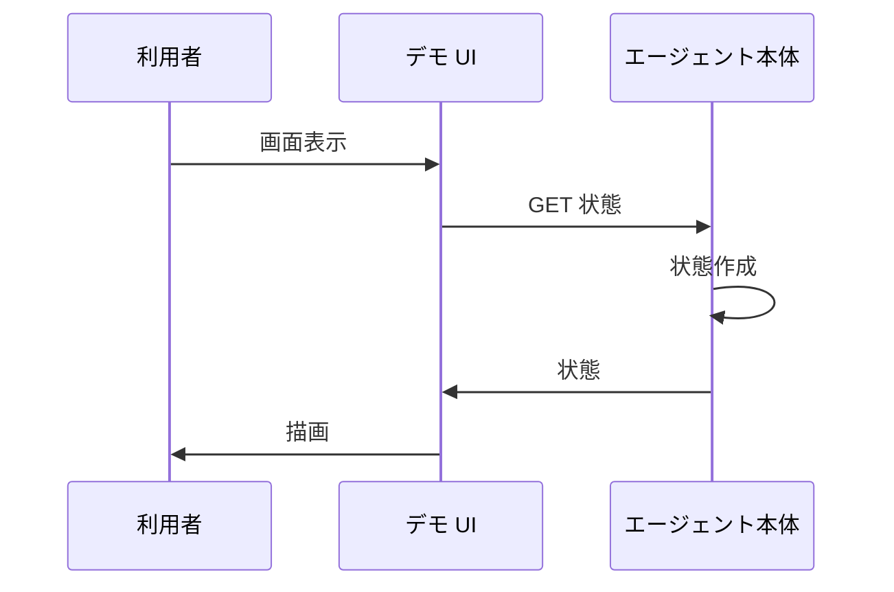
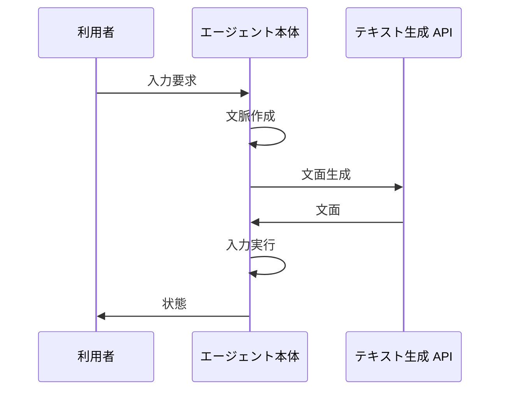

# 3. 主要な流れ <!-- b_d2ydgy4a -->

どの流れも `do_GET` と `do_POST` を入口とし、`command` の結果を `response_state` で返す点が共通する（[demo.py:81-87](../../jev_ultrafast/demo.py#L81-L87)、[demo.py:104-119](../../jev_ultrafast/demo.py#L104-L119)、[demo.py:44-67](../../jev_ultrafast/demo.py#L44-L67)）。`response_state` は `Agent` の `snapshot` に `text_model` と `max_steps` を添えた応答を作る（[demo.py:32-34](../../jev_ultrafast/demo.py#L32-L34)、[demo.py:54-55](../../jev_ultrafast/demo.py#L54-L55)、[agent.py:46-50](../../jev_ultrafast/agent.py#L46-L50)）。実行系は `predict` で選び `act` で動かす循環となり、画面が古くなると `StalePage` で再観測へ戻る（[agent.py:52-64](../../jev_ultrafast/agent.py#L52-L64)）。 <!-- b_5t55tjbr -->

## 3.1 デモからのエージェント実行 <!-- b_f9hxbz3k -->

利用者の操作は `do_POST` から `command` に入り、`Agent` の `tick` 循環で予測と実行を進める（[demo.py:104-119](../../jev_ultrafast/demo.py#L104-L119)、[demo.py:54-55](../../jev_ultrafast/demo.py#L54-L55)、[agent.py:52-58](../../jev_ultrafast/agent.py#L52-L58)）。`choose` は観測済み操作から `operation` と `target` を選び、`act` は `browser` の確認を経て実行し `response_state` で状態を返す（[model.py:81-82](../../jev_ultrafast/model.py#L81-L82)、[model.py:122-130](../../jev_ultrafast/model.py#L122-L130)、[agent.py:86-100](../../jev_ultrafast/agent.py#L86-L100)、[demo.py:44-67](../../jev_ultrafast/demo.py#L44-L67)）。 <!-- b_ej2tq960 -->

デモ操作がエージェント循環を経て状態として戻る順序を示す。

<!-- b_j4ghtxs6 -->

### 手順 <!-- b_3emfy06f -->

1. `do_POST` は `Host` と `X-Demo-Token` と `Origin` を検証し、`LOCK` の取得に成功した場合のみ `command` を呼び出す（[demo.py:104-119](../../jev_ultrafast/demo.py#L104-L119)）。
2. `command` は `reset` で `scenario` と `goal` を検証して `Agent` を作り直し、それ以外は既存の `Agent` に `command` を委譲する（[demo.py:44-67](../../jev_ultrafast/demo.py#L44-L67)）。
3. `tick` は `predict` の後に `act` を実行し、`StalePage` の場合は再観測して `ready` に戻る（[agent.py:52-64](../../jev_ultrafast/agent.py#L52-L64)）。
4. `predict` は画面の新鮮さを確認して `choose` で `decision` を作り、`act` は指紋照合と予算確認の後に `browser` を動かす（[agent.py:65-77](../../jev_ultrafast/agent.py#L65-L77)、[agent.py:86-94](../../jev_ultrafast/agent.py#L86-L94)）。
5. 実行結果は `snapshot` に `elements` を添えて `response_state` から返る（[agent.py:46-50](../../jev_ultrafast/agent.py#L46-L50)、[demo.py:32-34](../../jev_ultrafast/demo.py#L32-L34)）。 <!-- b_jz8q9105 -->

### 例外と境界 <!-- b_g8vbq4mv -->

- `do_POST` は想定外の `Host` や `TOKEN` 不一致で 403 を返し、実行中の要求がある場合は 409 を返す（[demo.py:104-112](../../jev_ultrafast/demo.py#L104-L112)）。
- 古い画面に対する操作は `StalePage` として退けられ、`tick` は再観測して `ready` に戻る（[browser.py:100-102](../../jev_ultrafast/browser.py#L100-L102)、[agent.py:55-64](../../jev_ultrafast/agent.py#L55-L64)）。
- 予算超過や停止後の `predict` は `ValueError` となり、何も実行されない（[agent.py:65-77](../../jev_ultrafast/agent.py#L65-L77)）。 <!-- b_7f8st0y7 -->

## 3.2 画面の状態取得と反映 <!-- b_rh6djfsv -->

`do_GET` は `/api/state` に対して `response_state` を返す（[demo.py:81-87](../../jev_ultrafast/demo.py#L81-L87)）。`snapshot` は `browser` を除いた状態に `action_space` 由来の `elements` を添える（[agent.py:46-50](../../jev_ultrafast/agent.py#L46-L50)）。画面は取得した状態を描画に反映する（推測）。 <!-- b_hjakyz2m -->

画面が状態を取得して描画へ反映する順序を示す。

<!-- b_kher24re -->

### 手順 <!-- b_q8k42s2q -->

1. `do_GET` は `Host` を検証し、パスに応じて応答を振り分ける（[demo.py:81-84](../../jev_ultrafast/demo.py#L81-L84)）。
2. `/api/state` への要求は `LOCK` の下で `response_state` を返す（[demo.py:85-87](../../jev_ultrafast/demo.py#L85-L87)）。
3. `/` や `/app.js` などの静的資源は `TOKEN` を埋め込んで配信される（[demo.py:92-102](../../jev_ultrafast/demo.py#L92-L102)）。
4. `snapshot` は `action_space` から作った `elements` を添えて画面更新の材料とする（[agent.py:46-50](../../jev_ultrafast/agent.py#L46-L50)）。 <!-- b_4ba12eaq -->

### 例外と境界 <!-- b_n30xcp2h -->

- `Host` 不一致の `do_GET` は 403 となり、未知パスは 404 となる（[demo.py:81-84](../../jev_ultrafast/demo.py#L81-L84)、[demo.py:98-100](../../jev_ultrafast/demo.py#L98-L100)）。
- 状態取得に失敗した場合は画面更新が行われない（推測）。 <!-- b_rceb03y1 -->

## 3.3 テキスト入力の生成と実行 <!-- b_4118w24h -->

`act` で `fill` が選ばれると `field_context` で文脈を作り `field_text` に文面を依頼する（[agent.py:86-87](../../jev_ultrafast/agent.py#L86-L87)、[agent.py:106-114](../../jev_ultrafast/agent.py#L106-L114)）。生成文は `browser` の `act` で入力され、履歴に `text` と `text_helper` が残る（[agent.py:116-118](../../jev_ultrafast/agent.py#L116-L118)、[agent.py:121-132](../../jev_ultrafast/agent.py#L121-L132)）。 <!-- b_q5d900fn -->

文面生成を伴う入力実行の順序を示す。

<!-- b_d3hwa46n -->

### 手順 <!-- b_nqvzh8t3 -->

1. `command` が `act` を受け取り決定済みの選択を取り出す（[agent.py:52-53](../../jev_ultrafast/agent.py#L52-L53)、[agent.py:86-92](../../jev_ultrafast/agent.py#L86-L92)）。
2. `fill` の場合は `fresh` で画面を確認し `field_context` で文脈を作る（[agent.py:106-109](../../jev_ultrafast/agent.py#L106-L109)）。
3. `pending_text` が一致すれば再利用し、なければ `field_text` で文面を生成する（[agent.py:110-114](../../jev_ultrafast/agent.py#L110-L114)）。
4. `browser` の `act` で入力を実行し、実行を履歴に記録してから再観測する（[agent.py:116-118](../../jev_ultrafast/agent.py#L116-L118)、[agent.py:121-142](../../jev_ultrafast/agent.py#L121-L142)）。
5. 記録時には `text` と `text_helper` と `executed_ms` が残り、変化の有無が追記される（[agent.py:121-140](../../jev_ultrafast/agent.py#L121-L140)、[agent.py:144-148](../../jev_ultrafast/agent.py#L144-L148)）。 <!-- b_ts0q3wdt -->

### 例外と境界 <!-- b_bc0btwtf -->

- `TEXT_MODEL_API_KEY` が無い場合は `field_text` が例外となり何も入力されない（[model.py:160-163](../../jev_ultrafast/model.py#L160-L163)、[agent.py:106-117](../../jev_ultrafast/agent.py#L106-L117)）。
- 文面が空や長過ぎる場合は `ValueError` となり、何も入力されない（[model.py:187-193](../../jev_ultrafast/model.py#L187-L193)）。
- 生成前や実行直前に画面が変わると `StalePage` となり、再選択を促す（[agent.py:106-108](../../jev_ultrafast/agent.py#L106-L108)、[browser.py:100-102](../../jev_ultrafast/browser.py#L100-L102)）。 <!-- b_9zb0r9c7 -->
