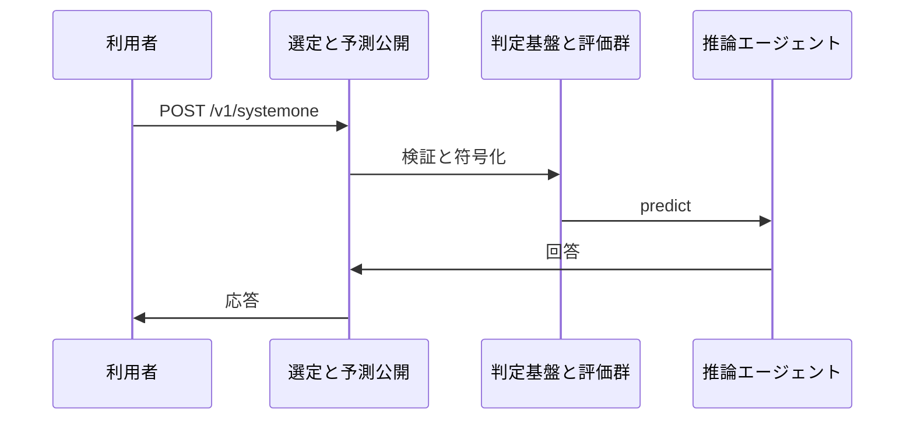
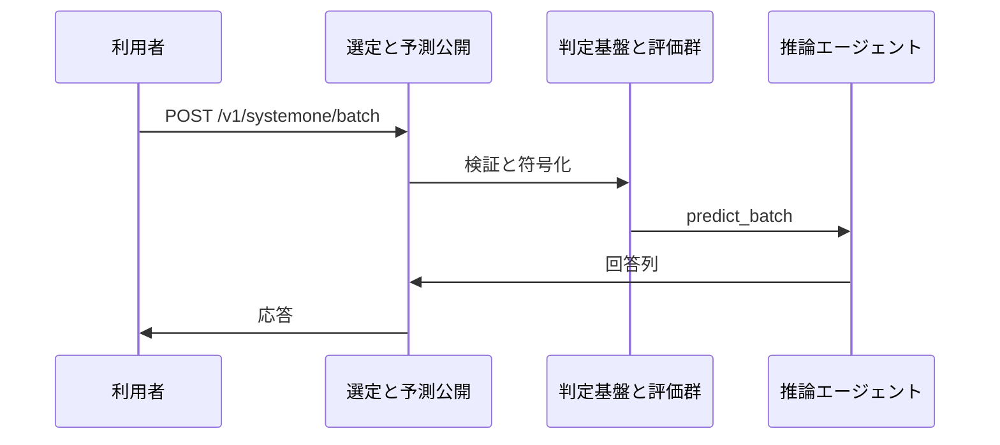
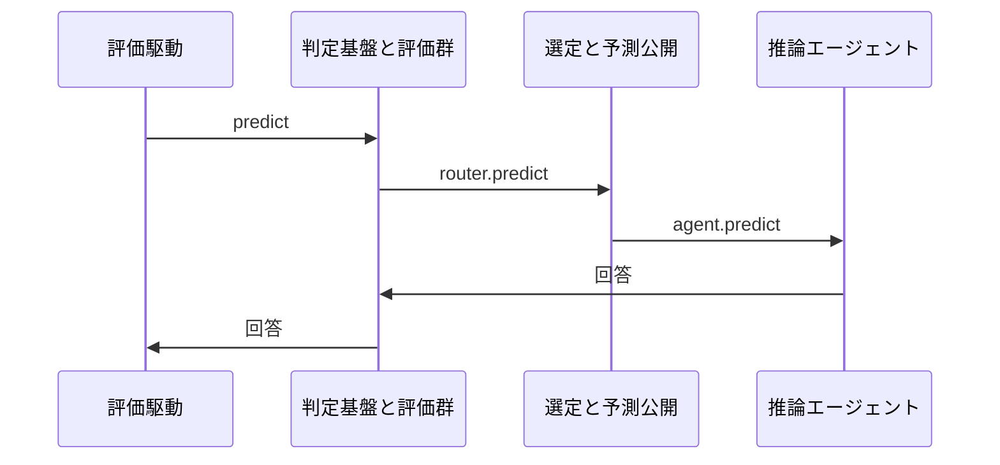

# 3. 主要な流れ <!-- b_trwypyc9 -->

いずれの流れも `state` と `questions` を受けて `predict` で型付き回答を得る構成である（[evals\_cli.py:30-35](../../laya/evals_cli.py#L30-L35)）。
HTTP 公開では `systemone` と `systemone_batch` が `_check_auth` と `_admit` を経て内部処理に渡す（[serve.py:1044-1048](../../laya/serve.py#L1044-L1048)、[serve.py:1130-1134](../../laya/serve.py#L1130-L1134)）。
実行の裏では `load` が `key` 単位に `Agent` を共有し再利用する（[router.py:692-702](../../laya/router.py#L692-L702)）。 <!-- b_zerw4sq4 -->

## 3.1 単一判定の提供 <!-- b_8c5k5af2 -->

POST `/v1/systemone` を `systemone` が受け、`_check_auth` と `_admit` を経て `_systemone_inner` が処理する（[serve.py:1044-1048](../../laya/serve.py#L1044-L1048)）。`_systemone_inner` は `state` と `questions` を取り出し、`router.predict` で推論した結果を返す（[serve.py:1050-1058](../../laya/serve.py#L1050-L1058)、[serve.py:1098-1101](../../laya/serve.py#L1098-L1101)）。推論は単一ワーカーの `ThreadPoolExecutor` と `run_in_executor` でイベントループ外に逃がす（[serve.py:880-887](../../laya/serve.py#L880-L887)、[serve.py:1100-1101](../../laya/serve.py#L1100-L1101)）。 <!-- b_2dc9twkm -->

単一判定が入口から回答まで進む順序を示す。

<!-- b_yt7jv7pz -->

### 手順 <!-- b_fmtpd6gn -->

1. `systemone` が POST を受け、`_check_auth` で bearer を確かめる（[serve.py:1044-1046](../../laya/serve.py#L1044-L1046)、[serve.py:974-976](../../laya/serve.py#L974-L976)）。
2. `_admit` が同時実行枠を取り、空きがなければ 503 で断る（[serve.py:1026-1037](../../laya/serve.py#L1026-L1037)）。
3. `_systemone_inner` が `state` と `questions` を読み、制限と孤立サロゲートを検査する（[serve.py:1050-1067](../../laya/serve.py#L1050-L1067)）。
4. `_resolve_model` で対象を決め、`max_len` と `head_max_len` を検証する（[serve.py:1068-1071](../../laya/serve.py#L1068-L1071)）。
5. `run_in_executor` で `router.predict` を実行し、結果を返す（[serve.py:1098-1102](../../laya/serve.py#L1098-L1102)）。 <!-- b_gvb6v2xr -->

### 例外と境界 <!-- b_fspw5p7v -->

- `_check_auth` が失敗すると 401 で拒む（[serve.py:974-976](../../laya/serve.py#L974-L976)）。
- `admission` が埋まっていると 503 と `Retry-After` で断る（[serve.py:1031-1037](../../laya/serve.py#L1031-L1037)）。
- `questions` がなければ 400 で拒む（[serve.py:1054-1055](../../laya/serve.py#L1054-L1055)）。
- `_has_lone_surrogate` が真なら 400 で拒む（[serve.py:1066-1067](../../laya/serve.py#L1066-L1067)）。 <!-- b_0069r9qf -->

## 3.2 複数判定の一括提供 <!-- b_ekpnd9xz -->

POST `/v1/systemone/batch` を `systemone_batch` が受け、`_check_auth` と `_admit` を経て `_systemone_batch_inner` が処理する（[serve.py:1130-1134](../../laya/serve.py#L1130-L1134)）。`_systemone_batch_inner` は `states` と `questions` を取り出し、制限と孤立サロゲートを検査する（[serve.py:1136-1159](../../laya/serve.py#L1136-L1159)）。`predict_batch` があれば一括で、なければ `predict` の繰返しで答える（[serve.py:1222-1230](../../laya/serve.py#L1222-L1230)）。 <!-- b_d606rx0y -->

一括判定が入口から回答まで進む順序を示す。

<!-- b_xtpgf2m0 -->

### 手順 <!-- b_pw3nfc0z -->

1. `systemone_batch` が POST を受け、`_check_auth` で bearer を確かめる（[serve.py:1130-1132](../../laya/serve.py#L1130-L1132)、[serve.py:974-976](../../laya/serve.py#L974-L976)）。
2. `_admit` が同時実行枠を取り、空きがなければ 503 で断る（[serve.py:1026-1037](../../laya/serve.py#L1026-L1037)）。
3. `_systemone_batch_inner` が `states` と `questions` を読み、制限と孤立サロゲートを検査する（[serve.py:1136-1159](../../laya/serve.py#L1136-L1159)）。
4. `predict_batch` があれば一括で、なければ `predict` の繰返しで答える（[serve.py:1222-1230](../../laya/serve.py#L1222-L1230)）。 <!-- b_hbf54bk7 -->

## 3.3 評価ハーネスの予測 <!-- b_gdaa2e54 -->

`predict` は `state` と `questions` を受け、`min_confidence` 指定時だけ閾値付きで `router` に渡す（[evals\_cli.py:30-35](../../laya/evals_cli.py#L30-L35)）。
`predict_batch` はリクエスト列を組み立てて `batch_size` と `sort_by_length` 付きで `router` の一括予測に渡す（[evals\_cli.py:37-45](../../laya/evals_cli.py#L37-L45)）。
単一実行では `_check_model` で対象を確かめて `agent` の `predict` に渡す（[evals\_cli.py:66-71](../../laya/evals_cli.py#L66-L71)）。 <!-- b_t8vmj2rb -->

評価予測がランナーから選定と実行へ進む順序を示す。

<!-- b_1jk2804h -->

### 手順 <!-- b_dhq2z5gt -->

1. `predict` は `min_confidence` ありなら閾値付きで `router` の `predict` を呼ぶ（[evals\_cli.py:30-35](../../laya/evals_cli.py#L30-L35)）。
2. `predict_batch` は `state` 列から `requests` を作り `batch_size` 付きで `router` に渡す（[evals\_cli.py:37-45](../../laya/evals_cli.py#L37-L45)）。
3. ONNX 単発では `_check_model` で `model` を確かめ `agent` の `predict` に渡す（[evals\_cli.py:66-71](../../laya/evals_cli.py#L66-L71)）。
4. `predict_batch` は `_check_model` の後に `agent` の `predict_batch` 有無を見て分岐する（[evals\_cli.py:73-82](../../laya/evals_cli.py#L73-L82)）。
5. `sort_by_length` 指定時は `agent_batch` に委ね、未対応時は `predict` を繰り返す（[evals\_cli.py:83-89](../../laya/evals_cli.py#L83-L89)）。 <!-- b_7q45nyzk -->

### 例外と境界 <!-- b_2k2ka18m -->

- `sort_by_length` 要求は `agent_batch` がなければ満たせず、注釈どおり単発繰返しでは順序付けできない（[evals\_cli.py:83-86](../../laya/evals_cli.py#L83-L86)）。
- `predict_batch` 対応を持たない `agent` では `predict` を順に呼ぶ縮退路に落ちる（[evals\_cli.py:78-82](../../laya/evals_cli.py#L78-L82)、[evals\_cli.py:88-89](../../laya/evals_cli.py#L88-L89)）。
- `min_confidence` 未指定時は `extra` を空にして閾値なしで呼び分ける（[evals\_cli.py:79-81](../../laya/evals_cli.py#L79-L81)）。 <!-- b_yjmmkkh8 -->
