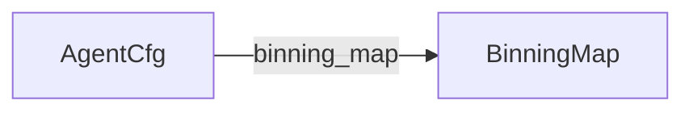

# 7. データモデル <!-- b_9wnqba9f -->

**主要な型（コードの宣言から読み取った 0 tok の一覧）**
| 型 | 種類 | 定義 | フィールド | 持っている型 | 使うファイル |
|---|---|---|---|---|---|
| `HookArg` | type | `laya-ts/src/hooks.ts:80` | — | — | 3 |
| `QuestionDef` | interface | `laya-ts/src/agent.ts:39` | 3 | — | 5 |
| `Router` | class | `laya/router.py:477` | 7 | — | 11 |
| `PredictHook` | type | `laya-ts/src/hooks.ts:79` | — | — | 3 |
| `LangGuess` | type | `laya-ts/src/router.ts:114` | — | — | 0 |
| `JsonValue` | type | `sdk/typescript/src/types.ts:2` | — | — | 0 |
| `OptionStats` | interface | `laya-ts/src/common.ts:68` | 3 | — | 2 |
| `BinningMap` | type | `laya-ts/src/common.ts:364` | — | — | 2 |
| `TokenizerLike` | interface | `laya-ts/src/tokenizer.ts:1` | 5 | — | 3 |
| `ActionInfo` | interface | `laya-ts/src/agent.ts:46` | 1 | — | 1 |
| `MinConfidence` | type | `laya-ts/src/common.ts:242` | — | — | 3 |
| `AgentCfg` | interface | `laya-ts/src/agent.ts:103` | 5 | `binning_map` → `BinningMap` | 1 |
<!-- b_5x2h8102 -->

<!-- b_g2qmrxk9 -->

- スキーマ（テーブル・モデル）は検出されませんでした。
<!-- b_qc60gv3f -->
