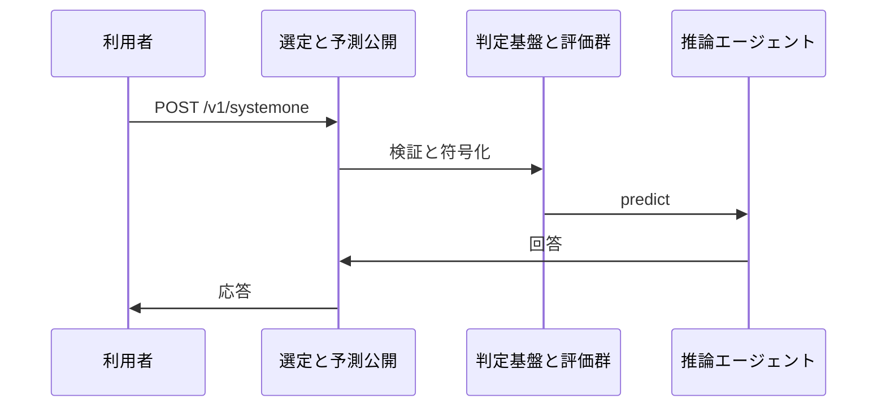
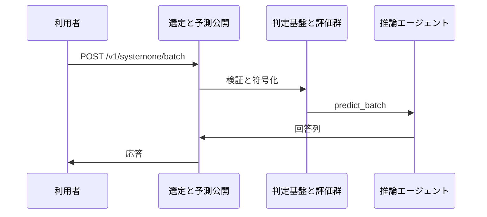
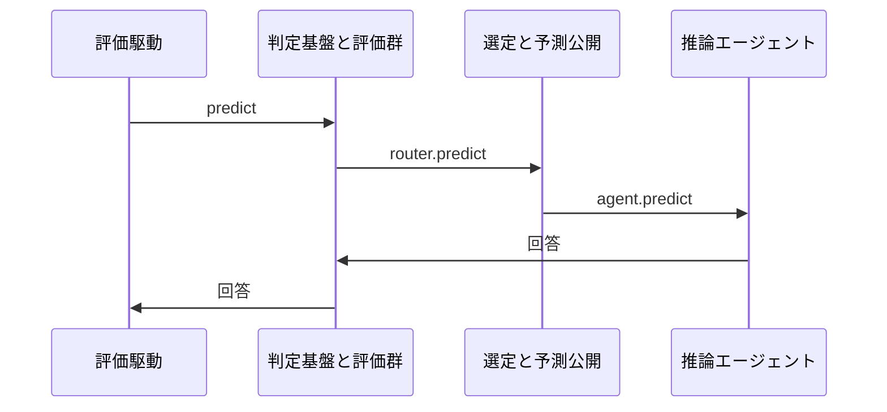

# 3. 主要な流れ <!-- b_trwypyc9 -->

いずれの流れも `state` と `questions` を受けて `predict` で型付き回答を得る構成である（[evals\_cli.py:30-35](../../laya/evals_cli.py#L30-L35)）。
HTTP 公開では `systemone` と `systemone_batch` が `_check_auth` と `_admit` を経て内部処理に渡す（[serve.py:1044-1048](../../laya/serve.py#L1044-L1048)、[serve.py:1130-1134](../../laya/serve.py#L1130-L1134)）。
実行の裏では `load` が `key` 単位に `Agent` を共有し再利用する（[router.py:692-702](../../laya/router.py#L692-L702)）。 <!-- b_zerw4sq4 -->

## 3.1 単一判定の提供 <!-- b_8c5k5af2 -->

`/v1/systemone` への POST は `systemone` が受け、`_check_auth` と `_admit` を経て `_systemone_inner` に渡す（[serve.py:1044-1048](../../laya/serve.py#L1044-L1048)）。
その先の選定と回答は `Router` と `Agent` の層で実行される（推測）。 <!-- b_2dc9twkm -->

単一判定が入口から回答まで進む順序を示す。

<!-- b_yt7jv7pz -->

### 手順 <!-- b_fmtpd6gn -->

1. `/v1/systemone` への POST を `systemone` が受け、`_check_auth` で認証を確認する（[serve.py:1044-1046](../../laya/serve.py#L1044-L1046)）。
2. `_admit` で同時実行枠に入り、`_systemone_inner` にリクエストを委譲する（[serve.py:1047-1048](../../laya/serve.py#L1047-L1048)）。
3. 担当準備では `load` が `normalise_name` で `key` を求め、`_agents` 済みなら `_touch` して返す（[router.py:692-702](../../laya/router.py#L692-L702)）。
4. 未登録なら `_build` で組み立てて `_agents` に格納し、`_evict_locked` で上限を保つ（[router.py:725-734](../../laya/router.py#L725-L734)）。
5. `on_evict` と `on_load` のライフサイクルを錠解除後に `PredictContext` 付きで送出する（[router.py:746-750](../../laya/router.py#L746-L750)）。 <!-- b_gvb6v2xr -->

### 例外と境界 <!-- b_fspw5p7v -->

- 生成待ち中に先行者が失敗すると `inflight` の `error` が呼び出し元に伝わる（[router.py:708-710](../../laya/router.py#L708-L710)）。
- 生成自体が例外で終わると `_loading` から除去して `error` を設定し再送出する（[router.py:738-744](../../laya/router.py#L738-L744)）。
- 錠待ちや生成中に他者が登録済みならそちらを `_touch` して使い、重複を作らない（[router.py:716-724](../../laya/router.py#L716-L724)、[router.py:727-729](../../laya/router.py#L727-L729)）。 <!-- b_0069r9qf -->

## 3.2 複数判定の一括提供 <!-- b_ekpnd9xz -->

`/v1/systemone/batch` への POST は `systemone_batch` が受け、`_check_auth` と `_admit` を経て `_systemone_batch_inner` に渡す（[serve.py:1130-1134](../../laya/serve.py#L1130-L1134)）。
その先の一括選定と回答は `Router` と `Agent` の層で実行される（推測）。 <!-- b_d606rx0y -->

一括判定が入口から回答まで進む順序を示す。

<!-- b_xtpgf2m0 -->

### 手順 <!-- b_pw3nfc0z -->

1. `/v1/systemone/batch` への POST を `systemone_batch` が受け、`_check_auth` で認証を確認する（[serve.py:1130-1132](../../laya/serve.py#L1130-L1132)）。
2. `_admit` で同時実行枠に入り、`_systemone_batch_inner` にリクエストを委譲する（[serve.py:1133-1134](../../laya/serve.py#L1133-L1134)）。
3. 担当準備では `load` が `normalise_name` で `key` を求め、`_agents` 済みなら `_touch` して返す（[router.py:692-702](../../laya/router.py#L692-L702)）。
4. 未登録なら `_build` で組み立てて `_agents` に格納し、`_evict_locked` で上限を保つ（[router.py:725-734](../../laya/router.py#L725-L734)）。
5. `on_evict` と `on_load` のライフサイクルを錠解除後に `PredictContext` 付きで送出する（[router.py:746-750](../../laya/router.py#L746-L750)）。 <!-- b_hbf54bk7 -->

## 3.3 評価ハーネスの予測 <!-- b_gdaa2e54 -->

`predict` は `state` と `questions` を受け、`min_confidence` 指定時だけ閾値付きで `router` に渡す（[evals\_cli.py:30-35](../../laya/evals_cli.py#L30-L35)）。
`predict_batch` はリクエスト列を組み立てて `batch_size` と `sort_by_length` 付きで `router` の一括予測に渡す（[evals\_cli.py:37-45](../../laya/evals_cli.py#L37-L45)）。
単一実行では `_check_model` で対象を確かめて `agent` の `predict` に渡す（[evals\_cli.py:66-71](../../laya/evals_cli.py#L66-L71)）。 <!-- b_t8vmj2rb -->

評価予測がランナーから選定と実行へ進む順序を示す。

<!-- b_1jk2804h -->

### 手順 <!-- b_dhq2z5gt -->

1. `predict` は `min_confidence` ありなら閾値付きで `router` の `predict` を呼ぶ（[evals\_cli.py:30-35](../../laya/evals_cli.py#L30-L35)）。
2. `predict_batch` は `state` 列から `requests` を作り `batch_size` 付きで `router` に渡す（[evals\_cli.py:37-45](../../laya/evals_cli.py#L37-L45)）。
3. ONNX 単発では `_check_model` で `model` を確かめ `agent` の `predict` に渡す（[evals\_cli.py:66-71](../../laya/evals_cli.py#L66-L71)）。
4. `predict_batch` は `_check_model` の後に `agent` の `predict_batch` 有無を見て分岐する（[evals\_cli.py:73-82](../../laya/evals_cli.py#L73-L82)）。
5. `sort_by_length` 指定時は `agent_batch` に委ね、未対応時は `predict` を繰り返す（[evals\_cli.py:83-89](../../laya/evals_cli.py#L83-L89)）。 <!-- b_7q45nyzk -->

### 例外と境界 <!-- b_2k2ka18m -->

- `sort_by_length` 要求は `agent_batch` がなければ満たせず、注釈どおり単発繰返しでは順序付けできない（[evals\_cli.py:83-86](../../laya/evals_cli.py#L83-L86)）。
- `predict_batch` 対応を持たない `agent` では `predict` を順に呼ぶ縮退路に落ちる（[evals\_cli.py:78-82](../../laya/evals_cli.py#L78-L82)、[evals\_cli.py:88-89](../../laya/evals_cli.py#L88-L89)）。
- `min_confidence` 未指定時は `extra` を空にして閾値なしで呼び分ける（[evals\_cli.py:79-81](../../laya/evals_cli.py#L79-L81)）。 <!-- b_yjmmkkh8 -->
