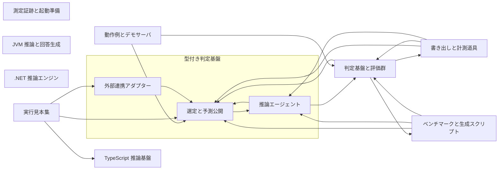

# 2. 間取り図 <!-- b_scty1h80 -->

配置図は中央の判定基盤と周囲の移植と道具の依存を矢印で示す（推測）。中央では `Router` が担当を選び `Agent` に渡して回答を返す（[router.py:477](../../laya/router.py#L477)、[agent.py:449](../../laya/agent.py#L449)）。周囲には `laya-ts` と JVM と .NET の推論移植が並ぶ（[README.md:1-3](../../laya-ts/README.md#L1-L3)、[README.md:3-4](../../laya-java/README.md#L3-L4)、[README.md:3-5](../../laya-dotnet/README.md#L3-L5)）。評価群と書き出し道具が検証と計測を支える（[evals.py:262-267](../../laya/evals.py#L262-L267)、[export\_onnx.py:264](../../laya-dotnet/tools/export_onnx.py#L264)）。 <!-- b_ac1gzc99 -->

<!-- b_7ax39nbc -->
