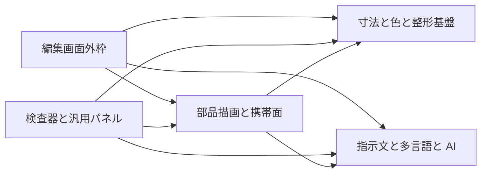

# 2. 間取り図 <!-- b_7qreqmaj -->

フロアプランは 5 つのまとまりを箱で示し、矢印の向きが依存の向き、太さが強さを表す（推測）。編集画面外枠は文書状態を保持して全体を組み立て、永続化と共有の出入口を集約する（[Editor.tsx:454-460](../../app/Editor.tsx#L454-L460)、[project.ts:80-81](../../lib/project.ts#L80-L81)、[share.ts:45-46](../../lib/share.ts#L45-L46)）。寸法と色と整形基盤は既定値と外形と配色の土台であり、指示文と多言語と AI は描画から指示文を作る（[tokens.ts:924](../../lib/tokens.ts#L924)、[color.ts:131](../../lib/color.ts#L131)、[prompt.ts:1745-1746](../../lib/prompt.ts#L1745-L1746)）。編集の要求は外枠から検査器と汎用パネルと部品描画と携帯面へ流れ、下位の土台と指示文生成に集まる（推測）。 <!-- b_yqm9tvwe -->

<!-- b_cqwfc4j9 -->
