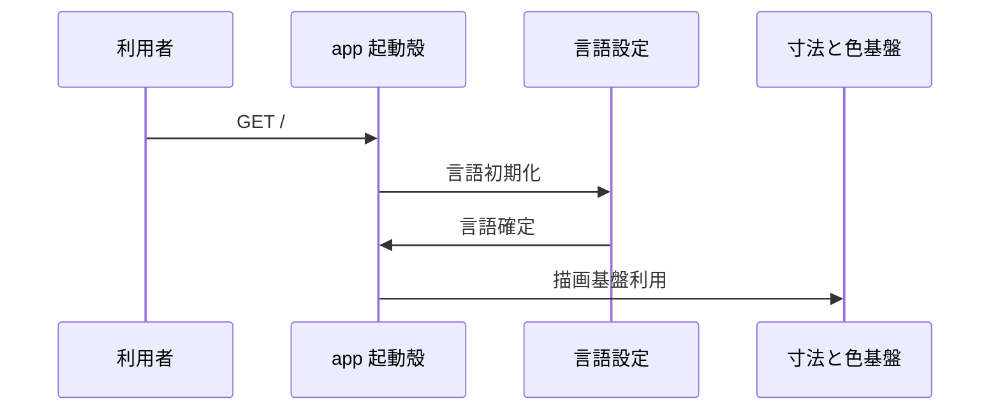

# 3. 主要な流れ <!-- b_vzv0xgqn -->

GET / の起動殻は `Page` である（[page.tsx:37](../../app/page.tsx#L37)）。言語を確定して `Editor` を出し、準備完了で `Boot` を消す（[page.tsx:40-55](../../app/page.tsx#L40-L55)）。 <!-- b_cmvzp5f3 -->

## 3.1 起動表示 <!-- b_8pq0q7sc -->

初回表示で `Page` は言語を決めて `lang` に保持する（[page.tsx:37-44](../../app/page.tsx#L37-L44)）。`lang` が決まると `Editor` を載せ、`onReady` で `fading` へ進める（[page.tsx:51-54](../../app/page.tsx#L51-L54)）。`fading` から一定時間後に `done` へ進み、`Boot` を外す（[page.tsx:46-54](../../app/page.tsx#L46-L54)）。 <!-- b_vr4bjbbt -->

起動から言語確定と編集画面表示までの順序である。

<!-- b_9dsvnvbf -->

### 手順 <!-- b_mnvtsagz -->

1. `loading` で `Page` が起動し、`initialLanguage` で初期言語を求める（[page.tsx:37-42](../../app/page.tsx#L37-L42)）。
2. `document.documentElement.lang` と `setGlobalLang` で反映し、`lang` に保持する（[page.tsx:38-44](../../app/page.tsx#L38-L44)）。
3. `lang` が決まると `Editor` を載せ、`onReady` で `fading` へ進める（[page.tsx:51-54](../../app/page.tsx#L51-L54)）。
4. `fading` から一定時間後に `done` へ進み、`Boot` を外して `Editor` のみ残す（[page.tsx:46-54](../../app/page.tsx#L46-L54)）。 <!-- b_s2a2j79p -->

### 例外と境界 <!-- b_z440cvac -->

- `lang` が `null` の間は `Editor` を出さず、`Boot` のみ表示する（[page.tsx:38-39](../../app/page.tsx#L38-L39)、[page.tsx:51-54](../../app/page.tsx#L51-L54)）。
- `phase` が `fading` 以外ではタイマーを作らず、`done` 遷移は起きない（[page.tsx:46-50](../../app/page.tsx#L46-L50)）。 <!-- b_y09z55k0 -->
