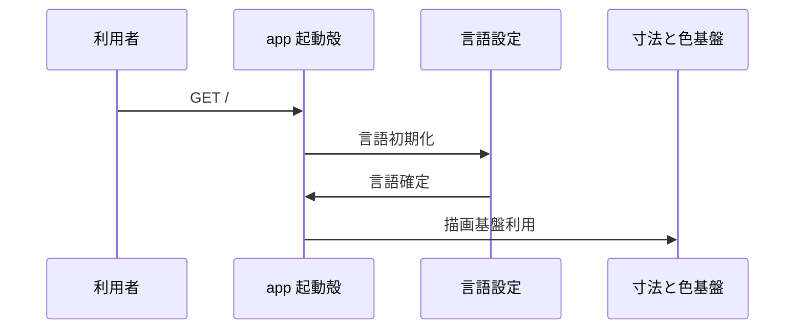
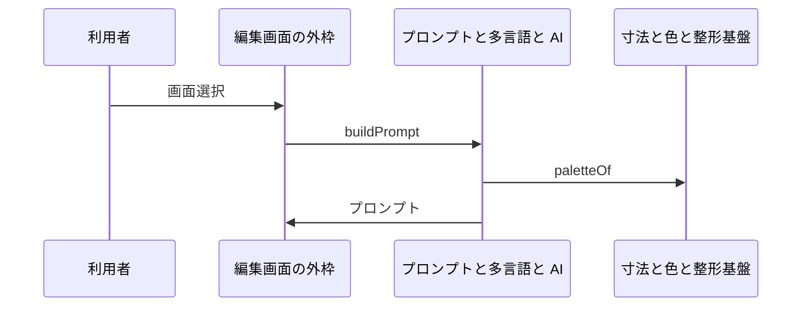
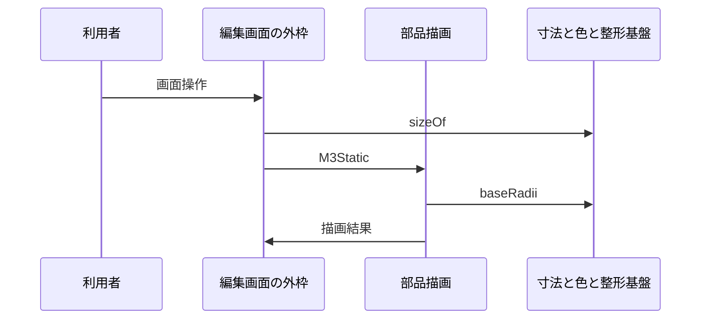

# 3. 主要な流れ <!-- b_vzv0xgqn -->

`Page` は GET / の起動殻であり、言語確定後に `Editor` を表示する（[page.tsx:37-57](../../app/page.tsx#L37-L57)）。起動後の流れはいずれも `Editor` が保持する `groups` と `frames` を起点とし、`M3Static` による描画と `buildPrompt` による文章化に分かれる（[Editor.tsx:454-465](../../app/Editor.tsx#L454-L465)、[Editor.tsx:3095-3101](../../app/Editor.tsx#L3095-L3101)、[Editor.tsx:4675-4681](../../app/Editor.tsx#L4675-L4681)）。 <!-- b_cmvzp5f3 -->

## 3.1 起動表示 <!-- b_8pq0q7sc -->

初回表示で `Page` は言語を決めて `lang` に保持する（[page.tsx:37-44](../../app/page.tsx#L37-L44)）。`lang` が決まると `Editor` を載せ、`onReady` で `fading` へ進める（[page.tsx:51-54](../../app/page.tsx#L51-L54)）。`fading` から一定時間後に `done` へ進み、`Boot` を外す（[page.tsx:46-54](../../app/page.tsx#L46-L54)）。 <!-- b_vr4bjbbt -->

起動から言語確定と編集画面表示までの順序である。

<!-- b_9dsvnvbf -->

### 手順 <!-- b_mnvtsagz -->

1. `loading` で `Page` が起動し、`initialLanguage` で初期言語を求める（[page.tsx:37-42](../../app/page.tsx#L37-L42)）。
2. `document.documentElement.lang` と `setGlobalLang` で反映し、`lang` に保持する（[page.tsx:38-44](../../app/page.tsx#L38-L44)）。
3. `lang` が決まると `Editor` を載せ、`onReady` で `fading` へ進める（[page.tsx:51-54](../../app/page.tsx#L51-L54)）。
4. `fading` から一定時間後に `done` へ進み、`Boot` を外して `Editor` のみ残す（[page.tsx:46-54](../../app/page.tsx#L46-L54)）。 <!-- b_s2a2j79p -->

### 例外と境界 <!-- b_z440cvac -->

- `lang` が `null` の間は `Editor` を出さず、`Boot` のみ表示する（[page.tsx:38-39](../../app/page.tsx#L38-L39)、[page.tsx:51-54](../../app/page.tsx#L51-L54)）。
- `phase` が `fading` 以外ではタイマーを作らず、`done` 遷移は起きない（[page.tsx:46-50](../../app/page.tsx#L46-L50)）。 <!-- b_y09z55k0 -->

## 3.2 プロンプト生成 <!-- b_fdh6ghj2 -->

`buildPrompt` は `Doc` と `widths` と対象画面を受けてプロンプトを組み立てる（[prompt.ts:1745-1753](../../lib/prompt.ts#L1745-L1753)）。内部では `paletteOf` で求めた明暗の配色とテーマと画面配置を順に文章化する（[prompt.ts:1798-1804](../../lib/prompt.ts#L1798-L1804)、[prompt.ts:1807-1813](../../lib/prompt.ts#L1807-L1813)、[prompt.ts:1818-1825](../../lib/prompt.ts#L1818-L1825)）。`Editor` は画面ごとのプロンプトを `buildPrompt` で求め、全文を `effectivePrompt` で複写する（[Editor.tsx:454-460](../../app/Editor.tsx#L454-L460)、[Editor.tsx:4675-4681](../../app/Editor.tsx#L4675-L4681)、[Editor.tsx:4462-4468](../../app/Editor.tsx#L4462-L4468)）。 <!-- b_nf0ayc79 -->

プロンプト生成の呼び出し順序である。

<!-- b_04zj7fam -->

### 手順 <!-- b_e7wmtj1r -->

1. `Editor` の画面欄は `buildPrompt` に `selectedFrame.id` を渡す（[Editor.tsx:454-460](../../app/Editor.tsx#L454-L460)、[Editor.tsx:4675-4681](../../app/Editor.tsx#L4675-L4681)）。
2. `buildPrompt` は `constrainModalRails` で `groups` を整え、対象画面だけに絞る（[prompt.ts:1745-1759](../../lib/prompt.ts#L1745-L1759)）。
3. `buildPrompt` は配色とテーマと画面記述を `lines` に積んで返す（[prompt.ts:1745-1746](../../lib/prompt.ts#L1745-L1746)、[prompt.ts:1798-1804](../../lib/prompt.ts#L1798-L1804)、[prompt.ts:1807-1813](../../lib/prompt.ts#L1807-L1813)、[prompt.ts:1818-1825](../../lib/prompt.ts#L1818-L1825)）。
4. 全文複写では `effectivePrompt` の結果をクリップボードに書く（[Editor.tsx:4462-4468](../../app/Editor.tsx#L4462-L4468)）。 <!-- b_t6dv00mh -->

### 例外と境界 <!-- b_mfzbc3j7 -->

- `onlyFrameId` が無い場合、`buildPrompt` は全画面を対象にする（[prompt.ts:1745-1754](../../lib/prompt.ts#L1745-L1754)）。
- `phone` でない文書では対象画面は空になる（[prompt.ts:1749-1754](../../lib/prompt.ts#L1749-L1754)）。
- 画面の `f.note` がある場合、言語に応じた句点を付けて添える（[prompt.ts:1818-1825](../../lib/prompt.ts#L1818-L1825)）。 <!-- b_5gz4jx75 -->

## 3.3 部品描画 <!-- b_t7b2f74q -->

`Editor` は出力時に `M3Static` を並べ、計測表示には `MeasuredContent` を使う（[Editor.tsx:454-460](../../app/Editor.tsx#L454-L460)、[Editor.tsx:3095-3101](../../app/Editor.tsx#L3095-L3101)、[Editor.tsx:3839-3845](../../app/Editor.tsx#L3839-L3845)）。`sizeOf` と `baseRadii` が外形と角丸を決め、`MeasuredContent` が種別ごとの中身を描き分ける（[tokens.ts:2448-2456](../../lib/tokens.ts#L2448-L2456)、[tokens.ts:2530-2536](../../lib/tokens.ts#L2530-L2536)、[M3Node.tsx:629-638](../../components/M3Node.tsx#L629-L638)）。押下時の `add` は `rippleSize` で波紋の大きさを決めて一覧に積む（[M3Node.tsx:196-207](../../components/M3Node.tsx#L196-L207)）。 <!-- b_ryr4g8dw -->

部品描画の呼び出し順序である。

<!-- b_bjs4wgy5 -->

### 手順 <!-- b_2h6c1aya -->

1. `Editor` は文書から配置を求め、出力時に `M3Static` を並べる（[Editor.tsx:454-460](../../app/Editor.tsx#L454-L460)、[Editor.tsx:3095-3101](../../app/Editor.tsx#L3095-L3101)）。
2. 寸法が必要な場面では `sizeOf` で幅と高さを求める（[tokens.ts:2448-2456](../../lib/tokens.ts#L2448-L2456)、[Editor.tsx:953-959](../../app/Editor.tsx#L953-L959)）。
3. 角丸は `baseRadii` で種別ごとに求める（[tokens.ts:2530-2536](../../lib/tokens.ts#L2530-L2536)、[Editor.tsx:3095-3099](../../app/Editor.tsx#L3095-L3099)）。
4. 中身は `MeasuredContent` が種別で描き分ける（[M3Node.tsx:629-638](../../components/M3Node.tsx#L629-L638)、[Editor.tsx:3839-3845](../../app/Editor.tsx#L3839-L3845)）。
5. 押下では `add` が `rippleSize` で波紋を作る（[M3Node.tsx:196-207](../../components/M3Node.tsx#L196-L207)）。 <!-- b_k2jtzq83 -->

### 例外と境界 <!-- b_yjps9cph -->

- `menuOpen` の部品は `MeasuredContent` がメニュー内容を優先して返す（[M3Node.tsx:629-631](../../components/M3Node.tsx#L629-L631)）。
- マウスの右中クリックは `add` が無視する（[M3Node.tsx:196-200](../../components/M3Node.tsx#L196-L200)）。
- `topAppBar` は幅が `PHONE_W` より広い場合に状態欄分を足さない（[tokens.ts:2489-2492](../../lib/tokens.ts#L2489-L2492)）。 <!-- b_v242hej9 -->
