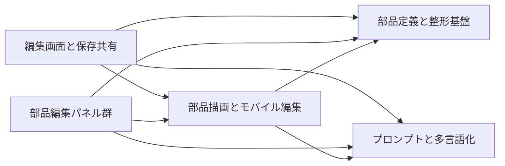

# 2. 間取り図 <!-- b_m3x1eyvg -->

配置図は依存の向きを矢印で示し、上から下に読む（推測）。主な部品は編集画面と保存共有、部品定義と整形基盤、プロンプトと多言語化、部品描画とモバイル編集、部品編集パネル群である（[page.tsx:8-17](../../app/page.tsx#L8-L17)、[tokens.ts:920-924](../../lib/tokens.ts#L920-L924)、[prompt.ts:1745-1746](../../lib/prompt.ts#L1745-L1746)、[M3Node.tsx:1939-1946](../../components/M3Node.tsx#L1939-L1946)）。編集状態は上から下へ渡り、描画や整形やプロンプト生成の下位機能が結果を返す（推測）。 <!-- b_3p8cp08p -->

<!-- b_8k65vbep -->
