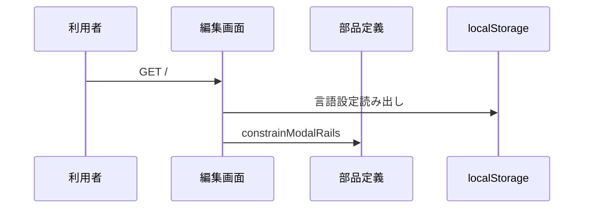
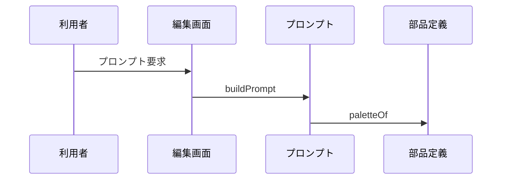
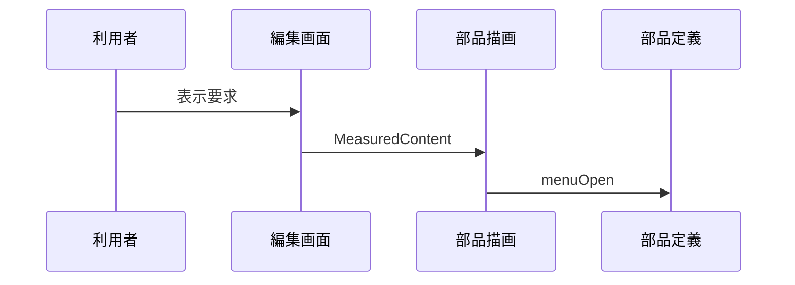

# 3. 主要な流れ <!-- b_eezpsjfk -->

`Page` は言語を確定して `Editor` を描画し、準備完了まで `Boot` で画面を覆う（[page.tsx:37-57](../../app/page.tsx#L37-L57)、[page.tsx:25-32](../../app/page.tsx#L25-L32)）。
`Editor` は `seed` から初期の `groups` と `frames` を得て編集の起点とする（[Editor.tsx:454-465](../../app/Editor.tsx#L454-L465)、[Editor.tsx:349-353](../../app/Editor.tsx#L349-L353)）。
`sizeOf` と `buildPrompt` と `MeasuredContent` が文書や部品を受けて寸法と文章と描画を担う（[tokens.ts:2448-2451](../../lib/tokens.ts#L2448-L2451)、[prompt.ts:1745-1748](../../lib/prompt.ts#L1745-L1748)、[M3Node.tsx:629-632](../../components/M3Node.tsx#L629-L632)）。 <!-- b_gzbap5fb -->

## 3.1 エディター起動と初期表示 <!-- b_c0s15kez -->

`initialLanguage` で保存言語かブラウザ言語を選び、`Page` が `Editor` と `Boot` を描画する（[page.tsx:25-32](../../app/page.tsx#L25-L32)、[page.tsx:37-57](../../app/page.tsx#L37-L57)）。
`Editor` は `seed` による `groups` と `SEED_FRAMES` による `frames` で初期文書を作る（[Editor.tsx:454-465](../../app/Editor.tsx#L454-L465)）。
初回描画では `fitRef` と `setViewReady` で位置合わせの完了後に表示を有効にする（[Editor.tsx:870-876](../../app/Editor.tsx#L870-L876)）。 <!-- b_aykfces0 -->

起動から初期キャンバス表示までの流れを示す。

<!-- b_0b10n803 -->

### 手順 <!-- b_pgaz3fpg -->

1. `initialLanguage` は保存済み設定かブラウザ言語から初期言語を選ぶ（[page.tsx:25-32](../../app/page.tsx#L25-L32)）。
2. `Page` は初期言語を `setGlobalLang` に反映し、`Editor` と `Boot` を描画する（[page.tsx:37-44](../../app/page.tsx#L37-L44)、[page.tsx:51-54](../../app/page.tsx#L51-L54)）。
3. `Boot` は `Skeleton` を重ねて準備中の表示とする（[page.tsx:17-23](../../app/page.tsx#L17-L23)）。
4. `seed` は `topAppBar` や `button` や `listItem` を組み立てて初期配置を作る（[Editor.tsx:349-356](../../app/Editor.tsx#L349-L356)、[Editor.tsx:362-368](../../app/Editor.tsx#L362-L368)）。
5. `Editor` は `setGroups` で `constrainModalRails` を通して更新を正規化する（[Editor.tsx:454-464](../../app/Editor.tsx#L454-L464)）。
6. `sizeOf` は `kind` に応じて `buttonHeightOf` や `chipHeightOf` などを使い幅と高さを返す（[tokens.ts:2448-2463](../../lib/tokens.ts#L2448-L2463)）。 <!-- b_7zxwy573 -->

### 例外と境界 <!-- b_qxemfsa1 -->

- `initialLanguage` は `localStorage` の解析に失敗しても例外を投げずブラウザ言語に進む（[page.tsx:25-32](../../app/page.tsx#L25-L32)）。
- `viewReady` は初回 `fitRef` の完了後に `setViewReady` で真になる（[Editor.tsx:524-526](../../app/Editor.tsx#L524-L526)、[Editor.tsx:870-876](../../app/Editor.tsx#L870-L876)）。 <!-- b_6yaynrxg -->

## 3.2 プロンプト生成 <!-- b_mdfdxv7e -->

`buildPrompt` は `Doc` と `widths` から LLM 向けのプロンプト文字列を組み立てる（[prompt.ts:1745-1748](../../lib/prompt.ts#L1745-L1748)）。
`paletteLines` と `themeLines` で配色と書体や形状の行を作る（[prompt.ts:1101-1110](../../lib/prompt.ts#L1101-L1110)、[prompt.ts:1417-1423](../../lib/prompt.ts#L1417-L1423)）。
`onlyFrameId` で対象画面を絞り、明暗の `paletteOf` 結果を両方書き出す場合がある（[prompt.ts:1752-1759](../../lib/prompt.ts#L1752-L1759)、[prompt.ts:1798-1806](../../lib/prompt.ts#L1798-L1806)）。 <!-- b_2emfrmj9 -->

文書からプロンプト文字列ができるまでの流れを示す。

<!-- b_hfsm8yd3 -->

### 手順 <!-- b_v404kq5d -->

1. `buildPrompt` は `constrainModalRails` と `normalizeTheme` と `paletteOf` で文書を正規化する（[prompt.ts:1745-1748](../../lib/prompt.ts#L1745-L1748)）。
2. `viewportOf` は画面一覧から表示種別を判定する（[prompt.ts:1505-1509](../../lib/prompt.ts#L1505-L1509)）。
3. `quote` は言語ごとに引用符の付け方を切り替える（[prompt.ts:166](../../lib/prompt.ts#L166)）。
4. `paletteLines` は主要な色トークンを行に並べて書き出す（[prompt.ts:1101-1110](../../lib/prompt.ts#L1101-L1110)）。
5. `themeLines` は形状と書体とモーションの行を作る（[prompt.ts:1417-1423](../../lib/prompt.ts#L1417-L1423)）。
6. 画面ごとに `screenHead` と `placement` と `describeScreen` で見出しと配置を書き出す（[prompt.ts:1818-1825](../../lib/prompt.ts#L1818-L1825)）。 <!-- b_c22r1tkq -->

### 例外と境界 <!-- b_e6043q5t -->

- `viewportOf` は電話画面がない場合に `free` や `desktop` を返す（[prompt.ts:1505-1509](../../lib/prompt.ts#L1505-L1509)）。
- `onlyFrameId` に一致がない場合に `frames` は全画面に戻る（[prompt.ts:1752-1753](../../lib/prompt.ts#L1752-L1753)）。 <!-- b_q6r6nhxx -->

## 3.3 部品描画 <!-- b_4aymsazp -->

`MeasuredContent` は `menuOpen` の有無と `kind` に応じて部品内容を切り替える（[M3Node.tsx:629-633](../../components/M3Node.tsx#L629-L633)）。
`Icon` はフォント合字で図形を描き、読み上げから隠す（[M3Node.tsx:81-84](../../components/M3Node.tsx#L81-L84)、[M3Node.tsx:94-100](../../components/M3Node.tsx#L94-L100)）。
メニュー付き部品は `SplitMenuContent` や `FabMenuContent` で展開表示を作る（[M3Node.tsx:527-530](../../components/M3Node.tsx#L527-L530)、[M3Node.tsx:726-729](../../components/M3Node.tsx#L726-L729)）。 <!-- b_58jgt77x -->

部品情報から画面表示ができるまでの流れを示す。

<!-- b_zd4vcg91 -->

### 手順 <!-- b_ewpewa8f -->

1. `MeasuredContent` は `menuOpen` の場合に `SplitMenuContent` か `FabMenuContent` を選ぶ（[M3Node.tsx:629-630](../../components/M3Node.tsx#L629-L630)）。
2. `kind` ごとに `ButtonContent` や `ChipContent` などの内容部品に振り分ける（[M3Node.tsx:631-637](../../components/M3Node.tsx#L631-L637)）。
3. `menuOpen` は `opensMenu` と `fabOpen` の両立で開状態を判定する（[tokens.ts:1856](../../lib/tokens.ts#L1856)）。
4. `Icon` は `size` と `color` と `weight` を受けて合字の図形を描く（[M3Node.tsx:81-86](../../components/M3Node.tsx#L81-L86)、[M3Node.tsx:94-109](../../components/M3Node.tsx#L94-L109)）。
5. `SplitMenuContent` は `transformOrigin` で開閉方向を定める（[M3Node.tsx:527-542](../../components/M3Node.tsx#L527-L542)）。
6. `FabMenuContent` は `grow` と `after` で大きさと遅延を決める（[M3Node.tsx:726-739](../../components/M3Node.tsx#L726-L739)）。
7. `sizeOf` と `menuHeight` と `buttonHeightOf` が描画に使う寸法を返す（[tokens.ts:2448-2458](../../lib/tokens.ts#L2448-L2458)）。 <!-- b_12twrc9w -->

### 例外と境界 <!-- b_ae2h1k7k -->

- `MeasuredContent` は対応 `kind` がない場合に `null` を返して何も描かない（[M3Node.tsx:629-631](../../components/M3Node.tsx#L629-L631)、[M3Node.tsx:650-652](../../components/M3Node.tsx#L650-L652)）。
- `reducedMotion` の場合にメニューの動きを `duration` 0 で無効にする（[M3Node.tsx:527-538](../../components/M3Node.tsx#L527-L538)）。 <!-- b_vz8th44a -->
