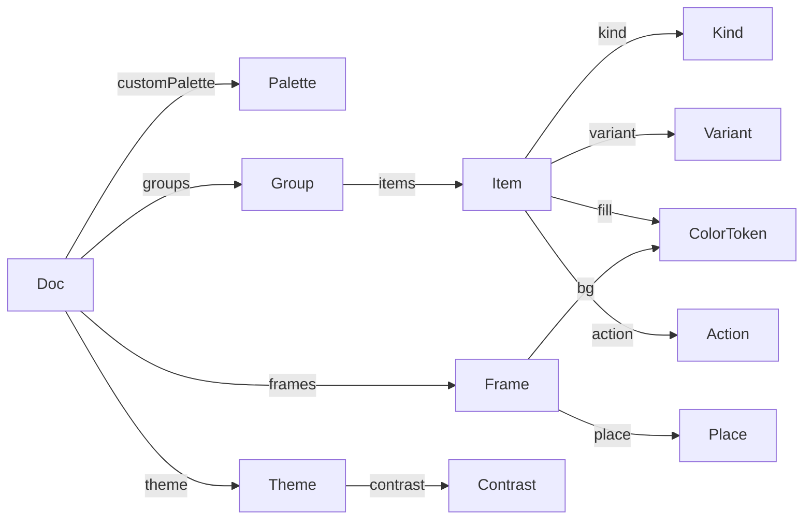

# 7. データモデル <!-- b_c3db2ntd -->

**主要な型（コードの宣言から読み取った 0 tok の一覧）**
| 型 | 種類 | 定義 | フィールド | 持っている型 | 使うファイル |
|---|---|---|---|---|---|
| `Palette` | type | `lib/tokens.ts:216` | 28 | — | 26 |
| `Item` | type | `lib/tokens.ts:1626` | 39 | `kind` → `Kind`・`variant` → `Variant`・`fill` → `ColorToken`・`action` → `Action` | 15 |
| `Frame` | type | `lib/tokens.ts:2117` | 11 | `bg` → `ColorToken`・`place` → `Place` | 13 |
| `Group` | type | `lib/tokens.ts:2317` | 8 | `items` → `Item` | 9 |
| `Variant` | type | `lib/tokens.ts:550` | — | — | 3 |
| `Doc` | type | `lib/tokens.ts:2340` | 12 | `groups` → `Group`・`frames` → `Frame`・`customPalette` → `Palette`・`theme` → `Theme` | 8 |
| `Theme` | type | `lib/tokens.ts:441` | 7 | `contrast` → `Contrast` | 6 |
| `Kind` | type | `lib/tokens.ts:581` | — | — | 8 |
| `Action` | type | `lib/tokens.ts:1752` | 3 | — | 7 |
| `ColorToken` | type | `lib/tokens.ts:1968` | — | — | 3 |
| `Contrast` | type | `lib/color.ts:85` | — | — | 2 |
| `Place` | type | `lib/tokens.ts:2137` | — | — | 5 |
<!-- b_ra69ew3f -->

<!-- b_4cbeyvp8 -->

- スキーマ（テーブル・モデル）は検出されませんでした。
<!-- b_qp3fj03w -->
