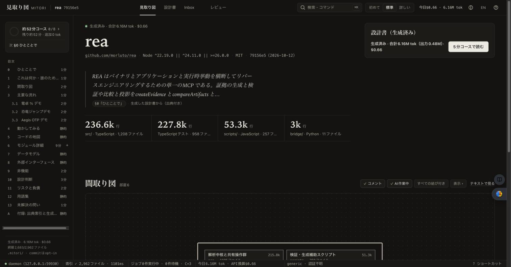
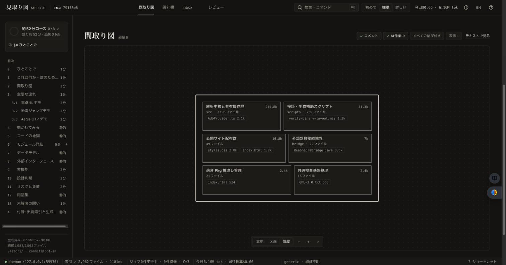
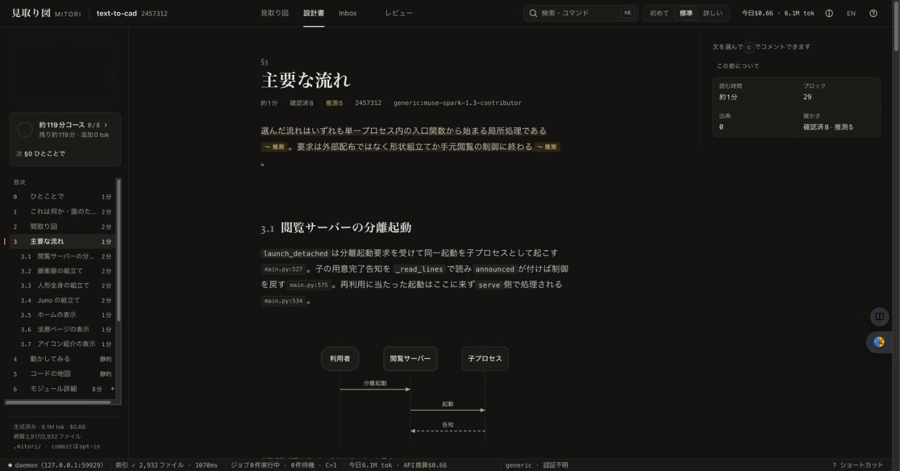
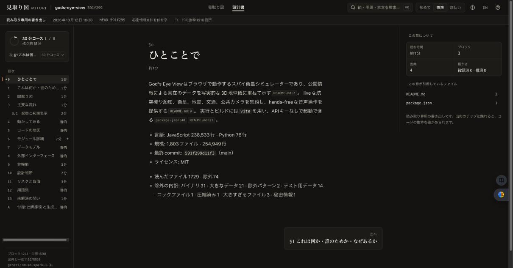

# トレンドOSS 3件での品質・UI確認（2026-10-12）

利用者の依頼「GitHubのトレンドに載っているリポジトリ3件で、Muse（muse-spark-1.3-contributor · high）を使って実行し、品質と利用者目線のUI/UXを確認する」の記録。見つかった問題はその場で直し、直せなかったものは残課題に書いた。

## 対象と条件

GitHub Trending（2026-10-12 取得、daily / weekly）から、mitori の対応言語で言語が分かれる3件を選んだ。

| リポジトリ | 位置づけ | 主言語 | 固定 SHA | ファイル |
|---|---|---|---|---|
| [morluto/rea](https://github.com/morluto/rea) | daily 1位（25,599★/日） | TypeScript | `79156e5bed1d` | 2,962 |
| [bilawalsidhu/gods-eye-view](https://github.com/bilawalsidhu/gods-eye-view) | daily 5位 | JavaScript | `591f299d11f3` | 1,803 |
| [earthtojake/text-to-cad](https://github.com/earthtojake/text-to-cad) | weekly | Python（+JS/TS） | `24573128ceaa` | 2,932 |

- エンジン: Muse native 1.4.6（`muse-bin-1.4.6-R6000.1`）、`muse-spark-1.3-contributor`、reasoning `high`、lean 起動（shell・書き込み・web ツールなし）。
- 範囲: 標準（§0〜§13 と主要モジュール章）。3件を同時に並列2で実行し、計測ハーネスの40分上限で止まった残り（rea 10・gods-eye-view 8・text-to-cad 2 タスク）をキャッシュ再利用・並列3で完了させた。
- 対象リポジトリの依存・スクリプトは実行していない。clone は `/private/tmp` の非公開ディレクトリ。

## 結果

| | rea | gods-eye-view | text-to-cad |
|---|---|---|---|
| 完了タスク / 失敗 | 57 / 0 | 56 / 0 | 58 / 0 |
| 実時間（2回の合計） | 44.6 分 | 44.2 分 | 44.0 分 |
| 最初のAI本文まで | 125 秒 | 87 秒 | 56 秒 |
| 見積り（生成前の画面表示） | 約14分 · $0.28 | 約11分 · $0.23 | 約14分 · $0.28 |
| API換算の記録（推計） | $0.66 | $0.54 | $0.64 |
| 主張数 | 1,752 | 1,618 | 1,656 |
| 出典の存在・行範囲（L0） | 100 % | 100 % | 100 % |
| 主張と出典の一致（L1、vacuous除く） | 95.6 % | 95.6 % | 92.2 % |
| 1回目で妥当だった行 | 93.8 % | 98.2 % | 97.4 % |
| 行の再試行率 | 18.4 % | 10.0 % | 7.1 % |

- 費用: Muse はトークン数を返さないため、記録はUTF-8バイト数による保守的な推計（トークンより大きい）。見積り（トークン単位）の約2.3倍になった。§3 の再生成3回を含む Muse の合計は約 $1.89（API換算の推計。Contributor 枠の実請求ではない）。
- 時間: 見積りは旧モデル（4秒＋100 tok/s）で 11〜14 分と表示されたが、実測は1タスク中央値86秒（68タスク）。見積りの算式を実測ベースへ直した（下の修正 4）。
- 引用の目視照合（各リポジトリで、ランダムに選んだ主張の出典行を原文と突き合わせ）: rea の `captureProcessScenario`（ProcessHarness.ts:819-826）・`TerminalFrame`（processCapture.ts:19-24）・`releaseProcessResources`（ProcessCaptureLifecycle.ts:1161-1174）・`@lydell/node-pty`（ProcessHarness.ts:1）、gods-eye-view の README:7-9・ライセンス（MIT、GitHub上は NOASSERTION だが LICENSE は MIT）、text-to-cad の README:25-28、Antigravity が書いた go-small の server.go:85-104。照合した範囲で誤りは見つからなかった。

### 文章の質（読んだ所感）

- 良い点: 事実ごとに出典があり、§0〜§2 は短く正確。モジュール章は「変更の手引き」（影響先・テスト・よく使われる宣言・一緒に変わるファイル）が具体的。
- 弱い点: モジュール章の「公開インターフェース」「データ構造」は識別子の列挙に寄り、初見者には硬い（例:「部分観測の容器を作る」）。巨大ファイルの「中身」節はシンボルの羅列。

## 見つけて直した問題

| # | 問題（利用者から見えたこと） | 直したこと | コミット |
|---|---|---|---|
| 1 | Codex の利用上限（「usage limit … try again at Oct 18th」）が「予算超過」と表示され、出力0なのに $0.21 が計上された | 提供元の上限として表示・計上0・run を止める | `cf79337` |
| 2 | Muse の自動更新で保存済みの実行ファイルが消えても「インストール済み（）」と表示 | 消えたことと `setup muse` の再実行を案内。未使用エンジンを赤エラーで並べない。「使用中」表示、思考の強さの選択 | `608b858` `3b7defc` |
| 3 | 生成中にページを開くと進捗が「0 / 40」のまま、ストリーミングの度に画面全体を再取得 | 見取り図ページは生成中に本体画面へ切り替え、タスクを一度読み込んで差分で更新（本文ページは従来の逐次表示を維持） | `a5aa956` `86728b7` |
| 4 | 生成時間の見積りが Muse / Codex で約3倍楽観的 | 非Claudeは実測（high は 10秒＋40 tok/s）から算出 | `88deb23` |
| 5 | 外部セッション（Cursor・Antigravity）で生成し終えても「未生成 · 0 tok」「README原文のまま」で、再生成を促す | セッション生成の完了時にも生成済みの印を付ける | `6cdd20c` |
| 6 | 「4. 動かしてみる」が全スクリプト・全環境変数を列挙（text-to-cad で624行） | 各表12行まで、残りは「詳しい」表示の続き。環境変数は§8の全件表を案内 | `091b976` |
| 7 | 「3. 主要な流れ」が製品ではなく、rea はランディングページのデモ、text-to-cad は文書サイトの法務・アイコンページを説明 | Webサイト・文書・デモ・テスト配下と法務ページを流れの候補から外す（製品側に候補がある場合） | `a25ce79` `fb6c7a7` |
| 8 | 本文画面の初回表示で「出典 0」と表示、左上に空の点線枠 | 出典数を主張から数える。枠は「見取り図を開く」リンク | `f189f1f` |
| 9 | エンジン未検出の案内が「プロジェクトのnix設定でCLIを用意」（利用者にNixは不要） | 公式手順での導入を案内 | `3b7defc` |

修正 7 の後、text-to-cad の §3 は「閲覧サーバーの分離起動」「緩衝器・人形全身・Juno の組立て」と製品の流れになった。rea は差分再生成のため既存の流れの題名（EXISTING_FLOWS）がモデルに渡り、デモの流れが維持された（残課題）。

## 画面

| | |
|---|---|
|  |  |
|  |  |

## 外部クライアントからの実生成（残件）

小さな fixture（go-small のコピー）で、画面の「生成手順をコピー」と同じ文面を各クライアントのヘッドレス実行へ渡した。

| クライアント | 結果 |
|---|---|
| Antigravity（`agy` 1.3.3） | 3フェーズの準備→生成→取り込みを完走（約8分、coverage 100 %、対象repo無変更）。出典を原文と照合して一致 |
| Cursor（`cursor-agent` 2026.10.01） | 3フェーズを完走（接続の再試行あり、約19分）、coverage 100 %、対象repo無変更 |
| Muse（muse-spark-1.3-contributor・high） | 3フェーズの準備→生成→取り込みを完走（coverage 100 %、`git status` クリーン） |
| Grok Build（1.0.50） | 3フェーズの準備→生成→取り込みを完走（2026-10-12 23:27〜23:48、約21分。手番の上限 40 で一度止まり、同じセッションを続けて完了。対象repo無変更）。抜き取りで照合した引用は1件の言い回しを除き原文と一致 |
| Codex（0.160.0） | 「usage limit … try again at Oct 18th, 2026 12:58 PM」のため未実施。引用の追加2生成は Muse で実施済み（下の後半の追記） |

## 2026-10-12 後半の追記

- **引用の追加2生成（Muse high）**: m3e `s6/lib-tokens` は主張44・L1 一致37・不一致0・判定不能7、Jev `s9` は主張22・一致17・不一致2・判定不能3。費用は API 換算の推計 $0.023 と $0.005。原文との突き合わせで内容の誤りは0件。詳細は [citation-review-muse.md](citation-review-muse.md)。
- **修正（すべて回帰テスト付き。e2e はホストで実行）**: 差分再生成で古い「主要な流れ」が残る問題（現在の候補と出典が重ならない既存の流れは入力から外し、出力に無かった既存の流れは削除の提案にする。prompt 本文と `prompts.lock.json` は不変）／HTML 書き出しの gzip 圧縮（rea 10.6→1.81 MB、gods-eye-view 10.1→1.72 MB、text-to-cad 12.4→2.02 MB、展開後の内容は一致。対応は Chrome 80+ / Firefox 113+ / Safari 16.4+、ビューアー JS 60,000 B（予算ちょうど））／生成中の `/ui` 全体再取得（表示に関係ないイベントでは取り直さず、確定ブロックの反映は約2秒に1回へ間引く）／使用量を返さないエンジンの見積り（記録と同じバイト換算で出し「（バイト換算の上限推計）」と表示）／React 規模のピークメモリ（S1 完了直後に解析 Worker を待機1本へ縮める。`idx.rss.peak` 中央値 786.4 MB で上限 1,000 MB を解消、目標 700 MB は WARN。Go 7k は同時刻で中央値 1,487 ms。証跡は [formal-bench-after-pool-shrink.json](formal-bench-after-pool-shrink.json)）。

## 残課題

- Grok Build の実生成は 2026-10-12 深夜に完走（上の表）。抜き取り照合で1か所、`flag.ExitOnError` のフラグ解析失敗を「エラーを返す」と書いていた（実際はプロセスが終了する）。
- Jev のホットパスの引用は閉じた。検証器が「不一致」と正しく判定し、画面にもそう出ているため、製品の不具合ではなくモデルが引用範囲を選ぶ精度の問題であり、検証器は緩めない。
- HTML 書き出しのビューアー JS は 59,553 B（関門 60,000 B、余裕 447 B）。残りはすべて使用中のコードで、58,000 B 以下は地図の部屋カードや本文の描画部品をビューアー用に分岐させないと届かず見送った。
- Go 7k の正式時間は負荷下で上限まで 13 ms。静かな時の再測定を推奨。
- React RSS の目標 700 MB（現在 786 MB、WARN）。
