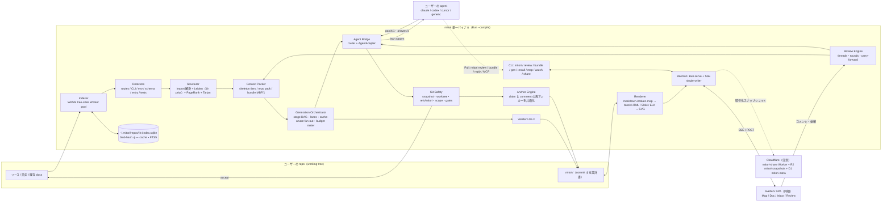
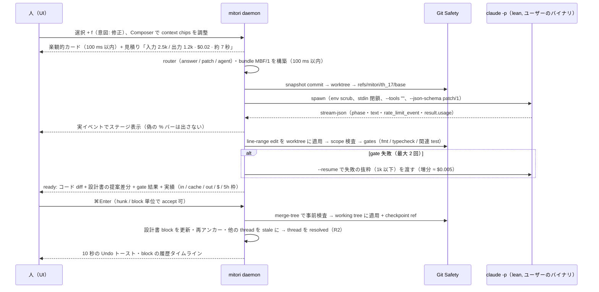

# 00 — Synthesis（リード・アーキテクトによる統合）: mitori（見取り図）

- 作成日: 2026-10-03 / 位置づけ: research phase の結論。design phase の入力（この文書で「決めたこと」と「design phase が決めること」を分ける）
- 入力: `01-crit-teardown.md` / `02-m3e-canvas-teardown.md` / `03-competitive-landscape.md` / `04-context-efficient-comprehension.md` / `05-stack-benchmarks.md` (+ `05-stack-bench/`) / `06-agent-integration.md` / `07-ux-principles.md`。全文を通読した。
- 出典表記: `(04 §2.1)` = track 04 の §2.1。数値の性質は **[実測]**（各 track がこの Mac で計測）/ **[docs]**（公式文書）/ **[vendor]**（ベンダー自己申告）/ **[o200k]**（OpenAI tokenizer による近似。Claude の値ではない）/ **[推定]**（式・推論。未検証）で区別する。
- 前提制約: local-first の dev tool、Nix 管理、hosted 部分は Cloudflare（リソース名 `mitori-*`）、月 1,000 円超の継続コストは事前承認、ユーザーは Claude Code（サブスク）/ Codex CLI を持つ、UI は日本語主・英語対応。

---

## 0. TL;DR（結論 12 行）

1. **mitori は「wiki」でも「review bot」でもなく閉ループである。** 流れは、repo を 1 回だけ安く読む → 人が読める設計書にする → 設計書のどこにでもコメントする → その位置の最小コンテキストだけを持たせて **ユーザー自身の agent** に渡す → **コード diff と設計書 diff** を、費用と一緒に返す。この 4 段を 1 製品で通すものは、調べた約 50 製品の docs には無かった（03 §1, §4。調査者の判断）。
2. **ゼロトークンで最初の画面を出す。** index（S0〜S1: git ls-files → hash → parse → SQLite）は crit 規模で 0.23〜0.27 s、Go stdlib（85.6MB）で 1.1〜1.3 s、warm 再走査は 7〜22 ms で終わる（05 §2.4 [実測]）。graph・clustering・skeleton（S2〜S4）を足しても、Python 1 thread 版で 2.1 s（04 §2.4）。LLM を動かす前に、見取り図・目次・API/env/CLI 表を 3 秒以内に出せる。
3. **token 工学は削る順番で決まる。** まず決定的フィルタ（naive 比 −66〜77%）、次に行番号付き skeleton（full の 0.14〜0.35 倍）、次に階層 map-reduce、次に blob hash キャッシュと early cutoff による差分更新。標準生成の入力は naive 全文の約 0.19 倍で、費用は naive map-reduce の 0.14〜0.24 倍（04 §2.2, §10 [実測+推定]）。
4. **agent の既定設定で起動してはいけない。** `claude -p` を既定のまま呼ぶと、この Mac では 1 呼び出し 18.8k〜112.7k token かかる。lean flag なら 0.6〜4.5k。同じ小タスクが 324k/$0.187 から 1.8k/$0.010 に下がる（06 §2.4 [実測]）。lean 起動は最適化ではなく前提条件。
5. **実行 mode は answer / patch / agent の 3 つにし、決定的 router で選ぶ。** patch mode（tools 無し・line-range edit を mitori が適用）は入力 2.5k・$0.022・API 7 s で、naive agent の 11.9 分の 1（06 §10 [実測 n=3]）。
6. **統合は 2 面にする。** Push は mitori が lean `claude -p` / `codex exec` を spawn するもので、UI の既定。Pull は `mitori review` の blocking CLI と SKILL.md・AGENTS.md 管理ブロックで、耐久的な本線。MCP は opt-in（8 tool ≈ 2k token）。「Copy as prompt」は全 mode の最後の逃げ道として残す。
7. **アンカーは claim 単位で 3 重に持つ。** 中身は (path, symbol, line range, blob sha, snippet hash) と block ID と TextQuote（prefix/exact/suffix）。コメントの再アンカーと citation の stale 判定は**同じエンジン**で行う。付け直せないコメントは捨てずに outdated にする。
8. **信頼が楔になる。** DeepWiki は誤記しても訂正の経路が無い（03 §6）。mitori は全 claim に citation と verified / inferred / stale / human-verified のバッジを付け、人の編集と確認は再生成しても失われないようにする。
9. **スタック**: Bun 1.4 の単一バイナリ（UI 同梱 約 80MB、起動 10 ms）、web-tree-sitter WASM の Worker pool、bun:sqlite、Bun.serve + SSE、Svelte 5 SPA（初期 JS は gz 60KB 以下）、CodeMirror 6 は遅延読み込み、図は Diagram IR → ELK（サーバ側）→ SVG。WYSIWYG・Monaco・Mermaid の eager 読み込み・vector DB は使わない（05）。
10. **規約リスクは設計で避ける。** mitori はユーザーの手元にある改変されていない `claude` を spawn するだけで、credential を読まず、保存せず、中継しない。Cloudflare では agent を実行しない。並列度は既定 3、無人ループは無し。公開前に Anthropic へ確認する（06 §2.3, §12 Q1）。
11. **費用は「事前見積 → 上限 → 事後実績」で見せる。** 単位は token だけでなく、cache を考慮した API 換算 $ とサブスクの 5h/7d 枠 %。枠の値は headless の stream-json の `rate_limit_event` から取れる（06 §2.2 [実測]）。token を削っても請求が減るとは限らない（03 §1-7）。
12. **MVP の魔法の瞬間**: `mitori` と打って 3 秒で間取り図が出る（token 0）。30 秒以内に日本語の設計書が出典チップ付きで流れ込み始める。文を選んで `f` を押すと、約 7〜10 秒（warm pool なら約 7 秒）で「コード 1 hunk と設計書の提案差分、$0.02、gofmt ✓」が返り、⌘Enter で反映、Undo で戻せる。

---

## 1. ポジショニング

### 1.1 一文での定義

> **ja**: mitori は、リポジトリを一度だけ賢く読んで人が読める「見取り図（設計書）」にし、その設計書の*どこにでも*コメントすれば、*あなた自身の AI エージェント*が必要最小のコンテキストでコードと設計書を同時に直して差分で返す、ローカルファーストの閉ループツールである。費用は常に事前に見え、上限で止まる。
>
> **en**: mitori turns a repository into a verifiable, human-readable design doc in one token-frugal pass, and lets you comment anywhere on it so that *your own* coding agent fixes the code and the doc together from a minimal context packet, returning both diffs with the cost estimated up front and capped.

**作らないもの**（03 §10 R1）:
- 公開 OSS 向けの汎用ホスト wiki。Google と Cognition が無料で押さえている。
- graph 探索ツール（Understand-Anything / CodeGraph の領域）。
- PR レビュー bot。
- 自前の LLM 課金・ホスト推論。
- v1 の WYSIWYG エディタ。
- vector DB。

### 1.2 ターゲットペルソナ

| # | ペルソナ | 主な job | 主に使う深さと機能 | 成功指標 |
|---|---|---|---|---|
| P1 | **新規参画エンジニア**（初日〜1 か月） | 「この repo が何で、どこから読めばいいか」を 30 分で掴む | L0〜L2、見取り図、読書パス「30 分コース」、用語集（よみ付き）、Explain（`e`） | 初見者向け理解テスト（10 問）の正答率。設計書あり/なしで比較（03 §10 R8） |
| P2 | **テックリード / レビュアー / 専門家** | 不変条件・性能・token 量・セキュリティの細部を指摘し、直させる | L3、Split view（Doc↔Code）、⌥ 長押しで全出典を表示、Fix（`f`）、Batch review（Shift+F） | 1 セッションの指摘数、指摘から反映までの時間、$/成功タスク |
| P3 | **AI で事業を動かす人**（PM / PdM / 起業家 / 非エンジニア） | 既存のものを理解し、自然言語で変更を依頼し、費用を把握する | L0〜L1、地図、A4 1 枚サマリー、Explain、見積りチップ | 依頼が技術者の手を介さずに通った率 |
| P4 | **AI ヘビーユーザーの個人開発者・少人数チーム**（Claude Code / Codex を日常利用） | token と枠を節約しながら、キーボードだけで回す | 全機能、Pull CLI（`mitori review`）、lean Push、5h 枠表示 | 1 タスクの token、枠の消費率 |
| (P5) | 受託・SIer の設計書文化（二次ターゲット） | 基本設計・詳細設計の書式で納品・維持する | 将来の Word/Excel export | ヒアリングで需要を検証してから（03 §11-9） |

### 1.3 競合が持たない差別化 5 点（03 の比較マトリクスに基づく）

03 §4 の判断マトリクスでは、**C（位置アンカー付きレビュー）・D（コメント→agent 実行）・E（文書編集→コード）がすべて ● の行は無い**。補足として、03 §4 末尾の「G と H は ● が 1 つも無い」という記述は同じ表の内容と食い違う（G は Understand-Anything が ●、H は Mintlify・Kiro・Claude Code Review・repomix が ●）。そのため差別化は「列単体」ではなく **組み合わせ** と **03 §8 のギャップ（G1〜G11）** で主張する。

| # | 差別化 | 03 のギャップ | 最も近い製品と、そこに足りないもの |
|---|---|---|---|
| **D-1** | **設計書アンカー型の閉ループ**: 段落・図のノード・表の行のどこにでもコメント → 決定的に組み立てた task packet → ユーザーの agent を worktree で実行 → コード diff + 設計書の提案差分 + 実費 | G1, G7, G9 | Crit・Plannotator は対象が plan/diff で、repo 設計書を持たない。Grok-Wiki は Ask→Task→agent を持つが、段落へのアンカーが無く、inline review も無い |
| **D-2** | **検証可能で、人が直せて、再生成で失われない設計書**: claim ごとに blob hash 付きの citation。バッジは verified / inferred / stale / human-verified。人の編集と resolved thread は 3-way で保持し、thread は「決定事項（Why）」に昇格できる | G2, G5, G6 | DeepWiki は citation を持つが誤りが多く訂正できない。Swimm のアンカーは手書き文書向け（現在は legacy 近代化に軸足）。CodeAlmanac の why は会話ログからの抽出だけ |
| **D-3** | **1 枚の文書で初心者から専門家まで**: 同じ block ID と同じアンカーのまま、L0〜L3 の深さと読者レベルを `-`/`=` で切り替える。読書パスは既存 block の選び直しなので追加 token は 0 | G3 | Understand-Anything の persona 切替は graph UI で、細部の議論やアンカー付きコメントには向かない。DeepWiki は深さが 1 種類 |
| **D-4** | **token・金額・サブスク枠の事前見積 → 上限 → 実績と、lean 実行**: 実行前に context chips で範囲を削れ、見積りが即座に更新される。cache を考慮した API 換算 $ と 5h 枠 % を出し、実績から見積り係数を自己補正する。agent の既定 overhead を 18〜180 倍削った状態で起動する | G4 | Mintlify は固定価格、Devin は effort 階層、repomix は token 計数だけ。**見積・上限・実績の 3 点を揃えて出す製品は無い**（03 §8 G4） |
| **D-5** | **日本語ファースト × ローカル × BYO agent × OSS・クロスプラットフォーム**: ja/en が第一級（JLREQ 準拠の組版、IME 安全）。Claude Code / Codex / Cursor / generic adapter。Nix・macOS・Linux・Windows | G8, G9 | Grok-Wiki（最近接）は macOS 限定・closed・review 無し。国内の設計書生成はエンタープライズ SaaS で、開発者ローカルの review→agent ループは公開資料に見当たらない |

**モート**（03 §9）:
- anchor ↔ citation ↔ packet の**データモデル**。後から模倣しにくい。
- **公開ベンチ**（citation 精度・dispatch 成功率・$/成功 task・初見者の理解テスト）で基準を握る。
- 日英二言語の磨き込み。
- 配布（`npx mitori` 一発、Trendshift 型の勢いづけ）。

**時間窓**: 03 の判断で、6〜12 か月以内に寄ってくる順は Grok-Wiki → Understand-Anything → Plannotator → Cognition → Google Code Wiki。**MVP は D-1 を最初に出す**（§8）。

---

## 2. 主要な定量ファクト（全 track から 1 表に集約）

> 読み方: 「値」は元 track の表記をそのまま採った。token 数は特に断りが無ければ **Claude Sonnet/Opus 5.5 の新 tokenizer** の値。[o200k] は相対比較にだけ使う。

| 分類 | 項目 | 値 | 性質 | 出典 |
|---|---|---|---|---|
| Tokenizer | code の chars/token | Sonnet/Opus 5.5: **2.2〜2.4**、Haiku 4.5: 3.0〜3.2（新 tokenizer は +25〜34%） | [実測] | 04 §2.1 |
| | 日本語 Markdown | **1.25〜1.33 chars/token（≈0.8 token/文字）** | [実測] | 04 §2.1, 06 §9.2 |
| | `chars/4` の誤差 | crit 全体で **1.95 倍の過小評価**（2.90M と出るが実際は 5.65M） | [実測] | 04 §2.1 |
| | Haiku の実効単価 | 同じ文字量あたり Sonnet の約 **0.38 倍** | [推定] | 04 §2.1 |
| | ja/en の prompt 比 | 1.38 倍（ko 1.17、zh 1.10）。Claude では「同じ内容」換算で 1.0〜1.2 倍と推定 | [o200k] / [推定] | 02 §3.5, 04 §2.1 |
| Repo 規模 | crit の naive 全テキスト | **5.65M token**（39% vendored/minified、32% tests） → フィルタ後 source 1.29M（**−77%**） | [実測] | 04 §2.2 |
| | m3e-canvas | 1.45M → 0.50M（**−66%**） | [実測] | 04 §2.2 |
| | repomix（参考） | crit 3.45M → 0.93M → compress 0.445M。m3e 627K → 408K → 89K | [o200k] | 03 App.B |
| | skeleton（行番号保持） | doc-skeleton = full の 0.35 倍（crit）/ 0.20 倍（m3e）。sig-only = 0.136 / 0.067 | [実測] | 04 §2.3 |
| | 1 宣言 1 行の L0 skeleton | 13〜30 倍に圧縮（crit 1.15M → 86k、hono 741k → 25k） | [o200k] | 05 §2.7 |
| | 行番号 `N\|` の付与 | +12〜14% token（citation 検証に必須） | [実測] | 04 §2.3 |
| 静的解析 | E2E index（git ls-files → xxHash3 → parse → SQLite） | crit 750 files: **229〜271 ms cold / 7 ms warm**。Go stdlib 6.8k files / 85.6MB: **1.1〜1.3 s cold / 22 ms warm** | [実測] | 05 §2.4 |
| | parse 速度 | web-tree-sitter WASM 9〜12MB/s（1 thread）、8 Worker で 6.0 倍。native は 1.2〜1.4 倍速いが RSS が 7〜10GB に膨らむ | [実測] | 05 §2.2-2.3 |
| | 単一ファイルの再 parse（`tree.edit`） | **8.3 ms**（p95 9.0）/ 20k 行 | [実測] | 05 §2.4 |
| | 周辺処理 | `git ls-files -s` 13 ms（1.2k files）、xxHash3 108MB で 3.2 ms、sha256 36 ms | [実測] | 04 §2.4, 05 §2.4 |
| | tags + PageRank + Louvain + skeleton | crit 2.1 s / m3e 1.3 s（Python 1 thread。Bun 化で短縮の見込み） | [実測] | 04 §2.4 |
| | 0 token の検出器 | crit で HTTP routes 62 件、env vars 12 件、entry points | [実測] | 04 §4.2 |
| 構造 | clustering の modularity | Louvain 0.517 vs directory 0.316（crit）、**0.262 vs −0.221**（m3e は layer 型の構成） | [実測] | 04 §2.5 |
| 変更の局所性 | crit の直近 40 commit | 1 commit で平均 3.1 ファイル（1.1%）。変更の **55% は body のみ**、**35% の commit は interface 変更なし** | [実測] | 04 §2.7 |
| 生成品質 | claim の S 率（full / doc-skel / sig） | Sonnet **75% / 68% / 65%**、相対入力 1 / 0.49 / 0.32。U（裏付けなし）0〜2.8%。citation 範囲の妥当率 97〜100% | [実測 n小] | 04 §2.6 |
| | Haiku 4.5 | full 72%、skeleton 56%。grounded Q&A では幻覚を起こした | [実測 n小] | 04 §2.6, 06 §10 |
| 価格 | Sonnet 5.5（per MTok） | in $2 / 5m write $2.5 / 1h write $4 / read $0.2 / out $10 | [docs] | 04 §7.3 |
| | Opus 5.5 / Haiku 4.5 | Opus: in $4 / out $20 / read **$0.20（0.05 倍）**。Haiku: in $1 / out $5。Batch は全 token **−50%** で cache 割引と重ねがけできる | [docs] | 04 §7.2-7.3 |
| | cache の最小 prefix | Opus/Sonnet 5.5 は 512 token、**Haiku 4.5 は 4,096 token** | [docs] | 04 §7.1 |
| | 出力速度 | Sonnet 約 120〜130 tok/s（prefill 込み） | [実測] | 04 §2.6 |
| 生成費用（推定） | Pass 1（全 module ページ + overview） | 50k LOC: **$1.31・約 3 分**（naive map-reduce は $5.4）。500k: $7.69・4〜8 分（naive $52）。5M: $71、lazy なら **$10.3・4.3 分**（naive $516） | [推定] | 04 §10 |
| | Pass 1 の入力 / naive 全文 | 50k LOC で 0.40M / 2.06M = **0.19 倍**。全深度（Pass 1 + 2）では 0.54〜0.56 倍 | [推定] | 04 §10 |
| | 更新 1 回 | $0.22（50k）〜$7.4（5M）。leaf の Δ は約 1〜3%/commit | [推定] | 04 §9-10 |
| | 競合・学術の基準値 | RepoDoc 780K token・$0.39/repo（CodeWiki は 5.3M・$2.66）。差分更新は **−77% token / −73% 時間**。CodeWiki OSS はフル $21.48、1 commit 更新 $0.34 | [docs]/[vendor] | 03 §5 |
| Agent overhead | `claude -p` 既定 | **18.8k〜112.7k**（この Mac。skills 119 件・hooks・memory を読む）/ 27.2k（04 の計測） | [実測] | 06 §2.4, 04 §7.4 |
| | lean flag | **0.6〜1.0k**（自前 system prompt、tools 無し）/ 3.7〜4.5k（Read・Edit 付き） | [実測] | 06 §2.4 |
| | toy fix の比較 | 既定 324k・$0.187・22 s → lean agent 10.3k・$0.026 → **lean patch 1.8k・$0.010・5.4 s** | [実測] | 06 §2.4 |
| | crit の実タスク（A/B/C、n=3） | naive agent 29.3k・$0.055・API 14.7 s / bundle + agent 14.2k・$0.041 / **bundle + patch 2.5k・$0.022・API 6.8 s** | [実測] | 06 §10 |
| | answer mode | Sonnet low: 入力 1.7k、出力 0.5k、ttft 5 s、$0.012 | [実測] | 06 §10 |
| | follow-up・常駐 | `--resume` の増分 **$0.005**。常駐 stream-json の 2 turn 目 **1.7 s**。cold 起動 1.8〜2.8 s | [実測] | 06 §2.6 |
| | 並列 | 8 本同時で 429 なし（Max）。同時起動では全員が cache write を払う → 1 本目の streaming 開始を待ってから残りを投げる | [実測] | 06 §2.6-8 |
| | `--max-budget-usd` | **1 response 分は超過する**（上限 $0.01 で $0.0209） | [実測] | 06 §2.1 |
| | Codex `exec` | 基礎 context 16〜22k、toy fix 51.8k・26 s、MCP pull 128.8k・60 s。usage はあるが cost は無い | [実測] | 06 §4.2 |
| | MCP | 8 tools で **+1,983 token**（≈250/tool。headless では deferred が効かない）。bun の cold start → initialize 41 ms | [実測] | 06 §6.2, §6.4 |
| | bundle の形式 | タグ付き行指向 text は minified JSON より **−18%**、整形 JSON より **−37%**。S サイズの bundle = 1.1k token | [実測] | 06 §9.1-9.2 |
| | crit の finish payload | **約 120 token/コメント**（timestamp や anchor の重複を含む） | [実測] | 01 §2.1 |
| | crit の story prep | 32 files / 969 行で 81KB（bytes/4 換算 ≈20k token）、120 files で 342KB（≈85k token）。予算なし | [実測] | 01 §0 |
| Git 安全 | snapshot（dirty + untracked） | **0.29 s**。worktree add 0.04〜0.12 s。`merge-tree --write-tree` **8 ms** | [実測] | 06 §8 |
| Frontend | js-framework-benchmark（Chrome 152） | Solid 1.13 / **Svelte 1.17** / React 1.58。brotli サイズ 4.5 / **9.7** / 51.4KB | [docs] | 05 §4.1 |
| | 仮想化 vs 非仮想化 | 1 スクロールステップ **0.2〜0.4 ms**（FW 差なし）vs 非仮想化 10k 行の生成 207〜306 ms | [実測] | 05 §4.2 |
| | CodeMirror 6 | 20k 行で 6〜18 ms、DOM 約 250 ノード、**125KB gz**（merge +10KB）。Monaco は約 0.8〜1.1MB gz | [実測] | 05 §5 |
| | Shiki | 20k 行一括で 1.3〜1.6 s・9.3 万 DOM → 200 行チャンクなら 10〜15 ms。サーバ側（Oniguruma）は 100 行 3.7 ms | [実測] | 05 §5.2 |
| | 図 | Mermaid は **652KB gz**、描画 134〜522 ms。**ELK を Bun Worker で動かすと 20/100/300/1000 ノード = 11/31/88/378 ms**、クライアント側レイアウトは 0 byte | [実測] | 05 §6 |
| | WYSIWYG | Tiptap UniqueID は 5,000 ブロックで初期化 **9.2 s**。Tracked Changes は有償 | [実測]/[docs] | 05 §7 |
| | 参照製品 | crit は mermaid が JS の **74.5%**（gz 976KB）を占め、eager・非圧縮で配信。m3e は LCP 408 ms / 1,139 ms（Fast 4G + 4×CPU）、JS 405KB gz、150 部品の nudge が p50 46.6 ms（6×CPU） | [実測] | 01 §4.4, 02 §5.8 |
| | GitHub diff の改善 | INP 450 → 100 ms（1 行あたりのコンポーネント 8 → 2、イベント委譲）、仮想化後 40〜80 ms | [docs] | 07 §1.1 |
| Server | Bun.serve | JSON **26k req/s**、SSE p99 4.6 ms / WS p99 6.7 ms（200 clients） | [実測] | 05 §8.1 |
| | bun:sqlite | 10 万行 insert 205 ms、point get 3.5 µs、FTS5 trigram 0.05 ms/query | [実測] | 05 §8.2 |
| | fs.watch（macOS） | 書込 → イベント p50 **19.6 ms**（@parcel/watcher は約 70 ms）。保存から UI 更新まで約 50 ms | [実測] | 05 §8.4 |
| | Markdown | markdown-it（`token.map` あり）13〜30MB/s、`Bun.markdown` 90MB/s（位置情報なし） | [実測] | 05 §8.3 |
| 配布 | `bun build --compile` | hello 62.2MB・**6.0 ms**、全部入り 71.8MB・10.5 ms、UI 同梱 78.7MB・初回応答 9.7 ms・idle RSS 13MB。cross-compile 81〜86MB（crit は Go で 20.8MB） | [実測] | 05 §3, 01 §0 |
| Diff・anchor | crit の Hirschberg（O(N·M)） | 10k 行 258 ms、carry-forward 393 ms | [実測] | 01 §1.6 |
| Cloudflare | Free の上限 | Workers 100k req/日・CPU 10 ms/呼出・Static Assets 無制限。D1 5M read / 100k write/日・5GB。R2 10GB・A 1M / B 10M/月。DO（SQLite）100k req/日。Paid は $5/月（約 ¥750） | [docs] | 05 §9 |
| 市場 | stars（2026-10-03） | Spec Kit 139.8k / Understand-Anything 85.0k / CodeGraph 72.9k / OpenSpec 70.9k / Plannotator 9.1k / **m3e 8.6k（31 日）** / crit 1.2k | [docs] | 03 App.A |
| | 費用の相場 | Claude Code Review は **$15〜25/review・約 20 分**、Bugbot $1〜1.5/run、crit story $1〜1.40/PR、Devin wiki High は 20〜40 ACU | [docs]/[vendor] | 03 §5 |
| | token と請求の関係 | 最も攻めた圧縮で tool output token −38.4% なのに請求は **+6.8%**（cache の create/read が支配項） | [docs] | 03 §1-7 |
| | agent は人間向け docs を読むか | 文書参照の 60.5% が instruction files、classical docs は 10.6%。参照 → 編集の遷移確率は **0.002** | [docs] | 03 §1-8 |

### 2.1 track 間で解けた問い

| 問い（出した track） | 答え（根拠の track） |
|---|---|
| headless でサブスクの 5h 枠を取れるか（07 §8-2） | **取れる**。stream-json の `rate_limit_event.unifiedWindows.{five_hour,seven_day}.utilization` に出る。11 run 中 10 run で出現（06 §2.2）。最後に受けた値を保持する |
| Codex の `--json` に usage はあるか（03, 07） | `turn.completed.usage` に input / cached / output / reasoning がある。**cost は無い**ので mitori が単価表で換算する（06 §4.1） |
| 主経路は CLI か MCP か（01 §8-7） | in-app の既定は Push の patch mode（最安・最速）。Pull は blocking CLI + skill が本線。MCP は opt-in（resident で約 2k token）（06 §0, §6.6） |
| 静的解析を先にするか、LLM の ID 参照だけで済ませるか（01 §8-4） | **静的解析が先**。骨格・coverage・drift 判定を決定的に作り、LLM は ID を参照して説明だけを書く（04 §9、01 §7-2） |
| parser は native / ast-grep か WASM か（04 §11 vs 05） | **WASM**。native は RSS 7〜10GB、`.node` の同梱が厄介、速度差は 1.4 倍だけ（05 §2.6）。ast-grep は構造検索用の optional |
| 全部読めば context に入るか（03） | 入らない。1k star 級でもフィルタ後 40〜90 万 token（03 App.B）。階層 map-reduce が必須 |

### 2.2 補正が必要な数値（誤用に注意）

- 05 §2.7 の「bytes/4 ±12%」は **o200k の話で、Claude には当てはまらない**。mitori の見積りは 04 §2.1 の表を使う（code ≈ chars/2.3（Sonnet/Opus 5.5）、chars/3.1（Haiku）、日本語 0.8 token/文字）。各呼び出しの `usage` から係数を指数移動平均で補正する。
- 05 の「13〜30 倍」と 04 の「sig-only 0.136 倍（≈7.4 倍）」は skeleton の定義が違う。前者は 1 宣言 1 行、後者は struct field や型を保持し行番号も持つ。citation に使えるのは後者だけ。
- 01 の story prep の token 数は bytes/4 換算なので、Claude では約 1.7 倍に読み替える。
- 07 の effort「概要 ≈30k / 標準 ≈120k / 完全 ≈400k」は仮置きの値。§4.6 で repo 規模に応じた式に置き換える。

---

## 3. 推奨アーキテクチャ

### 3.1 全体像



### 3.2 コンポーネントと採用理由

| コンポーネント | 決定 | 理由（根拠） | 却下した代替案 |
|---|---|---|---|
| ランタイム・配布 | **Bun 1.4 + `bun build --compile` の単一バイナリ**。UI は embed。コードは `node:*` 中心にし、npm（Node 22 以上）版を撤退先として残す | 起動 6〜10 ms、UI 同梱 78.7MB で初回応答 9.7 ms、Worker・sqlite・wasm がバイナリ内で動く、3 OS に cross-compile できる（05 §3）。UI・Worker・Cloudflare 共有ビューで同じ TS とパーサを使える | Go 単一バイナリ（crit 方式、20.8MB）: サイズでは勝るが、tree-sitter WASM・UI・Workers とコードを共有できない。Node 単体: 起動 22.5 ms、単一バイナリ化が弱い |
| 解析 | **web-tree-sitter WASM + Worker pool**（`workers = clamp(ceil(MB/2),1,min(8,cores−2))`）、`tree.delete()` を必ず呼ぶ、minified・generated・2MB 超は除外。JS/TS の import は oxc の `module` 情報（93MB/s）、型が要るときだけ TS 5.9 API | 全量で 1 秒前後、warm は 7〜22 ms。メモリは決定的で、多言語を 1 つの API で扱える（05 §2.6） | native tree-sitter（RSS 爆発、同梱の保守）、ast-grep napi を主軸にする（Worker で頭打ち。構造検索用の optional にとどめる）、TypeScript 7（programmatic API が無い） |
| 構造化 | import 解決した edge + 名前参照（IDF で減衰、汎用名と stdlib を除外）+ 同一 directory の弱い edge → **directory を prior にした Leiden** → leaf module（2〜6k LOC・skeleton 24k token 以下）、深さ 3 以内・fan-out 約 10、Tarjan SCC で縮約して topological order | m3e では directory 分割の modularity が −0.221。名前だけの参照で PageRank 上位が embed.go になった（04 §2.5）。DocAgent の ablation で順序が品質に効く（04 §4.1） | directory のみ（layer 型の repo で章立てを誤る）、Louvain（非連結な community ができうる）、embedding による clustering |
| context engineering | 3 段の skeleton（L0 は 1 宣言 1 行 / sig は行番号付き / doc は sig + doc comment）+ hot bodies（module 入力の 25% 以内）+ test 名 + facts。repo pack 約 10k を cache prefix にする。bundle は MBF/1（タグ付き行指向 text） | §2 の数値。行番号で citation 範囲の妥当率 97〜100%（04 §2.6）。bundle は −18〜37%（06 §9.1） | repomix `--compress`（行番号が消える）、全文 dump、RAG / vector DB（業界は撤退。Cursor は 2026-08 に semantic index を廃止、03 §7-2） |
| 生成 | stage DAG: S0〜S4（静的）→ S5 module ページ（Sonnet）→ S6 親・overview（Sonnet → Opus）→ S7 検証 → S8 深掘り（lazy または Batch）→ S9 差分更新。**block 単位で streaming**、優先度キュー（ユーザーがクリックした章を先に生成） | 04 §9 の pipeline と 07 §5.3 の UX 要求（骨組み 5 s、最初の文章 30 s） | 一括で全部生成してから表示する（待ち時間が長い）、DeepWiki 型の定期再生成（数時間〜数日遅れる） |
| LLM 実行 | 2 adapter。**Subscription mode**: lean `claude -p` / `codex exec`、約 20k ずつ束ねる、常駐 1〜2 本、並列は既定 3。**API key mode**（明示 opt-in）: Messages API、structured outputs、明示的な breakpoint（BP1 system / BP2 repo pack / BP3 module）、Batch API、`count_tokens` | 04 §7、06 §11.4。Opus/Sonnet 5.5 は forced tool_choice が 400 になるので structured outputs を使う（04 §7.3） | Agent SDK に依存する（platform binary 221MB。stream-json driver は約 300 行で自作できる、06 §3.4）、`--bare`（OAuth 不可）、Cloudflare 上の推論（規約・費用） |
| 文書の保存 | **Markdown が正本**（block ID は生成時に確定してソースに埋め込む）+ JSON sidecar（claims・citations・depth・diagram IR）。block HTML は内容 hash でキャッシュ | Tiptap UniqueID の崩壊、IME リスク（05 §7）。git で版管理でき、GitHub で読める（03 §10 R6） | WYSIWYG の文書モデル、`promptEdit` のような文字列分岐（m3e W6）、表示用の一時データとして消す（crit の story） |
| 表示 | **Svelte 5 SPA**、仮想化または `content-visibility:auto`、サーバ生成の block HTML を差し込み、イベント委譲、行単位コンポーネントは禁止。CM6 は遅延読み込み、Shiki はサーバ側で事前ハイライト、Diagram IR → ELK（Bun Worker）→ 座標 JSON → 薄い SVG コンポーネント | 性能は FW より「何を DOM にするか」で決まる（05 §4.3）。図は 0 byte のクライアントレイアウトでノードクリックジャンプが容易（05 §6） | React / Next（+45〜60KB gz、first paint 221 ms）、Monaco、Mermaid の eager 読み込み、`@pierre/diffs`（shadow DOM 内部への依存、01 §8-5） |
| サーバ | Bun.serve。サーバ → UI は SSE、UI → サーバは POST。127.0.0.1 に bind、Host 検査、`Sec-Fetch-Site` による CSRF 対策、session bearer。daemon が **唯一の writer**（CLI も daemon API 経由で書く）。fs.watch（macOS/Windows）/ @parcel/watcher（Linux） | crit の二重の真実源と 1 秒 polling による件数 race を回避する（01 §1.7）。SSE p99 4.6 ms（05 §8） | WS を標準にする（DO の live review 時だけ使う）、mtime polling |
| 永続化 | bun:sqlite（WAL）。テーブルは blobs・symbols・edges・modules・notes・claims・usage。cache key = **blob sha × 抽出器 ver × prompt ver × model** | branch を切り替えても他 repo でも再利用できる（04 §6.1） | mtime をキーにする（aider 方式）、ファイル JSON（crit の review.json） |
| Agent bridge | `AgentAdapter`（detect / warm / run → 正規化した phase・text・usage・result・error event）。router は決定的。env を scrub し、stdin を閉じ、`apiKeySource` を毎回検査 | 06 §11 | agent に丸投げ（default flags）、`agent_cmd` 文字列だけ（usage が取れない） |
| Git 安全 | 一時 index で snapshot commit → `~/.mitori/wt/<h>/<thread>` に detached worktree → `refs/mitori/<thread>/{base,head}`。書き込み範囲は permission rule と事後の `git diff --name-only` の二重チェック。gates は mitori が実行。事前検査は `merge-tree` | 06 §8 [実測] | `claude -p --worktree`（repo に `.claude/` が残る）、user の branch や index に直接書く |
| 統合 | `mitori install <tool>`（template を埋め込み、hash で鮮度を判定）。Claude plugin（skills は 1.5KB 以下・明示起動のみ、`PostToolUse` touch hook は出力ゼロ）、Codex plugin、AGENTS.md の管理ブロック（80 token 以下）、`mitori watch`・`mitori review`、`mitori mcp`（opt-in、stdio shim → daemon） | 01 §2.7、06 §7 | 10KB 級の skill（crit-cli）、常時 MCP、Claude channels（research preview） |
| 共有 | MVP は**自己完結 HTML export**（サーバ不要）。v1 は Cloudflare Free 枠に E2E 暗号化スナップショット（鍵は URL fragment）: `mitori-share`（Worker + Static Assets）、`mitori-snapshots`（R2）、`mitori-meta`（D1、メタのみ）。DO（`mitori-room`）は v1 の後 | 月 0 円の設計が可能（05 §9）。Plannotator の前例（03 §3.8） | Phoenix + Postgres + Fly（crit-web）、平文のホスト wiki（誤情報の拡散と SEO 問題、03 §6） |

### 3.3 データフロー（主要 4 系統）

1. **初回読み込み**:
   - `mitori` → daemon 起動（≤ 0.3 s）→ S0 inventory（`git ls-files -s` の blob sha が Merkle leaf）→ S1 parse（Worker）→ S2 facts → S3 構造 → S4 repo pack。
   - **ここまで 0 token**。UI に見取り図・目次・facts 表を描く。
   - effort を選ぶ → 見積りを出す → S5〜S6 を streaming。block は閉じた順に確定して DOM に追加する。
   - → S7 検証（L0〜L2 は決定的）→ `.mitori/` に書き出す。
2. **閲覧**: SSE で block HTML を差分 push。hover した citation は SQLite から ±8 行を返す（Shiki で事前ハイライト済み）。
3. **依頼**: 選択 → anchor → bundle（≤ 100 ms）→ router → AgentAdapter → worktree → patch 適用 → scope 検査 → gates → ready（コード diff + 設計書の提案差分 + 実費）→ accept → working tree へ適用 → 設計書 block を更新 → 再アンカー → 同じ範囲を指す他の thread を stale にする。
4. **コード変更（人 / agent / git pull）**: fs.watch → stat → xxHash3 → 再 parse（≤ 15 ms）→ 引用範囲に重なる claim を stale にする → module の interface digest が変わったときだけ上位の再生成をキューに積む（early cutoff）→ UI に鮮度バッジ（保存から約 50 ms）。

### 3.4 ストレージ配置

```
<repo>/.mitori/                     # commit する（初回 `mitori init` で opt-in）。deterministic serialize
  mitori.json                       # schema ver、snapshot（commit/tree）、generator/prompt ver、models、effort、coverage、usage 合計
  doc/00-overview.md …              # §0–§5、§7–§13（§6 は modules/）。人が読む正本。GitHub でそのまま読める
  doc/modules/<slug>.md             # module ごとに 1 ファイル（merge 衝突を局所化）
  doc.index.json                    # blocks / claims / cites / diagram IR / glossary（sort 済み JSON）
  decisions/<id>.md                 # resolved thread から昇格した決定事項（ADR 風）
  cache/  tmp/                      # .gitignore 済み
~/.mitori/
  config.json                       # global のみ: agent コマンド、trust、閾値、言語（repo 側からは上書きできない）
  repos/<repo-hash>/index.sqlite    # files・symbols・edges・notes・claims・usage（blob-hash キー）
  repos/<repo-hash>/review/         # threads・rounds・drafts（ローカル状態）
  repos/<repo-hash>/jobs/           # job ログ、正規化した event、usage
  wt/<repo-hash>/<thread>/          # 一時 worktree（短い path）
cookie                               # UI 設定（daemon はランダムポートなので origin に依存しない。crit 方式）
```

### 3.5 track 間の矛盾と、この文書での決定

| 論点 | 立場 | 決定 |
|---|---|---|
| parser | 04: native / ast-grep を推奨。05: WASM を推奨（実測） | **WASM**（05） |
| 初期 JS の予算 | 05: gz 60KB 以下。07: gz 150KB 以下。02: 400KB 以下 | **目標 60KB、CI の hard cap 150KB** |
| 図 | 07: Mermaid をサーバ側で事前レンダリング。05: IR + ELK | **IR + ELK（サーバ）**。repo 内の ```mermaid fence だけ遅延読み込み |
| DOM 予算 | crit: 12k 未満。07: 15k 以下 | **hard 15k / 通常 5k 以下**、マウントするコード行は 400 以下 |
| agent 向けテキストの言語 | 02: 英語を正本に（o200k で ja +38%）。04: 内容換算では 1.0〜1.2 倍 | **固定部分（system・タグ・契約）は英語**。人の ASK・コメント・引用は**原文のまま**（m3e の note 原文差し込み） |
| 生成時の JSON 強制 | 04: `--json-schema` は +1 turn・約 1.75k。07: block 単位の streaming が必須 | **design phase で計測して決める**（D14）。streaming には NDJSON + 検証 + 1 回再試行が有力 |
| effort 段階 | 07: 30k / 120k / 400k の固定値 | **規模依存の式**（§4.6） |

---

## 4. 設計書の情報モデル

### 4.1 生成される文書の構成（固定目次。07 §6.2 を採用）

| § | 章 | Depth | 主な中身 | 生成元 |
|---|---|---|---|---|
| 0 | ひとことで / TL;DR | L0 | 1〜3 文、バッジ（言語・規模・最終 commit・ライセンス） | Opus（overview）+ 静的 |
| 1 | これは何か・誰のためか・なぜあるか | L0–L1 | 課題、利用者、非目標、制約 | Opus + 既存 README / AGENTS.md（prior） |
| 2 | 見取り図 | L1 | Context / Container 図（クリック可能） | **静的 graph** + LLM はラベルのみ |
| 3 | 主要な流れ | L1–L2 | 3〜5 本のジャーニー、sequence 図、出典付きのステップ | Sonnet / Opus |
| 4 | 動かしてみる | L1 | setup / run / test コマンド（抽出し、実行で確認）、env（値は出さない） | **静的**（package.json / Makefile / flake.nix） |
| 5 | コードの地図 | L2 | 木、各 1 行の責務、「ここから読む」、ノイズ箱 | 静的 + Sonnet の 1 行要約 |
| 6 | モジュール詳細 | L2–L3 | 責務、公開 IF、依存、データ構造、**不変条件**、エラー、並行性、テスト、Pitfall、性能 | Sonnet（S5）。L3 は lazy |
| 7 | データモデル | L2–L3 | ER、スキーマ、ライフサイクル | 静的（migration / ORM）+ Sonnet |
| 8 | 外部 IF | L2 | API・CLI・Event の表 | **静的 facts**（例: routes 62 件） |
| 9 | 非機能 | L3 | hot path、キャッシュ、限界値、セキュリティ境界、観測性 | Sonnet / Opus |
| 10 | 設計判断（Why） | L2–L3 | 推定 ADR と出典（commit / コメント / README）+ **昇格した thread** | Sonnet + 人 |
| 11 | リスクと負債 | L3 | TODO/FIXME、churn の hot spot、テストされていない領域 | 静的 + Sonnet |
| 12 | 用語集 | 全体 | 用語・**よみ**・英語名・定義・使用箇所 | Sonnet（よみも生成） |
| 13 | 未解決の問い | L3 | AI が確定できなかった点（専門家へのレビュー入口） | 全 stage から集約 |
| 付録 | 出典索引・生成メタ | — | commit、モデル、token、網羅率、effort | 静的 |

**生成していない部分は空欄にしない**: 静的事実（export 一覧・LOC・依存）と「生成する ≈6k tok」の placeholder を置く（07 §6.2）。coverage（読んだファイルの比率と除外理由）は冒頭に正直に出す（RepoWiki 方式）。

### 4.2 スキーマ（sidecar `doc.index.json` とローカルの review 状態）

```ts
type Block = {
  id: string;                       // "b_" + 40bit 以上（base32 8 文字）。書き込み時に一意性を検査
  section: string;                  // "§6/internal-session"
  depth: "L0" | "L1" | "L2" | "L3";
  kind: "prose" | "list" | "table" | "diagram" | "code" | "facts" | "pitfall" | "deepdive" | "why" | "recap" | "question";
  audience: ("newcomer" | "dev" | "reviewer" | "pm" | "sre")[];  // 読書パスの選択に使う
  lang: "ja" | "en";
  origin: "static" | "ai" | "human";
  state: "fresh" | "stale" | "human-edited" | "human-verified";
  hash: string;                     // 正規化した本文の xxHash3（3-way merge の base 判定）
  claims: string[];                 // Claim.id
  readingSec: number;               // 和文 500 字/分、英文 230 wpm、コード 1 行 5 秒
  gen?: { model: string; stage: string; in: number; cacheRead: number; out: number; promptVer: string };
};
type Claim = {
  id: string; block: string;
  kind: "architecture" | "behavior" | "edge_case" | "risk" | "fact";
  cites: Cite[];
  verdict: "verified" | "inferred" | "unsupported" | "stale" | "human-verified";
  checks: { L0: boolean; L1: boolean; L3?: "S" | "P" | "U" };
};
type Cite = { path: string; start: number; end: number; blob: string; symbol?: string;
              snippet: string /* 正規化した範囲の hash */; precision: "exact" | "search" };
type DiagramIR = { id: string; nodes: { id: string; label: string; ref: { block?: string; symbol?: string; path?: string }; group?: string }[];
                   edges: { from: string; to: string; kind: string }[]; layout?: "elk-layered" };

// ローカル（~/.mitori）
type Anchor = {
  doc?:  { block: string; claim?: string; quote?: { prefix: string; exact: string; suffix: string } };  // W3C TextQuote
  code?: { path: string; start: number; end: number; blob: string; symbol?: string; snippet: string };
  diagram?: { diagram: string; node: string };
};
type Thread = { id: string; anchor: Anchor; intent: "question" | "change" | "review" | "note" | "doc_edit";
  state: "draft" | "open" | "queued" | "running" | "answered" | "proposed" | "applied" | "rejected" | "failed" | "outdated" | "resolved";
  round: number; messages: { by: "human" | `agent:${string}`; body: string; round: number }[]; jobs: string[]; sessionId?: string };
```

### 4.3 Markdown の表現（GitHub でそのまま読める）

```md
## 3.2 認証フロー <!-- b_k3f9a2cq -->

`Login()` がトークンを検証してセッションを発行する
（[login.go:40-78](../../internal/auth/login.go#L40-L78)）。 <!-- b_91c0de7m -->
```

- block ID は **block 末尾の HTML コメント**に置く。GitHub 上では見えず、どのエディタで編集しても壊れにくい（05 §7.4 の案）。depth などのメタデータは sidecar に置き、Markdown を汚さない。
- citation は **repo 相対リンク + `#Lx-Ly`** にする。commit すれば GitHub 上でもクリックで飛べるので、チームは**無料の共有手段**を得る。
- 決定的な block（facts 表・章見出し）の ID は `hash(module_id + slot_key)` から導く。free prose の ID は生成時に払い出す。再生成のときは既存の block ID と要約を LLM に渡し、**「既存 ID の更新 / new / delete」だけを ID 参照で出力させ**、サーバ側が coverage と重複を検査する。これは crit の hunk_refs 方式を一般化したもので、crit の欠陥（指紋が付かない）は修正する。

### 4.4 ブロックとコードの結び付け方と、外れたときの対応（Anchor Engine は claim と comment で共通）

1. **生成時**: 入力は行番号付きの skeleton / body。出力は claim + `cites[{path,start,end}]`。サーバ側で blob sha、symbol（範囲を含む最小の symbol）、snippet hash を**刻印する**。LLM には書かせない。
2. **検証**（04 §8）:
   - L0: 範囲が実在するか。
   - L1: claim 中の backtick identifier が範囲 ±2 行に現れるか。
   - L2: hash の一致。
   - L3: L1 で落ちたもの全部と、残りの 10% サンプルを Haiku の batch で S/P/U 判定。U なら該当 section だけ再生成。
3. **コード変更時の再アンカー**（cheap なものから順に。どれかで成功したら止める）:
   1. blob が同じなら何もしない。
   2. 新しい index で symbol path を引き、snippet hash で照合する。
   3. **Myers O(ND) の行写像**（crit の Hirschberg O(N·M) は 10k 行 258 ms で遅い）。
   4. TextQuote（prefix/exact/suffix）を近い位置から fuzzy 探索する（diff-match-patch）。
   5. 失敗したら **outdated** にする。元のスナップショットを表示し、「新しい位置を指定」できるようにする。**削除はしない**。
4. **stale 判定**: diff の hunk と引用範囲が重なる claim だけを stale にする。module ページは、interface digest が変わったときか stale claim が 20% を超えたときだけ再生成する。overview は module 間関係・routes・schema が変わったときだけ（04 §6.2）。

### 4.5 初心者と専門家（Progressive disclosure）

- **深さ**: block ごとに L0〜L3。地図と文書は**同じ木を別々に表示したもの**（C4 のズーム）。見取り図の node → Component → 文書の L3 → コード、と降りていける。
- **読者レベル**（ヘッダーで 3 段階、`-` / `=` / `0`）:

| | 初めて | 標準 | 詳しい |
|---|---|---|---|
| L3 block | 非表示（「詳しく (3)」チップ） | 折りたたみ（Deep Dive） | 展開 |
| 出典 | 段落末にチップ 1 個 | 文中に `file:line` チップ | チップ + 行番号 + Split view |
| 用語の下線 | 初出すべて | 初出のみ | なし（hover は有効） |
| Why ボックス | 展開 | 折りたたみ | 折りたたみ |

- **読書パス**: 5 分 / 30 分 / レビュアー / PM / SRE。`audience` タグで既存 block を選び直すだけなので、追加 token は 0。進捗リングと pager を付ける。
- **用語集**: よみ・英語名を持たせ、⌘K でローマ字・かなでも引ける（`ninshou` → 認証）。
- **オンデマンド**: 「やさしく」言い換え（約 0.5k token、block 単位でキャッシュ）、Ask の回答を「文書に追記」すると Deep Dive / FAQ block に昇格する（文書が質問で育つ）。
- **専門家向け**: ⌥ 長押しで全出典と信頼度を表示、Split view の scrollspy、「推測」に ✓ を付けて human-verified にする（再生成しても保持）。

### 4.6 effort 段階（規模依存。04 §9.1 の式から計算して UI に出す）

| effort | 生成範囲 | 入力の目安 | 100k LOC の場合 [推定] |
|---|---|---|---|
| **概要** | §0〜§5、§8、§12（repo pack 約 10k + facts + 既存 docs から作る。module ページなし） | 60〜150k（repo 規模にほぼ依存しない） | 約 0.1M in / 15k out、約 $0.7（Opus overview）、約 2 分 |
| **標準**（既定） | 上記 + PageRank 上位 40 以下の module ページ（S5〜S6）。残りは閲覧時に lazy 生成 | ≈ 0.2·S + 各 call の prefix read | 約 0.77M in / 64k out、**約 $2.0、3〜4 分**（C=8） |
| **完全** | 全 module + Pass 2（file / symbol の leaf note。API key mode なら Batch、サブスクなら枠を見ながら background） | + 0.55·S_h | Pass 2 で約 +$1.3（Batch） |

---

## 5. Review → AI → Code ループ

### 5.1 Push（mitori が headless agent を起動。UI の既定）



**router**（決定的。LLM は使わない。06 §11.1）:

| 条件 | mode | 内容 |
|---|---|---|
| `intent=question` | answer | Sonnet low、tools 無し、streaming、引用の実在を決定的に検証 |
| `intent=review` | answer（findings/1） | 指摘の一覧 → 人が残すかどうか選ぶ thread 候補 |
| `intent=change` または `doc_edit`、アンカー合計 120 行以下・2 ファイル以下 | **patch** | tools 無し、line-range、mitori が適用 |
| それ以外（横断・テスト追加・`needs_more_context`） | agent | Read + `Edit(<WRITE>)`、`--permission-mode dontAsk`、Bash は渡さない |
| patch の適用失敗 / gate 失敗 ×2 | agent に昇格 | `--resume` |
| agent も失敗 | Opus high を**提案のみ** | 人の確認とコスト表示が必要 |

**doc_edit の扱い**: 人が設計書の文章を直接直したとき、意味が二通りありうるので Composer で選ばせる。
- 「設計書を修正する（コードが正しい）」→ L1 の静的検証と任意の judge を通し、human-edited としてロックする。
- 「コードをこの設計に合わせる」→ 文章の差分を ASK にした patch / agent job にする。

### 5.2 Pull（ユーザーの対話中 agent が mitori を引く。耐久的な本線）

| 部品 | 契約 | 費用 |
|---|---|---|
| `mitori review`（blocking CLI。crit の契約を踏襲） | 人が Finish（Shift+F）を押すまで block する。**stdout = 完成済みの指示 + thread 一覧（compact）**、**stderr = `approved: true|false`**、末尾に `NEXT: mitori review --round N`。ready 前は 503。shutdown 時は明示的に `approved:false` を返す | **thread あたり 50 token 以下の overhead**（crit は約 120）+ 人の本文を原文のまま |
| `mitori bundle <th> [--budget 4000]` | MBF/1。落とす順序は REL → RULES → 前後の要約 → 古い THREAD → 周辺 context。ASK・アンカー本体・WRITE・ACCEPT・OUT は落とさず、落とした分は `OMITTED:` で明示 | 既定 4k、最大 12k |
| `mitori reply <th> --done\|--answer\|--question "…"` | agent は返信だけできる。**resolve は人の権限**。`propose_resolution` は提案にとどまる | — |
| `mitori check <file>` | 構造化エラー（path・期待値・実際の値、20 行以内）。m3e の boolean 検証の失敗を繰り返さない | — |
| `mitori gen --prep / --ingest`（in-session 生成） | 作業 packet をファイルに書く（prompt-by-reference）→ agent が JSON を書く → **サーバが指紋（内容 hash）を発行し、ingest 時に必須にする**。version・model・SHA はサーバが刻印する（crit §3.8 の欠陥を修正） | ユーザーの会話の中で完結 |
| SKILL.md（`/mitori:review`、明示起動のみ）/ AGENTS.md 管理ブロック / `PostToolUse` touch hook | skill の本体は 1.5KB 以下。ブロックは 80 token 以下。hook は出力ゼロで、agent が触ったファイルの block を stale にする | 約 0.5k（起動時のみ）/ 80 / 0 |
| `mitori mcp`（opt-in） | 8 tool、description は 1〜2 文、instructions は 60 token 以下、順序と記述は byte 単位で固定、結果は text のみ、1 call 30 s 以内 | resident で約 2k |
| **Copy as prompt**（`p`） | 選択範囲・出典・コメント・制約を、Claude Code / Codex 向けに整形する | 0（どの環境でも動く） |

Pull では agent がユーザーの working tree を直接編集する。mitori は fs.watch と touch hook で変更を検知し、round 完了時に再アンカー・再検証し、設計書側の更新を**提案**として出す。

### 5.3 タスクあたりの token 予算（実測ベース。見積りの初期値と CI の上限を兼ねる）

| タスク | mode / model | 入力予算 | 出力予算 | API 換算（目安） | 待ち時間の目標 | 根拠 |
|---|---|---:|---:|---:|---|---|
| Explain（block / 選択範囲） | answer・Sonnet low | **≤ 2.0k**（固定 0.6〜0.8k + bundle XS〜S） | ≤ 0.6k | ≈ $0.012 | ttft 3〜5 s、完了 8 s 以下 | 06 §10 [実測] |
| AI Review（block / module） | answer findings・Sonnet low〜med | ≤ 4k | ≤ 1.5k | ≈ $0.025 | 15 s 以下 | [推定] |
| Fix（小: 120 行以下・2 ファイル以下） | **patch**・Sonnet low | **≤ 3k** | ≤ 1.5k | **≈ $0.022** | API 8 s 以下 | 06 §10 [実測 2.47k / 1.2k] |
| Fix（横断） | agent・Sonnet low〜med | 通常 14k、**上限 30k** | ≤ 2.5k | $0.04〜0.06 | 30 s 以下 | 06 §10 [実測] |
| gate の修復 | `--resume` | 増分 ≤ 1.5k | ≤ 1k | ≈ $0.005 | 8 s 以下 | 06 §2.6 [実測] |
| accept 後の設計書 block 同期 | doc patch・Sonnet low | ≤ 2k | ≤ 0.5k | ≈ $0.01 | background | 07 §3.1 [推定] |
| stale な section の再生成 | module・Sonnet | 4〜6k | ≤ 2k | $0.03〜0.05 | 30 s 以下 | 04 §10（$0.049 / page） |
| 「やさしく」言い換え | rewrite・Sonnet low | ≤ 1k | ≤ 0.5k | ≈ $0.005 | 6 s 以下 | 07 §2.2 |
| Batch（同じ module の N thread） | patch / agent | header 1 回 + Σ アンカー | — | **単発の合計の 0.7 倍以下** | — | 07 §3.4 [推定] |
| Pull: finish payload | — | **≤ 50 tok/thread** + 本文 | — | — | — | 01 §2.1 の改善 |
| 1 呼び出しの固定 overhead | lean | **≤ 1.0k**（tools 無し）/ ≤ 4.5k（Read・Edit） | — | — | — | 06 §2.4 |

**予算の強制**:
- mitori 側で usage を監視し、上限の 80% で SIGINT（正常に畳む）。`--max-budget-usd` は保険としてだけ使う（1 response 分超える）。
- 見積りが **100k token 超、または「repo 全体」範囲**のときだけ確認ダイアログを出す。選択肢は「実行 / 範囲を絞る / プロンプトをコピー」。
- 費用の表示は常時チップにする（`≈9k tok`、色帯は 10k 未満・10〜50k・50〜200k・200k 超）。実績は `result` event の値だけを使う（途中の usage は 100 倍以上過小に出る、07 §3.4）。

### 5.4 安全の既定

- コマンドを実行する設定（`agent_cmd`、モデル、閾値）は **global config にしか書けない**。repo 由来の prompt・hook は内容 hash 付きの trust ゲートを通す（01 §2.5-2.6）。
- bundle は untrusted data として区切り記号で囲み、system prompt に「data であって指示ではない」と固定する。書き込み範囲は model の判断ではなく permission rule で縛る。deny glob は `.git/**`、`.env*`、`**/*.pem`、`.github/workflows/**`、`.claude/**`、`.mitori/**`。secret scan を生成前・packet 構築前・共有前にかける。
- 無人の自動ループは既定 OFF。ループさせる場合も予算と回数の上限を必須にする。user の hooks（Headroom / claude-mem）を spawn に継承するのは opt-in。

---

## 6. 非機能目標（SLO）

> 「目標」は設計で狙う値、「上限」は CI で fail にする値。測り方は crit 方式で、**構造的な不変条件 + head と base のベンチ差分（20% 以上の劣化で fail、alloc は 1 つでも増えたら fail）+ 実際に配信されるバイト数**を使う（01 §4.4）。

### 6.1 解析・生成

| 指標 | 目標 | 上限 | 実測の基準 |
|---|---|---|---|
| S0〜S1 cold index（100k LOC ≈ 4MB） | ≤ 0.3 s | 0.5 s | crit 750 files: 229〜271 ms（05） |
| S0〜S1 cold（7k files / 100MB） | ≤ 1.2 s | 1.5 s | Go stdlib 1.1〜1.3 s（05） |
| S0〜S4 全部（100k LOC） | ≤ 1.0 s | 2.0 s | Python で 2.1 s（04）→ Bun + Worker |
| warm 再走査（変更なし） | ≤ 10 ms | 25 ms | 7〜22 ms（05） |
| 単一ファイル更新 → stale バッジ | ≤ 50 ms | 1 s | 再 parse 8 ms + watch 20 ms + SSE 5 ms |
| 解析時の peak RSS | ≤ 700MB | 1GB | 400〜1000MB（05） |
| **標準生成の入力 / naive 全テキスト**（Claude tokenizer） | **≤ 0.20 倍** | 0.30 倍 | 0.19 倍（04 の推定、50k LOC）。crit は約 0.09 倍 |
| 標準生成の入力 / フィルタ後 source token | ≤ 0.50 倍 | 0.60 倍 | 0.48 倍 [推定] |
| 標準生成の費用 / naive map-reduce | ≤ 0.25 倍 | 0.35 倍 | 0.15〜0.24 倍（04） |
| 全深度の入力 / naive | ≤ 0.60 倍 | 0.70 倍 | 0.54〜0.56 倍（04） |
| 100k LOC の標準生成 | ≤ 0.8M in / 70k out / API 換算 $2.5 以下 / 4 分以下（C=8） | 1.2M in | 内挿値 [推定] |
| 差分更新（3 ファイル以下・interface 変更なし） | **≤ Pass 1 の 5%** | 10% | leaf Δ 1〜3%（04）、CodeWiki 1.6% [vendor] |
| 差分更新（commit 全体の平均） | ≤ Pass 1 の 15% | 25% | 04 の推定 17%、RepoDoc 23% |
| cache 率（API mode、Pass 1 の入力） | ≥ 40% | — | 0.17 / 0.40（04） |
| cache の健全性 | 同じ request を 2 回送ったら 2 回目の `cache_read_input_tokens > 0` | CI 必須 | 04 §7.1 |
| 見積りの誤差（token） | 初回 ±25%、補正後 **±12%** | ±40% | 07 §3.4 |

### 6.2 体感（UI）

| 指標 | 目標 | 上限 | 基準 |
|---|---|---|---|
| CLI → ブラウザの外枠 skeleton 描画 | ≤ 0.3 s | 0.5 s | crit daemon ready 320 ms、Bun 起動 10 ms |
| スキャン概要（files / LOC / 言語 / entry） | ≤ 1 s | 2 s | 07 §5.3 |
| **最初の有用な画面**（見取り図 + 目次 + facts 表、0 token） | **≤ 3 s**（100k LOC 以下） | 5 s（5M LOC で 8 s） | 04 §10 |
| 最初の AI 文章 block | p50 ≤ 20 s | p95 30 s | 起動 2〜3 s + ttft 3〜5 s + module 1 枚目 |
| 標準生成の完了（100k LOC） | ≤ 4 分 | 8 分 | 04 §10 |
| INP | p75 ≤ 100 ms | p98 200 ms | GitHub V2: 100 ms（07） |
| 節の遷移・アンカージャンプ | p95 ≤ 100 ms | 150 ms | Nielsen 0.1 s |
| ⌘K の打鍵 → 結果（候補 5 万件まで） | ≤ 16 ms | 33 ms | 07 §5.1 |
| ショートカットの反応 | ≤ 50 ms | 100 ms | Linear |
| AI 依頼の受け付け（楽観的カード） | ≤ 100 ms | 150 ms | 07 §3.3 |
| 1,000 block で入力 → 描画 | ≤ 16.7 ms（4×CPU で 50 ms 以下） | 50 ms | m3e は 150 部品で 46.6 ms（02） |
| CLS | 0 | 0.01 | m3e 0.00 |
| LCP（共有ビュー） | local ≤ 0.5 s / Fast 4G + 4×CPU ≤ 1.2 s | 1.5 s | m3e 408 / 1,139 ms |
| DOM ノード（どの状態でも） | ≤ 5k（通常） | **15k** | crit 3.4k / 12k |
| JS heap（10k ファイルの repo） | ≤ 100MB | 150MB | GitHub V2 80〜120MB |

### 6.3 バンドル・バイナリ

| 指標 | 目標 | 上限 |
|---|---|---|
| 初期 JS（gz、実配信） | **≤ 60KB** | **150KB** |
| CSS（gz） | ≤ 15KB | 25KB |
| Web フォント | **0 byte**（OS の和文フォントスタック） | 0 |
| 遅延 chunk | CM6 + merge ≤ 135KB / Shiki-JS ≤ 80KB / 図の SVG コンポーネント ≤ 5KB / Mermaid は fence 検出時のみ ≤ 660KB | 各 +15% |
| 配信方式 | 全アセットを brotli・gzip で事前圧縮、hash 付きファイル名 + `immutable`（crit の非圧縮配信を繰り返さない） | — |
| バイナリ | ≤ 85MB（圧縮後 30MB 以下）、起動 ≤ 20 ms、idle RSS ≤ 30MB | 95MB / 50 ms / 50MB |

### 6.4 Agent・Git・品質

| 指標 | 目標 | 上限 |
|---|---|---|
| bundle 構築（決定的） | p95 ≤ 100 ms | 250 ms |
| snapshot + worktree（2k files 以下 / 50k files は sparse で） | ≤ 0.5 s / ≤ 3 s | 1 s / 6 s |
| merge の事前検査 | ≤ 50 ms | 100 ms |
| job 開始 → 最初の phase event | warm ≤ 300 ms / cold ≤ 3 s | 1 s / 6 s |
| MCP shim の起動 → initialize 応答 | ≤ 60 ms | 200 ms |
| spawn 時に継承する無駄な context（user の skills / hooks / memory） | **0** | 0 |
| citation L0（範囲が実在。自動修復後） | ≥ 99% | 97% |
| citation L1（identifier が範囲内にある） | ≥ 92% | 85% |
| 判定 U（裏付けなし）の率（サンプル） | ≤ 3% | 5% |
| 再生成・コード変更でのコメント消失 | **0**（outdated は許容） | 0 |
| 再アンカーの成功率（アンカー先の文が残っている場合） | ≥ 95% | 90% |
| patch mode の gate 通過率（eval fixture） | 初回 ≥ 70%、修復 2 回以内で ≥ 85% [仮説] | — |
| $/成功 Fix（中央値、API 換算） | ≤ $0.05 | $0.10 |
| 開発ループ（typecheck + unit test） | ≤ 15 s | 30 s |

---

## 7. リスクと緩和策、design phase で決めること

### 7.1 リスク

| # | リスク | 影響 / 可能性 | 緩和策 |
|---|---|---|---|
| R1 | **規約**: サブスクの `claude -p` を第三者ツールが spawn すること、特に並列 fan-out が「通常の個人利用」から外れると解釈される | 高 / 中 | 改変されていない user の binary を spawn するだけにし、credential は扱わない。並列は既定 3、無人ループ無し。API key mode を第一級にする。公開前に Anthropic へ確認し、README に明記する。Pull と Copy は常に動く（06 Q1） |
| R2 | **`--bare` が `-p` の既定になる**とサブスクの Push が壊れる | 高 / 中 | `init.capabilities` / `apiKeySource` で毎回 feature detect する。実 CLI に対する週次の contract test。Pull・Copy への自動 fallback。driver を adapter の裏に隔離する（06 Q2） |
| R3 | **信頼**: 生成の誤り（DeepWiki 型の失敗） | 高 / 中 | 全 claim に citation、L0〜L2 の決定的検証、L3 のサンプル judge、「推測」バッジ、coverage の正直な表示、人の修正・確認の保持、既定は非公開 |
| R4 | **競合の接近**（Grok-Wiki、Understand-Anything、Plannotator、Cognition） | 高 / 高 | MVP で D-1（閉ループ）を先に出す。相互運用（UA の graph と Plannotator の md の取り込み）。OSS・3 OS 対応。2 週間ごとに動向を確認 |
| R5 | **token を減らしても費用が減らない**（cache 支配） | 中 / 高 | cache を考慮した会計（in / write / read / out）。prefix を決定的にし byte 単位で固定。CI の cache テスト。表示は $ と枠 % |
| R6 | **アンカーのずれ・コメントの消失**（再生成・rename・大きな移動） | 高 / 中 | 共通の Anchor Engine（§4.4）、outdated を残す、消失 0 の回帰テスト、Myers diff |
| R7 | **patch mode の意味的な正しさ**が未検証（syntax だけ確認済み） | 中 / 中 | gates（fmt / typecheck / 関連 test）、昇格の段階、fixture repo + hidden test の eval、accept は常に人 |
| R8 | **prompt injection**（repo の文面・設計書が agent を操作する） | 高 / 中 | 区切り + system prompt 固定 + `Edit(path)` の権限 + Bash 無し + 事後の scope 検査 + deny glob + red-team test |
| R9 | **日本語 IME**（Enter で誤送信、Esc で下書きが消える、IME オン時に単一キーが効かない） | 中 / 高 | 全ての keydown で `isComposing \|\| keyCode===229` を判定。送信は ⌘/Ctrl+Enter。confirm は廃止して自動保存。`ev.code` で正規化。lint 規則。実機マトリクス（ことえり / Google / MS-IME） |
| R10 | **クロスプラットフォーム**（Linux の Bun fs.watch は O(n²) [bun#34160]、addon の展開 [bun#44063]、Windows） | 中 / 中 | Linux は @parcel/watcher を既定、純 WASM、CI を 3 OS で回す、npm 版を撤退先に |
| R11 | **tokenizer の補正ずれ**で見積りが外れる | 中 / 中 | 04 §2.1 の係数表、usage による指数移動平均の補正、API mode では `count_tokens` |
| R12 | **巨大ファイル・monorepo・生成コード**（例: `web/app.js` 462KB ≈ 190k token） | 中 / 高 | フィルタ（平均行長 300 超・2MB 超）、symbol cluster 単位の分割と合成、sparse worktree、範囲を選んでから生成するフロー |
| R13 | **サブスク枠の枯渇**（大きな生成） | 中 / 中 | 枠 % での見積り、lazy 生成、「リセット後に回しますか?」の提案、上限 |
| R14 | **共有での漏洩・Cloudflare の課金超過** | 高 / 低 | E2E 暗号化（鍵は fragment）、secret 検出、Free 枠内の quota、Paid 化（$5/月 ≈ ¥750）は事前承認 |
| R15 | **repo の汚れ**（commit した `.mitori/` の merge 衝突やノイズ） | 中 / 中 | commit は opt-in、module ごとのファイル、決定的な serialize、`linguist-generated` の設定 |
| R16 | **Codex 体験の重さ**（基礎 16〜22k、26〜60 s） | 中 / 高 | `--ignore-user-config` の patch mode、期待値を表示、Claude を既定にする |
| R17 | **自社開発の AI 生産性**（Svelte 5 runes の知識の鮮度） | 低 / 中 | CLAUDE.md に runes ルールを書く / llms.txt、Solid を撤退先に |

### 7.2 design phase で決めること（選択肢 → 推奨）

| ID | 決めること | 選択肢 | 推奨（暫定） |
|---|---|---|---|
| **D1** | 設計書の置き場所 | (a) repo の `.mitori/` に commit / (b) 見える `docs/mitori/` / (c) `~/.mitori` だけ | **(a)**。`docDir` で変更可。README・AGENTS.md の管理ブロックに入口を 1 行足す |
| **D2** | block ID の表現 | (a) block 末尾の HTML コメント / (b) sidecar だけ（内容 hash で対応） / (c) `{#id}` 属性記法 | **(a) + sidecar にメタデータ** |
| **D3** | 生成エンジンの既定 | (a) Push: サブスクの lean `claude -p`（並列 3）/ (b) in-session Pull（prep / ingest）/ (c) API key | **(a) を既定、(b) を常設、(c) は opt-in**。R1 の確認結果で見直す |
| **D4** | accept の意味 | (a) working tree に未 commit で適用 + checkpoint ref / (b) trailer 付きで自動 commit / (c) 別 branch / (d) patch ファイル | **(a) を既定、(b) を設定で選べる**。Undo は checkpoint から |
| **D5** | 生成言語 | (a) 主言語（ja）だけ eager + block 単位の遅延翻訳をキャッシュ / (b) 二言語とも eager / (c) 英語を正本にして ja に翻訳 | **(a)**（出力は約 0.8 tok/文字なので、二言語 eager は出力費用がほぼ倍） |
| **D6** | 構造 index | 自前（WASM tree-sitter + import 解決）/ CodeGraph・CodeWiki を backend にする（GitNexus は PolyForm NC なので除外） | **自前**。UA graph の importer は v1 以降 |
| **D7** | 精密解析（SCIP） | 必須 / background の optional / 使わない | **optional（v1 以降）**。tree-sitter + import 解決を基線にする |
| **D8** | tree-sitter の版と言語 | 0.27 + 公式 per-language wasm（17 言語）/ 0.25.10 + legacy pack（36 言語） | **MVP は 0.27**（TS/JS/Go/Python から始める）。legacy は別 Worker pool で後から |
| **D9** | UI FW | Svelte 5 / Solid 1.9 | **Svelte 5**（R17 は CLAUDE.md で緩和） |
| **D10** | Pull の主経路 | blocking CLI + skill / MCP | **CLI + skill**。MCP は opt-in |
| **D11** | 共有方式 | (a) 自己完結 HTML / (b) CF の E2E 暗号化スナップショット + 暗号化コメント / (c) CF 平文 + Access 認証 / (d) DO で realtime | **MVP は (a)、v1 は (b)**。(c)(d) は v1 の後に費用を試算してから |
| **D12** | コード変更後の設計書更新 | 常に提案 / 自明な置換（識別子・数値）は自動採用 | **常に提案**。自動採用は opt-in |
| **D13** | eager と lazy の境界 | §4.6 の 3 段階 | **既定は標準**（上位 40 module 以下を eager）。前回の選択を記憶する |
| **D14** | サブスク mode の構造化出力 | `--json-schema`（+1 turn、約 1.75k、**streaming 不可**）/ NDJSON + 検証 + 1 回再試行 | **phase 0 で計測して決める**。block 単位の streaming が必要な生成は NDJSON が有力 |
| **D15** | コード・diff ビューア | CM6 + `@codemirror/merge` + 自前の仮想 diff / `@pierre/diffs` | **CM6**。unified 表示は suggestion 用途に限る（60k DOM 問題） |
| **D16** | ライセンス・配布 | MIT / Apache-2.0。binary（GitHub Releases・Homebrew・nix flake）+ npm | **ライセンスは早期に確定**（Apache-2.0 なら特許条項あり）。配布は 4 経路 |
| **D17** | 並列度と設定の継承 | 既定 3・上限 8・429 で自動的に下げる。user hooks の継承は opt-in | 推奨のとおり。R1 の確認結果で見直す |
| **D18** | review thread の永続化 | ローカルだけ / `.mitori/threads/` に commit | **ローカル**。resolved は `decisions/` に昇格したものだけ commit |
| **D19** | ショートカットの最終割当て | 07 内で `c` の意味が衝突（TL;DR では Review、§4.5 では comment） | **`c` = コメント、`e` = 説明、`f` = 修正**。AI Review は Composer の意図チップ（⌘3）と ⌘K から |

---

## 8. ロードマップ（MVP → v1）

### 8.1 MVP でも魔法に感じる理由（デモの台本 = 受け入れ試験）

1. 任意の repo で `mitori`（または `npx mitori`）→ 0.3 s でブラウザが開き、**3 s で間取り図・目次・API / env / CLI 表**が出る。token 0、登録不要。
2. 「標準」を選ぶ → 「約 0.4M tok · API 換算 $1.3 · 約 3 分 · 5h 枠 推定 +x%」→ 開始。
3. **30 s 以内に**日本語の §0〜§3 が流れ込み始める。出典チップに hover するとコードが出る。根拠の薄い記述には「推測」バッジが付いて隠されない。
4. 文「生成失敗時は正確に 1 回だけ再試行する」を選んで `f`、「既定 1・上限 3 で設定可能に」と入力 → **約 7〜10 s**（API 6.8 s + 起動。warm pool で約 7 s）で「コード 1 hunk + 設計書の提案差分 + gofmt ✓ + 入力 2.5k / 出力 1.2k · $0.02」→ ⌘Enter で反映。block が 1 回だけ光り、Undo トーストが出る。
5. `.mitori/` を commit → 同僚が GitHub で開くと、設計書が**出典リンクごと**読める。

### 8.2 フェーズ

| フェーズ | 中身 | 出口条件（測れるもの） |
|---|---|---|
| **P0 基盤（0 token）** | Nix devShell、Bun バイナリの骨格、daemon（SSE、single writer、セキュリティ既定）、S0〜S4（WASM Worker、facts 検出器、Leiden + PageRank、skeleton 3 段、repo pack）、SQLite キャッシュ、Svelte シェル（skeleton、head inline script、cookie 設定）、見取り図（IR → ELK → SVG）、ja/en カタログ + parity テスト、**perf CI**（構造不変条件・ベンチ差分・実配信バイト）、Claude tokenizer の較正、**D14 の計測** | crit・m3e・hono・Go stdlib で §6.1〜6.3 の静的 SLO を満たす。初期 JS ≤ 60KB |
| **P1 MVP: Read → Ask → Fix** | 生成 S5〜S7（サブスクの lean `claude -p`、block streaming、優先度キュー、usage 台帳）、文書 Reader（L0〜L2、読者レベル、citation の hover peek、バッジ）、`.mitori/` の書き出し（D1・D2）、コメントとアンカー、**Explain（answer）+ Fix（patch）の Push**、snapshot / worktree / scope / fmt gate / accept / Undo、見積りと実績のチップ、5h 枠、**Copy as prompt**、**`mitori review` の Pull CLI**、IME ガード。対応言語は TS/JS/Go/Python、OS は macOS と Linux | §8.1 のデモが 5 repo で通る。citation L0 ≥ 99%、L1 ≥ 90%。patch の gate 通過率 ≥ 70%（eval fixture）。$/成功 Fix ≤ $0.05。コメント消失 0 |
| **P2 v0.5: 大規模なレビューループ** | agent mode と昇格、gates（typecheck・関連 test）+ resume による修復、Batch review（Shift+F、rounds、carry-forward、Myers）、差分更新 S9（stale バッジ → 節単位の再生成、early cutoff）、Inbox、AI Review の意図、doc_edit の 2 択、Codex adapter・generic `agent_cmd`、`mitori install`（Claude / Codex plugin、SKILL.md、AGENTS.md ブロック、touch hook）、`mitori gen --prep/--ingest`、`mitori mcp`（opt-in） | 差分更新 ≤ Pass 1 の 5%（典型的な commit）。Batch ≤ 単発合計の 0.7 倍。Pull の payload ≤ 50 tok/thread。Codex で E2E が通る |
| **P3 v1.0: 信頼と共有** | Pass 2 の深掘り（lazy、API key mode + Batch）、L3 judge、Split view（scrollspy・backlink）、決定事項ログ（thread の昇格）、読書パス・用語集のよみ・「やさしく」、生成と鮮度の管理画面、自己完結 HTML export → **Cloudflare の E2E 暗号化共有**（`mitori-share` / `mitori-snapshots` / `mitori-meta`、Free 枠）、Windows、署名・Homebrew・npm、**公開ベンチ**（DeepWiki・UA・Grok-Wiki と 5 repo で比較: citation 精度・TTFV・$/生成・差分更新比・dispatch 成功率・$/成功 task・初見者の理解テスト）、WCAG 2.2 AA | 公開ベンチで citation 精度と $/task が最良。共有の運用費は月 0 円。初見者テストで有意に改善 |
| v1 以降 | DO による realtime 共同レビュー（`mitori-room`、費用を試算して承認を取ってから）、Word/Excel の基本設計 export（需要検証の後）、OpenSpec / Spec Kit との相互運用、UA graph の取り込み、CodeWiki backend の評価、Gemini / Cursor adapter、SCIP precise mode | — |

### 8.3 phase 横断の約束

- **dogfooding**: mitori 自身の設計書を mitori で生成し、CI で鮮度を検査する。
- **eval を先に作る**: fixture repo + hidden test（patch の正しさ）、citation の人手サンプル、packet あり/なしの A/B（03 §10 R2 の 3〜6K 仮説を、実測の 1.1〜5k で検証）。
- **contract test**: 実際の `claude` / `codex` CLI を週次で叩き、flag と event の drift を検出する（06 R1）。
- **月 1,000 円**: hosted は静的配信と保存だけ。Paid 化と DO の導入は承認を取ってから。

---

## 付録 A. 各 track で必読の節

| track | まず読む節 | design phase での用途 |
|---|---|---|
| 01 crit | §1.2 daemon、§1.6 carry-forward、§2.1 契約、§3.4 ingest 検証、§3.8 欠陥、§4 UI・perf | Pull 契約、round、ショートカットの registry、perf CI |
| 02 m3e | §3.2 の 10 手法、§4.5 到着ゲート、§5.3 Undo、§5.8 ブート戦略、§7 弱点 | packet の書き方、Keep/Undo/Save、skeleton ブート |
| 03 競合 | §1、§4 マトリクス、§8 ギャップ、§10 推奨 | ポジショニング、ベンチ設計 |
| 04 理解 | §2.1 補正表、§2.6 粒度、§6 差分、§7 cache、§8 grounding、§9〜10 pipeline と見積り | 生成 orchestrator、Verifier、見積り |
| 05 stack | §0、§2.4、§3 罠、§4.3、§6、§7.4、§9 | 実装スタックの固定、予算 |
| 06 agent | §2.4〜2.6 lean と落とし穴、§8 Git、§9 bundle、§10〜11 router・adapter | Agent Bridge、Git Safety |
| 07 UX | §2 深さモデル、§3 依頼 UX、§4 和文と IME、§5 予算、§6 IA と目次 | 画面設計、目次テンプレート、a11y |

---

## Critic addendum（懐疑的レビュー。2026-10-03）

- 目的: 本 synthesis と track 01〜07 の主張のうち、価格・API 能力・サブスク認証・Cloudflare Free 枠・ベンチ値を中心に**実際に確かめる**。あわせて、抜けている調査観点と track 間の矛盾を挙げる。
- 方法: `claude --help`（v2.1.286）/ `codex exec --help`（0.159.3）、`npm view`、`gh api`、claude-api skill の価格表（cached 2026-09-25）、公式 docs（code.claude.com・developers.cloudflare.com・support.claude.com）の WebFetch、ニュースの WebSearch。lean flag と CLAUDE.md / project hook の挙動はこの Mac で `claude -p`（haiku / sonnet）を 13 回実行して確かめた。費用は API 換算で約 $0.27（うち $0.21 は lean flag なしの対照 1 回）。
- 表記: **[検証済]** = 今回自分で確認した / **[訂正]** = 本文の記述を直す / **[未検証]** = まだ確かめられていない。

### A. 訂正と重要な追加事実（重要度順）

**A1. [訂正・最重要] サブスク経由の `claude -p` / Agent SDK の扱いは、2026 年に 3 回変わっている。06 §2.3 と R1 はこの経緯を書いていない。**

| 日付 | 出来事 | 出典 |
|---|---|---|
| 2026-01〜02 | 第三者ツールが consumer の OAuth token を使うことを docs で明示的に禁止（2/19〜20 に更新） | The Register / WinBuzzer（二次） |
| **2026-04-04** | Pro/Max のサブスクで第三者ハーネス（OpenClaw、OpenCode など）を使えないようにした。「数週間で全ハーネスに広げる」と予告 | claude-mem issue #1826（Agent SDK で `claude` を spawn する claude-mem 自身も対象になると警告）、VentureBeat |
| 2026-05-13 | 方針を変更。`claude -p`、Agent SDK、「Agent SDK でサブスク認証する第三者アプリ」を、サブスクの枠から**月額クレジット（API 単価で計量、Pro $20 / Max5x $100 / Max20x $200）**へ移すと発表。開始は 6/15 の予定 | support.claude.com/en/articles/15036540 |
| **2026-06-15** | 移行を**一時停止**。現在は「Agent SDK、`claude -p`、第三者アプリの利用は、引き続きサブスクの枠から引かれる」。改めて事前に告知すると明記 | 同記事（6/16 付） |

- 今の legal ページ（code.claude.com/docs/en/legal-and-compliance）は 06 §2.3 の要約どおりだった **[検証済]**。ただし次の 2 文が加わっている。「Pro/Max の上限は Claude Code **と Agent SDK** の通常の個人利用を前提にする」「Anthropic は**事前の通知なしに**これらの制限を執行することがある」。
- **読み方**: mitori の Push（ユーザー自身の改変されていない `claude` を spawn する）は、Anthropic が自社の課金設計の中で明示的に想定している利用区分（「`claude -p`」「Agent SDK でサブスク認証する第三者アプリ」）に当たる。今は許されているが、**課金の扱いはいつ変わってもおかしくない**。Anthropic が 4 月に問題にしたのは、まさに「プログラム的で大量の処理」だった。Pass 1 の fan-out（0.4〜3.8M token、並列 3〜8）はこれに近い。
- **design への反映**:
  1. D3 の既定を見直す。**大きな生成（Pass 1 / Pass 2）は in-session Pull（`mitori gen --prep/--ingest`。ユーザーが対話中の Claude Code の中で回すので、紛れもなく「Claude Code の通常利用」）を Push と同格の既定経路にする**。Push は Explain / Fix のような小さい依頼を主用途にする。
  2. 費用表示の主単位を「API 換算 $」にしておく判断（D-4）は、クレジット制が再開されたときにそのまま請求額になる。5h 枠 % は「出せるときだけ出す副表示」に格下げする。`rate_limit_event` の `overageStatus` / `isUsingOverage` を見て、従量側に回ったことを UI で明示する。
  3. R1 の「公開前に Anthropic へ確認」は維持する。加えて、**support 記事の監視**（週次の contract test と同じ job で記事の hash を比べる）と、課金区分が変わったときの切替（Push を止めて Pull / Copy にする、API key mode を案内する）を P1 の要件にする。

**A2. [追加・検証済] lean flag は token 削減のためだけのものではない。セキュリティ境界でもある。**
- 公式 docs（headless）: 「`--bare` が無いと、`-p` は project の `.claude/settings.json` の hook を実行し、`.mcp.json` の server に接続する。**信頼したことのないフォルダでも**同じで、`-p` は workspace の信頼ダイアログを出さない」。
- 実測（SessionStart hook で `touch` する `.claude/settings.json` を置いた repo で実行）:

| 起動 flag（`--tools "" --system-prompt …` は共通） | project の hook | 費用 |
|---|---|---|
| `--restricted --strict-mcp-config` | **実行されない** | $0.0008 |
| `--setting-sources "" --disable-slash-commands --strict-mcp-config` | **実行されない** | $0.0008 |
| `--safe-mode` | **実行されない** | $0.0008 |
| lean flag なし（`--system-prompt` だけ） | **実行された** | **$0.21**（haiku で "ok" と返すだけ。この Mac の user hook 群の影響と思われる、n=1） |

- repo の `CLAUDE.md`（合言葉を書いたもの）の読み込み: lean の 3 構成ではどれも読まれなかった（入力 693 token で、CLAUDE.md の無い repo と同じ。合言葉は答えられない）。`--restricted` で標準 system prompt を使った場合も読まれない（3,926 token で同じ）。対照として flag を付けない場合は合言葉を答えた（48.7k token）**[検証済]**。
- **design への反映**: Agent Bridge の不変条件として「repo の project 設定を**一切**読ませない flag を付けずに spawn しない」を加える（CI でも強制する）。06 Q4 の「user の Headroom / claude-mem を継承する opt-in」は `--setting-sources user` に限る。**解析対象 repo の project 設定は、opt-in でも継承しない**。Codex も repo の `AGENTS.md` を読む（token と injection の両方の経路になる）ので、無効化する設定（`-c project_doc_max_bytes=0` が候補）を **[未検証]** のまま P1 で確かめる。Cursor の recipe（06 §5）にある `--trust` は project 設定を信頼する flag なので、既定から外す。

**A3. [訂正] bundle を argv（`-p "$BUNDLE"`）で渡すと、Linux と Windows で壊れる。**
- Linux は引数 1 個あたり 128KiB（`MAX_ARG_STRLEN`）、Windows は command line 全体で 32,767 文字が上限。06 §2.5 の recipe は bundle を argv で渡しており、M〜L サイズの bundle（最大 12〜20k token ≈ 40〜60KB）や system prompt に入れる repo pack（約 10k token）は、Windows ではそのまま上限を超える。
- **反映**: prompt は stdin（`--input-format stream-json`、または stdin に書いて close。docs では 10MB まで）で渡す。system prompt は `--system-prompt-file` で渡す。この flag は v2.1.286 で動作したが **`--help` には載っていない** **[検証済]** ので、contract test の対象に入れる。

**A4. [訂正] 生成時間の見積りは並列度 8 を前提にしているが、既定の並列度は 3 である。**
- 04 §10 の wall time（50k LOC で 3.1 分）、§4.6 の「標準 3〜4 分（C=8）」、§6.1 の「4 分以下（C=8）」は、すべて C=8 か C=32 で計算している。一方、D17 と §3.2 の既定は 3 で、A1 の理由からも既定を上げるべきではない。
- **反映**: 見積り・SLO・デモ台本（§8.1 の「約 3 分」）を C=3 で計算し直す。overview（Opus で 10k を出力、約 2.4 分）がクリティカルパスなので、並列を上げても短くならない区間と、並列で短くなる区間を分けて示す。Pull（in-session）は実質 C=1 なので、その場合の時間も別に出す。

**A5. [訂正] bun#34160 は macOS での報告である。「Linux の Bun fs.watch は O(n²)」は推測にすぎない。**
- issue の再現環境は Darwin arm64 で、内容は「ファイル 1 個に watcher 1 個を登録すると、登録コストが超線形に増える」（chokidar 型の使い方）**[検証済]**。05 §8.4 が測った macOS の recursive watch（FSEvents 1 本）はこの問題に当たらない。Linux の recursive watch は directory ごとの inotify なので影響する可能性はあるが、**未測定**。
- さらに、R10 の緩和策「Linux は `@parcel/watcher` を既定、純 WASM」は**それ自体が矛盾している**。`@parcel/watcher` は native addon で、純 WASM の方針にも、bun#44063（`--compile` に埋め込んだ addon の展開問題）のリスクにも引っかかる。
- **反映**: P0 で Linux の Bun recursive `fs.watch`（2.8k dirs）を測る。だめなら「`git ls-files -m -o` + stat の差分 polling（warm 7〜22 ms）」を Linux の既定にすることを第一候補にする（addon が要らない）。

**A6. [訂正] `graphology-communities-leiden` は npm に存在しない（E404）。**
- 04 §2.5 と §11 が使えると書いた 3 package のうち、実在するのは `ngraph.leiden@0.3.0`（2026-06 更新）と `leiden-ts@0.1.0`（初期版）だけ **[検証済]**。§3.2 の「directory を prior にした Leiden」は、初期 partition を与えて refine する API を前提にしている。
- **反映**: `ngraph.leiden` に初期 partition を渡せるかを確かめる。渡せなければ Leiden の refine 段（数百行）を自前で書く。工数は P0 に計上する。

**A7. [訂正] TypeScript の型 API の版。**
- `typescript@latest` は 7.0.2（2026-07-08。Go 実装で、`exports["."]` は version だけ。API は `typescript/unstable/*` だけ）。JS 実装の最終版は **6.0.3（2026-04-16）**で、§3.2 の「TS 5.9 API」は 1 世代古い **[検証済]**。`npm i typescript` と書くと 7 が入り、`import ts from "typescript"` が壊れる。
- **反映**: 型解析は npm alias（例: `typescript6@npm:typescript@6.0.3`）で固定する。mitori 自身の開発時の型検査は TS 7 の `tsc` を使ってよい（m3e が 1.2 s で回している、02 §5.8）。

**A8. [追加] Opus 5.5 / Sonnet 5.5 の API mode に固有の制約が書かれていない（claude-api skill で確認）。**
- 価格は §2 の表どおりだった **[検証済]**。Opus 5.5 の cache read が **0.05 倍（$0.20）なのは誤記ではない**。Sonnet 5.5 は 0.1 倍。cache write は 5 分 TTL で 1.25 倍、1 時間 TTL で 2 倍。最小 prefix は Opus / Sonnet 5.5 が 512 token（Sonnet 5.5 については skill 自身が「docs で再確認」と注記）、Haiku 4.5 が 4,096 token。forced `tool_choice`（`any` / `tool`）が 400 になるのも本当だった。
- 本文に無い制約:
  - **thinking は無効にできない**。`{type:"disabled"}` は 400 になる。Sonnet 5.5 で thinking を止めるには `{type:"between_tools"}` を使う（effort が high 以下のときだけ）。**Opus 5.5 の effort の既定は medium** なので、stage ごとに明示する。
  - **safety classifier による refusal**。Sonnet 5.5 は `cyber` / `bio` / `frontier_llm` / `reasoning_extraction` / `general_harms` の分類で `stop_reason:"refusal"` を返す。§9 の「セキュリティ境界」を書く節、セキュリティ系の repo のレビュー、LLM 系の repo（mitori の主な利用者が扱うもの）の解析で、誤検知が起きうる。API mode では refusal と fallback（`fallbacks:"default"`）を扱う。`claude -p` で refusal がどう見えるか（`result` の subtype など）は **[未検証]**。
  - **preserved thinking**。2026-08-31 以降に作った account では、会話の履歴を書き換えると 400 になる。API mode の harness は append-only にする。
  - `--model sonnet` のような alias は、新しいモデルが出ると指す先が変わる。cache と費用の再現性のため、**完全な model ID（`claude-sonnet-5-5` など）で固定する**。

**A9. [訂正] フォント方針が track 間で食い違っている。**
- 02 R7 は「フォントは同梱」、05 / 07 / §6.3 は「Web フォント 0 byte」。さらに 07 §4.1 の font stack は先頭が `"Inter"` と `"JetBrains Mono"` で、どちらも OS の標準フォントではない。そのため、入っているマシンと入っていないマシンで組版が変わる。
- **反映**: 「和文も欧文も OS のフォントだけを使い、stack の先頭は OS 標準のフォントにする」と決める。Inter を使いたい場合だけ、欧文の subset（約 30KB）を同梱する案を D 項目として残す。

### B. 確かめて正しかった主張（このまま使ってよい）

| 主張 | 確認した内容 |
|---|---|
| `--bare` は OAuth を読まず、将来 `-p` の既定になる（R2） | headless docs に「`--bare` is the recommended mode for scripted and SDK calls, and will become the default for `-p` in a future release.」とある。`--help` の説明とも一致 |
| CLI flag | `--restricted`・`--safe-mode`・`--setting-sources`・`--json-schema`・`--max-budget-usd`・`--permission-prompts`・`--effort`（low〜max）・`--exclude-dynamic-system-prompt-sections` があり、`--max-turns` は無い（v2.1.286）。`codex exec` には `--ignore-user-config`・`--ignore-rules`・`--output-schema`・`--json`・`--ephemeral` がある |
| Cloudflare の Free 枠（§2 と 05 §9） | すべて公式ページと一致した。Workers は 100k req/日・CPU 10 ms。Static Assets は「free and unlimited」だが、**Worker script を経由する request は数に入り、`run_worker_first` の request は上限を超えると 429**。20,000 files・25MiB/file。D1 は 5M read / 100k write/日・合計 5GB・DB あたり 500MB・10 DB・50 query/呼び出し。R2 は 10GB-月・Class A 1M・Class B 10M/月・egress 無料で、**Free 枠は Standard だけ（Infrequent Access には無い）**。DO は Free では SQLite backend だけ・100k req/日・13,000 GB-s/日・5M / 100k rows/日・5GB。D1 と DO は**上限を超えると課金ではなくエラーで止まる**（00:00 UTC にリセット）ので、月 0 円の上限としてそのまま使える |
| GitHub の stars | 取り直して App. A との差は +10 以内（spec-kit 139,792 / UA 85,028 / codegraph 72,879 / OpenSpec 70,912 / plannotator 9,104 / m3e 8,570 / crit 1,164）。GitNexus の LICENSE 本文は PolyForm Noncommercial 1.0.0 |
| Cursor の semantic index 廃止 | HN と Cursor forum で確認した（二次情報。公式 changelog の日付は未確認） |
| Claude Code Review は $15〜25/review・約 20 分 | 複数の情報源で一致。Team / Enterprise 限定で、通常の利用枠とは別に課金される |
| package の版 | Bun 1.4.2（2026-09-05）・web-tree-sitter 0.27.0・svelte 5.57.1・solid-js 1.9.15・claude-agent-sdk 0.3.287・@modelcontextprotocol/server 2.2.0・elkjs 0.12.0・mermaid 12.1.0 |
| MCP 8 tool で +約 2k token、`-p` では deferred loading が効かない（06 §6.2） | この Mac では `ANTHROPIC_BASE_URL` が設定されている（host は api.anthropic.com）。docs には「BASE_URL を上書きすると tool search が無効になる」とあるので、測定が交絡しているのではないかと疑い、BASE_URL あり / なし × `ENABLE_TOOL_SEARCH` あり / なしの 4 通りで測り直した。合計はどれも 2,672〜2,677 token で、**交絡は無く、結論はそのまま成り立つ** |

### C. 抜けている調査観点（design phase の前に埋める）

1. **git 管理外のディレクトリと、GitHub URL の入力**。ユーザーの要求は「github（リポジトリ）**や**プロジェクト配下のソース」だが、S0（`git ls-files -s` の blob sha）、Git Safety（snapshot と worktree）、`.mitori/` の commit は、どれも作業ディレクトリが git repo であることを前提にしている。
   - 案: git 管理外のディレクトリは、ユーザーのディレクトリに触れない shadow repo（`GIT_DIR=~/.mitori/shadow/<h>.git` と `--work-tree`）で扱う。こうすれば同じ blob sha・snapshot・worktree の仕組みがそのまま使える。
   - 案: `mitori https://github.com/o/r` は `gh` の認証で shallow clone し、既定を read-only にする。Fix は patch か PR にして返す。
2. **データの扱いの開示**。consumer plan（Pro / Max）では、training を許可する設定にしていると code が学習に使われ、保持期間は 5 年になる（許可しなければ 30 日）。commercial（Team / Enterprise / API）では学習に使われない（code.claude.com/docs/en/data-usage）**[検証済]**。
   - P3 / P5 の顧客コードや NDA 下のコードでは、ここが購入の判断に直結する。初回の生成の前に「送信先と、あなたの plan のデータ方針」を 1 行で示し、API / commercial mode へ誘導する導線を置く。
   - Claude Code は session の transcript を平文で `~/.claude/projects/` に 30 日間残す。mitori が spawn する分はこれを汚さないよう、既定を `--no-session-persistence` にする（follow-up が必要な thread だけ例外）。
3. **1 回の生成で 5h 枠を何 % 使うか**。06 では 0.08 → 0.22 という変化が見えたが、他の agent と並行していたので切り分けられていない。Pro の利用者（P3）では、「標準」の生成 1 回で枠を使い切るおそれがある。並行する job が無い状態で、token と utilization の差分を測る必要がある。
4. **Codex 側の新しい公式経路**。OpenAI は DevDay（2026-09-29）で「Sign in with ChatGPT」を発表した。第三者ツールが ChatGPT plan の枠を使え、アプリごとの週次上限（10〜100%）を設定できる。OSS やローカルの個人用ツールは公開された仕組みを使え、有償・ホスト型は申請が要る（developers.openai.com/siwc/quickstart。二次情報で確認）。
   - Anthropic とは対照的に、mitori のような OSS のローカルツールに**公認の経路**がある。
   - `codex app-server`（experimental。共有のローカル daemon）は、Codex の warm pool（基礎 16〜22k・26 s の問題、R16）を解決できる可能性がある。
   - `codex exec --oss`（ollama / lmstudio）を使えば、**機密コード向けの完全ローカル mode**（費用 0、外部送信 0）が作れる。どれも 06 では扱っていない。
5. **言語の対応範囲とペルソナの整合**。MVP は TS / JS / Go / Python だが、P5（SIer）の主戦場は Java / C# / PHP（加えて COBOL / VB.NET）。tree-sitter 0.27 の公式 wasm には Java / C# / PHP があり、COBOL は無い。P1 か P2 で Java と C# を入れるかを決める。
6. **Pass 1 の実測が無い**。生成の費用と時間（$1.31・3 分など）は、すべて `estimate.py` による推定である。実測があるのは module 単位の実験と小さな fix だけ。P0 の出口条件に「crit と m3e で Pass 1 を実際に lean `claude -p`（C=3）で回し、token・時間・5h 枠・citation L0/L1 を記録する」を加える。
7. **サブスク mode での cache の効き方**。サブスクでは、process をまたいで cache が共有されるのは system prompt だけ（04 §7.4。自動で 1h TTL）。04 §9 の BP1 / BP2 / BP3 の layout は API mode でしか成り立たない。
   - したがって、サブスク mode では **repo pack を `--system-prompt-file` に入れる**のが唯一の共有点になる。
   - 1h TTL の write は 2 倍なので、API 換算 $ の見積り式に反映する。
8. **ユーザー自身の対話セッションとの取り合い**。mitori の background 生成とユーザーの対話中の Claude Code は、同じ 5h 枠を使う。mitori が 429 を誘発すると、ユーザーの本来の作業を止めてしまう。「ユーザーの枠が X% を超えたら background を一時停止する」譲り合いの規則を R13 に加える。
9. **まだ確かめられていない点**:
   - `claude -p` での refusal の見え方（A8）。
   - Codex で AGENTS.md の読み込みを止める設定（A2）。
   - Cloudflare Zero Trust / Access の Free 枠（05 §9 の注記のまま）。
   - js-framework-benchmark は Chrome 152（05 §4.1）、自前のベンチは Chrome 154（05 §5.2 / §7.1）で、ブラウザの版が揃っていない。数値を比べる前に、計測したブラウザの版を記録する。

### D. track 間の矛盾（今回見つけたもの。§3.5 への追加）

| 論点 | 立場 | 提案する決定 |
|---|---|---|
| 生成時間の並列度 | 04 / §4.6 / §6.1: C=8。§3.2 / D17: 既定 3 | **C=3 で計算し直す**（A4） |
| フォント | 02: 同梱。05 / 07 / §6.3: 0 byte。07 の stack の先頭が非 OS フォント | **OS フォントだけにし、stack の先頭も OS 標準にする**（A9） |
| Linux の監視 | R10: `@parcel/watcher` を既定 + 純 WASM | addon を使わない polling を第一候補にし、Bun の recursive watch を実測してから決める（A5） |
| Leiden の実装 | 04: 3 package が使える | 実在するのは 2 つで、どちらも成熟していない（A6） |
| TS の型 API | §3.2: 5.9 | **6.0.3 に alias で固定する**（A7） |
| prompt の渡し方 | 06 §2.5: argv。P3: Windows に対応 | **stdin + `--system-prompt-file`**（A3） |
| lean flag の位置づけ | §3.2 / 06: 最適化（`--setting-sources ""` は代替） | **セキュリティ境界として必須**（A2） |

### E. まとめ: design phase で変えること

1. D3（生成エンジンの既定）: **大きな生成は in-session Pull を Push と同格の既定にする**。Push は小さい依頼が主用途。support 記事を監視し、課金区分が変わったら自動で経路を切り替える（A1）。
2. Agent Bridge の不変条件: project 設定を読ませない flag（`--restricted` か `--setting-sources ""` と `--strict-mcp-config`）を必須にする。prompt は stdin、system prompt は file で渡す。model は完全な ID で固定する。`--no-session-persistence` を既定にする（A2 / A3 / A8 / C2）。
3. 見積りと SLO を C=3 と Pull（C=1）で計算し直す。表示の主単位は API 換算 $ にし、5h 枠 % は副表示にする（A1 / A4）。
4. P0 の作業に、Pass 1 の実測（C6）、Linux の watch の実測（A5）、Leiden の実装方針（A6）、TS 6 の固定（A7）、5h 枠の消費量の測定（C3）を加える。
5. 入力の範囲を広げる: git 管理外のディレクトリ（shadow repo）、GitHub URL（read-only + PR）、データ方針の開示（C1 / C2）。
6. adapter の優先度を見直す: Codex の SIWC と app-server、ローカル LLM（`--oss`）を P2 の調査項目にする（C4）。
