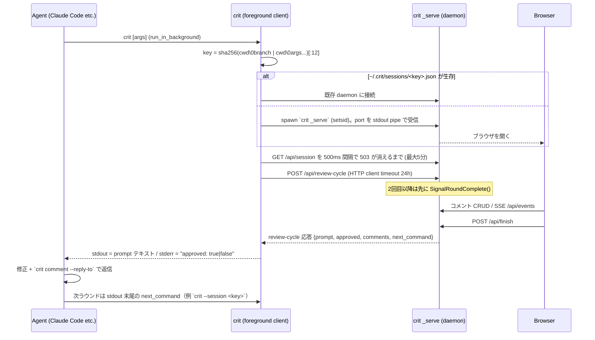

# 01 — crit teardown（mitori 向けリサーチ）

- 対象: https://github.com/tomasz-tomczyk/crit （MIT, Go）+ https://github.com/tomasz-tomczyk/crit-web （MIT, Elixir/Phoenix）
- 調査時点: 2026-10-03 / crit HEAD `406875d` (2026-10-02, v0.21.1)。ローカル clone: `scratchpad/refs/crit`
- 手法: ソースの通読 + **実バイナリをビルドして隔離 HOME で実行**（`go build -trimpath -ldflags "-s -w"`、HOME/GOPATH/GOCACHE はすべて scratchpad）、HTTP API を curl で叩いてブラウザ操作を再現、Browser pane で UI を目視、Go ベンチ実行、asset budget スクリプト実行、story prep のサイズ実測。
- 本文中の「実測」は上記の実験で得た値。「主張」は crit 側ドキュメントの記載。

---

## 0. TL;DR（数字で）

| 指標 | 値 | 出典 |
|---|---|---|
| GitHub stars / forks | 1,164 / 93 | `gh api repos/tomasz-tomczyk/crit` (2026-10-03) |
| 作成日 / commit 数 / 直近リリース間隔 | 2026-02-16 / 932 commits / v0.20.3→v0.21.0→v0.21.1 が 4日・4日 | GitHub API |
| Go 本体（非テスト） | 45,672 行。最大は `internal/server/server.go` 3,508 行、`internal/session/session.go` 3,114 行 | `wc -l` |
| Go テスト | 259 ファイル / 2,709 `Test*` 関数 / 83,046 行（本体の 1.8 倍） | `grep` |
| E2E | Playwright 133 spec / 911 test、11 project（mobile 375×812、perf 300 files、huge 2,500 files 等） | `test/e2e`, `AGENTS.md` |
| Web | vanilla JS（ビルドなし）。`web/app.js` 11,055 行 / 462 KB raw / 113 KB gzip | 実測 |
| バイナリ | 20.8 MB（darwin/arm64, stripped, 実測）。CI cap 24 MiB (linux/amd64) | `asset-budget.json` |
| 埋め込み JS (gzip) | `web/*.js` 合計 1,310,475 B（うち mermaid 976,021 B = **74.5%**）、`web/pierre/` 1,421,619 B | `scripts/check-asset-budget.sh` 実行 |
| daemon 起動→ready | 約 320 ms（plan.md 1 ファイル、プロセス spawn 込み） | 実測 |
| 行 diff (Hirschberg) | 1k 行 2.8 ms / 5k 行 78 ms / 10k 行 258 ms（**O(N·M)**） | `go test -bench` 実測 (M 系 18 core) |
| round 跨ぎコメント移送 | `BenchmarkCarryForward`（10k 行 plan + 50 comments）393 ms | 実測 |
| story prep サイズ | 3 files/115 行 diff → 8.8 KB(≈2.2k tok)、32 files/969 行 → 81 KB(≈20k tok)、120 files/5.1k 行 → 342 KB(≈85k tok)。**予算なし（意図的）** | `crit story --prep` 実測（bytes/4 換算） |
| story 生成コスト（主張） | 20–50 files / 2k–5k 行の PR で **$1–1.40（Claude Opus 5, `/crit-story`）** | `docs/story-mode.md` |
| agent へ返す finish payload | 3 comments で 1,415 B ≈ 120 tok/comment（timestamp・anchor 重複込み） | 実測 |

**一言で**: crit は「人間が AI 出力を GitHub PR 風に指摘 → agent がブロッキング CLI の stdout でそれを受け取り修正 → round diff で検証」というループを、単一バイナリ・ローカル・ゼロ設定で極めて丁寧に作り込んだツール。**ただし“変更差分（plan/diff/live page）”が対象で、リポジトリ全体の理解・設計書化は一切やらない**。mitori はこのループ設計をほぼそのまま借り、対象を「repo 全体の設計書 ↔ コード」に広げる立ち位置になる。

---

## 1. アーキテクチャ

### 1.1 パッケージ構成

```
cmd/crit/          package main。commandDispatch（cli_dispatch.go）→ 未登録は runReview へ fallthrough
  cli_install.go   `crit install <tool>`（1,478 行）: integrations/ を embed.FS から各ツールの所定パスへコピー
  integration_hashes_gen.go  埋め込み統合ファイルの sha256 表（インストール済みファイルの鮮度チェック用）
  cli_handlers_story.go      `crit story`（978 行）
internal/
  daemon/    セッション registry (~/.crit/sessions)、daemon spawn、readiness pipe、review-cycle long-poll client
  server/    net/http mux（全 API）、SSE、finish/prompt render、agent_cmd 実行、静的配信（embed.FS）
  session/   セッション状態（ファイル一覧・コメント・round）、review.json 読み書き、watch（1s polling）、carry-forward
  diff/      Hirschberg LCS 行 diff、hunk 化
  story/     story prep 生成・ingest 検証（trust boundary）
  prompt/    finish/story prompt テンプレート解決（5 段の優先度 + trust）
  hooks/     finish 時の command hook 実行（60s timeout）
  live/      live mode 用 reverse proxy + HTML injection、cookie 転送、CDP cookie 取得
  preview/   静的 HTML プレビュー
  share/     crit-web への share/unpublish/pull（dedup 付き）
  github/ gitlab/ forge/   PR/MR の pull/push（gh/glab CLI 経由）
  vcs/       VCS interface（git / sapling / jj）
  focus/     file focus・range focus（--range A..B）・stacked PR layer
  config/    ~/.crit.config.json + .crit.config.json マージ、global-only キー強制
  auth/      crit-web への OAuth Device Flow
web/          埋め込みフロントエンド（後述）
integrations/ 15 ツール分の skill / command / hook / plugin マニフェスト + stock prompts
```

設計判断（`AGENTS.md` "Key architecture decisions" より要約）:
1. **全アセットを `embed.FS` に埋め込み**単一バイナリ化。
2. **フロントのビルドステップなし**（npm は vendor 取得のみ）。
3. **markdown-it を採用した理由は `token.map`（ブロック→ソース行範囲）**。行単位コメントの土台。
4. **リスト・表・引用・コードフェンスを per-item/per-row/per-line ブロックに分割**し、各ソース行を独立にコメント可能にする。
5. コメントは**ソース行番号**で参照し `~/.crit/reviews/<key>/review.json` に保存（**200ms debounce で毎回書き出し**）。
6. ファイル監視は **git mode: `git status --porcelain` を 1s polling / files mode: mtime polling**、変更は SSE で push。
7. **127.0.0.1 bind がデフォルト**。非 loopback は `--allow-unauthenticated-network` 必須（認証機構が無いため）。

### 1.2 daemon モデル



要点:
- **セッションキー**: git mode `sha256(cwd + "\0" + branch)[:12]`、file mode `sha256(cwd + "\0" + args...)[:12]`（branch 非依存）、live `sha256(cwd + "\0live\0" + origin)[:12]`（`internal/daemon/daemon.go:175-205`）。symlink 解決済み cwd（macOS `/var`→`/private/var` 対策）。
- **registry**: `~/.crit/sessions/<key>.json` = `{pid, port, host, cwd, branch, review_path, started_at}`（実測値は下記）。生存判定は PID + `/api/health`（PID 再利用対策）。
- **readiness**: port bind 直後に OS pipe で親へ通知し、git/ファイル読込は後追い。**それまで `withReady` で 503**。クライアントは必ず `/api/session` を poll（`daemon/client.go:124`）。
- **ブロッキング**: `POST /api/review-cycle` は subscribe→（2回目以降は round-complete 通知）→ `finish` か `server-shutdown` イベントまで待つ long-poll（`server.go:2660`）。shutdown 時は 503 + `approved:false` を明示返却して「接続断＝暗黙承認」事故を防ぐ。
- **寿命**: approve されるか kill されるまで常駐。idle timeout 無し。approve 時はクライアントが `POST /api/shutdown?pid=` → 終了待ち → `cleanup_on_approve` でレビューファイル削除。`/api/shutdown` は `Sec-Fetch-Site`/`Origin` ヘッダがあれば 403（ブラウザからは停止不可）。
- **ロック**: `flock` + 100→500ms 指数バックオフ（`acquireSessionLock`）。書き込みは temp+fsync+rename の atomic write（`session/atomic_write.go`）。
- **stale sweep**: review/plan 開始時に 14日（`stale_review_days`）未更新のレビューをバックグラウンド削除。
- **再開**: `crit resume` は `~/.crit/reviews/*/review.json` の `cwd` を読み、`StartDaemonInDir` で元ディレクトリに daemon を再生成。

実測した session file:
```json
{"pid":18208,"port":62723,"host":"127.0.0.1","cwd":".../demo/repo","branch":"feature",
 "review_path":".../crithome/.crit/reviews/bf29afd81ae1","started_at":"2026-10-02T15:55:49.71252Z"}
```

### 1.3 HTTP API と SSE

主要エンドポイント（`server.go:136-224`）:
- 無ゲート: `GET /api/health` → `{status, browser_clients, api_version:1}`、`GET /api/qr`、`POST /api/shutdown?pid=`
- セッション: `/api/session`, `/api/config`, `/api/review-cycle`, `/api/finish`, `/api/round-complete`, `/api/rounds`, `/api/events`(SSE), `/api/wait-for-event`, `/api/focus`, `/api/picker`, `/api/branches`, `/api/base-branch`, `/api/commits`, `/api/files/list`, `/api/story`, `/api/agent/request`, `/api/attachments`, share 系 9 本
- ファイル: `/api/file?path=`, `/api/file/diff?path=`, `/api/file/comments?path=`, `/api/comment/{id}[/replies[/{rid}]|/resolve]?path=`, review-level は `/api/comments`, `/api/review-comment/{id}`
- 静的: `/files/<path>`（traversal 防御）、`/pierre/*.js.gz`（`Content-Encoding: gzip` で配信）、`/`（embed.FS）

SSE イベント型（実コードから抽出）: `file-changed`, `edit-detected`（agent 作業中の編集数）, `comments-changed`, `finish`, `server-shutdown`, `story-updated`, `focus-changed`, `base-changed`, `live-route`, `live-round-start`, `message`。heartbeat 30s、Safari 対策で接続直後に `:\n\n` を 1 byte 送る。

セキュリティ: 状態変更リクエストは `Sec-Fetch-Site` が付いていれば `same-origin` 必須（CSRF）、`checkHost` で DNS rebinding 防御、body 上限 10 MB（comments）/1 MB（share-url）、`ReadTimeout 15s / IdleTimeout 60s`（SSE のため WriteTimeout 無し）、コメント HTML は markdown-it `html:true` → DOMPurify（GitHub 互換 allowlist）。

> API の JSON ケースが混在（`/api/file/diff` は Go の `OldStart`/`Lines` をそのまま、他は snake_case）。mitori は最初から schema を固定すべき。

### 1.4 ストレージレイアウト（v4 folder form）

```
~/.crit/
  sessions/<key>.json, <key>.log, <key>.lock     # 稼働中 daemon の registry（daemon 死亡で削除）
  reviews/<key>/
    review.json        # エージェントが読む唯一のファイル（CritJSON）
    snapshots.json     # files mode の round ごとの本文（review.json を肥大化させないため分離）
    attachments/       # 画像添付
    share.lock
  plans/<slug>/        # `crit plan` / ExitPlanMode hook 経由の plan レビュー
  prompts/, hooks/     # global prompt テンプレ / command hook
  stats.json           # 生涯統計（disable_stats で無効）
~/.crit.config.json    # global config（agent_cmd 等の global-only キーと auth token を含む）
.crit.config.json      # project config（repo root）
```
`--output .crit` で repo 内（`.crit/reviews/<key>/`）にも置ける。

### 1.5 review.json の正確なスキーマ（`internal/session/session.go`）

```ts
// CritJSON（ファイル全体）
{
  branch: string; base_ref: string; updated_at: string; review_round: number;
  share_url?: string; share_base_url?: string; delete_token?: string; share_scope?: string;
  share_org?: string; share_org_name?: string; share_visibility?: string; last_share_hash?: string;
  review_comments?: Comment[];           // review-level (id "r_xxxxxx")
  cli_args?: string[];
  files: { [repoRelPath: string]: { status: string; file_hash: "sha256:..."; comments: Comment[] } };
  cwd?: string; active_diff_scope?: string; pending_remote_deletes?: RemoteRef[];
  review_type?: "" | "live"; origin?: string;      // live mode
  story?: Story;
}
// Comment（id "c_" + 3 random bytes hex = 6 hex）
{
  id: string; start_line: number; end_line: number; side?: "old"|...;
  body: string; quote?: string; quote_offset?: number;   // 選択テキストと（空白圧縮後の）開始位置
  anchor?: string;            // コメント作成時の対象行テキスト全体（drift 補正用）
  drifted?: boolean; drifted_on_round?: number;
  author?: string; user_id?: string; scope?: "line"|"file"|"review";
  created_at: string; updated_at: string;
  resolved?: boolean; resolved_round?: number; live?: boolean; carried_forward?: boolean; review_round?: number;
  replies?: Reply[];          // { id "rp_xxxxxx", body, author?, user_id?, created_at, review_round?, resolved_round?, github_id?, gitlab_*?, last_pushed_body_hash? }
  github_id?: number; gitlab_note_id?: number; gitlab_discussion_id?: string; gitlab_resolved?: boolean;
  last_pushed_body_hash?: string; head_sha?: string; diff_scope?: "layer"|"full_stack"|"";
  dom_anchor?: { pathname; css_selector; tag_chain: string[]; accessible_name?; role?; landmark?; outer_html; viewport_width; viewport_height };
  pin_number?: number;        // live pin の review 内通し番号
  focus_key?: "" | "pr:<n>" | "range:<base>..<head>";   // どの view で書かれたか
}
```
ルール（`crit-cli` skill）: `resolved` 欠落＝未解決、file-level は `start_line:0`、`anchor` で位置を再特定、`drifted:true` は行番号が概算。

実測した review.json（抜粋。ブラウザ相当の API で付けたコメント）:
```json
{"id":"c_f4b6eb","start_line":18,"end_line":21,
 "body":"Header presence is not auth. Validate a bearer token.",
 "quote":"r.Header.Get(\"Authorization\") == \"\"",
 "anchor":"\t\tif r.Header.Get(\"Authorization\") == \"\" {\n\t\t\thttp.Error(w, \"unauthorized\", ...)\n\t\t\treturn\n\t\t}",
 "scope":"line","created_at":"2026-10-02T15:56:22Z","updated_at":"2026-10-02T15:56:22Z","review_round":1}
```
（同じセッションで `crit comment` CLI 経由のコメントは `scope` と `review_round` が付かなかった — 書き込み経路で正規化がずれている。）

### 1.6 round-to-round diff と carry-forward

- **round の境界**: agent が再度 `crit`（= `POST /api/review-cycle`）を叩くと `SignalRoundComplete()` → watcher goroutine が `handleRoundComplete*` を実行。
  - markdown/files mode: 旧本文を `PreviousContent` に退避、`snapshots.json` に `{content, status, position, captured_at}` を round 番号キーで保存（R1 = 起動時ベースライン）、未解決コメントを carry forward、ディスクから再読込。
  - code/git mode: base ref に対して git diff を取り直し、`ChangedFiles()` を再実行して新規/削除ファイルを検出。
  - 待機中モーダルは `edit-detected` SSE で「agent が今 N ファイル編集中」を表示。
- **Document/Diff トグル**: markdown の Diff は **前ラウンドとの差分**（`/api/file/diff` が `previous_content` + hunks を返す。実測で確認）。
- **carry-forward アルゴリズム**（`session/watch.go:925-1220`）:
  1. `diff.ComputeLineDiff(prev, curr)`（Hirschberg LCS、O(N·M) 時間 / O(N) 空間）→ `MapOldLineToNew` で旧→新行マップ。
  2. `remapLines` で start/end を写像（未マップは元位置、`[1,maxLine]` に clamp）。
  3. `anchor` があれば `verifyAndCorrectPosition`: (a) 写像先がアンカー全文と一致 → OK、(b) `anchorSimilar`（trim 一致 / 短い方が 8 文字以上で長い方に包含 / 中央 1 箇所の連続削除のみ / Levenshtein 比 ≥ 0.7）→ OK、(c) ファイル全体からアンカー完全一致を探索し写像位置に最も近いもの、(d) 見つからなければ `drifted=true`（位置は LCS のまま）。
  4. `side:"old"`（base 側）と file-level は位置固定、live pin は `dom_anchor` で解決し drift しない。
  5. フィールドは `carryForwardComment` で**全列挙コピー**（新フィールド追加時の取りこぼしをレビューしやすくする意図的な冗長）。
- **実験**: server.go の先頭に 2 行コメント + import 1 行追加、対象行も書き換え → `c_f4b6eb` 18–21→**21–24**、`c_2286ef` 12→**15**、いずれも `drifted` なし（行内編集を `anchorSimilar` が吸収）。`carried_forward:true`、round 2。ただし `anchor` は旧テキストのまま更新されない。
- **コスト**: 10k 行 plan で diff 258ms + remap = 393ms（実測）。複数大型 plan では線形に積み上がる（`docs/performance.md` も認識）。

### 1.7 書き込み・監視・同期

- 書き込み: 変更ごとに 200ms debounce（`session_write.go:19`）→ read-merge-modify（story など外部フィールドを保持）→ atomic write。finish 前は `SyncWriteFiles()` で同期 flush。
- 外部書き込み（`crit comment` CLI が daemon を介さず review.json を直接書く）は、watcher が **1s ごとに `os.Stat` で mtime を見て `mergeExternalCritJSON`** → SSE `comments-changed`。
- **実測した race**: `crit comment` 直後（<1s）に finish すると、prompt 冒頭の件数は**メモリ上の 2 件**（`UnresolvedCommentCount`）なのに、埋め込み JSON は**ディスクから読んだ 3 件**（`listComments` は `LoadCritJSON`）。二重の真実源 + 1s polling が原因。→ mitori は「daemon 稼働中は CLI も daemon API 経由で書く（single writer）」にすべき。

### 1.8 live mode（proxy + injection）

`crit live <url>` / `crit <url>`（`internal/live/proxy.go`, `docs/live-mode.md`）:
1. API サーバ（review chrome）と **別ポートの proxy** を起動。chrome は proxy を iframe で読む。
2. `httputil.ReverseProxy`: `Accept-Encoding`/`If-None-Match`/`If-Modified-Since` を削除（本文を書き換えるため非圧縮で取得、`DisableCompression:true`）、`X-Forwarded-*` 付与、`Origin`/`Referer` を upstream に書き換え、cookie 注入（`--cookie` / `--cookie-file`(Netscape jar 可) / `--cdp-url` で Chrome DevTools から対象 origin の cookie を取得）。
3. `text/html` 応答のみ: CSP / X-Frame-Options **ヘッダ**削除、`Set-Cookie` の Domain 削除・loopback では Secure 削除・`SameSite=None`→`Lax`、chunked 強制、**最大 25 MB** までバッファ（超過は `X-Crit-Agent-Injection: skipped-oversized` で素通し）、HTML コメント内の `<head>`/`</body>` を誤検出しないよう**長さ保存マスキング**してから regex。
4. `<head>` 直後に service worker 無効化 shim（register を reject、既存 SW を unregister）+ route announcer、最後の `</body>` 直前に agent bundle 8 本（`agent-protocol.js`, `agent-anchor-utils.js`, `agent-scroll-utils.js`, `agent-marker-overlay.js`, `agent-mutation-batcher.js`, `agent-resolution.js`, `agent-reanchor-state.js`, `crit-agent.js`）を API origin から読み込み。
5. agent が `postMessage('agent-ready')` してから Comment/Pin を有効化。メッセージは A2C 11 種（`selection`, `pin-clicked`, `route-change`, `pin-resolution-result` …）/ C2A 12 種（`set-pins`, `request-resolution`, `enter-reanchor-mode` …）。
6. **DOM アンカー**: `css_selector`（root からの nth-of-type パス）+ `tag_chain` + 安価な fallback（`accessible_name`, `role`, `landmark`）+ `outer_html`（切り詰め）+ viewport。解決は「selector→tag chain 検証→landmark 内で role+name 探索」で `recovered_via` を返す。read（getBoundingClientRect）と write（style 変更）を分離して layout thrash を防止（`agent-mutation-batcher.js`）。
7. 既知の失敗: meta タグ CSP は剥がせない、`</body>` 無し応答、`localhost` vs `127.0.0.1` の origin 不一致で `agent-ready` が落ちる、等。Phoenix/Vite/Next.js の検出ヒントを stderr に出す。
8. **crit-web がこの 8 ファイルを byte 単位で vendoring** し、drift-guard テスト（`preview_agent_sync_test.exs`）で乖離を検出。

### 1.9 フロントエンド構成（`docs/frontend-js.md`）

- `index.html` 1 枚がパスで分岐（`/live` → live-mode スクリプト群、他 → code-review）。スクリプトは動的 `<script async=false>` で並列取得・順序実行。
- **レビュー一覧は `@pierre/diffs` 1.5.1（Apache-2.0）の `CodeView`**: 仮想化、sticky header、Shiki（146 grammar, JS regex engine）を **worker pool** でトークナイズ、word diff、split/unified、context 展開。crit はヘッダ・コメント・フォーム・Document view を「annotation」として差し込む。
- markdown Document view は crit 独自の line-block 文書を Pierre の空 file item の line-0 annotation に載せる（Pierre に任意コンテンツ item が無いための回避策）。**文書内部は非仮想化**（10k 行 plan が最大 DOM）。
- モジュールは IIFE + `window.crit.<ns>` / `module.exports` 二重 export（node --test で単体テスト可能に）。

---

## 2. エージェント統合プロトコル

### 2.1 契約（あらゆる agent 共通）

1. agent は `crit [args]` を**バックグラウンド実行**（Claude Code: `run_in_background: true`、Gemini: `run_shell_command` がブロック）。
2. 起動時 stderr の URL（`Started crit daemon at http://localhost:<port>`）を**そのまま**ユーザーへ中継。
3. 人間が Finish を押すまで**何もしない**（review file を先読みしない、ユーザーに入力を促さない）。
4. 終了したら **stdout = 次にやることの完成済みプロンプト**、**stderr = `approved: true|false`**。
5. 各コメントを Edit で反映 → `crit comment --reply-to <id> --author 'Claude Code' '<what you did>'`（**`--resolve` は付けない**：解決は人間の権限）。
6. stdout 末尾の `next_command`（例 `crit --session bf29afd81ae1`）を再実行 → round-complete 通知 + 次の Finish まで再ブロック。0 コメントで Finish = approve でループ終了。

実測した stdout（story 付き diff review、3 コメント、1,415 B）:
```
The story-mode review finished with 2 unresolved comments.        ← 実際は3件（1.7 の race）
Story mode is an editorial view over the underlying diff. Address the comments against the actual source files. ...
[{"scope":"review","id":"r_e9ded4",...,"created_at":"...","updated_at":"...","review_round":1}, ... ]
For each comment, make any needed code edit and reply ... `crit comment --reply-to <comment-id> --author <your-name> "<explanation>"`.
When you're done, run:
  crit --session bf29afd81ae1
```
stderr: `Connected to crit daemon at http://localhost:62723 (session bf29afd81ae1)` / `approved: false`。

**トークン観点**: 1 コメントあたり約 470 B ≈ 120 tok。`created_at`/`updated_at`（約 60 B）、`quote` と重複する `anchor`、`start_line:0` 等は agent にとってほぼ不要。mitori は「ファイル別グルーピング + 必要フィールドのみ」で 1/2〜1/3 にできる。

### 2.2 `/crit` skill（`integrations/claude-code/skills/crit/SKILL.md`, 6,317 B ≈ 1.6k tok）

frontmatter:
```yaml
name: crit
description: "... Use only when the user explicitly invokes /crit or directly asks to use Crit; a generic review request does not count."
allowed-tools: Bash(crit:*), Bash(command ls:*), Read, Edit, Glob
argument-hint: "[file|url]"
```
- **明示呼び出し限定**の description（誤発火 = 無駄なトークンと勝手なブラウザ起動を防ぐ）。
- `allowed-tools: Bash(crit:*)` で crit コマンドの permission prompt を省略。
- 本文は Step 1–5 + 「**CRITICAL — you MUST run this step. Do NOT skip it.**」の強調、`<important if="...">` 条件付きブロック（quote/anchor/drifted がある時、複数返信時は `--json` バルク、Tailscale 越し閲覧時、share/QR 時）。AGENTS.md でも同じ `<important if>` 方式を多用 — **条件に合う時だけ注意を向けさせる**指示の書き方。
- 引数省略時の推論: 会話中に plan ファイルを書いていれば `crit <plan>`、それ以外は bare `crit`（branch diff）。モードは CLI が自動判別するので agent に聞かせない。

### 2.3 `crit-cli` skill（10,702 B ≈ 2.7k tok, `user-invocable: false`）

model が自動参照するリファレンス。review.json の読み方、`crit comment` 文法、`--session` による複数セッション曖昧解消、plan レビューは `--plan <slug>` 必須、`pull/push`、share。バルク JSON:
```bash
echo '[{"body":"overall","scope":"review"},
       {"file":"src/auth.go","line":"50-55","body":"Extract to helper"},
       {"reply_to":"c_a1b2c3","body":"Fixed"}]' | crit comment --json --author 'Claude Code'
# 改行を含む本文は Write ツールで temp ファイル → crit comment --json --file /tmp/x.json
```
スコープ推論: `reply_to`→返信 / file も line も無い→review / path のみ→file / path+line→line。`quote` + `quote_offset` も受け付ける（v0.21.1 で追加、#1013）。**ID は per-session 一意だがファイル跨ぎで衝突し得る**ので `--path` で曖昧解消。

### 2.4 Plan hook（plan モードの自動レビュー）

- **Claude Code**: `integrations/claude-code/hooks/hooks.json` が `PermissionRequest` の `matcher: "ExitPlanMode"` に `crit plan-hook`（**timeout 345,600 s = 96 h**）。stdin の `tool_input.plan` を `~/.crit/plans/<slug>/` に保存してレビュー、結果を
  - approve: `{"hookSpecificOutput":{"hookEventName":"PermissionRequest","decision":{"behavior":"allow","updatedInput":...,"updatedPermissions":[{"type":"setMode","mode":"acceptEdits","destination":"session"}]}}}`（`plan_approve_mode` 設定時のみ setMode）
  - unresolved: `decision.behavior:"deny", message:<finish prompt>` → Claude はコメント付きで plan 修正に戻る。
  - session_id → slug を保存し同一会話の再 plan を同じレビューに束ねる。`CRIT_PLAN_REVIEW=off` で無効化。
- **Codex**: `Stop` hook で `crit plan-hook --mode codex`、未承認なら `{"decision":"block","reason":<prompt>}`。
- **Gemini CLI**: `BeforeTool` の `exit_plan_mode` に hook（timeout 345,600,000 ms）+ `policy.toml` で `exit_plan_mode` を allow。

### 2.5 Send to agent（実験的、`agent_cmd`）

- UI の「Send now」→ `POST /api/agent/request` → `buildAgentPrompt`（ファイル・行範囲・quote・本文・全返信履歴 + 「`crit` を呼ぶな、stdout が返信になる」）を `agent_cmd`（例 `claude --dangerously-skip-permissions -p`）の stdin へ。`{prompt}` プレースホルダがあれば引数渡し。timeout 10 分、cwd = repo root。
- stdout をそのまま reply として投稿、ファイル変更は watcher が拾って UI 更新。以後そのスレッドは **live thread**（⚡ badge）になり人間の返信が自動送信される。
- **`agent_cmd` は global config 限定**（悪意ある repo の `.crit.config.json` から任意コマンド実行させない）。同様に `auth_token`/`share_url`/`proxy_auth`/`plan_approve_mode`/`close_on_approve_after_ms`/`stale_review_days` も global-only。

### 2.6 Prompt テンプレートと command hook

- finish 文言は Go `text/template`。キー: `on_finish_unresolved[:files|:diff|:story|:live|:preview]`, `on_finish_approved[...]`, `on_story_generate`。
- 解決順: project config → global config → `.crit/prompts/*.md` → `~/.crit/prompts/*.md` → stock（story モードは stock story テンプレを generic より優先）。
- 変数: `review_path`, `comments_cmd`, `comments_all_cmd`, `next_round_cmd`, `session_key`, `mode`, `unresolved_count`, `total_count`, `files_with_comments`, `plan_slug`, `comments_unresolved_json`, `comments_json`, `session_stats.*`。例: 10 件超なら「トピック別にサブエージェントを並列起動せよ」（`integrations/prompts/examples/on_finish_unresolved.diff.md`）、approve 後に「議論から恒久ルールを AGENTS.md に蒸留」。
- **command hook**（`hooks` マップ / `.crit/hooks/on_finish_*.sh`）: stdin に JSON、`CRIT_*` env 18 種、60s timeout、失敗しても finish は止めない、stdout は agent に渡さない。
- **project trust**: project 側 prompt/hook があると Finish/Approve をブロックし、レンダリング済みプレビュー付きの trust ダイアログ（「変更されるまで信頼」= 参照ファイル全内容の hash で再確認 / 常に信頼 / Crit デフォルト使用）。trust は global config の `trusted_project_prompts`（repo root hash キー）。

### 2.7 パッケージング / 配布

- **Claude Code plugin marketplace**: repo root の `.claude-plugin/marketplace.json`（`"source": "./integrations/claude-code"`）→ `integrations/claude-code/.claude-plugin/plugin.json`（plugin 版 1.8.10、バイナリ版 v0.21.1 とは独立採番）+ `skills/{crit,crit-cli,crit-story}` + `hooks/hooks.json`。インストールは `claude plugin marketplace add tomasz-tomczyk/crit && claude plugin install crit@crit`。**バイナリは別途 brew/go/nix で入れる前提**（plugin はバイナリを同梱しない）。
- **Codex plugin**: `integrations/codex/plugin/crit/.codex-plugin/plugin.json`（`skills`, `hooks`, `interface.defaultPrompt` 等）。Cursor は `.cursor-plugin/marketplace.json`。
- **`crit install <tool>`**: 15 ツール（Claude Code, Cursor, Copilot, OpenCode(v1/v2 plugin), Codex(+plugin), Pi, Qwen, Hermes, Windsurf, Cline, Aider, Gemini, Grok, Amp, Docker）。cwd が `$HOME` なら global、repo root なら project に配置。既存はスキップ（`--force`）。統合ファイルはバイナリに embed、`integration_hashes_gen.go` の sha256 で**インストール済みが古いと起動時に警告**（`no_integration_check` で抑止）。
- crit 自身の開発用 `.claude/settings.json` に `PostCompact` hook で「lint が拾わない 5 つの注意」を再注入 — compaction 後のルール喪失対策として面白い。

---

## 3. Story mode

### 3.1 フロー

推奨（in-session、`/crit-story` skill, 6,472 B）:
1. `crit story --guide` → 解決済みガイド（ユーザーのカスタム含む）+ `---` + JSON schema を stdout（実測 6,880 B ≈ 1.7k tok）。skill 本文にガイドを複製せず**毎回ランタイム取得**。
2. `crit story --prep /tmp/crit-story-prep.txt` → **diff 全文（無トリム）をファイルに書くだけ**。プロンプトには貼らない（prompt-by-reference）。
3. agent が読んで `prologue`/`chapters`/`support` だけの JSON を書く。
4. `crit story --story-file /tmp/crit-story.json` → 検証（coverage を毎回 stdout に JSON 出力）→ review.json の `story` に保存 → daemon 起動 + ブラウザ。
5. bare `crit` で通常の `/crit` ループに合流（コメントは**ソースファイル**に対して処理、story JSON は触らない）。

代替（ターミナル）: `crit story [--pr N|--mr N|--range A..B]` が global `agent_cmd`（agentic CLI 必須: `claude -p`, `codex exec`）を spawn。**5 分 timeout、JSON parse 失敗時に 1 回だけ**エラー文を添えて再試行、2 回目も失敗なら raw 出力を temp に保存して exit 1。`ExtractJSON` は ```json フェンス除去 → なければ最初の `{` から最後の `}`。その他 `--refresh`, `--no-spend`（再生成せず開く）, `--clear`, `--skip-llm`（全 hunk を support に入れた stub）。

### 3.2 prep 形式（実測）

```
=== SCOPE ===
base_sha: 415b2825239ad19f1f5df327d837a191916f4abe
head_sha:                                     ← working tree scope は空
scope_fingerprint: f25073614238d8e5...

=== COMMITS ===
feat: add auth middleware and server timeouts

=== HUNKS ===
--- (go.mod, 0) [added]                       ← hunk ID = (file_path, old_start)。新規ファイルは 0
@@ -0,0 +1,3 @@
+module demo
...
--- (server.go, 1) [modified]
@@ -1,10 +1,26 @@
 package main
-import "net/http"
+import (
...
```
`ignore_patterns` に一致するファイルの hunk は prep から除外され、ingest 時に `support[]`（reason `"ignored"`）へ自動配置。

### 3.3 JSON shape（agent が書く部分）

```json
{"prologue":{"title":"<=48 chars","overview":"1-3 sentences, stands alone",
   "key_changes":["required"],"risks":["required"],"diagram":""},
 "chapters":[{"id":"ch1","title":"<=48 chars","summary":"one-liner",
   "hunk_refs":[{"file_path":"internal/server/prompts.go","old_start":42}],"diagram":""}],
 "support":[{"hunk_refs":[{"file_path":"go.sum","old_start":120}],"reason":"Dependency checksum churn."}]}
```
crit 側が付与（とドキュメントは言う）: `version`, `generated_at`, `base_sha`, `head_sha`, `scope_fingerprint`, `coverage{ok, indexed, placed, missing[], duplicated[], auto_repaired}`。実際は `coverage` 以外を刻印するのは `--skip-llm` 経路だけ（§3.8）。`agent`（モデル名）フィールドは struct に定義があるが、どの経路でも設定されない。chapter 配列順＝表示順（order フィールド無し）。

### 3.4 ingest 検証（`internal/story/ingest.go` — trust boundary）

順序厳守: ① 正規化（title を 48 rune で `...` 切り詰め）→ ② shape（prologue 4 項目必須、chapter id は `[A-Za-z0-9_-]+` 一意で `overview`/`support` 禁止）→ ③ **drift**（`story.scope_fingerprint` と live diff の fingerprint 不一致で拒否）→ ④ ignored を support へ事前配置 → ⑤ **重複**（同一 hunk が 2 箇所以上 → 拒否）→ ⑥ **placed < 50% で拒否**（ハルシネーション/drift とみなす）→ ⑦ 欠落を `support[]`（reason `"auto-repaired"`）へ back-fill → `ok = !auto_repaired`。

実測: chapter 1 + support 1 で 3 hunk 中 2 を配置 → `{"ok":false,"indexed":3,"placed":2,"missing":["(plan.md, 7)"],"auto_repaired":true}` / exit 0 で保存。

### 3.5 stock プロンプトの原則（`integrations/prompts/on_story_generate.md`, 5,301 B）

1. **Explainer, not reviewer**（バグ探し・判定・修正提案禁止）、2. **chapter はファイルでなくテーマ**、3. **coverage 必須**（全 hunk を chapter か support に丁度 1 回）、4. support はロックファイル・生成物・依存 bump 等のノイズ、5. **prologue だけ読めば変化の形が分かる**、6. diagram は既定で空（最大 1 つ）、7. **hunk は prep の ID でのみ参照し、diff テキストを再引用しない**、8. outside-in 順（API→ロジック→永続化→テスト）を推奨、9. **2–6 章が典型、8 が上限**、1 章あたり 1–6 hunk。出力は raw JSON のみ。

### 3.6 トークンコストと「安く保つ」工夫

| 工夫 | 効果 |
|---|---|
| prompt-by-reference（prep はファイル、ガイドにはパスだけ） | プロンプト自体は ~1.7k tok に固定。agent は必要に応じて読む／分割読み |
| **出力は ID 参照のみ**（`(file_path, old_start)`）、diff 再引用禁止 | 出力トークンが hunk 数に比例する小さな JSON に収まる（Opus の出力単価が高いので効く） |
| support バケット + ignore_patterns の事前除外 | ロック/生成物に章立ての思考を使わせない |
| 検証・修復はサーバ側の決定的コード | 再生成ループ（= 再課金）を減らす。欠落は auto-repair、50% 未満のみ拒否 |
| in-session 生成を推奨 | 既に会話にある文脈を再利用でき、サブスク内で完結（`agent_cmd` は別課金） |
| story は明示呼び出し時のみ | 通常 `/crit` で勝手に生成させない |

**安くならない点（mitori の改善余地）**:
- prep に**予算が一切ない**（コメントで「意図的に diff budget 無し」と明言, `prep.go:51`）。実測で 120 files/5.1k 行 → 342 KB ≈ 85k tok。lockfile は ignore_patterns 未設定だと全文入る。
- **キャッシュ/差分再生成なし**: `--refresh` は全部作り直し。round が進んでも story は古いまま（再生成は手動）。
- コストは「探索の深さ」依存で読めない（ドキュメント自身が「線形にスケールしない」と記述）。$1–1.40/PR は Opus 5 前提の経験値。

### 3.7 story UI（実画面で確認）

- 左レール: Overview（Prologue & index）/ Chapters（各章に「N file · M hunk」と進捗リング）/ Support。ヘッダに「0 / 3 files viewed」、Story/Diff トグル、Split/Unified、Finish Review。
- Prologue ページ: タイトル・overview・Key changes / Risks の 2 カラム・「Read in order」章リスト（各章の +/- 行数）。
- Chapter ページ: 「Chapter 1 of 1」+ summary + 章に属する hunk のみを Pierre `FileDiff`（非仮想化）で表示、ファイル単位 Viewed チェック。**章の進捗＝章に含まれるファイルの viewed 比率**（通常 diff と同じ viewed 状態を共有）。
- ショートカット: `Shift+J/K` 章移動、`Shift+O` prologue、`Shift+S` support、`1–9` 章ジャンプ、`\` レール開閉。URL hash `#story/ch1` で深リンク。

### 3.8 実測で見つけた story の欠陥

1. **`--story-file` 経路では `version`/`generated_at`/`base_sha`/`head_sha`/`scope_fingerprint` が付与されない**（保存結果 `"version":0`、SHA/指紋なし）。`--skip-llm` 経路（`cli_handlers_story.go:546`）だけが付与している。しかも skill は「scope_fingerprint を含めるな」と指示 → `Run()` の drift 判定は `ScopeFingerprint != ""` ガードで**推奨経路では常に no-op**。
2. fingerprint は `(file_path, old_start)` の ID 集合だけを hash（struct コメントは「ids+headers」と書くが実装は ID のみ）→ hunk 内容が変わっても検出できない。
3. support ページのラベルが**最初の entry の reason**（実測で go.mod の「Module file.」が auto-repaired の plan.md も含むページ名になった）。
4. 「8 章上限」はプロンプトのみで ingest は強制しない。

---

## 4. 真似すべき UI/UX・性能テクニック

### 4.1 コメント体験

| テクニック | 実装 | mitori での使い道 |
|---|---|---|
| 行番号クリック／ドラッグで範囲コメント、GitHub 風インラインスレッド | Pierre gutter utility + annotation（`kind: thread/form/outdated/...`）、要素を `kind:id` でキャッシュし仮想化で外れても**入力途中のフォームの caret・本文を保持** | 設計書セクション・コード範囲の両方に同じコメント UI |
| テキスト選択→`c` で **quote 付き**コメント | shadow DOM 越し選択を `Selection.getComposedRanges({shadowRoots})` で取得、`quote_offset` を空白圧縮後のオフセットで保存 | 「この一文」への指摘をピンポイントで AI に渡す |
| quote ハイライト | **CSS Custom Highlight API**（`::highlight(crit-quote)`）— DOM を割らない | 長文設計書でも DOM 変更ゼロで強調 |
| suggestion ブロック | ```` ```suggestion ```` を選択行で挿入、カード上で −/+ diff 表示 | 「この文をこう直して」を機械可読に |
| `@path/to/file` 参照チップ、`` `c_xxxxxx` `` を他コメントへのリンクチップ化 | markdown-it inline rule + TreeWalker | 設計書⇄コード⇄コメント相互リンク |
| 下書き自動保存 | `localStorage` に 500ms debounce（`crit-draft.js`）、Ctrl+Enter 送信 | 同様 |
| IME 対応 | `if (e.isComposing) return;`（comment-form, live-mode 各所） | **日本語必須**。Enter 確定で誤送信しない |
| 解決は人間だけ | agent には `--resolve` を禁止、R1/R2 の round バッジ、hide resolved（`h`） | 同じ権限モデル |
| review-level conversation | ページ上部「Review conversation」+ `Shift+G` | 全体所感 |
| Finish ワンボタン + 待機モーダル（agent の編集数を live 表示）+ `notify_on_round_ready` デスクトップ通知 + approve 後 auto-close カウントダウン | SSE `edit-detected` | 待ち時間の可視化 |

### 4.2 キーボード

`crit-shortcuts.js`: グループ化されたレジストリ（Navigation/Comments/Review/Story/Live/View）、各ショートカットに `modes`、**ユーザー再割当て + 衝突検出 + 予約キー**（Esc/Tab/Enter/1–9/Ctrl+Enter/?）、`eventToBinding` が `ev.code` で Shift+数字・記号を正規化（キーボード配列差異対策）、設定は cookie に保存。既定: `j/k` ブロック移動、`Shift+V` visual line（範囲選択）、`]`/`[` コメント移動、`n/N` 変更移動、`c/e/d` コメント作成/編集/削除、`Shift+F` finish、`Shift+1..4` スコープ切替（all/branch/staged/unstaged）、`b` サイドバー、`t` TOC、`?` 一覧。

### 4.3 表示・テーマ・a11y

- **設定を cookie に保存する理由**: daemon がランダムポートで立つため origin（=localStorage）がポートごとに分かれる。cookie はポートを区別しないので**全セッションで設定共有**できる。mitori も同じ問題を持つので必須テクニック。
- テーマ: Shiki の全バンドルテーマから light/dark を各 1 つ選び、`scripts/crit-theme-palette.mjs` がテーマ JSON から UI パレット（surface/accent/border/status）をビルド時に導出、コード・markdown・図・コメント・chrome が同一パレット。opt-in「Syntax contrast: Increased」でトークン色の明度だけを 4.6:1 未満から引き上げたテーマ複製を登録。CSS 変数は 4 ブロック（`:root` dark fallback / `prefers-color-scheme: light` / `[data-theme=dark]` / `[data-theme=light]`）すべてに定義するルール。`/themes` に固定サンプルのテーマプレビュー頁。
- a11y: ARIA 属性 ~300 箇所（`aria-label` 118, `aria-hidden` 35, `aria-expanded` 25, `aria-live` 17, `aria-modal` 9 …）、`prefers-reduced-motion` 4 箇所、Pierre の組み込みコントロールに accessibility label を後付け。mobile は 375×812 + touch の E2E project がある。
- `.gitattributes` の `linguist-generated` を折りたたみ、`auto_viewed_patterns`（`*.lock`, `generated/` 等）を初回自動 viewed。

### 4.4 性能（`docs/performance.md`）

- **大規模レビュー**: サーバは先頭 25 ファイルのみ eager（`lazyFileThreshold = 25`）、残りは numstat のみ。クライアントも `EAGER_FILE_LIMIT=25`（全件同時 fetch で Chrome のリクエスト上限を超えた経験から）。未ロードファイルは **numstat から行数を見積もった空行の stub patch** を置いてスクロール高さをほぼ確定させ、深いジャンプが着地するようにする。表示時に並列 4 で hydrate。
- **構造的不変条件で perf を E2E 保証**（wall clock ではない）: 300 files/9k 行で mounted item ≤15（実測 3〜7）、`[data-line]` ≤400（33〜84）、DOM ノード <12,000（~3.4k）、ロード後 fetch ≤30（25）、TBT <4,000ms（36ms、6×CPU throttle で ~700ms）。2,500 files（2^22px 超）で深いジャンプ後 mounted ≤40（2）、ノード <60k、in-flight `/api/file` ≤100（76）。
- main thread を空ける: Shiki は Pierre の worker pool（2000 行フェンスの main thread 側は ~5ms、main thread で Shiki すると ~350ms）。イベントは**コンテナ単位で委譲**（10k 行で 10k listener を付けた過去バグ #657 の再発防止）。annotation の metadata オブジェクトを安定させ Pierre に node 再利用させる。動的な範囲 tint は全 shadow root に adopt した 1 つの constructable stylesheet（`unsafeCSS` 変更は全 item 再描画になるため）。
- Go 側: `b.Loop()` + `ReportAllocs()` のベンチ、CI で head vs base 比較 — time は有意 **≥20% 劣化**で fail（分散 ≥25% の行は無視）、**allocs は 1 つでも増えたら fail**（決定的なので）。`perfsprint` linter。
- **asset budget**（`asset-budget.json` + `scripts/check-asset-budget.sh`、CI job）: ファイル別 gzip cap（実測/上限）

| asset | gzip 実測 | cap | 使用率 |
|---|---|---|---|
| mermaid.min.js | 976,021 | 1,180,000 | 83% |
| pierre-diffs.js.gz | 167,933 | 200,000 | 84% |
| pierre-worker.js.gz | 106,715 | 128,000 | 83% |
| app.js | 113,239 | 155,000 | 73% |
| markdown-it | 47,874 | 60,000 | 80% |
| live-mode.js | 28,834 | 31,000 | 93% |
| style.css | 36,166 | 41,000 | 88% |
| `web/crit-*.js`（glob） | 98,671 | 100,000 | **98.7%** |
| `web/*.js` 合計 | 1,310,475 | 1,950,000 | 67% |
| `web/pierre/` 合計 | 1,421,619 | 1,650,000 | 86% |
| binary (linux/amd64) | — | 25,165,824 | — |

  cap は実測の ~1.15–1.2 倍、四半期ごと再較正。vendor は `ASSETS-PROVENANCE.txt` に sha256 + npm 出所を記録し `verify-assets` で検証。

**ただし実測した弱点**:
- **mermaid（3,572,661 B raw）を code-review ページで毎回 eager ロード**（`index.html:458`）。perf doc 自身が「mermaid の遅延化」を未対応 follow-up に挙げている。
- `/` 配下は `http.FileServer` で**非圧縮・Cache-Control なし**（実測: mermaid 3.57 MB を gzip 要求でも 3.57 MB 転送。圧縮配信は `pierre/*.gz` のみ）。budget は gzip を測るが、実際の配信は raw。localhost では 7ms だが、Tailscale/`public_url` 越しや JS parse/compile コストには効く。
- Document view の markdown は非仮想化、gutter 初回 mousedown で 10k 行文書を全再描画（未対応 follow-up #1）。

---

## 5. Share（crit.md / crit-web）

- **構成**: crit-web は **Elixir/Phoenix + LiveView + PostgreSQL 17**、hosted は Fly（`SENTRY_RELEASE` を Fly deploy が設定と README に記載）、self-host は `ghcr.io/tomasz-tomczyk/crit-web` の Docker（`SELFHOSTED=true`）。876 ファイル、33 stars。
- **データモデル**（`lib/crit/review.ex`）: `reviews{token, delete_token, last_activity_at, review_round, cli_args(≤64 個, 各≤256B), title, visibility: unlisted|public|organization, comment_policy: open|logged_in_only|disallowed, review_type: files|preview, user, organization}` + `comments` + `review_round_snapshots`。**30 日無操作で自動失効**（`inactive_cleanup_worker`）。
- **API**: `POST /api/reviews`（files[] + comments[] + review_round + cli_args + org + visibility）→ `{url, delete_token}`、`PUT /api/reviews/:token`（upsert、内容変化で round を上げる）、`DELETE /api/reviews`（delete_token）、`GET /api/reviews/:token/comments`（pull 用）。CLI 側は `ShareScope`（ソート済みパスの sha256 先頭 16 hex）でファイル集合の変化を、`computeShareHash`（内容 + 解決状態）で「前回 share から変化なし」を検出し無駄な round を作らない。
- **閲覧**: `/r/:token`（LiveView）。著者ごとにコメント色分け、キーボード操作・テーマも同等。preview の生 HTML は `/r/:token/raw/*`。**`PREVIEW_HOST` で別オリジンに隔離**しないと共有 preview 内のユーザースクリプトがセッション cookie を読めると README が警告。
- **認証**: 匿名 share 可。アカウントは GitHub OAuth（hosted）/ 汎用 OIDC（self-host）。CLI は **OAuth Device Flow**（`crit auth login`、token は `~/.crit.config.json`）。組織・招待・メンバー・org 単位 visibility、discussion のメール digest（SMTP、quiet window/バッチ）。
- **SSO リバプロ配下の self-host**: `proxy_auth:true` だとターミナル経由 share を禁止し、**ブラウザのポップアップ relay**（`/share-receiver` が same-origin fetch で `/api/...` を代理）で share/pull/unpublish。
- **取り込み時 dedup 必須**: `buildLocalIDSet` + `buildLocalFingerprintIndex`（author+lines+body）+ `dropDuplicateWebComment` を経ないと pull のたびに重複（AGENTS.md の太字ルール）。GitHub PR 同期も同様（`mergeGHComments*`）。
- **初回 share 同意**（`share_consented`）、**テレメトリなし**、起動時の更新チェック 1 回のみ（`CRIT_NO_UPDATE_CHECK=1`）。
- 料金: crit.md 上に有料プランの記載なし（2026-10-03 時点、WebFetch 確認）。

**mitori への示唆（Cloudflare 前提）**: Phoenix+Postgres+Fly 相当は Cloudflare では Workers（API + 静的）+ D1（reviews/comments/rounds）+ R2（ファイル本文を content-hash キーで重複排除保存）+ Durable Objects（同時閲覧・コメントの WebSocket fan-out、hibernation で常時課金を抑制）+ Cron Trigger（30日失効）に写像でき、リソース名 `mitori-*`。SSO は Cloudflare Access で「popup relay」を不要にできる可能性。preview 隔離は別サブドメイン（`mitori-preview.*`）。

---

## 6. mitori のビジョンに対する crit の弱点・ギャップ

| # | ギャップ | 根拠 | mitori の機会 |
|---|---|---|---|
| 1 | **リポジトリ全体の理解をしない**。対象は plan/diff/live page/HTML のみ。story も「diff スコープ専用」（docs 明言） | `docs/story-mode.md` "diff-scoped only" | repo 全体 → 設計書（モジュール・データフロー・API・非機能）を生成するのが本業 |
| 2 | **設計書という成果物が無い**。story は review.json 内の一時的な editorial view で、approve で既定削除（`cleanup_on_approve:true`） | `README.md` config 表 | 設計書を一級の永続成果物（git 管理可能な md/JSON）にし、コードと双方向リンク |
| 3 | 段階的開示は prologue → chapter → hunk の 3 段だけ。初心者向け（用語集・前提知識・「まずここを読め」）も熟練者向け（不変条件・計算量・トークン量）も無い | UI 実画面 | L0 一行要約 → L1 全体像 → L2 モジュール → L3 シンボル/コード の階層と、読者レベル切替 |
| 4 | 「Explainer, not reviewer」を強制 — リスク・非機能面の分析をしない（risks は箇条書き 1 つ以上必須なだけ） | stock prompt 原則 1 | 説明と評価（非機能: 性能・トークン・セキュリティ）を分離レーンで両立 |
| 5 | **トークン予算・キャッシュ・増分更新が無い**（prep 無予算、`--refresh` は全再生成、round が進むと story が陳腐化） | `prep.go:51`、実測 85k tok | content-hash 単位のキャッシュ、変更モジュールだけ再要約、予算に応じた階層要約（map-reduce） |
| 6 | アンカーが「行番号 + 行テキスト」のみ。シンボル/AST 単位の意味的アンカーが無い。設計書のある記述 ↔ コード範囲という**多対多の対応**を持てない | `Comment` schema | `anchor` を `{file, range, text, symbol_path, ast_hash}` に拡張し、設計書ノード ↔ コード範囲の対応表を持つ |
| 7 | drift 検出が推奨経路で無効、fingerprint が ID のみ | §3.8 | prep 時にサーバ側で token を発行し ingest 時に必須化、内容 hash で fingerprint |
| 8 | 二重の真実源（メモリ / review.json）+ 1s polling で件数不一致 race | §1.7 実測 | daemon 稼働時は single writer、FS 監視は fsevents/kqueue（chokidar 相当）で即時 |
| 9 | O(N·M) Hirschberg（10k 行 258ms）、mermaid 3.57 MB eager・非圧縮配信、Document view 非仮想化 | §1.6, §4.4 実測 | Myers O(ND)/patience diff、図ライブラリ遅延ロード、brotli/gzip 事前圧縮 + immutable cache、文書も仮想化 |
| 10 | agent への payload が冗長（~120 tok/comment） | §2.1 実測 | 必要フィールドのみ・ファイル別グループで ≤50 tok/comment を目標 |
| 11 | **i18n なし**（`<html lang="en">`、翻訳機構なし）。IME 対策はあるが UI は英語固定 | `web/index.html:2` | ja/en を初日から（文言カタログ + 日付/数値ロケール） |
| 12 | MCP サーバなし。ループは「バックグラウンド bash + skill の CRITICAL 指示」頼みで、agent がステップを飛ばすと壊れる（だから大文字で繰り返し強調している） | skill 本文 | CLI 契約は踏襲しつつ MCP（`wait_for_review`, `get_comments`, `reply`）や hook も用意し、取りこぼしを構造で防ぐ |
| 13 | 共同作業はローカル単一ユーザー + 非同期 share のみ（リアルタイム共同編集なし）。share 基盤は Elixir+Postgres で self-host が重い | §5 | Cloudflare DO でリアルタイム共同レビュー、月額 ≤1000円 |
| 14 | 巨大モノリス（`app.js` 11k 行、`server.go` 3.5k 行）、`web/crit-*.js` が budget 98.7% | §0, §4.4 | 最初から機能境界で分割 + budget を served bytes で測る |

---

## 7. mitori への具体的推奨

**そのまま採用する（実績のある契約）**
1. **ブロッキング CLI + long-poll 契約**: `mitori review` が「人間の Finish まで待つ → stdout に完成済みプロンプト、stderr に `approved:`、末尾に next command」。daemon は `sha256(cwd\0branch)[:12]` で registry 管理、ready 前は 503、shutdown 時は明示的に `approved:false`。どの agent でも動く最小公倍数。
2. **ID 参照のみで LLM に出力させ、検証・修復はサーバ側の決定的コード**: crit の hunk_refs + coverage（重複拒否・<50% 拒否・欠落 auto-repair・support バケット）を、mitori の「設計書セクション → コード anchor ID」に一般化。出力トークンが最小になり、再生成ループも減る。
3. **prompt-by-reference**: 大きな入力はファイルに書き、プロンプトにはパスと指示だけ。ガイドは skill に埋め込まず `mitori guide` でランタイム取得（ユーザーカスタムを常に反映）。
4. **解決権限は人間**（agent は返信のみ、`--resolve` 禁止）、round バッジ、round 間 diff。
5. **セキュリティ既定**: 127.0.0.1 bind、`Sec-Fetch-Site` CSRF 防御、Host 検査、コマンド実行系設定は global-only、project 由来の prompt/hook は内容 hash 付き trust ゲート。
6. **配布**: `.claude-plugin/marketplace.json` → plugin（skills + hooks）、Codex `.codex-plugin`、`mitori install <tool>` は embed + sha256 鮮度チェック。skill は「明示呼び出し限定」description + `allowed-tools: Bash(mitori:*)` + `<important if>` 条件ブロック。plan モードは Claude `PermissionRequest/ExitPlanMode` hook（長い timeout）で自動レビュー。
7. **UI 技法**: annotation 要素キャッシュ（仮想化でも入力保持）、`getComposedRanges` + Custom Highlight API、suggestion ブロック、コメント ID/ファイル参照チップ、draft autosave、IME `isComposing`、再割当て可能なショートカットレジストリ、**設定は cookie（ポート跨ぎ共有）**、viewed 状態と章進捗、`?` 一覧、テーマ由来パレット。
8. **perf ガードレール**: 構造的不変条件の E2E（mounted item 数・DOM ノード数・fetch 数・TBT）、Go/TS のベンチを CI で head-vs-base（allocs は厳格）、asset budget を CI で。`@pierre/diffs`（Apache-2.0）は差分/コード表示に流用候補。

**改良して採用する（crit の穴を埋める）**
9. fingerprint は **内容 hash**（hunk/シンボル本文）で、prep 時にサーバが発行し ingest 時に必須。生成物には `version/generated_at/base_sha/model` を必ずサーバ側で刻印。
10. **トークン予算 + 階層要約 + content-hash キャッシュ**: ファイル → モジュール → システムの map-reduce、未変更ノードは再利用、変更があったノードと祖先だけ再生成。目標値（例: 初回生成のトークン/行、増分更新のトークン/変更行）を定義して CI で計測。
11. **single writer**（daemon 稼働時は CLI も API 経由）+ OS ファイル監視で即時反映（1s polling と件数 race を回避）。
12. diff は Myers O(ND)（類似文書でほぼ線形）＋行 hash、アンカーは行テキストに加えシンボルパス/AST hash。
13. agent payload を圧縮（timestamp 除去、anchor と quote の重複排除、ファイル別グループ）。
14. 配信: 重いライブラリ（mermaid 等）は使用時のみ動的 import、全アセットを brotli/gzip 事前圧縮 + content-hash ファイル名 + `immutable`。budget は「実配信バイト」と「初期ロードバイト」で測る。
15. i18n（ja/en）を初日から。

**避ける**
16. 巨大単一ファイル（`app.js` 11k 行）と、仕様をプロンプトだけで強制して検証しない部分（8 章上限など）。
17. 表示用ビューを一時データとして消す設計（mitori の設計書は永続・バージョン管理対象）。

---

## 8. オープンクエスチョン

1. mitori の「設計書」は repo 内（`docs/mitori/*.md` + JSON sidecar）に置き git 管理するか、crit 同様 `~/.mitori` に置くか。チーム共有と PR レビューを考えると前者が有力だが、生成物ノイズとの兼ね合い。
2. 生成は in-session（ユーザーの Claude Code/Codex サブスク内、crit 推奨方式）か、mitori が `claude -p` / `codex exec` を spawn（`agent_cmd` 方式、並列化しやすい）か。両対応にするなら、どちらを既定にするか。
3. 全 repo 読込の初回コスト目標（例: 10万行 repo を何トークン/何分で）と、増分更新の目標をどう置くか。crit は「PR 1 本 $1–1.40」しか基準が無い。
4. 設計書ノード ↔ コード範囲の対応を、LLM 出力の ID 参照だけで作るか、tree-sitter 等の静的解析で骨格を先に作り LLM は説明だけを書くか（後者の方が coverage 検証・drift 検出が決定的になる）。
5. `@pierre/diffs` を採用するか自前描画か（Apache-2.0 だが、crit は shadow DOM 内部属性への依存を「upgrade リスク」と明記）。
6. リアルタイム共同レビューを v1 に入れるか（crit は非同期 share のみ）。入れるなら Durable Objects の課金が 1000円/月以内に収まる利用規模の見積もり。
7. MCP サーバを主経路にするか CLI 契約を主にするか（crit は MCP を持たず、HN の旧投稿にあった "Optional MCP integration" は現行コードに存在しない）。

---

## 付録 A: 実験ログ（再現手順）

```bash
S=<scratchpad>; export HOME=$S/crithome CRIT_NO_UPDATE_CHECK=1 CRIT_NO_INTEGRATION_CHECK=1
export GOPATH=$S/gopath GOCACHE=$S/gocache GOMODCACHE=$S/gopath/mod GOTOOLCHAIN=local
cd $S/refs/crit && go build -trimpath -ldflags "-s -w" -o $S/bin/crit ./cmd/crit   # 5.6s, 20.8MB
# demo repo（main + feature branch, server.go/plan.md/go.mod）で:
crit story --guide | wc -c                       # 6880
crit story --prep $S/demo/prep.txt               # 1120 B
crit story --no-open --story-file story.json     # {"ok":false,"indexed":3,"placed":2,...,"auto_repaired":true}
crit --no-open &                                 # review-cycle で待機
curl -X POST "localhost:$P/api/file/comments?path=server.go" -d '{"start_line":18,"end_line":21,"body":"...","quote":"..."}'
crit comment --author 'Claude Code' server.go:12 'Consider WriteTimeout too'
curl -X POST localhost:$P/api/finish             # → foreground crit の stdout に prompt（1415 B）
# 編集 + `crit comment --json` で返信 → `crit --no-open &` で round 2 → 行番号 18→21, 12→15
cd $S/refs/crit && git fetch --deepen=40 && crit story --range HEAD~5..HEAD --prep p.txt   # 80,889 B
go test -run='^$' -bench='ComputeLineDiff|CarryForward|ReviewSaveLoad' -benchmem ./internal/diff/ ./internal/session/
bash scripts/check-asset-budget.sh --web-only
curl -s -o /dev/null -H 'Accept-Encoding: gzip' -w '%{size_download}' localhost:$P/mermaid.min.js   # 3572661
```

## 付録 B: 主要参照ファイル

- 契約/プロトコル: `internal/daemon/client.go`, `internal/server/server.go:2456-2830`（finish / review-cycle / SSE）, `internal/server/server.go:3135-3270`（agent_cmd）
- スキーマ: `internal/session/session.go:72-200, 540-680`, `internal/session/round_snapshot.go`, `internal/session/review_paths.go`
- carry-forward: `internal/session/watch.go:440-560, 900-1220`, `internal/diff/diff.go`
- story: `internal/story/{prep,ingest,prompt,scope}.go`, `cmd/crit/cli_handlers_story.go`, `integrations/prompts/on_story_generate.md`, `docs/story-mode.md`
- live: `internal/live/proxy.go`, `web/agent-*.js`, `web/crit-agent.js`, `docs/live-mode.md`
- 統合: `integrations/claude-code/{skills,hooks}`, `.claude-plugin/marketplace.json`, `integrations/codex/plugin/crit/.codex-plugin/plugin.json`, `internal/session/plan_cli.go:200-420`, `docs/agent-prompts.md`, `docs/agent-hooks.md`
- UI/perf: `docs/frontend-js.md`, `docs/performance.md`, `asset-budget.json`, `web/crit-shortcuts.js`, `web/crit-draft.js`, `web/crit-pierre-dom.js`
- share: `internal/share/share.go`, crit-web `lib/crit/review.ex`, `lib/crit_web/router.ex`, README

## 付録 C: 外部ソース

- https://github.com/tomasz-tomczyk/crit （README, AGENTS.md, docs/）
- https://github.com/tomasz-tomczyk/crit-web （README, lib/）
- https://crit.md （機能一覧、価格記載なし、1,164 stars 表示）
- https://news.ycombinator.com/item?id=47322273 （Show HN, 4 points / 1 comment）
- https://news.ycombinator.com/item?id=47746165 （Ask HN April 2026: 比較対象として Codex desktop app、VSCode 拡張 "Markco" が挙がる）
