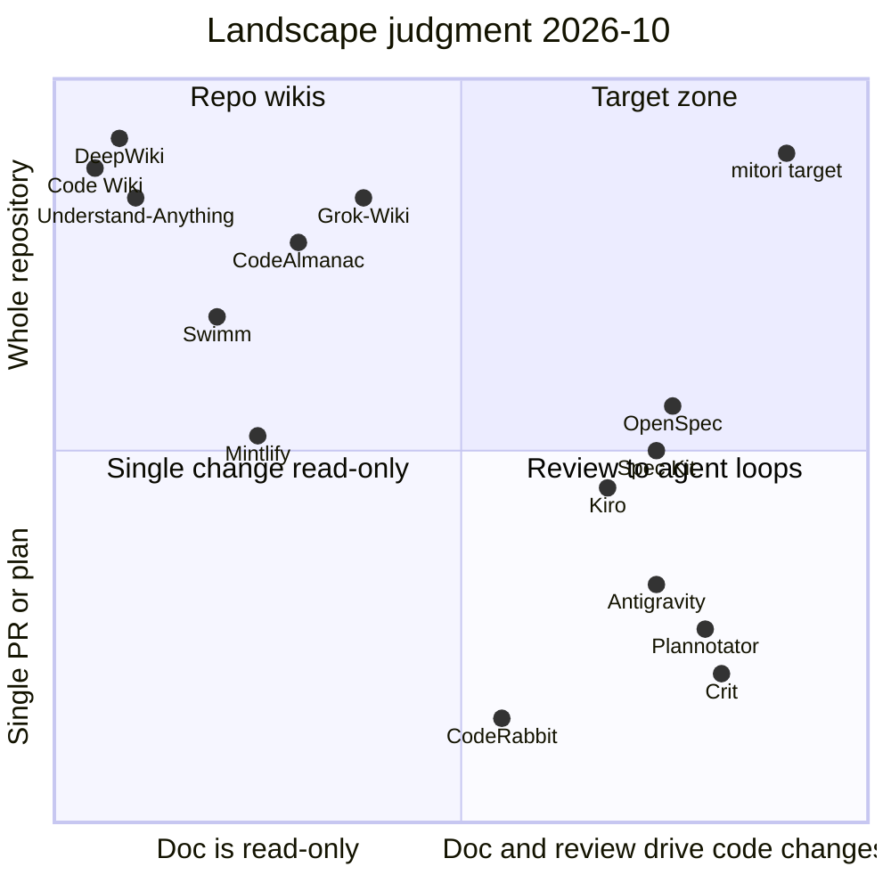

# 03. Competitive Landscape: mitori (見取り図) の競合・隣接プロダクト調査

- 調査日: 2026-10-03 (全ての「現在」はこの日付)
- 範囲: repo-to-wiki / code intelligence / doc-sync / AI code review / context packer / spec-driven dev / coding agent の plan review / agent 向け review UI / 2026 newcomers
- 目的: mitori が「作るべきもの」「作ってはいけないもの」「先に取れる空白」を、証拠付きで決める

## 0. 読み方と信頼度

各主張の末尾に信頼度タグを付けた。

| タグ | 意味 |
|---|---|
| [P] | Primary。ベンダー docs / pricing page / README / GitHub API を 2026-10-03 に直接取得して確認 |
| [S] | Secondary。ブログ・比較サイト・ニュース。方向性の参考。数値は食い違うことがある |
| [L] | Local。この調査中に手元で実行して測定した値 (Appendix B) |
| [J] | 調査者の判断・推定。事実ではない |

制約と正直な注意点:

- WebFetch は小型モデルによる要約を返すため、数値は「ページ本文が引用している」場合のみ [P] とした。価格は pricing page 直接取得分のみ [P]。
- DeepWiki 本体は bot checkpoint (HTTP 429, Vercel Security Checkpoint) で取得不能。回避はしていない。DeepWiki の UX/出力品質は docs・第三者レビュー・HN スレッド (いずれも [S]) に依拠する。Code Wiki は SPA (Angular) で静的取得では中身が読めず、ブラウザ操作も権限で拒否された。UX の細部は未確認。
- aggregator 系 SEO 記事 (「Best X 2026」類) は価格・日付が互いに矛盾する (例: Kiro の GA 日は 2025-11-17 / 2026-03 / 2026-05 と3説、Mintlify Pro は $250/$300/$450 と3説。公式 pricing page は $450/月 [P])。矛盾がある項目は本文中で明示した。
- 「どの製品も X をしない」は、「読んだ docs/README に X の記載がない」の意味で使う。機能が非公開に存在する可能性は排除できない。

---

## 1. エグゼクティブサマリ

1. **空白は実在する。** 「repo 全体から生成した人間向け設計書」+「設計書上の位置に anchored したレビュー/編集」+「その位置に必要な最小コンテキストだけを持たせてユーザー自身の agent (Claude Code / Codex / Gemini CLI) に修正を dispatch」+「結果を doc と code の diff で返す」を一つの閉ループで提供する製品は、調べた約50製品の docs に見当たらなかった [J]。個々の部品は別々の製品に散らばっている。
2. **部品の最近接:**
   - repo 全体の設計書生成: DeepWiki / Code Wiki / Grok-Wiki / Understand-Anything。いずれも **read-only** (人が直す経路が無い)。
   - anchored review → agent: Crit / Plannotator / Antigravity。対象は **plan・diff・単一 artifact** であり repo 全体の設計書ではない。
   - 文書 → コード: Kiro / Spec Kit / OpenSpec。**機能単位の spec** であり既存 repo の現状理解書ではない。`/speckit-converge` は spec→code の照合で append-only (tasks.md にしか書かない) [P]。
   - コード → 文書同期: Mintlify / Swimm。前者は顧客向け product docs、後者は 2026 時点で COBOL/mainframe 近代化に軸足 [P]。
3. **信頼の穴が最大の痛点。** DeepWiki は LibreOffice の build system を誤記 (Buck と主張、実際は Make)、LLVM の主要部品を欠落、未完成の VS Code extension を主要インストール方法と断定した事例が報告され、初期は訂正・削除の正式な経路が無く、個別メールで対応された例と無視された例が混在した [S: biggo / blopker / HN]。CodeWikiBench (CodeWiki 著者自身の benchmark である点に注意) でも DeepWiki は 64.06% で CodeWiki 68.79% に劣る [P: arXiv 2510.24428]。→ 「人が直せる」「根拠がその場で検証できる」は強い楔になる。
4. **市場の熱量は巨大 (GitHub stars, 2026-10-03 [P])**: Spec Kit 139,784 / Understand-Anything 85,022 (作成 2026-03-15, 6.5か月) / CodeGraph 72,862 / OpenSpec 70,908 / GitNexus 47,680 / deepwiki-open 18,111 / Plannotator 9,103 / m3e-canvas 8,567 (作成 2026-09-02, 1か月) / Crit 1,164。「理解」「spec」「トークン節約」の3領域が爆発的で、**レビュー UI は Plannotator (9.1k) が先行し、Crit (1.2k) は静か**。機能差より UX 磨きと配布 (Trendshift 等) が勝敗を分けている [J]。
5. **local + BYO agent は既に標準。** deepwiki-open (18k stars) 自身が README で「Grok Wiki is now live」と告げ、RAG+API key の Docker アプリから「ローカル CLI agent (Claude Code, Codex CLI, Grok CLI, Pi, Antigravity CLI) を使うデスクトップアプリ」へ転換した [P]。Crit/Plannotator/CodeAlmanac/Understand-Anything、さらに CodeWiki OSS 2.0 (`claude`/`codex` CLI を API key 無しで使う subscription mode) も同方向。**local-first 単体は差別化にならない** (必須条件)。
6. **embedding/RAG は後退、構造 index + agentic search が主流。** Cursor は Aug 2026 に semantic index を廃止し、local trigram index の Instant Grep のみに [P: docs / S: forum・解説]。CodeGraph (vendor 測定) は Claude Opus 4.8 で tool call -88%、tokens -62%、cost -44% [P: README, vendor-claimed]。→ mitori は vector DB を持たない設計が妥当 (インフラ不要・Nix 適合)。
7. **トークン削減 ≠ コスト削減。** arXiv 2607.12161 は、最も攻めた圧縮が tool output tokens を -38.4% にしたのに請求は +6.8% 増、相関 r=0.15、支配項は prompt cache の create/read と報告 [P]。CodeGraph 自身も「resident context は +80%」と開示 [P]。→ mitori の token 透明性は **tokens でなく cache 込みの金額 (USD/JPY) と cost per successful task** で出す。ここは誰も出していない。
8. **agent は人間向け docs をほとんど読まない。** 557 sessions / 94,813 events / 33,097 PRs の実証研究 (arXiv 2608.20195): 文書参照の 60.5% が instruction files、classical docs は 10.6%、API reference 1.3%。参照→編集の遷移確率は 0.002、code が先に触られる比率は 4.7倍 [P]。→ **設計書を agent に「読ませる」設計は効かない。dispatch 時に最小コンテキストを task packet として明示的に注入する**必要がある。これが mitori の中核技術要件。
9. **価格は usage-based へ一斉移行、請求の驚きが不満の源。** Copilot (2026-06-01 AI Credits) [S]、Cursor Bugbot ($40/seat→約$1.0-1.5/run, 2026-05) [P]、Mintlify (2026-09-04 固定クレジット 25/250) [P]、Greptile (2026-03 に $1/review 従量導入で反発) [S]、Codex (2026-04-02 token credit) [S]。Claude Code Review は 1 review 平均 $15-25・約20分 [P]。→ **事前見積 → 上限 → 事後実績** を出す製品は無い。BYO-agent なら mitori 自身の推論コストはゼロで、月 1,000 円上限の制約と整合する。
10. **脅威 (6-12か月以内に空白へ寄ってくる順) [J]:** (a) Grok-Wiki (Tasks board で finding→local agent 実行を既に持つ。ja UI あり)、(b) Understand-Anything (85k stars、persona UI、ja 対応。review/編集が無いだけ)、(c) Plannotator (9k stars、md/HTML/URL annotate + AI、Workspaces 発表)、(d) Cognition (Devin Wiki + Ask Devin + Codemaps + Review + Autofix を一社で保有)、(e) Google Code Wiki (Gemini CLI extension)。**窓は開いているが狭い。**

---

## 2. 市場マップ

### 2.1 レイヤー

| 層 | 代表 | mitori との関係 |
|---|---|---|
| A. Hosted repo wiki | DeepWiki, Google Code Wiki, Devin Wiki/Ask Devin | 最大の比較対象。「生成だけ・read-only」が弱点 |
| B. OSS / local wiki・knowledge graph | Grok-Wiki, deepwiki-open, OpenDeepWiki, Litho/Terrain, RepoWiki, Understand-Anything, CodeGraph, GitNexus, CodeAlmanac | 最も近い競合群。local+BYO agent は既に標準 |
| C. Doc-sync / knowledge platform | Mintlify, Swimm, Dosu, GitBook, Sourcegraph, (CodeSee は消滅) | 「コード→文書」の一方向。anchor 技術 (Swimm) は参考 |
| D. AI code review | CodeRabbit, Greptile, Graphite (Cursor傘下), Qodo, Devin Review, Claude Code Review, Cursor Bugbot | 「指摘→agent 向けプロンプト」文化の先行例。対象が PR 差分 |
| E. Context packer / map | repomix, gitingest, code2prompt, aider repo-map, Cursor index, Augment Context Engine, CLAUDE.md//init | token 工学の部品・基準値 |
| F. Spec-driven dev | Kiro, Spec Kit, OpenSpec, Tessl | 文書→コードの方向性。機能単位 |
| G. Coding agent の plan review | Antigravity, Cursor Plan Mode, Jules, Codex cloud, Copilot coding agent, Claude Code plan mode | 「計画へのコメント→反復」の UX 先行例 (クローズド) |
| H. Agent 向け review surface | Crit, Plannotator, (m3e-canvas: 視覚→prompt) | review→agent loop の直接の先行例 |
| I. Provenance / governance | Entire Checkpoints | 隣接 (commit に agent 文脈を保存) |
| J. 日本の設計書自動生成 | Fujitsu Application Transform, Jitera, SHIFT AIドキュメントリバース, GEAR.indigo | エンタープライズ SaaS。dev-local ではない |

### 2.2 ポジショニングマップ (判断 [J])



読み取り: 右上 (全体 repo × 文書/レビューが code を動かす) は **空**。Grok-Wiki が左上から右へ最も近づいている。

---

## 3. プロダクト別プロファイル

凡例の項目: **What / Review / Doc↔Code / Anchoring / Token・Cost / Speed / Price / Local・Cloud / UX / 示唆**。

### 3.1 層A: Hosted repo wiki

#### DeepWiki (Cognition) / Devin Wiki / Ask Devin / Devin Review / Codemaps

- **What**: `github.com` を `deepwiki.com` に置換するだけで repo の wiki (構成ページ+Mermaid 図+チャット) を得る。50,000+ の人気公開 repo は事前生成済み [S: codersera]。
- **Review**: 閲覧者がコメント・編集する機能は docs に無い。生成内容の調整は `.devin/wiki.json` のみ (repo_notes 各10,000文字以内・合計100件以内、pages 30件 (Enterprise 80件)、`purpose`/`parent`/`page_notes`) [P]。"No human curation, no path to hand-edit" [S: codersera]。
- **Doc↔Code**: Ask Devin に Plan mode があり、会話からそのまま Agent session を起動、進捗が会話内に出る [P]。ただし**文書の特定箇所に anchored ではない**。コード→文書は定期再生成で「最新 main から数時間〜数日遅れ」 [S]。
- **Anchoring**: 全 claim に行単位 citation (GitHub の該当行へ遷移) [S]。
- **Token/Cost**: wiki 生成の effort: Low=無料(既定)、Medium≈5-10 ACU/wiki、High≈20-40 ACU/wiki (ACU は旧 $2.25 単価 [S] で換算すると High は約 $45-90。ただし 2026 の self-serve は ACU から quota 制へ移行済みで換算は目安) [P docs / S]。Enterprise は low 固定。Fast mode は事前計算 graph から即答、Deep Research は 20-60秒 [S]。
- **Speed**: 新規 index は数分 (docs: "a few minutes depending on repo size" [P])。日本語生成は 10-30分、大規模 repo は約1時間 [S: Zenn]。
- **Price**: 公開 repo は無料 [P]。private/Ask Devin/DeepWiki は Pro $20 / Max $200 / Teams $80 base + $40/seat / Enterprise (Free プランには含まれない) [P: devin.ai/pricing]。
- **Local/Cloud**: Cloud only (コードは Cognition infra で index)。MCP (`mcp.deepwiki.com`) は公開 repo 向けに無料・認証なし [S: docs の検索要約]。
- **UX**: URL 置換オンボーディング、左ツリー+図+出典、チャット。多言語 (日本語) 生成を Devin settings で指定可 [S]。
- **評判の傷**: 誤情報 (LibreOffice/LLVM/Codebook)、図が「arbitrary」、SEO で公式 docs を押しのける、メンテナが訂正/削除できない、「excessive diagrams with invented content」(docs 貧弱な repo ほど悪化) [S: HN 45884169・45884860, blopker.com, biggo]。
- **隣接**:
  - **Devin Review**: PR URL の `github`→`devinreview` 置換、smart diff organization・copy/move 検出・codebase-aware chat・Autofix [S]。当初無料だったが 2026-04 の新プランで有償化 [S]。
  - **Autofix**: PR 上の bot コメント (linter/CI/security scanner) を Devin が自動処理。「internal token spend が大幅増」と自社ブログで認める [P: cognition.com blog]。
  - **Windsurf Codemaps** (Windsurf は docs が `docs.devin.ai/desktop` へリダイレクト、Devin Desktop 化 [P]): agent が repo を探索し階層ビュー (node→file/function)、共有リンク、`@` で agent prompt に参照可能。編集可否は不明 [P]。
- **示唆**: (1) URL 置換オンボーディングは配布面で模倣価値大。(2) 最大の弱点は「訂正不能+根拠が薄い」。(3) Cognition は部品 (Wiki/Ask/Review/Autofix/Codemaps) を全て持つ。**doc anchored comment を足されると最強の競合になる**。ただし Cloud/Devin 課金モデルのため local-first・BYO agent には寄れない [J]。

#### Google Code Wiki

- **What**: `codewiki.google`、公開 GitHub repo の wiki を自動生成、**変更のたびに再生成**と謳う。Gemini チャット、architecture/class/sequence 図、概念→file/class/function へのハイパーリンク [P: Google Developers Blog / DevOps.com]。2025-11-13 public preview [S]。
- **Review/Doc↔Code**: 記載なし (一方向 code→doc)。
- **Local/Cloud**: Cloud。private repo は **Gemini CLI extension** で local 実行予定、waitlist (2026-05 時点で未提供 [S]。2026-10 時点の更新は検索で見つからず) 。
- **Price**: 記載なし (public preview 無料)。
- **示唆**: Google が repo wiki を無料で出す = **汎用の「公開 OSS 向け wiki」で戦うのは無意味**。private/local/協働に寄せるのが筋。

### 3.2 層B: OSS / local の wiki・knowledge graph (最重要の競合群)

#### Grok-Wiki (AsyncFuncAI。deepwiki-open の後継)

- **What**: macOS (Apple Silicon のみ) Tauri デスクトップアプリ v0.0.38。GitHub repo/ローカルを **source-cited wiki / architecture guide / codebase map** に。**ローカルの CLI agent (Grok CLI, Codex CLI, Claude Code, Pi, Antigravity CLI) を実行**し API key は自分で管理 (BYOK/BYOC) [P: README]。
- **機能**: Ask (multi-turn, screenshot 添付, Clarify interview)、Knowledge Bases (Ask を study card に蒸留)、**Tasks board (Ask の finding を backlog/epic/sub-task にし、カードから検出済み local agent で実行、terminal transcript と変更サマリ付き)**、opt-in Code Graph、Quick Open (Cmd+P)、public read-only publish (grok-wiki.com)、Markdown ZIP export、**UI は en/ja/zh/ko** [P]。
- **Review**: inline comment の記載なし。**Doc↔Code**: wiki→code の anchored dispatch は無いが、Ask→Task→agent 実行の経路は存在 [P]。
- **Token/Cost**: "provider account and usage surfaces" を追加済みだが詳細不明 [P]。
- **License/規模**: desktop は closed (License 未記載)、OSS web 版は rlm-wiki。65 stars、作成 2026-05-15。PostHog telemetry (opt-out 可、exception は redact) [P]。deepwiki-open (18,111 stars) の README が Grok-Wiki への誘導に置換済み [P]。
- **示唆**: **最も近い競合。** mitori の差は「wiki の *各段落* にコメントを anchored し、最小コンテキストで dispatch し、doc/code diff で返す」点と、token/金額の事前見積、OSS+Linux/Windows+Nix。Grok-Wiki は mac 限定・closed・review 無しで、ここを突ける [J]。

#### Understand-Anything (Egonex-AI, 旧 Lum1104)

- **What**: Claude Code plugin (+ Codex/Cursor/Copilot/Gemini CLI/OpenCode/Kiro 等 14+ プラットフォームに install.sh)。`/understand` の multi-agent pipeline が `.ua/knowledge-graph.json` を生成し、`/understand-dashboard` でローカル配信 (tokenized URL, read-only, 生成後は LLM 呼び出し無し) [P]。
- **機能**: structural graph / domain view (業務フロー) / guided tours (依存順) / fuzzy+semantic search / diff impact / **persona-adaptive UI (junior dev, PM, power user)** / layer 可視化 / language concepts 解説 (12 patterns) / `/understand-onboard` / `/understand-knowledge` (Karpathy-pattern LLM wiki を解析) / `--language` (ja 含む) / Ollama でローカル LLM [P]。
- **Review/Doc↔Code**: 無い (README に comment/annotate/edit/fix の記載なし)。
- **Token/Cost**: 「初回は大規模 repo で大量 token。subscription か local model 推奨」と警告のみ。incremental は tree-sitter fingerprint で変更ファイルだけ再解析、`--auto-update` で post-commit hook [P]。graph JSON を commit すればチームメイトは pipeline をスキップ [P]。
- **規模**: MIT、85,022 stars / 7,171 forks、作成 2026-03-15 [P]。
- **示唆**: 「初見の人が全体を掴む」体験の事実上の基準。persona 切替・guided tour・commit 可能な成果物は踏襲価値大。**graph UI は expert の細部議論には向かない**点と、review→fix が無い点が空白。

#### CodeGraph (colbymchenry) / GitNexus

- **CodeGraph**: Rust kernel + SQLite、100% local の pre-indexed knowledge graph を MCP で提供 (Claude Code, Cursor, Codex, OpenCode, Gemini, Kiro, Copilot 等)。vendor 測定 (7 repos, `claude -p` Opus 4.8, 4 run 中央値, CLI を両 arm でブロック): **tool call -88%、時間 -53%、tokens -62%、cost -44%、file read ゼロ**。ただし長い session の resident context は **+80%** (VS Code: 67k vs 18k) と自己開示。Linux kernel (70k files) を 2 core/6GB で12分未満、保存時 incremental は <1秒 [P: README, vendor-claimed]。72,862 stars、MIT、作成 2026-01-18。hosted "CodeGraph platform" (PR ごとの影響・テスト範囲) は waitlist [P]。
- **GitNexus**: in-browser WASM (tree-sitter + 組込DB) の code intelligence、19 MCP tools (impact, trace, detect_changes, context, cypher, rename)、wiki 生成機能あり。47,680 stars。**PolyForm Noncommercial** (商用は別ライセンス) [P]。
- **示唆**: 構造 index を **LLM 無しの決定的処理**で作り、MCP/CLI で agent に渡すのは確立パターン。mitori は index を自前で持つか、CodeGraph 等を optional backend にするかを選べる (open question)。

#### CodeAlmanac (YC S26) / Terrain (Litho 後継)

- **CodeAlmanac**: repo 内 `almanac/` に plain markdown の wiki。「コードが語れないこと (why, invariants, gotchas, 失敗履歴)」を、**ローカルの Claude Code/Codex の会話ログから 5 時間ごとに抽出 (sync)**、24 時間ごとに garden (陳腐化・重複整理)。`serve` で local viewer。Git で通常のコードとしてレビュー。macOS+Codex/Claude、Apache-2.0、997 stars [P]。agent は広い FS 権限で動く (README が trust model を明記) [P]。
- **Terrain** (Litho の後継, MIT, 251 stars): `.terrain/human/` (C4 narrative+Mermaid) と `.terrain/agent/context.md` (**≤14 KiB**) の **二系統出力**、freshness score (50 未満は agent が割り引く)、HEAD 追跡の incremental、Rust single binary、LLM 無しで scan/pack/search [P]。Litho は C4 docs 生成 (3,102 stars)。
- **示唆**: 「同じ source から human 用と agent 用を別に出す」(Terrain)、「why は会話から拾う」(CodeAlmanac) は mitori に直接効く。**review thread そのものが "why" の一次資料**になりうる [J]。

#### OpenDeepWiki / RepoWiki / 学術系

- **OpenDeepWiki** (AIDotNet, 3,613 stars, MIT): .NET 10 + Next.js 16、Docker、Git/ZIP/ローカル取込、wiki+mind map+翻訳、repo-scoped MCP、chat、Feishu/Slack 等の webhook、増分更新ワーカー。エンタープライズ寄りサーバー型 [P]。
- **RepoWiki** (he-yufeng, 290 stars): `pip install`。PageRank による "start here" 読書順、`repowiki diff main...HEAD` で変更ファイルを blast radius 順に並べるレビュー順、`.repowiki-state.json` で増分、**partial coverage を正直に表示** (「wiki が完全だと偽らない」) [P]。→ 誠実さの UX として参考。
- **CodeWiki (arXiv 2510.24428, ACL 2026 Findings) と OSS 実装 FSoft-AI4Code/CodeWiki (MIT, 1,749 stars, 作成 2025-06-25)**: 階層分解+再帰 multi-agent+図の統合。CodeWikiBench で 68.79% vs DeepWiki 64.06% [P]。OSS 版 2.0 は `pip install` の CLI で、依存 graph をクラスタリングして module 木を作り、**leaf module ごとに agent が tool でコードを読んでページを書き、親ページは子ページから書く**。Mermaid は保存前に検証。build file・CI・Dockerfile・manifest も graph の node として文書化 (artifact-aware)。12 言語、数千行〜100万行超。**subscription mode で `claude` / `codex` CLI を API key 無しで使える**、`codewiki mcp` で IDE 側のモデルに執筆させる、`--github-pages` で HTML viewer。**component 単位の増分更新 `--update`: svelte で 1 commit 後の更新が $0.34、フルビルドは $21.48** (vendor-claimed)。review/comment UI は無い [P: README]。→ 生成エンジン側の最も近い OSS 競合。「ユーザーの subscription で回す」「増分更新」は mitori と同方針で、**差別化は生成ではなく review→dispatch ループ側に置く**のが妥当 [J]。
- **RepoDoc (arXiv 2604.26523)**: knowledge graph 基盤。比較 (Python repo): 生成 1,242秒 vs CodeWiki 3,673秒、**780K vs 5,311K tokens**、$0.39 vs $2.66/repo。変更影響伝播による増分更新は全面再生成比で **時間 -73%、tokens -77%** (342秒/181K vs 1,315秒/835K) [P]。→ 増分更新の費用目標の根拠。

### 3.3 層C: Doc-sync / knowledge platform

| 製品 | What | Review / Doc↔Code | Anchoring | Cost / Price | 備考 |
|---|---|---|---|---|---|
| **Mintlify** | 顧客向け product docs。Agent が PR を出す。Autopilot は merged PR を監視し docs 更新を suggestion→PR 化 [P] | 既定で毎回 PR を開き人がレビュー [P]。**code→doc のみ** (逆なし) | PR diff 単位 | Pro **$450/月**、10,000 credits、超過 $0.01/credit。**2026-09-04 から固定**: assistant 回答 25、automation 更新 250、no-op 0。editor/Slack agent は credits 消費なし [P] | 価格の予測可能性を明示的に売りにしている点は参考 |
| **Swimm (2.0)** | 2026 は "understanding platform for AI modernization"。COBOL/CICS/JCL 等のレガシー向け。**決定的 static analysis + AI は翻訳層** (LLM 単独は 35% coverage / 70% accuracy / 42% variance と自社測定) [P]。MCP server で agent に検証済み文脈を渡す | 人が理解を validate/注釈してから agent が消費 [P] | business rule → source への trace | **LOC 課金・営業問い合わせ**、SOC2/ISO27001、on-prem/air-gapped [P]。旧 $9-20/user は stale [S] | 旧 Auto-sync (特許): snippet/smart token/smart path を CI で最新コードと照合、軽微なズレは自動修復 [S]。**anchor+drift 検出の先行技術** |
| **CodeSee** | コード可視化。GitKraken が 2024-05-14 に買収、単体製品は終了 [S] | - | - | - | **教訓: 可視化単体は事業にならなかった** [J] |
| **Dosu** | GitHub issue/PR/discussion から知識・docs を作る agent。OSS メンテナは無料 [S] | - | - | Pro $19, Ultra $60 /user/月 (年払い) [S] | |
| **GitBook** | Git Sync (双方向)、MCP で docs を agent が読み書き [S] | 人間は visual editor、agent は repo | ファイル | - | 「人と agent が同じ content を別 UI で編集」の実例 |
| **Backthread / Unblocked / Sourcebot** | 意思決定の理由/Slack・Jira 履歴/コード検索+引用 [S: backthread.dev 比較] | - | - | $25 / $19-35 / Basic 無料・Pro $20 /user/月 [S] | DeepWiki は「なぜ」を捉えないという批判に対応 |
| **Sourcegraph** | Cody Free/Pro は 2025-07-23 終了、Enterprise 専用 ($59/user/月報告、契約 $16k〜)。Deep Search (agentic、監査証跡付き)。Amp は独立会社へ [S] | - | symbol 単位 | - | 個人/小チームは対象外になった = 空き市場 |

### 3.4 層D: AI code review

| 製品 | What / Review UX | agent 連携 | Anchoring | Cost / Price | 備考 |
|---|---|---|---|---|---|
| **CodeRabbit** | PR summary+walkthrough+行コメント+sequence/architecture 図 [S] | 各指摘に **"Prompt for AI Agents"**、"Fix all issues with AI agents" で全指摘を1プロンプトに集約し**ユーザー自身の agent にコピペ** [P]。**Issue Planner** (2026-02 beta): issue→Coding Plan を issue コメントとして投稿、chat で re-plan、agent へ prompt/MCP/Coding Agent で handoff、生成に 5-10分 [P] | 行 | Essentials **$24** / Team **$48** / Advanced **$72** /dev/月 (年払い)。review rate 5-12/dev/h、超過 $0.25/file、Agent $0.40/agent-min [P] | 「指摘→ユーザー自身の agent 用 prompt」は mitori の dispatch の先行例 |
| **Greptile** | repo graph+embeddings index、multi-hop 調査、Query/Search API、MCP [S] | MCP | 行/関数/クラス | Pro **$30/seat** (50 credits 含む)、**$1/credit** 超過、1/3/10 credits (base/plus/apex)、OSS 無料、startup 50% off、self-host は Enterprise [P] | 2026-03 の従量化で反発 [S] |
| **Graphite** | stacked PR+AI reviewer (旧 Diamond→Graphite Agent)。**Cursor が買収** (2025-12-19 合意)。2026-03-03 に Cursor Cloud Agents が Graphite 内で動作 [S] | Cursor Cloud Agents | 行 | - | 「IDE vendor が review を内製化」の動き |
| **Qodo** | 2026-02 に multi-agent reviewer、Context Engine ("Wisdom Base")、PR-Agent は OSS [S/P] | - | 行 | Pro Team **$30/月** (30人まで、$0.012/credit のプール)、恒久無料なし (14日トライアル)、Enterprise は on-prem/BYOK [P] | |
| **Cursor Bugbot** | 従量化 (2026-05-11 発表、更新時から)。平均 **$1.00-1.50/run**。effort 切替で high は 35% 多く検出、解決率 80% 維持 [P] | - | 行 | 旧 $40/seat | 「per-run 価格」の前例 |
| **Claude Code Review** | Team/Enterprise の research preview。複数 agent 並列+検証段で false positive を除去、severity (Important/Nit/Pre-existing)、`REVIEW.md` で調整、**平均 $15-25/review・約20分** [P] | `/code-review --fix` はローカルで修正適用 [P] | 行 | 使用量課金 (extra usage) [P] | **inline コメントへの返信は Claude を起動しない** [P] = 対話ループの欠落 |
| **Devin Review** | 前述 | Autofix | 行 | 有償化 [S] | |

速度: Claude Code Review は平均約20分 [P]、CodeRabbit Issue Planner は5-10分 [P]、Greptile は初回 index に時間がかかり以降は継続更新 [S]。Qodo/Graphite の所要時間は一次情報なし。いずれも「待たせる」前提の非同期設計で、対話的な即応性は競争軸になっていない [J]。

示唆: review 系は「指摘を **agent 向けに整形したプロンプト**にして渡す」文化を確立した (CodeRabbit)。しかし対象は PR 差分。**設計書の段落に対する指摘→修正**は誰もやっていない [J]。

### 3.5 層E: Context packer / map / agent 向け文脈

| 製品 | 仕組み | 数値 | 備考 |
|---|---|---|---|
| **repomix** (28,652 stars [P]) | repo を1ファイルにパック (XML/MD/JSON)。`--compress` は tree-sitter で署名のみ抽出、`--token-count-tree`、Secretlint、MCP、Claude Code plugin [P] | vendor 主張 約70% 削減。**手元測定 (Appendix B): -52% (Go+JS+CSS の crit) 〜 -78% (TS/React の m3e-canvas)** [L] | 前処理の除外 (vendored min.js・data JSON・tests・lock) の効果の方が大きい場合がある [L] |
| **gitingest** (15,801 stars [P]) | URL の `hub`→`ingest` 置換でテキスト digest、tiktoken で token 推定、PAT で private | - | URL 置換 UX の源流 |
| **code2prompt** (7,720 stars [P]) | Rust、Handlebars template、token 計数、git diff、TUI、MCP、Python SDK | - | |
| **aider repo-map** | file を node、依存を edge とする graph ranking で重要な定義だけを選び、**既定 1k tokens** (`--map-tokens`) に収める。チャット状態で動的に拡縮 (ファイル未指定時は大きく展開) [P: aider.chat docs]。定義/参照の抽出は tree-sitter、重み付けは PageRank とされる [S]。最終 release v0.86.0 は 2025-08-09、最終 push 2026-05-22 で**更新停滞** [P: GitHub API] | 1,024 tokens (既定) | 考え方は後続 (CodeGraph, GitNexus, RepoWiki) が引き継いだと見られる [J] |
| **Cursor index** | 以前: Merkle tree+embedding+turbopuffer。**現在 (docs): Instant Grep のローカル trigram index。file path/code をアップロードせず、embedding も保存しない** [P]。Explore subagent が別 context で並列検索 [P]。semantic search 廃止は 2026-08 [S] | 14-80倍 (vs ripgrep) は [S: 解説] | **業界が embedding から撤退** |
| **Augment Context Engine** | semantic index (call 関係・API contract・cross-service)。MCP は 2026-02-06 GA、local(Auggie CLI)/hosted [S]。Standard $20 / Business $100 (pooled usage)、MCP は LLM token+40% fee [S] | 500k files / 50k files/min は vendor 主張 [S] | |
| **Claude Code: /init, CLAUDE.md** | `/init` は codebase を解析して CLAUDE.md を生成 (既存があれば改善提案)。`CLAUDE_CODE_NEW_INIT=1` で対話型 multi-phase (CLAUDE.md/skills/hooks を選び、subagent で探索、提案を見せてから書く)。CLAUDE.md は **200 行未満推奨**、path-scoped `.claude/rules/`、AGENTS.md を直接読む (v2.1.277+)、auto memory は先頭 200 行/25KB を毎 session 読込 [P] | 200 行 | 「agent 向け最小文脈」の規範。mitori の task packet の設計基準 |

### 3.6 層F: Spec-driven development

| 製品 | フロー | 文書↔コード | レビュー | 価格/規模 |
|---|---|---|---|---|
| **Kiro** (AWS) | `requirements.md`(または `bugfix.md`) → `design.md` → `tasks.md`。Requirements-first / Design-first / Quick Spec。tasks は依存 graph を wave 化し並列実行 [P] | spec→code。design 変更が tasks にどう伝播するか、comment/review 機構は docs に記載なし [P] | 承認ゲート (Quick は省略) | Free 50 credits / Pro $20 (1,000) / Pro+ $40 (2,000) / Pro Max $100 (5,000) / Power $200 (10,000)、超過 **$0.04/credit**。credit は model により変動 (Sonnet 4.6 は Auto の約1.3倍) [P]。GA 日は資料間で不一致 [S] |
| **Spec Kit** (GitHub) | `/speckit-constitution → specify → plan → tasks → implement → converge`。clarify/checklist/analyze の品質ゲート。bug-fix・idea-assessment 拡張 [P] | **converge は spec→code の照合。code も spec も書き換えず、tasks.md に追記するだけ (append-only)** [P] | 人が各段で確認 | 139,784 stars、MIT、作成 2025-08-21 [P] |
| **OpenSpec** (Fission-AI) | `/opsx:propose` → proposal/specs/design/tasks → `apply` → **`archive` で delta を living spec に統合**。brownfield 重視、cross-repo "Stores" (beta)、dashboard [P] | spec→code、完了後 code の結果を spec に戻す (archive) | 計画をコード前に確認 | 70,908 stars、MIT、作成 2025-08-05 [P] |
| **Tessl** | Spec Registry (open beta, 10,000+ 外部 library の usage spec)、Framework は closed beta、約 $125M 調達 [P/S] | spec と test でコードを検証 | - | 価格非開示 |

示唆: spec-driven は **「これから作る機能」の spec** が対象で、**「既に在るコードの現状理解書」から出発する brownfield の協働設計書**は薄い。OpenSpec が brownfield を掲げ、archive で living spec 化する点は最近接。mitori の設計書は OpenSpec/Spec Kit の成果物と**相互運用** (spec の取り込み・出力) できると強い [J]。

### 3.7 層G: Coding agent 側の plan review

| 製品 | plan への介入 | 補足 |
|---|---|---|
| **Google Antigravity** | implementation plan artifact に **Google Docs 式コメント**(選択範囲→コメント)。Review policy は "Request review"(既定)/"Always proceed"。コメント後 agent は plan を更新して再度 review を求める、または実装に進む。`/plan` で明示生成 [P] | closed IDE。plan は task 単位で repo 設計書ではない |
| **Cursor Plan Mode** | clarifying question → research → plan 生成 → chat か markdown 編集 → Build。Shift+Tab、workspace へ保存して共有 [P] | inline comment の記載なし [P] |
| **Claude Code plan mode** | local で research→plan→承認。**Ultraplan (cloud plan + browser で inline comment/絵文字反応) は research preview として提供後、削除された** [P: docs "Ultraplan is no longer available"。削除日 2026-08-04 は S] | 「browser で plan にコメント」は Anthropic が一度出して撤回 = 需要は plannotator/Crit が埋めている |
| **Jules** (Google) | 変更前に plan を提示し承認、AGENTS.md を自動探索 [P]。Free 15 task/日、Pro 100 task/日 (Google AI Pro $19.99/月に含む) [S] | cloud VM |
| **Codex cloud** (OpenAI) | task ごとに隔離 workspace。2026-09-29 DevDay で「environment を一度 publish し各 task はそこから起動」へ刷新 [S]。`codex exec` は `--json`、`--output-schema`、`-o`、`--sandbox`、`--ephemeral`、`resume` を持つ [P]。Plus $20、4/2 から token credit 課金 [S] | headless 呼び出しが整備済み |
| **Copilot coding agent** | Copilot Workspace は 2025-05-30 に終了し coding agent に統合 [S]。GitHub Actions 上の ephemeral 環境、最大59分/session、PR コメントで `@copilot` に変更依頼 [P]。2026-06-01 から全プランが **AI Credits (token 課金)** [S: github.blog の検索要約。changelog 本文は取得不可] | |
| **Amp** | Sourcegraph から独立した coding agent。従量課金、BYO key 可、Free 枠は 2026 中頃に停止報告 [S] | |
| **Factory Droid** | Spec Mode (Shift+Tab): 計画段階を承認してから実装。計画は強いモデル、実装は速いモデルに分担して token の無駄を削る設計 [S] | model-agnostic、enterprise (SSO/SAML) |
| **Atlassian Rovo Dev** | Code Planner が Jira の work item+関連 Confluence ページ/設計書+codebase から実装計画を作り、Code Reviewer が PR を Jira issue に照らして検査 [S] | 設計文書→コード検査の enterprise 版。Atlassian 製品内に閉じる |

### 3.8 層H: Agent 向け review surface (直接の先行例)

#### Crit (tomasz-tomczyk) [ローカル repo を精読済み, L/P]

- Go 単一バイナリ、MIT、1,164 stars、作成 2026-02-16。`crit plan.md` / `crit`(git diff) / `crit http://localhost:3000`(live app proxy) / `crit landing.html`。**行/範囲 inline comment**、**round-to-round diff** と **comment の carry-forward (round 完了時に anchor を remap)**、Vim keybinding、per-branch review 隔離、draft autosave。
- **agent 連携**: `/crit` slash command で agent が Crit を起動→人がレビュー→agent が review file を読んで修正、を繰り返す。`crit comment path:line 'text'` で agent 側からもコメント追加可。**Send to agent**: `agent_cmd` (例 `claude -p`, `opencode run`, `aider --message-file -`) に stdin で「コメント本文・引用テキスト・path・行範囲」を渡し stdout をスレッド返信にする。live thread は後続返信を自動転送。`agent_cmd` は **global config のみ許可** (悪意ある repo による任意コマンド実行を防ぐ設計) [P]。
- **Story mode**: PR/ブランチの chaptered 解説 (explainer であって reviewer ではない)。**費用の目安 $1-1.40 / 複雑 PR (20-50 files, 2k-5k lines, Claude Opus 5)** [P]。
- 共有: crit.md (GitHub OAuth)、self-host target、SSO proxy。GitHub PR / GitLab MR と双方向 sync。telemetry なし。CI に benchmark gate (time/op +20% / allocs 増で fail)。
- **欠けているもの**: repo 全体の設計書の生成、設計書上の symbol/段落 anchor、最小コンテキスト packing、token/金額の事前見積、日本語 UI。

#### Plannotator (backnotprop)

- Apache-2.0、9,103 stars、作成 2025-12-28。Claude Code/Codex/Copilot CLI/Gemini CLI/OpenCode/Kiro/Droid/Amp/Pi 対応。plan mode の ExitPlanMode を hook して browser で plan に annotate→approve か feedback 返却。任意 markdown・HTML artifact・URL の annotate、diff/PR code review (Git, GitButler, jj, Perforce)、AI 内蔵 (質問や review agent)、ターミナル版 (Herdr Annotate)。共有は URL fragment 圧縮、大きい物は **AES-256-GCM 暗号化 paste (PrivateBin 方式、7日で失効)**。no telemetry だがリリースチェックの opt-out 無し。hosted の **Workspaces** (waitlist) が収益化方向 [P]。
- 示唆: 暗号化共有 (key は URL fragment) は Cloudflare 上で ほぼ無料に再現可能。収益化は team workspace という選択肢がある。

#### M3E Canvas (lnkiai) [ローカル repo 精読, L/P]

- 静的 Next.js (localStorage、backend 無し)。Material 3 Expressive 画面をドラッグ配置→**日英中韓の自然文プロンプト**として出力→AI coding tool に貼る。agent.md を AI が読んで下書きを作る共有リンク (beta)。8,567 stars を **31日**で獲得 (Trendshift 日次1位バッジ) [P]。
- 示唆: 「静的・登録不要・日本語を含む多言語・コピーで agent に渡す」という低摩擦の型が爆発的に伸びた。mitori の初回体験の設計基準になる。

### 3.9 層I-J: 隣接

- **Entire** (元 GitHub CEO Dohmke、$60M seed、2026-02): Checkpoints が commit と一緒に agent の transcript・prompts・触ったファイル・token 使用量・tool call を保存。Git 互換 DB [S]。→ mitori の dispatch 記録 (誰が何のコメントでどの agent に何を投げ、何 token 使ったか) を将来 Checkpoints 形式と互換にする余地 [J]。
- **日本の設計書自動生成 [S]**: Fujitsu Application Transform powered by Fujitsu Kozuchi (2026-03-30 SaaS 提供開始、COBOL 等→設計書)、Jitera(リバース設計書)、SHIFT「AIドキュメントリバース」(31言語、CRUD図/シーケンス/クラス/フロー、**"AIに推論させない" 決定的技術**)、GEAR.indigo、Cresco(初版で完成度90%・残り10%を人が仕上げ)。共通: SIer/エンタープライズ向け SaaS、成果物は人が読む設計書。**開発者 local・agent への修正反映ループは公開資料に見当たらない** [J]。
- **Karpathy "LLM Wiki" パターン (2026-04)** [S]: raw sources(不変)/wiki(LLM が所有する md)/schema(CLAUDE.md or AGENTS.md) の3層。「RAG のように毎回再発見せず、一度コンパイルして保守する」。Understand-Anything・CodeAlmanac・Terrain がこの系譜。mitori の設計書はこの "コンパイル済み知識" 側に立つ。
- **AGENTS.md**: 60,000+ の OSS repo が保持、20+ の agent が読む [S]。Claude Code も直接読む [P]。

---

## 4. 比較マトリクス

●=十分 ◐=部分的 ○=無し(docs に記載なし) ?=不明。**全て調査者の判断 [J]**で、根拠は 3 章。

| 製品 | A repo全体の文書 | B 読みやすい物語+図 | C 位置anchor付きレビュー | D コメント→agent実行 | E 文書編集→コード | F 行/symbol citation | G 初心者→専門家の段階 | H token/金額の可視化 | I local-first | J 増分更新 |
|---|---|---|---|---|---|---|---|---|---|---|
| DeepWiki | ● | ● | ○ | ◐ (Ask→session) | ○ | ● | ○ | ◐ (effort 階層) | ○ | ◐ (定期) |
| Google Code Wiki | ● | ● | ○ | ○ | ○ | ◐ | ○ | ○ | ○ (CLI 版 waitlist) | ● (謳い) |
| Grok-Wiki | ● | ● | ○ | ◐ (Ask→Task→local agent) | ○ | ● | ◐ (形式選択) | ◐ | ● (mac のみ) | ? |
| Understand-Anything | ● | ◐ (graph+要約) | ○ | ○ | ○ | ◐ | ● (persona/tour) | ◐ (警告のみ) | ● | ● |
| CodeGraph / GitNexus | ○ | ○ | ○ | ○ | ○ | ● | ○ | ◐ (ベンチ公開) | ● | ● |
| CodeAlmanac | ◐ (why 中心) | ◐ | ○ | ○ | ○ | ◐ | ○ | ○ | ● | ◐ |
| CodeWiki OSS (FSoft) | ● | ● | ○ | ○ | ○ | ◐ | ○ | ◐ (増分の費用を開示) | ● (subscription mode) | ● |
| Terrain / Litho | ● | ● (C4) | ○ | ○ | ○ | ? | ◐ (human/agent 二系統) | ○ | ● | ● |
| Mintlify | ○ (product docs) | ● | ◐ (docs PR) | ◐ (Slack/prompt→PR) | ○ | ○ | ○ | ● (固定価格) | ○ | ● |
| Swimm 2.0 | ◐ (業務ルール) | ● | ◐ (人が validate) | ○ | ○ | ● | ◐ | ○ | ◐ (on-prem) | ◐ |
| CodeRabbit | ○ | ◐ | ● (PR 行) | ● (prompt/agent loop) | ○ | ● | ○ | ◐ | ○ | ● |
| Claude Code Review | ○ | ○ | ● (PR 行) | ◐ (--fix。返信は無反応) | ○ | ● | ○ | ● ($/review) | ○ | ● |
| Crit | ○ | ◐ | ● | ● (agent_cmd) | ◐ (plan→agent が実装) | ● | ○ | ○ | ● | ● (round diff) |
| Plannotator | ○ | ◐ | ● | ● | ◐ | ● | ○ | ○ | ● | ◐ |
| Antigravity | ○ | ◐ | ● (artifact) | ● | ◐ | ◐ | ○ | ○ | ○ | ○ |
| Kiro | ○ (機能単位) | ◐ | ○ | ◐ (chat) | ● | ○ | ○ | ● (credit) | ◐ | ◐ |
| Spec Kit / OpenSpec | ○ / ◐ | ◐ | ○ | ○ | ● | ○ | ○ | ○ | ● | ◐ / ● |
| Codex / Jules / Copilot agent | ○ | ○ | ◐ (plan 承認/PR コメント) | ● | ○ | ◐ | ○ | ◐ | ○ | ○ |
| Cursor | ○ | ○ | ◐ (plan 編集) | ◐ | ○ | ◐ | ○ | ◐ | ◐ (local index) | ● |
| Claude Code (/init, CLAUDE.md) | ◐ (agent 向け) | ○ | ○ | ○ | ○ | ○ | ○ | ◐ (/cost, JSON) | ● | ○ (手動) |
| repomix 類 | ○ | ○ | ○ | ○ | ○ | ○ | ○ | ● (token 計数) | ● | ○ |
| **mitori (目標)** | ● | ● | ● | ● | ● | ● | ● | ● | ● | ● |

読み取り: C, D, E, G, H の列が全て ● の行は存在しない。特に **G (段階的開示)** と **H (金額の可視化)** は ● が 1 つも無い。

---

## 5. コスト・速度・token モデルの実測/公表値

| 対象 | 値 | 出典 |
|---|---|---|
| Devin wiki 生成 | Low 無料 / Medium 約5-10 ACU / High 約20-40 ACU | [P] docs.devin.ai |
| RepoDoc (学術) | 1,242秒・780K tokens・$0.39/repo (CodeWiki: 3,673秒・5,311K・$2.66、RepoAgent: $2.35) | [P] arXiv 2604.26523 |
| RepoDoc 増分更新 | 全再生成比 時間 -73% (342s vs 1,315s)、tokens -77% (181K vs 835K) | [P] 同上 |
| CodeWiki OSS 2.0 | svelte: フルビルド $21.48 / 1 commit 後の `--update` $0.34 (約 -98%、vendor-claimed) | [P] FSoft-AI4Code/CodeWiki README |
| Crit story mode | 約 $1-1.40 / 複雑PR (20-50 files, 2k-5k lines) | [P] crit README |
| Claude Code Review | 平均 $15-25/review、約20分 | [P] code.claude.com |
| Cursor Bugbot | 平均 $1.00-1.50/run | [P] cursor.com blog |
| Greptile | 1 / 3 / 10 credits (base/plus/apex)、$1/credit 超過 | [P] pricing |
| Mintlify | 25 credits/回答、250 credits/自動更新、0 = no-op ($0.01/credit) | [P] |
| Kiro | $0.04/credit、spec task 実行は 1 credit 超が通常 | [P] |
| CodeGraph (vendor 測定) | tokens -62%、cost -44%、tool call -88%、時間 -53%、ただし resident context +80% | [P] README (vendor-claimed) |
| aider repo-map | 既定 1,024 tokens | [P] |
| Terrain agent context | ≤ 14 KiB | [P] |
| CLAUDE.md 推奨 | < 200 行、auto memory 先頭 200 行/25KB | [P] |
| repomix --compress | vendor 約70%削減 / 手元 52% (crit)〜78% (m3e-canvas) | [P]/[L] |
| 素朴な全読み (手元) | crit 3,450,488 tokens (941 files)、m3e-canvas 627,442 tokens (95 files)。**除外+圧縮後も 445K / 89K** | [L] Appendix B |
| Token 削減と請求 | 最も攻めた圧縮: tool output tokens -38.4% で請求 +6.8%、Pearson r=0.15 | [P] arXiv 2607.12161 |
| agent の文書利用 | instruction files 60.5% / classical docs 10.6% / API ref 1.3%、参照→編集 0.002、code 先行 4.7倍 | [P] arXiv 2608.20195 |

含意 [J]: (1) 実 repo は小さくても数十万〜数百万 token で、**「全部読む」は map-reduce が必須**。(2) 除外フィルタ (vendored/minified/data/test/lock) が最初の最大の節約で、これは決定的処理で無料。(3) signatures-only 圧縮は挙動の主張には不足 (本体を落とす) ので、citation 検証時の**必要箇所だけ本体を取る二段構え**が要る。(4) 評価指標は tokens でなく **cost per successful task / citation 精度**。

---

## 6. ユーザーの不満・失敗事例 (mitori の設計入力)

| # | 事象 | 根拠 | mitori への含意 |
|---|---|---|---|
| 1 | 生成 wiki の事実誤認 (build system、未完成 extension を主要手段と断定、存在しない性能数値) | HN 45884169 / 45884860, biggo, blopker [S] | 全 claim に検証可能な citation と stale/unverified バッジ |
| 2 | メンテナが訂正・削除できない、opt-out なし、SEO で公式 docs を押しのける | blopker.com, HN [S] | 人が直せる (編集・却下) こと自体が価値。公開ホスティングを避け local/限定共有 |
| 3 | 「図が arbitrary で理解に寄与しない」 | HN [S] | 図は根拠付き・最小限。生成図に対しても anchor コメント可 |
| 4 | docs が貧弱な repo ほど推測で埋める | HN [S] | 根拠が無い節は「不明」と書く。coverage を正直に表示 (RepoWiki 方式) |
| 5 | 従量課金への突然の移行 (Greptile 2026-03、Copilot 2026-06、Bugbot 2026-05) | [S]/[P] | 事前見積+上限+事後実績。予測可能性を売る (Mintlify 固定価格が好例) |
| 6 | review agent が token を大量消費 ("massively increased our internal token spend") | Cognition blog [P] | 自動ループには予算上限と停止条件 |
| 7 | レビューコメントへの返信が agent を動かさない | Claude Code Review docs [P] | 返信=次の dispatch という対話スレッド (Crit の live thread 方式) |
| 8 | 初回の全解析が重い (Understand-Anything の警告) | README [P] | 初回も段階表示 (骨格→詳細)、中断・再開、コスト見積 |
| 9 | 可視化単体は事業化に失敗 (CodeSee) | GitKraken 買収・単体終了 [S] | 可視化でなく「行動に繋がる review loop」を主役に |
| 10 | agent は人間用 docs を読まない | arXiv 2608.20195 [P] | 設計書は人のための物。agent へは task packet で明示注入 |

---

## 7. 2025-2026 トレンドと設計含意

1. **local + BYO agent が標準化**: deepwiki-open→Grok-Wiki、Crit の `agent_cmd`、Plannotator の hook、CodeAlmanac の Codex/Claude runner、Understand-Anything の plugin。→ mitori は `claude -p --output-format json --json-schema` / `codex exec --json --output-schema` / `gemini -p --output-format json` を adapter 化 (いずれも [P] で確認)。実績コストは Claude Code の JSON `total_cost_usd` と Gemini CLI の `stats.tokens` から取れる [P]。Codex の `--json` イベントに usage が含まれるかは要確認。注意: Claude Code の `--bare` は subscription ログインを使わず API key 必須 [P] なので、subscription で回す既定では `--bare` を外し、CLAUDE.md・hook・MCP の自動読込は `--setting-sources` 等で制御する設計が要る。ACP (Zed 発の Agent Client Protocol。JetBrains・Gemini CLI・Copilot CLI が対応、2026-01-28 に registry 公開 [S]) は将来の統一 adapter 候補。
2. **embedding の後退と agentic search の台頭**: Cursor の semantic index 廃止、CodeGraph の graph-over-grep 優位、Claude Code の grep+Explore subagent。→ vector DB を持たない。決定的 index (tree-sitter/import graph/ctags) + 必要時のみ LLM。
3. **spec-driven の爆発** (Spec Kit 140k, OpenSpec 71k, Kiro, Tessl)。→ 文書を中心に据える思想は市場に受け入れられている。ただし「機能の事前 spec」であり既存 repo の理解・合意は薄い。
4. **review surface for agents** (Plannotator 9k, Crit, Antigravity, Cursor)。→ 「annotate→agent」は既に一般化。差別化は対象 (repo 設計書) と最小コンテキスト dispatch に移る。
5. **usage-based pricing と価格の予測可能性への渇望**。
6. **"agent 向け文脈" と "人間向け文書" の分離** (Terrain の二系統、AGENTS.md、CLAUDE.md < 200 行、Karpathy LLM wiki)。→ 1 回の解析から human doc と agent context pack の両方を出す。
7. **AI 生成物の provenance/governance** (Entire)。→ dispatch ログを残す。
8. **ホスト型の無料公開 wiki は Google/Cognition が押さえた**。→ 競わない。

---

## 8. ギャップ分析 (mitori が取れる空白)

難易度 (S/M/L) とリスクは [J]。「最近接」は 3 章の根拠。

| # | ギャップ | 最近接の製品 | それで足りない理由 | mitori の打ち手 | 難易度 | 検証指標 |
|---|---|---|---|---|---|---|
| G1 | **設計書の段落・図・表に anchored したコメント→最小コンテキスト packing→ユーザー自身の agent に dispatch→doc と code の diff で返す閉ループ** | Crit (agent_cmd)、Grok-Wiki (Ask→Task→agent)、Antigravity、CodeRabbit (prompt for agents) | 対象が plan/diff/PR/Q&A で、repo 設計書の位置に紐付かない。最小コンテキストの設計が無い (agent に丸投げ) | doc block ID ↔ (path, symbol, line range, blob hash) の対応表を持ち、コメントから task packet を機械的に組み立てる | M | dispatch 成功率、packet 平均 token、再試行回数 |
| G2 | **検証可能な設計書**: 全 claim が citation を持ち、hash 不一致で stale、citation が claim を支えるかを自動検証 | DeepWiki (行 citation)、Swimm (anchor 特許, 現在は legacy 向け) | DeepWiki は citation があっても誤りが多く、訂正不能。Swimm は手書き doc 前提 | 生成後に「claim↔引用コード」の検証パス (安価モデル/決定的チェック)、不一致は "unverified" 表示、人が却下/修正可 | M-L | citation precision (人手サンプル)、stale 検出率 |
| G3 | **1つの文書内での段階的開示** (L0 一枚概要 → L1 モジュール → L2 symbol → L3 コード) と読者プロファイル切替 | Understand-Anything (persona graph)、Grok-Wiki (形式選択) | graph UI は細部議論に不向き。文書内で深さを折り畳み可能にし、同じ anchor で議論できる製品は無い | 同一 block ID を保ったまま深さを切替、初心者向けは用語・"まずここから" 経路 (RepoWiki の PageRank 読書順)、専門家向けは symbol と citation を前面に | M | 初見者の理解テスト正答率、専門家の指摘件数/セッション |
| G4 | **token と金額の透明性**: 実行前見積 → 上限 → 実行中 → 事後実績 (cache 込み金額、section 別内訳) | Mintlify (固定価格)、Devin (effort 階層)、repomix (token 計数) | 見積と実績を出す製品が無い。多くは tokens のみ (arXiv 2607.12161 が示す通り不十分) | 各 agent の JSON 出力 (cost/token stats) を集計、生成/dispatch ごとに「見積→実績」を表示、予算超過で停止 | M | 見積誤差率、予算超過ゼロ |
| G5 | **再生成・コード変更をまたぐ人手編集とレビュースレッドの保持** (3-way merge: 前回生成 / 人の編集 / 今回生成) | Crit (自ファイル内の comment carry-forward)、CodeAlmanac (garden)、RepoDoc (増分更新, 人手編集は対象外) | 生成物+人手編集+コメントを同時に生かす仕組みが無い | block 単位の content hash、変更影響だけ再生成 (RepoDoc の -77% token を目標)、人手編集ブロックは「ロック」し衝突時は 3-way 差分提示 | L | 再生成後に失われたコメント率 (0 目標)、増分 token 比 |
| G6 | **"why" の蓄積**: レビュー議論そのものを設計判断として残す | CodeAlmanac (会話ログから抽出)、Backthread、Entire | コードに現れない理由は文書化されず、会話ログ頼み | resolved thread を ADR 風 "decision" に昇格 (人が承認)、citation 付きで設計書に差し込む | M | 昇格された decision 数、再議論の減少 [J] |
| G7 | **変更前後の設計影響プレビュー**: dispatch 前に「触る doc 節・code 範囲・推定 token/金額」を提示、dispatch 後に整合性を再検査 | Spec Kit (analyze/converge, ただし CLI・spec 中心)、GitNexus (impact, コード側のみ) | doc と code を同時に見て差分を示す UI が無い | 影響範囲は決定的 graph から推定 (LLM 不要)、承認後に実行、完了後に doc↔code の整合再検証 | M-L | 想定外の変更ファイル率 |
| G8 | **日本語ファースト+設計書文化への適合** (基本設計/詳細設計、Markdown/Excel/Word 出力) | DeepWiki(日本語出力可)、Grok-Wiki(ja UI)、Understand-Anything(ja)、国内 SIer SaaS | dev-local で review→agent まで回る日本語製品は未確認。国内 SaaS はエンタープライズ SaaS | UI・生成物を ja/en の二言語を第一級に。設計書テンプレート (章立て) を選択式に | S-M | ja/en 品質差、国内ユーザー比率 |
| G9 | **複数 agent の統一 task 契約**(Claude Code / Codex / Gemini CLI) と構造化結果 | Crit (agent_cmd 文字列)、Grok-Wiki (CLI 検出)、Plannotator (hook) | agent ごとに権限モデル・JSON 形式・再開方法が違う。統一契約と安全既定は未整備 | adapter 層: 入力=task packet、出力=JSON schema (変更要約/触ったファイル/cost)、worktree 隔離+dry-run+diff 承認を既定 | M | agent 間の成功率差 |
| G10 | **性能を製品要件にする** (初回表示までの時間、巨大 repo、CI の perf budget) | Crit (benchmark gate)、CodeGraph (index 速度) | review UI で数値目標を公開し CI で守っている製品は Crit のみ | 初回 view は骨格を数秒で、詳細は後続ストリーム。perf budget を CI で | M | TTFV、p95 操作遅延、巨大 repo 時間 |
| G11 | **ほぼ無料の共有**(静的+暗号化) | Plannotator (AES-GCM 暗号化 paste)、Crit (crit.md)、Grok-Wiki (公開 snapshot) | 有償 workspace に誘導される | Cloudflare (Workers+R2、`mitori-` 接頭辞) の暗号化 paste。key は URL fragment。月額は無料枠内 | S | 共有 1 件あたり運用費 |

---

## 9. 脅威とモート

| 脅威 | 近づく速さ [J] | 彼らに足りない物 | mitori の防御 |
|---|---|---|---|
| Grok-Wiki | 速い (Tasks board・ja UI 既存、リリース頻繁) | inline review、anchor、token 見積、OSS、mac 以外 | G1/G2/G4 を先に出す。OSS・Nix・Linux/Windows |
| Understand-Anything | 速い (85k stars、コミュニティ大) | review/編集/dispatch。graph 中心で文書読解向きでない | 文書体験と review loop。UA の `.ua/knowledge-graph.json` を取り込める互換 |
| Plannotator | 中 (annotate 基盤は完成、md/HTML/URL 対応済み) | repo 設計書の生成・anchor・最小コンテキスト | 「生成から review まで一体」。Plannotator と相互運用 (md を渡せる) |
| Cognition (Devin) | 中 (部品は全て保有) | local/BYO、編集可能な wiki への方針転換 (商用モデルと衝突) | local・OSS・自分の subscription を使える点 |
| Google Code Wiki | 中 (Gemini CLI extension が出れば) | review/編集 | 同上 |
| Crit | 中 (story mode の延長で repo 概要を出す可能性) | 生成の深さ、設計書 | G1 の質と UX |
| CodeWiki OSS (FSoft) | 中 (増分更新・subscription mode・MCP は既に在る。UI と review が無い) | review/anchor/dispatch、UX | 生成エンジンで競わず、同エンジンを optional backend として取り込む選択肢も検討 |
| Anthropic / OpenAI の標準機能化 | 不確実 (Ultraplan は撤回) | 汎用 vendor は agent 非依存の UI を作りにくい | agent 非依存の立場 |

モート候補 [J]: (1) anchor↔citation↔packet の設計データモデル (post-hoc に模倣しにくい)、(2) 評価ベンチ (citation 精度・dispatch 成功率・$/task) を公開して基準を握る、(3) 日本語を含む二言語の磨き、(4) 配布 (URL/CLI 一発の初回体験、Trendshift 的な勢いづけ)。

---

## 10. mitori への具体的推奨

### R1. ポジショニング

> 「repo を一度だけ賢く読み、人が読める設計書にする。その設計書の*どこにでもコメント*でき、コメントした位置に必要な最小コンテキストだけを付けて*あなた自身の AI agent* が修正し、doc と code の差分で返ってくる。費用は常に事前に見え、上限で止まる。」

作らない: 公開 OSS 向け汎用 wiki (Google/Cognition が無料で押さえた)、graph 探索ツール (UA/CodeGraph)、PR レビュー bot (CodeRabbit 等)、独自 LLM 課金。

### R2. 中核ループ

生成 → 読む (L0-L3) → 段落/図/表にコメント (anchor) → **影響プレビュー (触る doc 節・code 範囲・見積 token/金額)** → 承認 → dispatch (ユーザーの agent を worktree で) → 結果 (code diff + doc diff + 実績コスト) → 検証 (citation 再検査) → resolve / 再コメント。

task packet のイメージ [J]:

```json
{
  "anchor": {"doc_block": "b_7f3a", "quote": "...コメント対象の本文...", "comment": "..."},
  "cites": [{"path": "src/auth/session.ts", "symbols": ["refresh"], "lines": [88, 142], "blob": "9c1e..."}],
  "section_digest": "この節の要約 (<=300 tokens)",
  "constraints": ["触ってよいパス", "テスト実行コマンド", "既存規約へのポインタ (AGENTS.md)"],
  "acceptance": "期待される変更と検証方法",
  "budget": {"max_usd": 0.5, "max_turns": 12}
}
```

目標 (仮説, 検証要): packet は 3-6K tokens、agent が repo 全体を探索しないで済むこと。測定は「packet 有/無」での `total_cost_usd` と成功率の A/B。

### R3. Token / 速度の工学

1. **決定的処理を先に**: ファイル列挙 → 除外 (vendored/minified/data/test/lock/生成物、`.gitignore`、Secretlint 相当) → tree-sitter で symbol/import graph → 依存順位 (PageRank 相当)。LLM 呼び出し 0。手元測定では除外だけで crit 3.45M→0.93M tokens (-73%)、m3e-canvas 627K→408K (-35%)。
2. **階層 map-reduce**: leaf (ファイル/symbol 群の digest, <=2K tokens) → module → system。content hash をキーに digest をキャッシュ、**再生成は変更影響のみ** (RepoDoc: -77% tokens / -73% 時間。CodeWiki OSS: 1 commit 更新 $0.34 対 フル $21.48 = 約 -98%)。
3. **モデル階層**: leaf は軽量モデル、architecture 統合と矛盾検出は上位モデル。ユーザーの subscription 内で agent CLI を `--model` 指定 (Crit も `--model` を案内)。
4. **prompt cache を意識した順序**: 共通 prefix (規約・symbol map) を先頭に固定。arXiv 2607.12161 が示す通り cache read/create が費用の主因。
5. **embedding/vector DB は持たない** (Cursor 撤退、インフラ不要)。必要なら trigram/ripgrep 相当の局所検索。
6. **段階表示**: 骨格 (構成・主要 symbol) を数秒で表示 → 節ごとにストリーム。巨大 repo は "scope を選んでから" のフローも (UA の `/understand src/frontend` 相当)。
7. **金額を一級市民に**: `claude -p --output-format json` の `total_cost_usd` と `gemini -p --output-format json` の `stats.tokens` を集計 (Codex `--json` の usage は要確認)。見積は過去実績の回帰で出す。いずれも client 側推定で請求額と異なりうる点 (Claude Code docs が明記 [P]) を UI に注記。
8. **CI の perf budget** を最初から (Crit の benchstat gate 方式)。

### R4. Anchoring と信頼

- doc block ごとに安定 ID。claim ごとに (path, symbol, line range, blob hash)。hash 不一致で **stale**、検証パスで claim と引用の整合を確認し **verified / unverified / stale / human-edited** を表示。
- 根拠の無い節は「不明」と書かせる。coverage (読んだ file 比率、除外パス) を冒頭に明示 (RepoWiki 方式)。
- 引用ホバーで code peek。図 (Mermaid) も node から citation へ。

### R5. UX

- 初回体験は `npx mitori .` (または単一バイナリ) → 数秒で骨格が開く。URL 置換・登録不要・静的配信の低摩擦を踏襲 (DeepWiki / gitingest / M3E Canvas)。
- 段階的開示 L0-L3 と読者プロファイル (初見 / 実装者 / レビュア)、"まずここから" 経路、用語集 (Understand-Anything の persona と RepoWiki の読書順)。
- キーボード中心 (Crit の Vim 風)、コメントは行/範囲/選択/図ノード。スレッドは live (返信=次の dispatch)。
- ja/en を第一級。生成言語と UI 言語は分離 (Grok-Wiki / UA と同様)。
- round 間の doc diff と comment の carry-forward (Crit の仕組みを設計書へ拡張)。
- エクスポート: Markdown (repo に commit できる `mitori/`)、HTML 単体、将来 Word/Excel (国内設計書向け)。

### R6. 保存形式と共有

- 設計書 = repo 内 `mitori/` の Markdown + JSON sidecar (block ID・citation)。**commit すれば他メンバーは再生成不要** (UA の知見)。review 状態は `~/.mitori/` (Crit 方式)。
- AGENTS.md/CLAUDE.md へのリンクを 1 行追加するオプション。agent 向け pack は ≤14 KiB 目安 (Terrain)・CLAUDE.md 200 行未満の規範に合わせる。
- 共有は Cloudflare Workers+R2 の暗号化 paste (`mitori-share` 等、key は URL fragment)。運用費は無料枠内を想定 (要試算)。

### R7. 安全

- `agent_cmd` 相当は **global config のみ**可 (Crit の教訓)。dispatch は git worktree で隔離、既定は dry-run (packet とコマンドを提示)、変更は diff 承認後に適用。秘密情報は生成前に除外、packet にも混入させない。
- 自動ループ (Devin Autofix のような) は予算・回数上限を必須に。

### R8. 評価 (公開ベンチ)

1. 生成品質: CodeWikiBench の再現 + 自前の citation 精度 (claim↔引用の人手サンプル)。DeepWiki/UA/Grok-Wiki と同一 5 repo で比較。
2. 効率: 初回 view までの秒、全体生成の tokens/金額、増分更新の比 (目標: RepoDoc 並み -70% 以上)。
3. review loop: dispatch 成功率、packet token、$/成功 task、コメント carry-forward 損失 0。
4. 理解: 初見者に 10 問の理解テスト (設計書あり/なし)。

### R9. 事業・配布

- OSS コア (MIT/Apache)。推論はユーザーの agent 契約を使うため運用コストほぼ無し (月 1,000 円上限と整合)。
- 収益化を考えるなら team workspace (Plannotator Workspaces / Crit の crit.md の前例)。ただし hosted で LLM を回さない限りコスト増は軽微 [J]。
- 初期の勢いは M3E Canvas 型 (静的・登録不要・日本語・コピーして使える) と Trendshift/X での可視化が有効 [J]。

### R10. 直近の実装優先順 (提案)

1. 除外フィルタ+symbol map (決定的、LLM 無し) と token 計数表示
2. 階層 digest と L0-L1 の設計書生成、citation + 検証パス
3. 静的ビューア (段階的開示・引用ホバー・ja/en)
4. anchor コメント → task packet → `claude -p` adapter (dry-run/worktree) → doc/code diff
5. 見積/実績コスト表示と予算上限
6. 増分更新・carry-forward
7. Codex/Gemini adapter、spec (OpenSpec/Spec Kit) 取込、暗号化共有

---

## 11. 未解決の問い・リスク

1. **index を自前で持つか既存 (CodeGraph/GitNexus/Terrain) を使うか**: 自前=Nix/単一バイナリの一貫性・ライセンス自由、既存=実装工数と成熟度。GitNexus は商用に制限 (PolyForm NC)。
2. **ユーザーの subscription 内で agent CLI を自動実行することの規約面**: 各社 CLI の headless 利用・自動化に関する利用規約・レート制限を要確認。Claude Code の `--bare` は subscription ログインを使わない (API key 必須) と docs が明記 [P]。subscription で動かす既定との整合が要設計。
3. **citation 検証の費用対効果**: 全 claim 検証は高価。サンプリング+高リスク claim のみ、の閾値設計が未確定。
4. **人手編集と再生成のマージ戦略**: block 単位で十分か、段落内の部分編集をどう扱うか。
5. **「読みやすさ」の測定法**: 理解テスト以外の自動指標が無い。
6. **誤情報の責任**: 生成物が誤っていたとき、DeepWiki 批判と同じ構図を避ける運用 (公開ホスティングしない、既定 private、unverified 明示)。
7. **競合動向の追跡**: Grok-Wiki (毎週更新)、UA、Plannotator Workspaces、Code Wiki の Gemini CLI extension、Cognition の編集機能追加を 2 週間ごとに確認。
8. **未確認事項**: DeepWiki/Code Wiki の実 UI (bot 保護・SPA により未観察)、Augment/Jules/Codex の一次情報の一部、Fujitsu 等国内 SaaS の詳細仕様 (429 や 404 で取得失敗)、Kiro の GA 日、Amp の free 枠の現状。
9. **Japan 市場の実需**: 設計書 (基本/詳細設計) の様式・Excel 出力の需要は仮説 [J]。ヒアリングが要る。

---

## Appendix A. GitHub メトリクス (2026-10-03 取得 [P: GitHub API])

| repo | stars | forks | 作成 | 最終 push | license | 言語 |
|---|---:|---:|---|---|---|---|
| github/spec-kit | 139,784 | 12,512 | 2025-08-21 | 2026-10-02 | MIT | Python |
| Egonex-AI/Understand-Anything | 85,022 | 7,171 | 2026-03-15 | 2026-10-02 | MIT | TypeScript |
| colbymchenry/codegraph | 72,862 | 4,679 | 2026-01-18 | 2026-10-02 | MIT | C |
| Fission-AI/OpenSpec | 70,908 | 4,869 | 2025-08-05 | 2026-10-02 | MIT | TypeScript |
| Aider-AI/aider | 49,330 | 5,021 | 2023-05-09 | 2026-05-22 | Apache-2.0 | Python |
| abhigyanpatwari/GitNexus | 47,680 | 5,179 | 2025-08-02 | 2026-10-02 | NOASSERTION (PolyForm NC) | TypeScript |
| yamadashy/repomix | 28,652 | 1,559 | 2024-07-13 | 2026-09-29 | MIT | TypeScript |
| AsyncFuncAI/deepwiki-open | 18,111 | 2,014 | 2025-04-30 | 2026-09-03 | MIT | Python |
| coderamp-labs/gitingest | 15,801 | 1,179 | 2024-11-29 | 2026-10-02 | MIT | Python |
| backnotprop/plannotator | 9,103 | 682 | 2025-12-28 | 2026-10-02 | Apache-2.0 | TypeScript |
| lnkiai/m3e-canvas | 8,567 | 903 | 2026-09-02 | 2026-10-01 | MIT | TypeScript |
| mufeedvh/code2prompt | 7,720 | 455 | 2024-03-09 | 2026-09-25 | MIT | Rust |
| AIDotNet/OpenDeepWiki | 3,613 | 465 | 2025-04-27 | 2026-09-30 | MIT | C# |
| sopaco/deepwiki-rs (Litho) | 3,102 | 299 | 2025-09-05 | 2026-09-14 | MIT | Rust |
| tomasz-tomczyk/crit | 1,164 | 93 | 2026-02-16 | 2026-10-02 | MIT | Go |
| AlmanacCode/codealmanac | 997 | 73 | 2026-04-16 | 2026-07-25 | Apache-2.0 | TypeScript |
| he-yufeng/RepoWiki | 290 | 52 | 2026-04-15 | 2026-10-02 | MIT | Python |
| FSoft-AI4Code/CodeWiki | 1,749 | - | 2025-06-25 | 2026-10-02 | MIT | Python |
| sopaco/terrain | 251 | 26 | 2026-06-14 | 2026-09-29 | MIT | Rust |
| AsyncFuncAI/grok-wiki | 65 | - | 2026-05-15 | 2026-08-18 | 未記載 | - |

補足: Aider の最終 release は v0.86.0 (2025-08-09) [P]。参考: claude-code 148,939 / opencode 211,440 / codex 127,608 / gemini-cli 107,206 / zed 91,202 / cline 69,718 stars。

## Appendix B. 手元測定: 「全部読む」のコスト [L]

方法: `nix develop` 内で `npx repomix@latest` (v1.18.1) を `refs/crit` と `refs/m3e-canvas` に実行。測定結果は scratchpad の `bench/` に出力 (repo は未改変)。別トラックが作った未追跡の `.aider.*` (crit で 67K tokens) は全測定で除外した。token 数は repomix の計数 (tiktoken 系)。

| 対象 | 設定 | files | tokens | 備考 |
|---|---|---:|---:|---|
| crit (Go+JS/CSS, 1,164 stars) | 素朴 (.gitignore のみ) | 941 | 3,450,488 | `web/mermaid.min.js` だけで 1,276,736 (37.0%) |
| 同 | 除外後 (min.js, lock, svg, tests, `__tests__`, e2e, docs/images) | 392 | 930,063 | 素朴比 -73.0% |
| 同 | 除外後 + `--compress` | 392 | 445,326 | 除外後比 -52.1%、素朴比 -87.1% |
| m3e-canvas (Next.js/TS) | 素朴 | 95 | 627,442 | `public/material-symbols.json` 213,242 (約34%) |
| 同 | 除外後 (min.js, lock, svg, tests, png) | 90 | 621,072 | |
| 同 | 除外後 + data JSON 除外 | 89 | 407,817 | 素朴比 -35.0% |
| 同 | 上 + `--compress` | 89 | 88,814 | 比 -78.2%、素朴比 -85.8% |

読み取り:

- 1,000-star 級の小さな repo でも「除外後」で 40万〜90万 token。**200K context に収まらない**。単発の全読みは成立せず、階層 digest が必須。
- 最初の節約は決定的な除外 (35-73%)。LLM もコストも不要。
- tree-sitter 署名抽出は言語/構成で 52-78%。ただし関数本体を失うので、挙動に関する claim の検証には本体の局所取得が要る。
- 圧縮後も crit は 445K。**さらに 1 桁 (例: 全体 digest 30-60K) 落とすには、symbol 単位の要約+階層化**が必要 [J]。

## Appendix C. 出典一覧

### 一次 ([P])

- Devin / DeepWiki: https://docs.devin.ai/work-with-devin/deepwiki , https://docs.devin.ai/work-with-devin/ask-devin , https://docs.devin.ai/onboard-devin/index-repo , https://docs.devin.ai/desktop/codemaps , https://devin.ai/pricing , https://cognition.com/blog/closing-the-agent-loop-devin-autofixes-review-comments
- Google Code Wiki: https://developers.googleblog.com/en/introducing-code-wiki-accelerating-your-code-understanding/ , https://devops.com/google-code-wiki-aims-to-solve-documentations-oldest-problem/
- Grok-Wiki: https://github.com/AsyncFuncAI/grok-wiki , https://github.com/AsyncFuncAI/deepwiki-open
- Understand-Anything: https://github.com/Egonex-AI/Understand-Anything
- CodeGraph: https://github.com/colbymchenry/codegraph ; GitNexus: https://github.com/abhigyanpatwari/GitNexus
- CodeAlmanac: https://github.com/AlmanacCode/codealmanac ; Terrain: https://github.com/sopaco/terrain ; Litho: https://github.com/sopaco/deepwiki-rs ; OpenDeepWiki: https://github.com/AIDotNet/OpenDeepWiki ; RepoWiki: https://github.com/he-yufeng/RepoWiki
- CodeWiki OSS: https://github.com/FSoft-AI4Code/CodeWiki
- Mintlify: https://www.mintlify.com/docs/agent , https://www.mintlify.com/pricing , https://github.com/mintlify/docs/pull/7268
- Swimm: https://swimm.io/pricing , https://swimm.io/blog/swimm-2-0-the-understanding-platform-for-ai-modernization
- CodeRabbit: https://www.coderabbit.ai/pricing , https://docs.coderabbit.ai/issues/planner , https://www.coderabbit.ai/blog/fix-all-issues-with-ai-agents-a-quality-of-life-improvement
- Greptile: https://www.greptile.com/pricing ; Qodo: https://www.qodo.ai/pricing/ ; Cursor Bugbot: https://cursor.com/blog/may-2026-bugbot-changes ; Cursor search/index: https://cursor.com/docs/agent/tools/search ; Cursor plan mode: https://cursor.com/docs/agent/plan-mode
- Claude Code: https://code.claude.com/docs/en/memory , https://code.claude.com/docs/en/headless , https://code.claude.com/docs/en/code-review , https://code.claude.com/docs/en/ultraplan
- Codex exec: https://learn.chatgpt.com/docs/non-interactive-mode ; Codex cloud: https://learn.chatgpt.com/docs/cloud ; Jules: https://jules.google/docs ; Copilot coding agent: https://docs.github.com/en/copilot/concepts/agents/coding-agent/about-coding-agent ; Copilot billing: https://github.blog/news-insights/company-news/github-copilot-is-moving-to-usage-based-billing/ ; Gemini CLI headless: https://google-gemini.github.io/gemini-cli/docs/cli/headless.html
- Antigravity: https://antigravity.google/docs/implementation-plan/
- Kiro: https://kiro.dev/docs/specs/ , https://kiro.dev/pricing/ ; Spec Kit: https://github.com/github/spec-kit , https://github.github.io/spec-kit/reference/agentic-sdd.html ; OpenSpec: https://github.com/Fission-AI/OpenSpec ; Tessl: https://tessl.io/blog/how-tessls-products-pioneer-spec-driven-development
- Crit: https://github.com/tomasz-tomczyk/crit (ローカル: `scratchpad/refs/crit`) ; Plannotator: https://github.com/backnotprop/plannotator ; M3E Canvas: https://github.com/lnkiai/m3e-canvas (ローカル: `scratchpad/refs/m3e-canvas`)
- repomix: https://github.com/yamadashy/repomix ; gitingest: https://github.com/coderamp-labs/gitingest ; code2prompt: https://github.com/mufeedvh/code2prompt ; aider repo map: https://aider.chat/docs/repomap.html
- 論文: CodeWiki https://arxiv.org/abs/2510.24428 ; RepoDoc https://arxiv.org/html/2604.26523v1 ; Token Reduction Is Not Cost Reduction https://arxiv.org/abs/2607.12161 ; Agents and documentation https://arxiv.org/abs/2608.20195 ; Spec Growth Engine https://arxiv.org/abs/2606.27045 ; Nidus https://arxiv.org/pdf/2604.05080
- GitHub API (stars, dates, license): `https://api.github.com/repos/<owner>/<repo>` を 2026-10-03 に取得

### 二次 ([S])

- DeepWiki 解説: https://codersera.com/blog/deepwiki-complete-guide-2026/ , https://backthread.dev/compare/deepwiki-alternatives
- DeepWiki 批判: https://blopker.com/writing/12-deepwiki/ , https://biggo.com/news/202508270142_DeepWiki_Accuracy_Concerns , https://news.ycombinator.com/item?id=45884169 , https://news.ycombinator.com/item?id=45884860
- Zenn (DeepWiki 日本語化): https://zenn.dev/makikubo/articles/3641a72feb23c4
- CodeSee: https://gitkraken.com/blog/gitkraken-launches-devex-platform-acquires-codesee
- Graphite/Cursor: https://www.vktr.com/ai-news/cursor-acquires-graphite-to-tackle-ai-code-review-bottlenecks/
- Sourcegraph/Amp: https://tessl.io/blog/sourcegraph-spins-out-ai-coding-agent-amp-as-a-standalone-company
- Augment: https://www.augmentcode.com/changelog/context-engine-mcp-in-ga (取得不可、検索スニペットのみ)
- ACP: https://zed.dev/blog/acp-registry
- Entire: https://thenewstack.io/thomas-dohmke-interview-entire/
- Karpathy LLM Wiki: https://www.mindstudio.ai/blog/andrej-karpathy-llm-wiki-knowledge-base-claude-code
- 国内設計書生成: https://global.fujitsu/ja-jp/pr/news/2026/03/30-01 , https://www.cresco.co.jp/ja/news/news-7931549844289912211.html , https://prtimes.jp/main/html/rd/p/000000020.000110428.html
- 各社価格の比較記事 (Kiro, Jules, Codex, Copilot, Dosu, Cursor ほか): 検索結果の aggregator。数値は参考扱い。

## Appendix D. 調査ログ (再現用)

- WebSearch / WebFetch: 上記 URL 群 (DeepWiki 本体 429、Code Wiki 内容は SPA のため未取得、Fujitsu は 429、SHIFT は 404)。
- `gh api repos/<owner>/<repo>` で stars/dates/license/README を取得 (Appendix A)。
- ローカル: `scratchpad/refs/crit/README.md`・`docs/performance.md`・`docs/story-mode.md`、`scratchpad/refs/m3e-canvas/README.md` を精読。
- 測定: `nix develop --command bash -c "npx --yes repomix@latest <dir> -o <out> [--compress] [--ignore ...] [--token-count-tree N]"` (Appendix B)。
