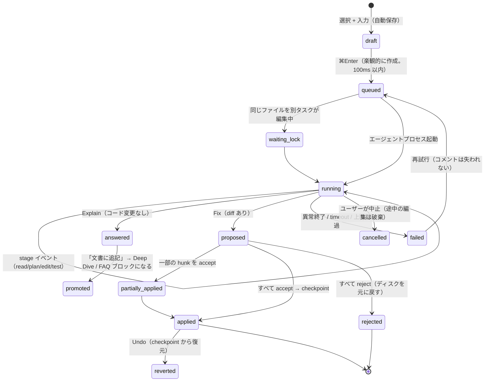

# 07 UX 原則 / UX Principles for mitori（見取り図）

> Research track 07-ux ・ 2026-10-03 ・ 対象: mitori の UI/UX 設計原則、参照 UI 分析、情報設計（IA）提案
> 根拠: 参照 UI の公式ドキュメントと技術記事（URL は末尾 §9）、ローカルに clone した crit / m3e-canvas のコード精読（パスは `refs/…` と表記。実体は `/private/tmp/claude-501/-Users-satoki252595-work-20261002-aiAgentTool/99463a6e-6928-41bd-851e-ed1a1028dc52/scratchpad/refs/`）。
> 表記: 「(要検証)」= 一次ソースで確認できなかったか、実機計測が必要なもの。

---

## 0. TL;DR — mitori の UX 原則 12 箇条

1. **Map-first（まず見取り図）**: ホームはリポジトリの「間取り図」（C4 の Container/Component 相当）。地図をクリックして掘り下げる「Zoom」を、地図と文書の両方で同じ操作体系にする（`-`/`=` キーで深さを変える）。
2. **1 枚の文書を、深さで出し分ける（Progressive disclosure）**: 文書の各ブロックに `depth: L0–L3` を付け、読者レベル（初めて／標準／詳しい）で表示を切り替える。別々の文書は作らない（同期ずれと二重のトークンコストを避けるため）。
3. **すべての主張に出典を付ける（Citation-first）**: 文中の主張は必ず `file:line` チップを持ち、hover でコードをのぞける（peek）。根拠がない記述は「推測」バッジを付けて隠さない。DeepWiki / Code Wiki の弱点であるハルシネーションへの不信に対する答え。
4. **コメントは「アンカー」に付く**: 文書ブロック、コード範囲、図のノードのどれにでも付けられる。アンカーは `blockId + sourceRanges(contentHash) + TextQuote(prefix/exact/suffix)` の 3 重構成で、コードが変わっても付け直しに耐える。付け直せなかったコメントは捨てずに「outdated」として残す。
5. **AI への依頼は 3 動詞だけ: 説明 (Explain) / 修正 (Fix) / 指摘 (Review)**。どれも選択範囲から 1 キー（`e` / `f` / `c`）で呼べる。
6. **待ち時間はステージで見せる**: 実際のイベント（`Read src/auth.ts` → `Edit` → `Bash: test`）をそのまま進捗にする。偽のプログレスバーは使わない。依頼は 100ms 以内に楽観的 UI で反映し、ユーザーは待たずに読み続けられる。
7. **トークンは「前に見積り、後に実績」を目立たせず出す**: ボタン横の小さなチップ（≈9k tok）で示し、hover で内訳を出す。実績は `result.usage` から取り、見積りを自動で補正する。確認ダイアログを出すのは閾値（既定 100k tok）を超えるときだけ。
8. **まとめて送るとトークンが減る（Batch）**: GitHub の「Add suggestion to batch」と crit の「Finish review」を合わせる。複数コメントを 1 回のエージェント実行にまとめ、節約できた見積りを表示する。
9. **人間が承認するまで反映しない（Two-layer review）**: コードの diff と、それに連動する文書の差分（Google Docs の提案モードと同じ見た目）の両方を、hunk / ブロック単位で accept・reject できる。すべて Undo 可能。
10. **日本語ファースト**: `lang` 属性、和文フォントスタック、`line-height: 1.8`、40 字前後の行長、`line-break: strict`、`text-autospace`。IME の Enter / Esc を誤爆させない（`isComposing || keyCode===229`）。
11. **体感 100ms**: 画面遷移・検索・ショートカットは 100ms 以内（INP は p75 ≤100ms）。Mermaid と Shiki はサーバー側で事前レンダリングし、クライアントに 1MB を超える JS を送らない。
12. **キーボードで完結しつつ、マウスとタッチでも同じことができる**: ⌘K パレット、`j/k`、`g`+文字のジャンプ、`?` でヘルプ。単一キーのショートカットはオフにも割り当て変更にもできる（WCAG 2.1.4）。ドラッグ操作には必ずキーボードやクリックの代替を用意する（WCAG 2.5.7）。

---

## 1. 参照 UI の分析（何が優れているか、mitori が取り入れるもの、避けるもの）

### 1.1 GitHub PR review（Files changed）

| 観点 | 事実 | mitori に取り入れること |
|---|---|---|
| Inline thread | 行・複数行範囲にスレッドを付ける。行が変わると **Outdated** になり、Resolve で畳まれる | アンカーが外れたら Outdated バッジを付け、スレッドは消さずに「孤立コメント」箱へ移す |
| Suggested changes | コメント内の ```` ```suggestion ```` ブロックを 1 クリックで commit できる。**Add suggestion to batch** で複数を 1 commit にまとめ、提案者は co-author になる（2018 年〜。2025-11 には新しい Files changed でも batch に対応、2026-03 には Code Quality 指摘も batch 適用可能に） | AI の修正提案を「suggestion カード」として出し、複数を batch で承認したら 1 checkpoint にまとめる |
| Pending review | 「Start a review」で下書きコメントを溜め、Submit でまとめて送る | crit の「Finish review」と同じ。**Shift+F = まとめて AI に送る** |
| 性能 | V1（10,000 行の PR）: 1 行あたり DOM 10–15 ノード、コンポーネント 8–13 個、ハンドラ 20 個超、ヒープ 150–250MB、INP 約 450ms。V2: コンポーネントを 1 行 2 個に減らし、イベント委譲、Map による O(1) 参照、useEffect の制限を入れて **INP 100ms、ヒープ 80–120MB**。10k 行を超える PR は TanStack Virtual で仮想化し、**INP 40–80ms** | 行単位のコンポーネントを禁止し、`data-*` 属性とイベント委譲で組む。仮想化はコード 2k 行以上または diff 10k 行以上の場合だけ使う |
| 避ける | 長い PR で迷う（全体像がない）。2025 年から Copilot が変更をグループ化しているのは、全体像の不足を後から補う対応 | 最初から「章立て（story）」と「見取り図」を出す |

### 1.2 Google Docs 提案モード（Suggesting mode）

- 挿入は下線、削除は取り消し線で示し、作成者ごとに色を変える。余白のカードに ✓ / ✗ が並ぶ。`Tools > Review suggested edits` に **Accept all / Reject all** と、提案を反映した状態／元の状態を切り替えるプレビューがある。
- **mitori**: AI が文書の文章を変えるときは、必ず提案として出す（作成者 = `mitori AI (Sonnet)` のような表記）。上部に「変更後で表示／元で表示」のトグルを置き、ブロック単位で accept・reject できる。コード変更に連動して文書も変わる場合は、同じ UI で文書側の差分を見せる。

### 1.3 Notion / Linear のコメント

- Notion: 右側にコメントサイドバーがあり、ページ内の全スレッドを一覧できる。**Resolved で絞り込むと「決定の履歴」になる**。Suggested edits は「Can comment」以上の権限で使え、hover で ✓ / ✗ を押す。
- Linear: Cmd+K、`g`+文字によるナビゲーション、確認ダイアログより Undo を優先する設計、装飾の少ない画面。ショートカットの処理は 50ms 未満とされ、「よく使う操作はすべて 2 キー以内」を設計目標にしている（二次情報）。Inbox を `j/k` でさばく。
- **mitori**: 解決済みスレッドを集めて「決定事項ログ」ビュー（ADR に近い）を自動で作る。Inbox 画面を設け、AI タスクと自分宛てのスレッドを `j/k` で処理できるようにする。削除や reject は確認を出さず、Undo トーストで戻せるようにする。

### 1.4 Figma のコメントとマルチプレイヤー

- `C` でコメントモード、クリックしたところにピンを立てる（ドラッグで範囲も選べる）。ピンはフレームに付くので、フレームを動かしてもずれない。`Shift+C` でコメントの表示・非表示を切り替える（自分だけに効く）。Resolve はファイル全体に効く。アバターをクリックすると相手の視点を追従できる（observation）。
- **mitori**: 見取り図のノードにピン型のコメントを置き、地図のオーバーレイで「コメント」「AI 作業中」「変更頻度」を切り替える。共有モード（フェーズ 2）ではアバターと「追従」を提供する。1 人で使うときは **「AI を追従」**（AI が編集中のブロックへ自動スクロール。既定はオフ）。

### 1.5 ドキュメントサイト（Stripe / Mintlify / Docusaurus / react.dev）

| 製品 | 優れている点 | mitori に取り入れること |
|---|---|---|
| Stripe | 3 カラム（ナビ / 本文 / コード）。本文を読み進めると対応するコード行がハイライトされる。ログイン中は自分の test key がサンプルに入る。Markdoc で書かれている | **Doc ↔ Code の同期表示（Split view）**: 段落に hover するか scrollspy に入ると、右ペインの引用行がハイライトされる |
| Mintlify | 各ページの contextual menu: Copy page（Markdown）、View as Markdown、Open in ChatGPT/Claude/Perplexity/Devin、MCP の URL や install コマンドのコピー。`/llms.txt` と `llms-full.txt` を置く | **「プロンプトとしてコピー」と「Markdown としてコピー」** を全ブロックに付ける。エージェント向けに `llms.txt` 相当を書き出す |
| Docusaurus | 左サイドバー、右の TOC（scrollspy）、admonition（note/tip/warning/danger）、タブ、「Last updated by/at」、前後ページへの pager | 「最終更新: commit abc123 / 2 日前」と、読書パスの次の節へ進む pager |
| react.dev | 各ページの冒頭に **You will learn**、本文に **Deep Dive**（折りたたみ、読み飛ばし可）と **Pitfall**、末尾に **Recap** と Challenges | 初心者と専門家の両方に効く定番パターン。L3 は Deep Dive として折りたたみ、Pitfall はそのまま「落とし穴」ブロックに使う |

### 1.6 リポジトリ wiki 系（DeepWiki / Google Code Wiki / Windsurf Codemaps）— 直接の競合

| 製品 | 事実 | 弱点（mitori が差別化できる点） |
|---|---|---|
| DeepWiki (Cognition) | github.com を deepwiki.com に置き換えるだけで使える。左ナビにモジュール単位のページ、Mermaid 図、行単位の出典リンク（GitHub の該当行を開く）。Ask は Fast（1 秒未満）と Deep Research（20–60 秒）の 2 種類。`.devin/wiki.json` の `repo_notes`（1 件 10,000 字まで）と `pages`（最大 30 ページ、Enterprise は 80、notes は合計 100 件まで）で生成を誘導できる。生成の effort は Low（無料）/ Medium（5–10 ACU）/ High（20–40 ACU） | **読むだけで、レビューや修正に進めない**。更新は定期実行なので、活発なリポジトリでは数時間〜数日遅れる。深さが 1 種類しかない。トークンや費用が見えない。図をクリックしてもコードに飛べない |
| Google Code Wiki | 変更のたびに再生成され、図（architecture/class/sequence）も追従する。文章からシンボルへのハイパーリンク、Gemini によるチャット | 公開リポジトリだけ（preview）。ローカルや非公開では使えず、人間との共同編集もない |
| Windsurf Codemaps | タスクのプロンプトからコードの経路（trace）を地図にする。各ノードに AI の注釈、行へのリンク、Fast（SWE-1.5）/ Smart（Sonnet 4.5）を選べる。`@codemap` でエージェントに渡せる。オンボーディングに 3–9 ヶ月かかるという課題設定 | IDE の中に閉じている。文書として残らない |

**結論**: mitori は「DeepWiki のような読み物」に「crit のようなアンカー付きレビューと修正ループ」を足し、さらに「深さの切り替え」「鮮度管理」「トークンの見える化」を加えた位置を取る。

### 1.7 Sourcegraph のコードナビゲーション

- hover するとシグネチャと docstring、**Go to definition / Find references** が出る。正確な（SCIP/LSIF）結果と検索ベースのヒューリスティックの結果を混ぜて出す。
- **mitori**: Code peek の中でもう一段 hover できるようにする。定義へのジャンプは、tree-sitter の symbol index で取れれば「正確」、取れなければ文字列検索で「推定」と、**精度ラベル**を付ける。

### 1.8 コマンドパレット（Raycast / Linear / Superhuman）

- Superhuman の原則: どこでも同じキーで開く／すべての操作を登録する／fuzzy 検索（タイプミス許容）／同義語を「優先名 (一致した別名)」の形で出す／既定スコアと文脈による加点／見える候補は 5 件 + 次の 1 件を半分だけ（続きがあると分かる）。
- 8 つの状態（setproduct）: 入力が空（最近使ったもの 4–6 件 + 提案）／入力中（1 フレームで更新し、一致文字をハイライト）／結果なし（復帰の手段を出す）／読み込み中（**最終的な高さで skeleton を出す**）／エラー・オフライン（ローカルの操作は動き続ける）／ネスト（パンくずと戻る。**入力が空の Backspace で 1 階層戻る**）／複数選択／無効（理由を表示）。幅 560–680px、行の高さ 40–48px、最大 6–8 行、表示 150–200ms、非表示 100–140ms、200 件を超えたら仮想化、非同期ソースは 150–250ms の debounce、`aria-activedescendant` でフォーカスは入力欄に置いたまま。
- Raycast: 項目を選んで `⌘K` を押すと Action panel（副アクション一覧）、Enter で主アクション、⌘Enter で副アクション。
- **mitori**: ⌘K で節・モジュール・ファイル・シンボル・用語・スレッド・操作を横断検索する。項目上で ⌘K を押すと「この節を: 説明 / 再生成 / プロンプトとしてコピー / permalink」を出す。**日本語の読みでも引ける**（`ninshou` → 認証、`にんしょう` → 認証。用語集に yomi を持たせる）。

### 1.9 crit（`refs/crit`）— コードを読んで分かったこと

| 発見 | 根拠（ファイル） | mitori への示唆 |
|---|---|---|
| 出力の種類ごとに UI を変える（plan.md / diff / live URL / HTML） | `README.md`「Adaptive UI」 | mitori は「設計書」専用の UI にする。汎用ビューアにはしない |
| レビューのループ: エージェントが起動 → 人が Finish → エージェントがレビューファイルを読んで修正 → **round-to-round diff**（R1, R2…） | `README.md`、`docs/agent-prompts.md` | round の概念をそのまま使う。文書の「前回から変わった箇所」を出す |
| **Send to agent / Live thread**: コメントの「Send now」で `agent_cmd`（例 `claude -p`）を実行する。stdin にコメント・引用・ファイル・行範囲を渡し、stdout を返信として投稿し、編集はファイル監視で検出する。その後の返信は自動で agent に送られる（⚡ live バッジ） | `README.md` Send to agent | 依頼の基本の流れとして採用する。ただし crit の待機表示は「Waiting for @claude…」の 1 行だけで、段階・経過時間・トークンが出ない（`docs/images/live-mode.png`）。**ここで差を付けられる** |
| セキュリティ: `agent_cmd` は global 設定にしか書けない。悪意あるリポジトリによる任意コマンド実行を防ぐため | `README.md` Global-only config keys | 同じ方針にする。リポジトリの設定から実行コマンドを差し替えられないようにする |
| Story mode: prologue と chapters と support（ノイズ）に分ける。「explainer であって reviewer ではない」。20–50 ファイル / 2k–5k 行の PR で、Claude Opus 5 を使い **$1–1.40** | `docs/story-mode.md` | 「章立て」と「ノイズ箱」（lockfile・生成物）の考え方を文書生成に使う。費用の目安を UI に出す前例 |
| ショートカット登録: モード別、競合検出、予約キー、ユーザーによる上書きを cookie に保存 | `web/crit-shortcuts.js`（`j/k`、`c`、`e`、`d`、`[ ]`、`n/N`、`Shift+F`、`b`、`t`、`h`、`Shift+V`=visual line、`?`） | ほぼそのまま使う（§4.5）。ただし判定が `ev.key` 主体なので、IME がオンだと `Process` や全角文字になって効かない恐れがある（要検証）→ mitori は `ev.code` で補う |
| IME: `if (e.isComposing) return;` だけで、`keyCode===229` を見ていない | `web/crit-comment-form.js:62`、`web/live-mode.js:1448,1530,1688,2073` | Safari（WebKit bug 165004）では compositionend が keydown より先に来るため、Esc で `window.confirm('Discard comment?')`（同ファイル 149 行目）が誤って出る恐れがある。mitori は **確認ダイアログを廃止し、下書きを自動保存** する |
| 和文フォントが指定されていない: `--crit-font-body: 'Inter', -apple-system, …, sans-serif` | `web/theme.css:106-108` | 日本語は OS 任せになる。mitori は和文スタックを明示する（§4.1） |
| body の `line-height: 1.7` | `web/style.css:22` | 和文の本文は 1.8 前後がよい |
| 性能予算: Pierre 項目のマウント 15 以下、コード行 400 以下、**DOM 12,000 未満（実測 3.4k）**、TBT 4,000ms 未満（実測 36ms）。Shiki をメインスレッドで動かすと 2000 行で約 350ms、worker なら約 5ms | `docs/performance.md` | 予算を CI で守る方式を真似る（§5） |
| **mermaid.min.js が gzip で 1.18MB、出荷 JS の約 70%** | `asset-budget.json` | mitori は **図をサーバー側で SVG に事前レンダリングする**。Mermaid はクライアントで図を編集するときだけ遅延読み込みする |
| a11y: `role="status" aria-live="polite"` のコピー通知、resize handle に `role="separator"` と `aria-valuenow` | `web/index.html:132,163` | 同水準を最低ラインにする |
| タブが非表示の間に round が終わると `document.title` の先頭に「•」を付ける。デスクトップ通知は opt-in（`notify_on_round_ready`） | `web/app.js:193-206`、`README.md` | 同じ仕組みにし、さらに favicon のドットを足す |
| 下書きの自動保存。生成ファイルは折りたたむ（`linguist-generated`） | `README.md` Everything else | そのまま採用する |
| 描画済み Markdown にも行番号を出す（`docs/images/demo-overview.png`） | — | 専門家には便利だが、初心者には邪魔。**読者レベルが「詳しい」のときだけ出す** |

### 1.10 m3e-canvas（`refs/m3e-canvas`）— コードを読んで分かったこと

| 発見 | 根拠 | mitori への示唆 |
|---|---|---|
| 作ったデザインがそのまま AI 用のプロンプトになる。右パネルに常に表示し、唯一の主 CTA は「プロンプトをコピー」 | `README.md`、`docs/prompt.png` | 「選択範囲 + 出典 + コメント → エージェント用プロンプト」を 1 キー（`p`）でコピーできるようにする。mitori の中で実行しない人への逃げ道にもなる |
| **Skeleton.tsx**: エディタと同じ寸法の静的な外枠を、JS より先に HTML で描く。前回のパネル幅は head 内のスクリプトで CSS 変数に読み込むので、実物が骨組みと同じ位置に現れる | `components/Skeleton.tsx` 冒頭のコメント | **レイアウトのずれ（CLS）ゼロの起動**。mitori も「前回のペイン幅」を head で復元する |
| 共有は `#docz=`（deflate-raw + base64url）を fragment に入れる → サーバーに届かず、静的サイトのまま | `lib/share.ts` | 小さな選択範囲の共有なら、サーバーなしで fragment に入れる案もある（大きな文書は Cloudflare 側） |
| `public/agent.md`: エージェントに JSON を書かせてリンクで返させる。「検証や往復変換をするな、アプリ側で検証する」と指示し、約 100KB 以内 | `public/agent.md` | mitori も「エージェント向けの仕様書（agent.md / skill）」を同梱し、検証はアプリ側でする（エージェントのトークンを節約できる） |
| AI による書き換えには履歴（`noteHistory`）があり、元に戻せる。共有時には履歴を除く | `lib/share.ts` `shareable()` | ブロックごとの「履歴タイムライン」と Undo |
| 4 言語の UI 文言を parity テストで保証 | `lib/i18n.parity.test.ts` | ja/en の文言キーが一致しているかを CI で検査する |
| `prefers-reduced-motion` で transition と skeleton の明滅を止める | `app/globals.css:198` | 同じ扱いにする |
| スマホでは機能を絞ったエディタにする（ボタンだけ、bottom sheet） | `README.md` Phone-friendly | スマホでは「読む + コメントする」だけに絞る |

### 1.11 Cursor の Agent review（hunk 単位の accept/reject）

- Review タブで diff を確認し、**Keep（accept）/ Reject（ディスク上で元に戻す）** をファイル単位・hunk 単位・一括で選べる。判断済みの hunk には「Accepted / Rejected + Undo」が付く。2026 年の版では、既定の流れがセッション単位の Review に寄ったことで、hunk 単位のレビューを戻してほしいという要望がフォーラムに出ている。
- **mitori**: hunk 単位の判断を常に使える状態にする（ユーザーに好まれている機能を削らない）。ショートカットは Cursor の慣習に合わせる（⌘Enter = 採用、⌘⌫ = 却下）。

---

## 2. Progressive disclosure — 1 枚の文書で初心者と専門家の両方に応える

### 2.1 深さモデル（Depth L0–L3）× C4 のズーム

| Depth | 想定読者 | 時間 | 内容 | 例 | C4 対応 |
|---|---|---|---|---|---|
| **L0 ひとこと** | 経営・ビジネス・初見 | 1 分 | 1–3 文の TL;DR とバッジ（言語、規模、状態） | 「Go 製の単一バイナリ。AI エージェントの計画や差分をブラウザでレビューする」 | — |
| **L1 概要** | 新メンバー・PM | 5 分 | 目的、主要な流れ 3 本、見取り図、動かし方、主要用語 10 個 | 図 1 枚とステップ 5 つ | Context |
| **L2 構造** | 着任初日のエンジニア | 30 分 | モジュールの責務、データモデル、API、依存関係 | 表と図 | Container / Component |
| **L3 詳細** | レビュアー・専門家 | 随時 | 不変条件（invariant）、エッジケース、並行性、性能、セキュリティ、テストの穴、設計判断 | Deep Dive の折りたたみと出典の密な列 | Code |

- C4 の原則「どのズームレベルでも、要素は同じ種類」を守る。見取り図で Container を開くと Component が見え、Component を開くと文書の L3 とコードが見える。**地図と文書は同じ木を別々に表示したもの** にする。
- 読者レベル（ヘッダーで 3 段階、`-`/`=` キー、`0` で標準に戻す）の挙動:

| | 初めて | 標準 | 詳しい |
|---|---|---|---|
| L3 ブロック | 非表示（「詳しく (3)」チップ） | 折りたたみ（Deep Dive） | 展開 |
| 出典 | 段落末に「出典 3」チップ 1 個 | 文中の `auth.ts:42` チップ | チップと行番号、Split view を既定で表示 |
| 用語の下線 | 多め（初出すべて） | 初出だけ | なし（hover card は有効） |
| 「なぜ?」ボックス | 展開 | 折りたたみ | 折りたたみ |
| 行番号（描画済み Markdown） | 非表示 | 非表示 | 表示（crit 方式） |

### 2.2 パターン一覧（具体的な仕様）

| パターン | 仕様 | 根拠・前例 |
|---|---|---|
| **Map-first home** | ホームは見取り図（クリックできる SVG）と、その横の「5 分で分かる」ペイン。ノードに hover すると L0 の 1 行要約（300ms の遅延）、クリックするとズーム遷移（View Transitions、same-document 版は 2025-10 から Baseline）。オーバーレイ: コメント / AI 作業中 / 変更頻度（git churn）/ 鮮度 | C4、Figma のピン、Codemaps |
| **読書パス（コース）** | 「5 分コース」「30 分コース」「レビュアー向け」「PM 向け」「SRE 向け」。既存のブロックをタグで選び直すだけなので、**追加のトークンはかからない**。進捗リング（3/7）と、次の節へ進む pager | Docusaurus の pager、react.dev |
| **読了時間** | 和文 500 字/分（標準の目安 400–600 字/分。大学生の平均は 653 字/分。専門書は 300–400 字/分に落ちる）、英文 230 wpm、コード 1 行 5 秒として計算する。節ごとに「約 3 分」、全体に「全部で 25 分 / 概要だけなら 5 分」 | §9 の読書速度の資料 |
| **You will learn / Recap** | 各ページの冒頭に「この章で分かること」を 3 項目、末尾に「まとめ」 | react.dev |
| **Deep Dive / Pitfall / Why ボックス** | Deep Dive は L3 の折りたたみ。Pitfall（落とし穴）は常に表示。Why は「なぜこの設計か」で、出典（commit・コメント・README）を付ける | react.dev、Docusaurus の admonition |
| **Hover card（用語）** | 点線の下線。hover か focus で 300ms 後に表示: 定義、よみ、英語名、使用箇所の数、「用語集で開く」。**WCAG 1.4.13 に従う**: Esc で閉じられる、カード自体に hover できる、勝手に消えない | Sourcegraph、Wikipedia の preview |
| **Hover card（シンボル / 出典）** | `auth.ts:42` チップに hover すると Code peek（前後 ±8 行、Shiki で事前ハイライト済み）。`o` で Split view に固定、`Shift+O` でエディタで開く（`vscode://file/…`、`cursor://…`） | Sourcegraph、Stripe |
| **⌥（Alt）長押しで出典をすべて表示** | 押している間だけ、全段落の出典チップと信頼度バッジを表示する（専門家の確認用） | 独自 |
| **Breadcrumbs** | `mitori › 見取り図 › api (Container) › auth (Component) › login()`。地図と文書で同じ表記にする | C4 |
| **Split view（Doc ↔ Code）** | 55:45 で幅を変えられる。scrollspy で、本文の今の段落が引用している行を右ペインでハイライトする。右ペインのガターには「この行を説明している節 §3.2」の backlink | Stripe |
| **信頼度バッジ** | 「コードで確認済」（出典あり）/「推測」（推論のみ）/「確認済 by @name」（専門家が ✓ を付けたもの） | DeepWiki への不信の裏返し |
| **鮮度バッジ** | 節ごとに「古い可能性: 3 ファイル変更（abc123 以降）」→ 1 クリックで「この節だけ再生成 ≈4k tok」 | DeepWiki は定期更新で数時間〜数日遅れる |
| **未解決の問い** | AI が判断できなかったことを列挙する章。専門家にとってのレビュー入口になる | 独自。arc42 の Risks |
| **「やさしく」言い換え** | ブロック単位でオンデマンド生成し、キャッシュする（≈0.5k tok と事前に表示）。生成済みの言い換えには「やさしく版」のタグを付ける | トークンを節約するため、全体を最初から生成しない |

### 2.3 ブロックのメタデータ（UI が必要とする最小スキーマ）

```jsonc
{
  "id": "blk_3f9a",                 // 安定 ID（再生成しても見出しパス + 意味ハッシュで維持する）
  "depth": "L2",                    // L0..L3
  "kind": "prose|diagram|table|code|pitfall|deepdive|why|recap",
  "audience": ["dev","pm"],         // 読書パスで選ぶためのタグ
  "sources": [{"path":"internal/auth/login.go","start":40,"end":78,"hash":"sha1:…","precision":"exact|search"}],
  "confidence": "verified|inferred|human-verified",
  "freshness": {"commit":"abc123","staleFiles":[]},
  "readingSec": 45,
  "gen": {"model":"sonnet","inTok":2100,"outTok":380,"at":"2026-10-03T10:00:00Z"},
  "history": [{"round":1,"by":"ai"},{"round":2,"by":"human"}]
}
```

---

## 3. アンカー付きレビューと AI への依頼の UX

### 3.1 操作の流れ（1 本の典型的な流れ）

1. **選ぶ**: 文書のテキストかブロック、コードの行範囲（ガターをクリック / Shift+クリック / ドラッグ / キーボードの `Shift+V`）、図のノードのどれか。
2. **浮遊ツールバー**（選択した直後、100ms 以内に表示）: `💬 コメント (c)` `✨ 説明して (e)` `🛠 修正して (f)` `📋 プロンプトとしてコピー (p)` `🔗 permalink (y)`。
3. **Composer**:
   - 意図チップ: 質問 / 修正 / 指摘 / メモ（`⌘1–4`）。
   - **Context chips**: 「§3.2」「login.go:40-78」「+ 関連: session.go」。× で外せ、`@` で追加できる（Cursor の @-mention 方式）。**送るコンテキストを見せて、削れるようにする = トークンをユーザーが制御できる**。
   - 見積りチップ: `≈9k tok · 30–60秒 · Sonnet`（hover で内訳）。
   - 送信は ⌘Enter / Ctrl+Enter。Enter は改行。IME で変換中の Enter と Esc は無視する。
4. **楽観的 UI**: 送った瞬間にスレッドカードが現れ、状態は `queued` になる。対象ブロックの枠が柔らかく脈動する（reduced-motion のときは静的な枠）。
5. **進捗**（本当のイベントで見せる。§3.3）。ユーザーはその間も読み続けられる。
6. **完了**: カードに「何を・なぜ変えたか」の 3 項目、テスト結果のチップ、diff の要約（+12 −3、2 ファイル）。`r` か「レビュー」で diff 画面を開く。
7. **Review**: コードの diff（split/unified）と文書の差分（提案モード）。hunk / ブロック単位で accept（⌘Enter）か reject（⌘⌫）、全部まとめて accept（⌥⌘Enter）。
8. **反映**: accept すると checkpoint を作り、作業ツリーに書く。文書の該当ブロックが 1 回だけ緑に光る。スレッドは「R2 で解決」と自動で resolve される。**10 秒間の Undo トースト** と、ブロックの履歴タイムラインに残る。
9. **文書の自動更新**: コードの変更に引っ張られて、アンカーされていた文書ブロックも差分再生成する（≈1–3k tok）。これも提案として出し、「文書も 2 段落更新」のように示す。小さな変更（数値や名前の置換）は自動で採用する設定も選べる。

### 3.2 AI タスクの状態遷移



- 状態ごとに色と形とラベルを変える（色だけで区別しない。WCAG 1.4.1）: queued ○灰、running ◐青（脈動）、proposed ◆紫、applied ✓緑、failed ✕赤、outdated ⚠黄。
- **並列実行**: 別々のアンカーへの依頼は並列で走らせる。同じファイルに触る場合は直列にし、「待機: login.go を別タスクが編集中」と表示する。
- **failed の UX**: stderr の末尾 3 行、原因の分類（認証 / 上限 / timeout / 競合）、再試行ボタン。**コメントは決して失わない**。

### 3.3 待ち時間を感じさせない工夫（Latency masking）

| 経過 | 表示 | 根拠 |
|---|---|---|
| 0–100ms | カード作成と脈動を開始（楽観的） | Nielsen: 0.1 秒が「即時」と感じる限界 |
| 0.1–1s | 「送信中…」（スピナーは出さない） | 1 秒までは思考の流れが途切れない |
| 1–10s | **ステージ表示**: `コンテキスト収集 (3 files)` → `計画中` → `編集中 login.go` → `テスト実行中`。最新の 1 行を tail 表示（`Read internal/auth/session.go`） | `claude -p --output-format stream-json --verbose` の tool_use イベント、`codex exec --json` のイベントから取れる |
| >10s | 経過時間と「通常 40–90 秒」（同じ意図の過去実績の p25–p75）。進めない %バーは出さない | Nielsen: 10 秒を超えたら完了の見込みを示す |
| >20s かつタブ非表示 | 完了時にタブタイトルを「(1) ✓ mitori」にし、favicon にドットを付ける | crit `web/app.js:193` |
| >60s | 初回だけ「完了時にデスクトップ通知しますか?」と聞く（Notification の許可は初めて長いタスクが出たとき。読み込み時には聞かない） | 許可を求めるタイミングの定石 |

- **ストリームの表示**: Explain の回答は流しながら描画する。Fix は途中の diff を出さない（中途半端な diff はノイズになる）。代わりに「編集中: 2 ファイル」。
- **Prefetch**: Composer を開いた時点でコンテキストの組み立て（ファイル読み込みとトークン数の計算）を先に始める。送信までの時間を隠せる。
- **キャッシュを意識**: 同じリポジトリへの依頼は、システムプロンプトとリポジトリ要約を固定の接頭辞にして、プロンプトキャッシュに当たりやすくする。UI には「キャッシュ 72%」を出す（§3.4）。

### 3.4 トークンとコストの UX（邪魔をしない見せ方）

**原則**: (1) 小さな操作では確認を挟まない。(2) 見積りは常にそばにあるが目立たせない。(3) 実績は必ず残す。(4) 見積りは自動で補正する。(5) まとめて送ったときの節約額を見せる。

| 場面 | 表示 | 詳細 |
|---|---|---|
| ボタンの hover / focus | tooltip の 2 行目: `≈9k tok（入力 7.5k / 出力 1–2k）` | 色帯: <10k 灰 / 10–50k 標準 / 50–200k 琥珀 / >200k 赤 |
| Composer | 見積りチップ（常に表示。context chips を外すと即座に再計算） | 内訳: 指示 0.3k、§3.2 0.6k、login.go 2.1k、関連 3.5k、固定部分（cached）約 X k |
| 確認ダイアログ | **閾値を超えたときだけ**（既定 100k tok、または「リポジトリ全体」の範囲）。選択肢: 「実行」「範囲を絞る」「プロンプトをコピー（自分のセッションで実行）」 | 確認を多用すると、確認すること自体に慣れて意味がなくなる |
| 完了後 | スレッドのフッター: `入力 12.4k（キャッシュ 9.1k）· 出力 1.8k · 41秒 · Sonnet · 見積 ≈10k` | 出典は stream-json の **`result` イベントの `usage`**。注意: ストリーミング途中の `usage.input_tokens` は 100–174 倍少なく出るという報告があるので、途中の値は使わない。`total_cost_usd` はセッションの累計で、値が過大になる報告もある（§9） |
| ステータスバー | `今日 182k tok · 5h枠 23%`（取得できるときだけ） | Claude Code の statusline JSON には `rate_limits.five_hour.used_percentage` と `seven_day` がある（v2.1.80、2026-03 から）。mitori が statusline の断片を配って値をファイルに書き出させれば、サブスク利用者にとって意味のある「枠の消費率」を出せる（要検証。§8） |
| Batch 送信 | 「3 件のコメント → 1 回の実行にまとめると ≈18k tok（別々だと ≈41k）」 | 共通のコンテキストとキャッシュで減らせる |
| 初回生成 | effort を 3 段階で選ぶ: **概要（≈30k）/ 標準（≈120k）/ 完全（≈400k）**。それぞれ所要時間の目安付き | DeepWiki の Low/Medium/High（0 / 5–10 / 20–40 ACU）と同じ考え方。数値はリポジトリの規模から見積もる |
| 見積りの補正 | 意図ごと・モデルごとに `実績 / 見積` の指数移動平均を取り、次の見積りに掛ける。設定画面に「見積り精度 ±12%」 | 和文はトークン化の比率が英文と違うので、固定の係数では外れる |
| 通貨の表示 | 既定はトークン。設定で「API 換算 $」も出せる | サブスク利用者には $ は無意味で、API 利用者には必要 |

### 3.5 アンカーを外れにくくする（Robust anchoring）

- 3 重に持つ: `blockId`（文書側）+ `sourceRanges[{path,start,end,contentHash}]`（コード側）+ `TextQuoteSelector{prefix 32字, exact, suffix 32字}`（W3C Web Annotation / Hypothesis 方式）。
- 付け直しの順番: (1) hash が一致 → そのまま。(2) diff による行の写像（crit の carry-forward。10k 行で約 370ms → worker / サーバーで処理）。(3) prefix/exact/suffix を近い位置から fuzzy に探す（diff-match-patch。crit は同梱済み）。(4) 失敗したら **outdated** にし、元のスナップショットを表示して「新しい位置を指定」できるようにする。
- 孤立コメントを黙って消さない（Hypothesis でも「付け直しに失敗したのに孤立と報告されない」バグが issue になっている）。

### 3.6 依頼の 2 つのモード（どちらを使っているかを UI で常に示す）

| モード | 仕組み | 使う場面 | UI での表示 |
|---|---|---|---|
| **In-app 実行** | mitori がその場で `claude -p` / `codex exec --json` を起動する（コマンドは global 設定にだけ書ける） | 説明、小さな修正 | ⚡ バッジ（crit の live に相当） |
| **Hand-off** | レビューファイルと slash command / skill で、ユーザーの対話中のエージェントセッションに渡す（crit と同じ） | 大きな修正、ユーザーが自分のセッションで見届けたいとき | 「Claude Code で `/mitori` を実行してください」のコピーボタンと待機表示 |
| **Copy prompt** | 整形したプロンプトをクリップボードへ（m3e と同じ） | どのツールでも | `p` |

---

## 4. 日本語組版・IME・ダークモード・アクセシビリティ・キーボード・レスポンシブ

### 4.1 和文タイポグラフィ（そのまま使える CSS の方針）

```css
:root {
  /* 本文: 欧文を先に、和文は OS ごとの良いフォントへ。system-ui は使わない
     （Windows で細長い Yu Gothic UI が当たるため。ICS MEDIA 2026 / neos21 2026） */
  --font-sans: "Inter", "Helvetica Neue", Arial,
               "Hiragino Sans", "Hiragino Kaku Gothic ProN",
               "Noto Sans JP", "Noto Sans CJK JP", "BIZ UDPGothic", Meiryo,
               sans-serif, "Apple Color Emoji", "Segoe UI Emoji", "Noto Color Emoji";
  /* コード: 欧文の等幅を先に。日本語コメント用の和文も最後に入れる */
  --font-mono: "JetBrains Mono", "SF Mono", ui-monospace, Menlo, Consolas,
               "BIZ UDGothic", "Noto Sans Mono CJK JP", monospace;
}
html:lang(ja) body { font-size: 16px; line-height: 1.8; }   /* JLREQ: 行間は字の 0.5–1 倍。35 字を超える行は 1 倍近く */
html:lang(en) body { line-height: 1.6; }
.prose { max-width: 40em; }          /* JLREQ: 横組みは 1 行 40 字以下が望ましい。表・コード・図はこの幅を超えてよい（breakout） */
.prose p  { line-break: strict; overflow-wrap: anywhere; text-wrap: pretty;
            text-autospace: normal;            /* 和欧の間に 1/8em。Chrome 140 / Firefox 145 / Safari 18.4。初期値は no-autospace なので明示する */
            text-spacing-trim: trim-start; }   /* 行頭の括弧を詰める。Chrome 123+ */
.prose h1, .prose h2, .prose h3 { line-height: 1.4; text-wrap: balance;
            word-break: auto-phrase; }         /* 見出しを文節で改行。Chrome 119+、Safari は未対応で、その場合は通常の改行 */
code, pre { font-family: var(--font-mono); font-size: 0.875em; line-height: 1.6;
            font-variant-ligatures: none; }   /* リガチャは誤読の元なので切る（設定で戻せる） */
```

- **`word-break: keep-all` を和文の本文に使わない**（和文の連続部分の中で改行できず、はみ出す）。`auto-phrase` は見出しに限る。
- `<html lang>` は UI の言語で切り替える。英文ブロックやコードには `lang="en"` を付ける（フォント選択と読み上げ音声が正しくなる）。混在する文書では、ブロック単位で言語を判定して `lang` を付ける。
- 太字: 和文には `font-weight: 600`。700 だと Hiragino が W6 を飛ばして W8 になる環境がある（ICS MEDIA が iOS 13 の Yu Gothic の例で指摘）。
- 約物: 全角括弧の連続は `text-spacing-trim` で詰める。英数字は半角で書き、和欧間の空白は `text-autospace` に任せる（生成プロンプトで「和欧の間にスペースを入れない」と指示しておく）。
- 数値の多い表には `font-variant-numeric: tabular-nums`。
- フォントは Web フォントを読み込まない（OS のフォントだけを使う。日本語の Web フォントは数 MB あり、起動予算を壊す）。

### 4.2 IME（日本語入力）

| 問題 | 対策 |
|---|---|
| 変換確定の Enter で送信してしまう（Safari: compositionend が keydown より先に来て `isComposing=false` になる。WebKit 165004） | `if (e.isComposing \|\| e.keyCode === 229) return;` を**全ての** keydown ハンドラに入れる。送信は ⌘Enter / Ctrl+Enter に統一する（Enter 単独では送信しない） |
| 変換を取り消す Esc で Composer が閉じる、または下書きが消える | Esc にも同じ判定を入れる。閉じても下書きは自動保存する。「Discard?」の confirm は出さない（crit は `window.confirm` を出す） |
| IME がオンのままだと、単一キーのショートカットが `key: "Process"` や全角の「ｊ」になる | `ev.code`（`KeyJ`）で正規化して判定する。英字キーのショートカットは物理キーで照合する（要実機検証: macOS ことえり / Google 日本語入力 / Windows MS-IME） |
| 変換中にパレットを絞り込む | 変換中の文字列でもプレビュー表示はするが、Enter による実行は確定後に限る |
| モバイルの IME で確定の Enter が送信になる（u7chan の issue） | モバイルでは送信ボタンだけで送る |
| Biome に IME 安全性の lint 規則が提案されている（discussion #10041） | 自前の lint 規則か、テストで「keydown ハンドラは必ず IME 判定を通す」を保証する |

### 4.3 ダークモード

- 既定は OS の設定に従う（`prefers-color-scheme`）。手動でも切り替えられる（ライト / ダーク / システム）。`color-scheme: light dark` を指定して、スクロールバーやフォーム部品も追従させる。
- 色はトークンで定義する（`--bg`、`--fg`、`--fg-muted`、`--accent`、`--diff-add`、`--diff-del`、`--ai`、`--warn`）。ダークの背景は純黒にしない（#0f1115 前後）。本文のコントラストは 4.5:1 以上、ダークでは文字を 95% 程度の明るさに抑えて眩しさを減らす。
- コードのテーマは Shiki のライト版とダーク版を対にする（crit 方式: UI・コード・描画済み Markdown で同じ色を共有）。図はライト用とダーク用の 2 種類の SVG を事前レンダリングするか、CSS 変数で塗り分ける。
- diff の色は色だけに頼らない: `+`/`−` の印、左端の帯、パターンを併用する（色覚多様性への配慮。WCAG 1.4.1）。

### 4.4 アクセシビリティ（WCAG 2.2 AA を目標とし、mitori で特に効く項目）

| SC | レベル | mitori での要件 |
|---|---|---|
| 2.1.4 Character Key Shortcuts | A | 単一キーのショートカットはオフにも割り当て変更にもできる（crit の registry と同等） |
| 2.5.7 Dragging Movements | AA（2.2 新規） | 行範囲の選択はクリック → Shift+クリック、またはキーボードの `Shift+V`（visual mode）でもできる。ペイン幅の変更はキーボード（矢印）でもできる |
| 2.5.8 Target Size (Minimum) | AA（2.2 新規） | ガターの「+」や出典チップも **24×24 CSS px 以上**（または 24px の円が重ならない間隔） |
| 2.4.11 Focus Not Obscured | AA（2.2 新規） | 固定ヘッダーや浮遊ツールバーにフォーカスが隠れない。`scroll-padding-top` をヘッダーの高さに合わせる |
| 3.3.8 Accessible Authentication | AA（2.2 新規） | 共有のログインは OAuth device flow など、パスワードの手入力を必須にしない |
| 3.2.6 Consistent Help / 3.3.7 Redundant Entry | A（2.2 新規） | `?` によるヘルプを常に同じ位置に置く。Composer に前回の意図とコンテキストを引き継ぐ |
| 1.4.13 Content on Hover or Focus | AA | hover card は Esc で閉じられ、カードに hover でき、勝手に消えない |
| 4.1.3 Status Messages | AA | AI タスクの状態変化は `aria-live="polite"` で読み上げる。**状態が遷移したときだけ**にし、トークンが流れるたびには読まない |
| 1.4.10 Reflow / 1.4.12 Text Spacing | AA | 320px 幅でも横スクロールしない（コードブロックだけは除く）。ユーザーが行間を広げても崩れない |
| 1.1.1 図の代替 | A | Mermaid の `accTitle` / `accDescr` に加え、ノードと辺のテキスト一覧を「図をテキストで見る」で出す |
| prefers-reduced-motion | — | 脈動・光る演出・ズーム遷移を止める（m3e と同じ） |

### 4.5 キーボードの割り当て表（既定。すべて変更でき、競合は検出する）

| 範囲 | キー | 動作 | 前例 |
|---|---|---|---|
| Global | ⌘K / Ctrl+K | コマンドパレット（項目の上でもう一度押すと Action panel） | Linear / Raycast |
| | `/` | 文書内を検索 | GitHub |
| | `?` | ショートカットの一覧 | crit / GitHub |
| | `g` `h` / `g` `d` / `g` `i` / `g` `c` / `g` `r` / `g` `s` | 見取り図 / 文書 / Inbox / コード / レビュー / 設定 へ移動 | Linear / GitHub |
| | `-` / `=` / `0` | 深さ（読者レベル）を下げる / 上げる / 標準に戻す | 地図のズーム |
| | `b` / `t` / `Shift+C` | 左ナビ / 目次 / スレッドパネルの開閉 | crit |
| 読む | `j` / `k` | 次 / 前のブロック | crit |
| | `1`–`9` | 章へジャンプ | crit の story |
| | `[` / `]` | 前 / 次のスレッド | crit |
| | `o` / `Shift+O` | Code peek を固定 / エディタで開く | — |
| | `y` / `p` | permalink をコピー / プロンプトとしてコピー | GitHub / m3e |
| | `⌥` 長押し | 出典をすべて表示 | 独自 |
| 依頼 | `c` / `e` / `f` | コメント / 説明を依頼 / 修正を依頼（選択範囲、またはフォーカス中のブロックに対して） | crit の c |
| | `Shift+V` | 範囲を選ぶ visual mode（j/k で広げる） | crit |
| | `Shift+F` | レビューを終えて、まとめて AI に送る | crit |
| | `h` | 解決済みを隠す | crit |
| Composer | ⌘Enter | 送信（IME 判定あり） | crit / GitHub |
| | ⌘1–4 | 意図（質問 / 修正 / 指摘 / メモ） | — |
| | `@` | コンテキストを追加 | Cursor |
| | Esc | 閉じる（下書きは保持。IME 判定あり） | — |
| Review | `n` / `Shift+N` | 次 / 前の hunk | crit |
| | ⌘Enter / ⌘⌫ / ⌥⌘Enter | 採用 / 却下 / すべて採用 | Cursor |
| | ⌘Z | 直前の採用を取り消す（入力欄の外にいるとき） | — |

### 4.6 レスポンシブ（タブレットで読む場面を重視）

| 幅 | レイアウト | 主な用途 |
|---|---|---|
| ≥1440px | 3 ペイン（ナビ 260 / 本文 ≤40em / 文脈ペイン 420–560: Code peek・スレッド・AI タスク） | レビューと修正 |
| 1024–1439（iPad 横置き 1180×820 を含む） | 2 ペイン（ナビは折りたたみ）+ 文脈ペインは overlay | 読む、軽いレビュー |
| 600–1023（iPad 縦置き） | 1 ペイン。ナビは drawer、スレッドと Code peek は bottom sheet（50% / 90% の 2 段） | 読む、コメントする |
| <600（スマホ） | 読むこととコメントするだけ（m3e と同じく機能を絞る）。AI への依頼は「説明」だけ | 移動中の確認、共有リンクを見る |

- タッチ: 長押しでテキストを選ぶと、浮遊ツールバーを選択範囲の**下**に出す（OS のコピー用メニューと重ならないように）。ターゲットは 44px 以上を推奨（WCAG 2.5.5 AAA と Apple HIG）。
- 前回のペイン幅は head 内のスクリプトで CSS 変数に復元する（m3e の Skeleton と同じ方式。CLS がゼロになる）。

---

## 5. 体感性能（Perceived performance）

### 5.1 予算（CI で守る。crit の方式に倣い、絶対値ではなく構造的な不変条件と差分で判定する）

| 指標 | 予算 | 根拠 |
|---|---|---|
| 節・画面の遷移（クリック → 描画） | p95 ≤ 100ms | Nielsen の 0.1 秒 |
| INP | p75 ≤ 100ms、p98 ≤ 200ms | Core Web Vitals の「良好」は 200ms。GitHub V2 は 100ms、仮想化後は 40–80ms |
| パレットの入力 → 結果 | ≤ 16ms（1 フレーム。候補 50k 件まで） | setproduct の「1 フレーム以内に更新」 |
| ショートカットの反応 | ≤ 50ms | Linear |
| 起動（キャッシュ済みのリポジトリ）: CLI → 操作可能 | ≤ 1.5s | — |
| 初回生成: 骨組み（目次・見取り図の静的版） | ≤ 5s（LLM を使わず静的解析だけで作る） | — |
| 初回生成: 最初の文章（L0/L1） | ≤ 30s | 10 秒を超えるので、進捗のステージ表示が必須 |
| 初期 JS | core は gzip で ≤ 150KB。Mermaid / Shiki / diff は遅延読み込み | crit の app.js の上限が 155KB。Mermaid 1.18MB はその約 8 倍 |
| DOM ノード | ≤ 15k（どの状態でも） | crit は 12k 未満（実測 3.4k）。GitHub の最悪例は 400k 超 |
| JS ヒープ | ≤ 150MB（10k ファイルのリポジトリ） | GitHub V2 は 80–120MB |
| CLS | 0（ストリーミングで節が埋まるときは高さを確保しておく） | パレットの skeleton は最終的な高さで出す |
| AI 依頼の受け付け | ≤ 100ms（楽観的 UI） | — |

### 5.2 手法（効果が大きい順）

1. **事前レンダリング**: Markdown → HTML、Shiki によるハイライト、Mermaid → SVG を、生成時にサーバー（ローカル）側で作ってキャッシュする。クライアントは HTML を差し込むだけ。crit の計測では、Shiki をメインスレッドで動かすと 2000 行で 350ms、worker なら 5ms。Mermaid は gzip で 1.18MB。
2. **ローカルサーバーと SSE**: 127.0.0.1 への往復は約 1ms なので、ボトルネックは描画になる。生成やタスクの進捗は SSE で送る（crit `web/crit-sse.js`）。
3. **ブロック単位で確定してから描画する（ストリーミング）**: トークンごとに文書全体を描き直さない。ブロックが閉じたら確定して DOM に追加し、未完成の最後のブロックだけをプレーンテキストとカーソルで表示する。Mermaid は完成してから描画する。
4. **`content-visibility: auto` を節単位に**（Baseline。Chrome 85+ / Firefox 125+ / Safari 18+。web.dev の例では描画が 232ms → 30ms）。`contain-intrinsic-size: auto 800px` と併用する。**注意: Safari では SVG の `<text>` を含む要素に付けると文字が描画されない**（adactio）→ 図のブロックには付けない。ページ内検索（Ctrl+F）が効くのも利点（仮想化だと効かない）。
5. **仮想化は最後の手段**: コード 2k 行以上、diff 10k 行以上（GitHub の閾値）、ファイルツリー 5k 件以上のときだけ使う。仮想化した領域では Ctrl+F が効かないので、`/` の自前検索を案内する。
6. **イベント委譲と行単位コンポーネントの禁止**: `data-line` / `data-block` を使い、ルートに 1 つだけハンドラを置く（GitHub V2: 1 行あたりのコンポーネント 8 → 2、INP 450 → 100ms）。参照には Map を使う。
7. **Worker**: 検索インデックス（かな・ローマ字の読みも含む）、diff の写像、トークン見積り、ハイライトを worker で処理する。
8. **Hover-intent による prefetch**: hover して 65ms 以上たったら、遷移先の節やファイルの HTML を先に取りに行く（ローカルなので負担は小さい）。
9. **View Transitions**（same-document 版は 2025-10-14 から Baseline。Firefox 144+）: 見取り図のズームと、文書 ↔ 地図の切り替えに使う。reduced-motion のときは使わない。
10. **起動時の骨組み**: m3e の Skeleton と同じく、静的な HTML で外枠を先に描き、データが来たらフェードで差し替える。

### 5.3 初回生成の体験（最初の 30 秒）

```
t=0s   CLI: mitori .  → 0.3 秒以内にブラウザを開き、外枠の skeleton を表示
t≤1s   スキャン結果: 1,240 files / 86k LOC / Go 72%・TS 20% / エントリポイント 3（静的解析）
t≤2s   effort の選択: 概要 ≈30k / 標準 ≈120k / 完全 ≈400k（推定時間付き。前回の選択を既定にする）
t≤5s   目次と見取り図（静的版: ディレクトリ・import グラフ・パッケージ境界）を表示 → この時点でもう歩き回れる
t≤30s  L0/L1 から順に、各節が埋まっていく（skeleton → 文章）。節には「読んでいるファイル」を表示
       ★ まだ生成中の節をクリックすると「この章を先に生成」（優先度が上がる）
t=…    完了: 「合計 112k tok · 3分40秒 · 見積 ≈120k」。読書パス「5分コース」を提案する
```

---

## 6. mitori の情報設計（IA）提案

### 6.1 画面一覧

| # | 画面 | 役割 | 主な構成要素 |
|---|---|---|---|
| S0 | **Launcher**（`mitori` を引数なしで起動） | 最近のプロジェクト、生成状況、鮮度 | プロジェクトカード（最終生成の commit、古くなった節の数、未解決スレッドの数） |
| S1 | **見取り図 Home**（Map） | 全体像。初心者の入口 | クリックできる SVG の地図、オーバーレイの切り替え、「5 分で分かる」ペイン、読書パス |
| S2 | **文書 Reader**（Doc） | 読む・コメントする | 左: 節の木とミニマップ / 中: 本文（≤40em）/ 右: 文脈ペイン（Code peek・スレッド・タスク）、読者レベルの切り替え、パンくず |
| S3 | **Split view**（Doc ↔ Code） | 専門家の検証 | scrollspy による同期ハイライト、ガターの backlink、シンボルの hover |
| S4 | **Inbox** | AI タスクと自分宛てスレッドをさばく | フィルタ: 作業中 / レビュー待ち / 失敗 / 自分宛て / outdated。`j/k`、一括操作 |
| S5 | **Review**（Change review） | AI の提案を承認する | AI の要約、コードの diff（split/unified）、文書の差分（提案モード）、hunk 単位の操作、テスト結果、round 間の diff |
| S6 | **用語集・索引** | 引く | 用語（よみ・英語名・定義・使用箇所）、シンボルの索引、ファイル地図 |
| S7 | **決定事項ログ** | 「なぜ」の履歴 | 解決済みスレッドと Why ブロックを時系列で並べる（Notion の Resolved に相当） |
| S8 | **生成と鮮度** | 品質と費用の管理 | 網羅率（文書がカバーしているファイルの割合）、古い節の一覧、トークン履歴、見積り精度、再生成キュー |
| S9 | **設定** | — | エージェント（Claude Code / Codex、コマンドは global のみ）、モデル、トークンの閾値、言語、テーマ、フォント、ショートカット |
| S10 | **共有ビュー**（フェーズ 2、Cloudflare 上の `mitori-share-*`） | 社外・非エンジニアの閲覧とコメント | 読み取り専用のスナップショット、作成者ごとの色分け、公開の取り消し、秘密情報の検出 |

**ナビゲーション**: 一番上はヘッダーのタブ（見取り図 / 文書 / Inbox / レビュー）の 4 つだけ。それ以外の場所へは ⌘K と `g`+文字で移動する。URL はすべて permalink にする（`/doc/§3.2#blk_3f9a`、`/code/internal/auth/login.go#L40-78`、`/review/r2`）。戻る・進むが正しく効くようにする。

**画面の骨格（S2、幅 1440 以上）**

```
┌ mitori ▸ crit ▸ 見取り図 › api › auth  [初めて|標準|詳しい]  ⌘K  ◐  (2)Inbox  今日182k·5h 23% ┐
├──────────┬───────────────────────────────────────┬───────────────────────────┤
│ 節の木    │ §3.2 認証フロー            約3分 · 確認済   │ [Code peek|スレッド 3|タスク 1] │
│ ▸ 0 ひとこと│ この章で分かること: …                     │ login.go:40-78  (Shiki)      │
│ ▸ 1 これは何│ 本文 … ［login.go:42］ …［推測］          │  40 func Login(…            │
│ ▾ 3 主要な流れ│ ▸ Deep Dive: セッション失効の競合 (L3)   │  42 ▌ if token == "" {      │
│   3.2 認証 ◐│ ⚠ Pitfall: …                            │ ─────────────────────────── │
│ ミニマップ │ まとめ: …                                │ ◐ 修正中 · 編集 login.go · 23s  │
└──────────┴───────────────────────────────────────┴───────────────────────────┘
```

### 6.2 設計書テンプレート（生成される文書の固定目次。初心者から専門家への順）

> Diátaxis（tutorial / how-to / reference / explanation）と arc42（12 章）、C4（4 段階）を対応させた。すべての節で、各ブロックが depth・出典・信頼度を持つ。

| § | 章（ja / en） | Depth | Diátaxis | arc42 | 中身（生成時の必須要素） |
|---|---|---|---|---|---|
| 0 | **ひとことで** / TL;DR | L0 | — | 1 | 1–3 文、バッジ（言語・規模（LOC/ファイル数）・最終 commit・ライセンス・状態） |
| 1 | **これは何か・誰のためか・なぜあるか** / What & Why | L0–L1 | Explanation | 1, 2 | 解く課題、利用者、非目標（やらないこと）、制約 |
| 2 | **見取り図** / Floor plan | L1 | Explanation | 3, 5 | System context と Container 図（クリックできる）、外部依存 |
| 3 | **主要な流れ** / Key flows | L1–L2 | Explanation | 6 | 3–5 本のユーザージャーニー。sequence 図と、出典付きのステップ一覧 |
| 4 | **動かしてみる** / Quickstart | L1 | Tutorial / How-to | — | セットアップ・起動・テストのコマンド（package.json / Makefile / flake.nix から**抽出して実行確認**したもの）、環境変数（値は出さない） |
| 5 | **コードの地図** / Codebase map | L2 | Reference | 5 | ディレクトリの木と 1 行の責務、「ここから読む」エントリポイント、ノイズ箱（生成物・lockfile。crit の support に相当） |
| 6 | **モジュール詳細** / Modules | L2–L3 | Reference | 5 | 責務、公開 IF、依存（入・出）、主なデータ構造、**不変条件**、エラー処理、並行性、設定、テスト、Pitfall、性能メモ |
| 7 | **データモデル** / Data model | L2–L3 | Reference | 8 | ER 図、スキーマ、ライフサイクル、マイグレーション |
| 8 | **外部インターフェース** / APIs・CLI・Events | L2 | Reference | 3 | エンドポイントやコマンドの表、認証、互換性 |
| 9 | **非機能** / Quality: perf・security・reliability・observability | L3 | Explanation | 8, 10 | 計算量の hot path、キャッシュ、限界値、セキュリティ境界、ログとメトリクス、障害時の振る舞い |
| 10 | **設計判断** / Decisions（Why） | L2–L3 | Explanation | 9 | 推定 ADR: 判断・代替案・根拠（commit / コメント / README） |
| 11 | **リスクと負債** / Risks & debt | L3 | — | 11 | TODO/FIXME、変更頻度（churn）の hot spot、テストされていない領域、古い依存 |
| 12 | **用語集** / Glossary | 全体 | Reference | 12 | 用語・よみ・英語名・定義・使用箇所 |
| 13 | **未解決の問い** / Open questions | L3 | — | 11 | AI が確定できなかった点（専門家へのレビュー依頼） |
| 付録 | 出典索引 / 生成メタデータ | — | — | — | commit、生成日時、モデル、トークン、網羅率、effort |

- **読書パス（既定）**: 5 分 = §0→1→2→3 の要約。30 分 = §0–5 と、§6 のうち主要モジュール 2 つ。レビュアー = §6・9・10・11・13。PM = §0・1・3・11・13。SRE = §4・8・9・11。
- **effort との対応**: 概要 = §0–5（§6 は静的解析の事実だけ）。標準 = §0–12 で、§6 は主要モジュール。完全 = 全モジュール分の §6 と §9。生成していない部分には「生成する ≈6k tok」の placeholder を置き、空欄にしない（静的事実: export 一覧、LOC、依存）。

### 6.3 Delight（細部のこだわり）一覧

1. 生成中の章をクリックすると、その章を先に生成する。
2. 見取り図のノードに hover すると 1 行要約、クリックするとズーム遷移、`Esc` で 1 段引く。
3. `⌥` を長押ししている間だけ、全段落の出典と信頼度を表示する。
4. 「前回から変わった箇所」を左端の細い帯で示し、既読の位置を覚えておく（端末ごと、localStorage）。
5. 用語の hover card に**よみ**と英語名。⌘K はローマ字でもかなでも引ける。
6. 「やさしく」を押すとその段落だけ初心者向けに言い換える（≈0.5k tok と事前に表示し、キャッシュする）。
7. AI 作業中のブロックは柔らかく脈動し、完了時に 1 回だけ緑に光る（reduced-motion のときは静的）。
8. タブタイトル「(1) ✓ mitori」と favicon のドット（タブが非表示のときだけ）。
9. permalink をコピーすると「§3.2 認証フロー — login.go:40-78」という見出し付きのテキストになり、Slack にそのまま貼れる。
10. 「プロンプトとしてコピー」: 選択範囲・出典・コメント・制約を、Claude Code / Codex 向けに整形する。
11. 採用後 10 秒間の Undo トーストと、ブロックごとの履歴タイムライン（R1 生成 → R2 人の編集 → R3 AI の修正）。
12. 見積りと実績の差から学習し、「見積り精度 ±12%」と表示する。
13. Batch 送信のとき「まとめると ≈23k tok 節約」と出す。
14. コメントの下書きを自動保存し、ブラウザを閉じても復元する（crit と同じ）。
15. `1`–`9` で章へ、`-`/`=` で深さを変える。
16. IME の変換中の Esc では変換だけが取り消され、コメントは消えない。
17. 長いコードは「n 行省略」で折りたたみ、出典の範囲だけを開いておく。
18. 図は事前レンダリングした SVG なので、すぐに表示され、ライト / ダークの両方がある。図のノードをクリックするとコードへ飛ぶ。
19. 「この節は古いかも」バッジに変わったファイル名を出し、1 クリックで部分再生成。
20. 「推測」バッジに専門家が ✓ を付けると「確認済 by @name」になり、次回の再生成でもその内容を保つ（人が確認した事実を優先する）。
21. ビジネス向けの「A4 1 枚サマリー」（印刷用 CSS、§0・1・2・11）。
22. 初回起動では空状態にせず「5 分コース」を提案し、進捗リングを出す。
23. 「AI に聞く」の回答を「文書に追記」すると Deep Dive や FAQ のブロックになり、文書が質問で育つ。
24. Code peek の中でももう一段 hover でき、定義へのジャンプと参照一覧に「正確 / 推定」のラベル。
25. 共有時に秘密情報（`.env` 由来の値や高エントロピーの文字列）を検出して警告する。
26. 「Markdown としてコピー」と `llms.txt` の書き出し（エージェントに文書をそのまま渡せる。Mintlify と同じ）。
27. 並列タスクが同じファイルに触るときは、自動で直列にして理由を表示する。
28. ステータスバーに 5 時間枠の消費率（取得できる場合）。枠のリセット時刻に近づくと「重い生成はリセット後に回しますか?」と提案する。

### 6.4 避けるべき UX（Anti-patterns）

- **偽のプログレスバー**や、根拠のない「残り 30 秒」。
- 小さな操作のたびに確認ダイアログを出す（確認することに慣れてしまい、意味がなくなる）。
- 初心者向けと専門家向けで**別々の文書を生成する**（同期がずれ、トークンも 2 倍かかる）。
- Mermaid や Shiki をメインスレッドで、しかも全部を最初に読み込む。
- コメントを黙って捨てる（付け直しに失敗した、IME の Esc、ブラウザが落ちた）。
- AI が文書やコードを人の承認なしに上書きする（小さな変更を自動採用する設定も、既定はオフ）。
- 和文に `system-ui` や `word-break: keep-all` を使う。行長が 60 字を超える。
- hover だけで出る情報（タッチやキーボードで触れない）。
- トークンを $ だけで出す（サブスク利用者には無意味）。

---

## 7. 他トラックへの申し送り（UX が前提として求めるもの）

| 対象 | 要求 |
|---|---|
| 生成（context / token） | ブロック単位でストリーミングすること、ブロックのメタデータ（§2.3）、静的解析で 5 秒以内に骨組みを出すこと、節ごとの再生成、生成の優先度を変えられること |
| アンカー / 同期 | contentHash、diff による写像、TextQuote による fuzzy 付け直し、outdated の判定 |
| エージェント連携 | stream-json / exec --json のイベントを stage に正規化すること、`result.usage` の取り込み、ファイル単位のロック、checkpoint の作成と復元 |
| フロントエンド | 事前レンダリング済み HTML の差し込み、SSE、worker、CI での性能予算、IME の lint 規則 |
| i18n | ja/en の文言の parity テスト（m3e 方式）、ブロック単位の `lang` 判定 |

---

## 8. 未解決の問い（要検証）

1. **IME がオンのときの単一キーショートカット**: macOS（ことえり / Google 日本語入力）と Windows（MS-IME）で、編集できない要素にフォーカスがあるときの `key` と `code` の実際の値。`ev.code` で正規化する方針でよいか、実機で確認する。
2. **サブスク利用者の枠の消費率**: statusline の `rate_limits` を mitori に渡す仕組み（statusline の断片 / hook）は使える形にできるか。headless の `claude -p` で同等の値が取れるか。Codex では何が取れるか。
3. **見積りの初期係数**: 和文と英文、コードそれぞれの文字数 → トークン数の比率（Claude / GPT の tokenizer）。初回の誤差をどこまで減らせるか。
4. **accept の意味**: 作業ツリーへの未 commit の変更とするか、`refs/mitori/rounds/N` の checkpoint とするか、自動 commit とするか（Undo の確実さと git の汚れ方の兼ね合い）。
5. **文書側の自動更新をどこまで自動採用するか**: 数値や名前の置換は自動、意味が変わるものは提案、の境界。
6. **見取り図のレイアウト**: ELK や dagre による自動レイアウトは、ノードが 50 個を超えると読めるか。LLM にグルーピング（≤ 9 ノード / 階層）を任せるべきか。
7. **ローマ字・かな検索**: 用語の「よみ」を LLM に生成させるコストと精度（形態素解析の辞書を同梱するとサイズが増える）。
8. **共有（フェーズ 2）**: Cloudflare（Workers + R2 / D1）で月 1000 円以内に収まる共有の規模と、マルチプレイヤー（Durable Objects）の必要性。
9. **Safari の `content-visibility` と SVG text の不具合**は Safari 26 で直っているか。

---

## 9. 出典

**参照 UI / 製品**
- GitHub suggested changes / batch: https://docs.github.com/articles/incorporating-feedback-in-your-pull-request ・ https://github.blog/changelog/2025-11-06-pull-request-files-changed-public-preview-and-merge-experience-november-6-updates/ ・ https://github.blog/changelog/2026-03-17-github-code-quality-batch-apply-quality-suggestions-on-pull-requests/
- GitHub diff の性能: https://github.blog/engineering/architecture-optimization/the-uphill-climb-of-making-diff-lines-performant/ ・ https://github.blog/changelog/2026-01-22-improved-pull-request-files-changed-page-on-by-default/
- Google Docs の提案モード: https://support.google.com/docs/answer/6033474
- Notion: https://www.notion.com/help/suggested-edits ・ https://www.notion.com/help/comments-mentions-and-reminders
- Figma のコメント: https://help.figma.com/hc/en-us/articles/360041068574-Add-comments-to-files ・ https://help.figma.com/hc/en-us/articles/360039825314-Guide-to-comments-in-Figma
- Stripe docs: https://www.moesif.com/blog/best-practices/api-product-management/the-stripe-developer-experience-and-docs-teardown/ ・ https://apidog.com/blog/stripe-docs/
- Mintlify: https://www.mintlify.com/docs/ai/contextual-menu ・ https://www.mintlify.com/blog/simplifying-docs-with-llms-txt
- react.dev: https://react.dev/learn/your-first-component ・ https://techleadtoolkit.substack.com/p/elevate-your-documentation-a-review
- DeepWiki: https://cognitionai.mintlify.app/work-with-devin/deepwiki ・ https://docs.devin.ai/desktop/deepwiki ・ https://codersera.com/blog/deepwiki-complete-guide-2026/
- Google Code Wiki: https://developers.googleblog.com/introducing-code-wiki-accelerating-your-code-understanding/
- Windsurf Codemaps: https://cognition.com/blog/codemaps
- Sourcegraph: https://sourcegraph.com/docs/code-navigation ・ https://sourcegraph.com/docs/integration/browser-extension/references/features
- コマンドパレット: https://blog.superhuman.com/how-to-build-a-remarkable-command-palette/ ・ https://www.setproduct.com/blog/command-palette-ui-design-guide ・ https://www.hackdesign.org/toolkit/linear/
- Cursor の review: https://forum.cursor.com/t/bring-back-per-change-apply-inline-diff-review-you-re-throwing-away-your-best-ux-advantage/160856
- crit（ローカル）: `refs/crit/README.md`, `docs/story-mode.md`, `docs/performance.md`, `docs/agent-prompts.md`, `asset-budget.json`, `web/crit-shortcuts.js`, `web/crit-comment-form.js`, `web/theme.css`, `web/style.css`, `web/index.html`, `web/app.js`, `docs/images/*.png`
- m3e-canvas（ローカル）: `refs/m3e-canvas/README.md`, `components/Skeleton.tsx`, `lib/share.ts`, `public/agent.md`, `lib/i18n.ts`, `lib/i18n.parity.test.ts`, `app/globals.css`, `docs/prompt.png`

**文書の枠組み**
- Diátaxis: https://diataxis.fr/ ・ C4: https://c4model.com/（解説 https://www.infoq.com/articles/C4-architecture-model/）・ arc42: https://arc42.org/overview
- アンカー: https://web.hypothes.is/blog/fuzzy-anchoring/ ・ W3C Web Annotation Data Model https://www.w3.org/TR/annotation-model/

**日本語組版・IME**
- JLREQ: https://www.w3.org/TR/jlreq/ ・ https://w3c.github.io/jlreq/docs/line-composition/
- CSS の国際化機能: https://developer.chrome.com/blog/css-i18n-features ・ https://caniuse.com/mdn-css_properties_word-break_auto-phrase ・ https://developer.mozilla.org/en-US/docs/Web/CSS/Reference/Properties/text-autospace ・ https://zenn.dev/inaniwaudon/articles/3ff8761773178c
- font-family: https://ics.media/entry/200317/ ・ https://zenn.dev/neos21/articles/0b7de5d05fe7ea
- IME の Enter: https://bugs.webkit.org/show_bug.cgi?id=165004 ・ https://github.com/assistant-ui/assistant-ui/issues/8319 ・ https://github.com/biomejs/biome/discussions/10041
- 読書速度: https://speed-reading.jp/2026/03/27/average-reading-speed-japanese/

**性能・a11y**
- Nielsen の応答時間: https://www.nngroup.com/articles/response-times-3-important-limits/
- View Transitions: https://brainstormsandraves.com/css/view-transitions-2026/
- content-visibility: https://www.debugbear.com/blog/content-visibility-api ・ Safari の SVG の不具合 https://adactio.com/journal/21498
- Speculation Rules（Safari / Firefox は未対応。ローカルの SPA では自前の prefetch で代替する）: https://blog.logrocket.com/speculation-rules-api-web-speed-test/
- WCAG 2.2: https://wcagpatterns.com/guides/wcag-2-2 ・ https://www.w3.org/TR/WCAG22/

**トークン・エージェント出力**
- Claude stream-json の注意点: https://github.com/anthropics/claude-code/issues/83239 ・ https://github.com/anthropics/claude-code/issues/53371 ・ https://gille.ai/en/blog/claude-code-jsonl-logs-undercount-tokens/
- Claude Code statusline の rate_limits: https://code.claude.com/docs/en/statusline ・ https://nyosegawa.com/en/posts/claude-code-statusline-rate-limits/
- Codex exec --json の usage: https://takopi.dev/reference/runners/codex/exec-json-cheatsheet/
