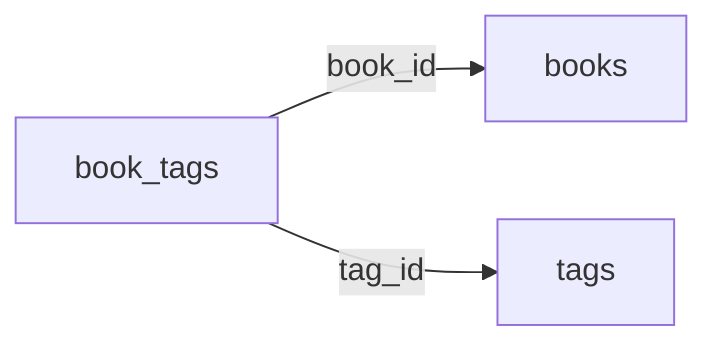

# 7. データモデル <!-- b_bt3ztc8k -->

| エンティティ | フィールド | 定義 | 形式 |
|---|---|---|---|
| `book_tags` | book_id, tag_id | `migrations/0001_init.sql:1` | sql |
| `books` | id, isbn, title, status, added_at | `tsundoku/models.py:1` | sqlalchemy |
| `books` | id, isbn, title, status, added_at | `migrations/0001_init.sql:1` | sql |
| `tags` | id, name | `tsundoku/models.py:1` | sqlalchemy |
| `tags` | id, name | `migrations/0001_init.sql:1` | sql |
<!-- b_xgcdn0ft -->

<!-- b_vxg0wssp -->

> [!NOTE]
> **未生成**
> この節はまだ生成されていません。mitori の「生成する」で作られます。 <!-- b_y38tb6tr -->
